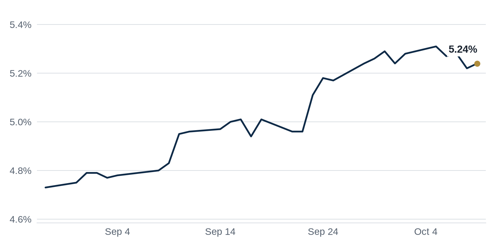

> **Review before publishing:**
> - editor: fixed: The GlobeSt source (title/summary) says only that the 10-year could reach 6%; it does not state heavy government borrowing as the cause, so this reason is un...
> - editor: fixed: The CoStar source title/summary only says an LA office complex got one of the nation's biggest loans; it does not describe the property as well-located and w...
> - check/long_sentence: 35 words: **Why it matters:** Bond investors who hold these...
> - check/long_sentence: 31 words: **Why it matters:** developers who want to build...
> - check/missing_link: https://news.google.com/rss/articles/CBMiiAFBVV95cUxOeHFMOFUwaUYzLURuWDNreWc1Mm1LWWNrQWhscEZsTjhTM1NkVmxNNVRjeTZOT1hNLWR4aTFUUFRKakVaUGNVcjNXd25vanE5MnhiLVJON1pBdnVhb0x1MHZNaE1sdzRweUF1WEdhaWxaWTJMUHdIOUJrbWd2dURrX1g2LUU0OXJm0gGcAUFVX3lxTE9ENElDWWZXb2w1YXRJbnlMOWI0cENVYVdjdU1GWloxcGxvd0ozQjdSWWphUHo0d3pMakhKVnRCUE1lVTJhVEpwNGxaSXpDV19hX2NrdzVYTmZEZ2pOUER1VVN0QmFGY096SHNQazIya0Y2NkVJa3B5ZGgwb1ZLbTIxQjZ3czFNeXVzMkpSdktYMzRGZVVHY0ZVMHN5eQ?oc=5

## The Brief

- A 1980s San Francisco law limiting new offices is now blocking fresh downtown development. [The Real Deal](https://news.google.com/rss/articles/CBMiqgFBVV95cUxOZ3JwVFhEcWtZTHVVN0RHUFZQMHktalJmRmRiZVRPUkZxeE51WVJQd2F1bWphMHg0eGFmQndBQlFiZFZvY21rS0tHRkxKcGdCZFhTaHpoSmZmajZxbU84MExhckxKSklSeFRaRHZybXMyWmRDWk1YenM0ZUJFMkphTmJmZGRBZURhOVp5ZTNYRlRtWW9wV3JIdWp0MWxFMFpTQ3JWVEw0bDl1QQ?oc=5)
- Manhattan office rents hit a record, a sign the best space is finally recovering. [The Real Deal](https://news.google.com/rss/articles/CBMinAFBVV95cUxNSUNvZ3QxQ1Fhel9FTkRlRllkYWE4M1pmQXRzdTZRdUdiWlhERFcxLUJLTDg1Q3F4M2l2ek8zbWdTemhpdXFRV0s2aHl5ODMtVUpCTG9HdEhrQUpsMjA2cEpEVGhsTHdWZVhGYWg1ejRCbEFhYlpKREhBU1NTdWY4SmZjQ3Y3aDJTbzF4b2dJU09KQmJmX09ObUltYWg?oc=5)
- Pimco warns long-term Treasury yields could climb much higher, raising borrowing costs across real estate. [GlobeSt.com](https://news.google.com/rss/articles/CBMijgFBVV95cUxOeEN5cWlzNDhOUjY4STdGQ1gzdHp3SjhQbm1uejNqSi14ZTcwQWhVRkJUazZ6bTVNWTBHUHlmRE9Pc1pJMzh2bmhlRVR3UGY0X2Y3eVdyb1kwWG1vNjVyblIzX2FfcV85SmNpaDF4NjFjMmFtdkhueGNBTGlUd0NGb3loaDNISy1VcWF2dFVR?oc=5)

## The Numbers

*Rates as of Oct 9 close.*

- **10Y Treasury:** 5.24% (+2 bps)
- **5Y Treasury:** 5.02% (+3 bps)
- **SOFR:** 3.87% (-1 bps)
- **Fed funds:** 3.75% to 4.00%
- **Next Fed meeting (Oct 28):** Polymarket's top outcome is No change 82.5%
- **REITs:** VNQ $90.65 (+1.5%). Best: UDR +1.6%. Worst: VNO -0.5%.
- **REIT yield vs. 10Y:** VNQ yields 3.80%, -144 bps vs. the 10Y.

**What it means:** rates were little changed, so borrowing costs for new loans and refinancings sit about where they did last week. That gives buyers and lenders a steady base to price deals.

**Why UDR moved:** No company-specific news today; it may have moved with other apartment REITs.

**Why Vornado Realty Trust (VNO) moved:** No company-specific news today; it may have moved with other office REITs.

## Debt Markets

Pimco warned that the 10-year Treasury yield could climb toward 6%, GlobeSt reports, a level the firm says would ripple through stocks and credit. [GlobeSt.com](https://news.google.com/rss/articles/CBMijgFBVV95cUxOeEN5cWlzNDhOUjY4STdGQ1gzdHp3SjhQbm1uejNqSi14ZTcwQWhVRkJUazZ6bTVNWTBHUHlmRE9Pc1pJMzh2bmhlRVR3UGY0X2Y3eVdyb1kwWG1vNjVyblIzX2FfcV85SmNpaDF4NjFjMmFtdkhueGNBTGlUd0NGb3loaDNISy1VcWF2dFVR?oc=5)
**Why it matters:** the 10-year is the base rate for most commercial mortgages, so a move that high would make nearly every new loan and refinancing more expensive.

An LA office complex landed one of the nation's biggest loans, CoStar reports, a rare vote of confidence in a battered sector. [CoStar](https://news.google.com/rss/articles/CBMipgFBVV95cUxQUkU4TWNXSzg5eXdMU1M3NWRwSDlUYnF6U01xYWl6XzhWTU5sUmFTV3lNMzJDSlFZekNoNlE1Z0Joa19sazd1NnpXWDAtVjVpNFd6NHZ1RGNBSGtTdjlFSS13Nlh3aEhCQWdTYmJMUnh2Mml2cHFJTERub0YzZDdBb0hLd01BTXFOWkZ4QnpsNktoWmR2V0h4bFhINmg3azhKM2dyTkRR?oc=5)
**Why it matters:** when lenders write a huge check for office, it tells the market that strong buildings can still carry debt.

Terra secured a $507 million construction loan from TYKO Capital for a 28-story luxury condo tower on Miami Beach's Biscayne Bay, Connect CRE reports. [Connect CRE](https://www.connectcre.com/stories/terra-inks-507m-construction-loan-for-biscayne-bay-condos/)
**Why it matters:** a large construction loan shows lenders will still fund high-end Florida development even as financing tightens in many markets.

CMBS borrowers (companies whose commercial property loans are bundled and sold to bond investors) broke a four-month streak of rising distress. That means fewer of these loans slipped into trouble, such as missed payments or looming defaults. It is the first monthly break in the climb since the streak began. [Green Street News](https://news.google.com/rss/articles/CBMimgFBVV95cUxOUDVWLXZqZWhkb2EtcnlGYWR1NHhvdDFHZTlqZlBocnZDQUZQeHNLNndJSnNFSnBNV2l4UHhoZXpHS1R6anZ3dy0wZkhsUG5XTjE1MUxWVnV3U3Z6YXRNZlEzb1lEaWdvcWgtbW1FZ1ZYdnZWTGFPRUVOQl9BUml0WmxqdlMwNEs3ZVdtUzFKS3hhTEprdVN2bXBB?oc=5).

**Why it matters:** Bond investors who hold these loans lose money when borrowers stop paying, so a pause in rising distress is an early sign the pain in commercial real estate may be leveling off.

**Distress Watch:** storeys.com reports an Ottawa office-to-residential conversion fell into receivership, where a court appoints an outside party to take over and sell a troubled property. [storeys.com](https://news.google.com/rss/articles/CBMiakFVX3lxTE5IUFVHdzEwM2FtS3l3YmtIMU5kNVlPb0c0S0hiNTFjQVA1VkFOS3dKSFlmX1VpWl9qMFBJN3RVZnR3S2hibTYzUTFkVXc5MHc2RkExREs2MkcxRkRZMDRzVjNXWDdGM3V2MEE?oc=5)

## Top Stories

### San Francisco's office cap collides with new development

A 1980s law caps how much new office space San Francisco can approve each year. The Real Deal reports the limit is slowing proposals even as the city tries to revive its downtown.

**Why it matters:** developers who want to build or convert office space face a hard annual ceiling, so a city that badly needs new investment may end up turning builders away. [The Real Deal](https://news.google.com/rss/articles/CBMiqgFBVV95cUxOZ3JwVFhEcWtZTHVVN0RHUFZQMHktalJmRmRiZVRPUkZxeE51WVJQd2F1bWphMHg0eGFmQndBQlFiZFZvY21rS0tHRkxKcGdCZFhTaHpoSmZmajZxbU84MExhckxKSklSeFRaRHZybXMyWmRDWk1YenM0ZUJFMkphTmJmZGRBZURhOVp5ZTNYRlRtWW9wV3JIdWp0MWxFMFpTQ3JWVEw0bDl1QQ?oc=5)

### Manhattan office rents set a record

The Real Deal reports Manhattan asking rents just hit a record high. Tenants are paying up for the best buildings while older space lags behind.

**Why it matters:** owners of top-tier towers can push rents and refinance more easily, while owners of dated buildings fall further behind and may struggle to cover their loans. [The Real Deal](https://news.google.com/rss/articles/CBMinAFBVV95cUxNSUNvZ3QxQ1Fhel9FTkRlRllkYWE4M1pmQXRzdTZRdUdiWlhERFcxLUJLTDg1Q3F4M2l2ek8zbWdTemhpdXFRV0s2aHl5ODMtVUpCTG9HdEhrQUpsMjA2cEpEVGhsTHdWZVhGYWg1ejRCbEFhYlpKREhBU1NTdWY4SmZjQ3Y3aDJTbzF4b2dJU09KQmJmX09ObUltYWg?oc=5)

### Blue Origin commits $550M to a Texas campus

Blue Origin confirmed a $550 million industrial development called Constellation Park in Hutto, outside Austin. The Real Deal reports the project adds major manufacturing space to the Sun Belt.

**Why it matters:** a large corporate commitment anchors demand for industrial land near Austin, giving nearby landlords and suppliers a reason to expand. [The Real Deal](https://news.google.com/rss/articles/CBMimwFBVV95cUxQWmt6V2hXc1NjRFhadlF6TnVIRmNEaWl6UUZPYWlGQk5UQzNxSVRVLVBnNUs2TmdpNXBsdnhGb1JLQ2g2em1YNFM0MC1hVmdTU2JfUDJuRVJOcUVtX2RqalNSZ0lsM09RaExiLU9laGFlVG1BOFY2Z09GMWJlWkNCaEdxZm05bHd4UlA5OFhOQjJiVFVOX0RrQ2lSbw?oc=5)

### Zoom's San Jose campus trades in priciest deal since the pandemic

SFF bought a Zoom headquarters campus from KBS, the priciest San Jose office trade since the pandemic, The Real Deal reports. The buyer paid up for a leased Silicon Valley asset.

**Why it matters:** a marquee sale gives Bay Area office owners a fresh comp to point to, an early sign that buyers will pay real money for well-leased space again. [The Real Deal](https://news.google.com/rss/articles/CBMinwFBVV95cUxObm5IOFNLb0JMV0drMVBLUUtPUzZXM1pkc0tFU0haUnN2blBPQWRZN1ppZkdqb1ZNMy01Q1RiNXdLV2pGTFMxc3EzSHpQeGFISVhTai1rMlUxWkpPUFBaSnJvREFxNXY1VUVSeXVOQTh0UHZIZjR0dFU4RFhISDE5SjZMYUpveE1ZWkxaZ0tZNnFmUlVRdTVmTVVlSTR3eVU?oc=5)

### San Francisco keeps pushing offices into homes

The New York Times reports San Francisco is still trying to turn empty offices into apartments to revive its downtown. Conversions remain slow and costly to pull off.

**Why it matters:** if conversions work, they shrink the office glut and add housing; if they stall, vacant towers keep dragging on the city's tax base. [The New York Times](https://news.google.com/rss/articles/CBMiigFBVV95cUxQbllRUHhVcFZMUzFZMDRFWXk1V21RMm1PS0djbGlOMDVLcjlNZURNOVpDV2dIN05FeXVmNlRJVmdGOEtuOC1uZTFuNE1DMGNYbGVsQ25HWW9qc2l6ZjE1blJvMDF0eHpyeEhIYTBKZVRvYjhWSWxZd2JuYnpXS2xSUmxDYU9xVWJ6ekE?oc=5)

**Coffee chat talking points:**

- Blue Origin's $550 million Hutto campus shows manufacturers still betting on Austin's Sun Belt even while coastal offices struggle to fill space. [The Real Deal](https://news.google.com/rss/articles/CBMimwFBVV95cUxQWmt6V2hXc1NjRFhadlF6TnVIRmNEaWl6UUZPYWlGQk5UQzNxSVRVLVBnNUs2TmdpNXBsdnhGb1JLQ2g2em1YNFM0MC1hVmdTU2JfUDJuRVJOcUVtX2RqalNSZ0lsM09RaExiLU9laGFlVG1BOFY2Z09GMWJlWkNCaEdxZm05bHd4UlA5OFhOQjJiVFVOX0RrQ2lSbw?oc=5)
- Singapore's Grade A office vacancy at 2.6% is pushing prime rents to a post-2022 high, a reminder that supply-starved markets can thrive while US downtowns still fight vacancy. [Singapore Business Review](https://news.google.com/rss/articles/CBMiqAFBVV95cUxPc0NYcEFUTmtRZElqdFpRZWdYM09wNWpuNjV1OWMxNk83WVNXNWowVXZPQWRCOWdHNmZjaHZSejc3aDVrUjhKMUx6NzdoR0hfUkE1VGkxdHFzNEQ1X3hCakNlWGt0SVN6WWt0RU16d0c5UHFSSC1waGZ2WXctRkRzMDh2UWZaQU04ZkNucXo1TzI5TnBjZkloUWxzUTVuLXZPVGRxNXJZQko?oc=5)

## Market Watch

### Sun Belt

Pantzer paid $79 million for a transit-oriented apartment community in the New York City metro, Multifamily & Affordable Housing Business reports. Transit-oriented means the homes sit within easy walking distance of train or subway lines. [Multifamily & Affordable Housing Business](https://news.google.com/rss/articles/CBMisgFBVV95cUxNRjdYR21QdWg0WVAxUTdkWDhnc2s2ME9ZVDNTZnpWXzY3VmJhTkVaakRkeDI4ZkhEY2w0aFBQWFZ2aS1BaXczckNfZ0pGQW9tbFduQXI2Y0hPQjB0V1E0eFNHRVRKV1duUm11RWZIVnQ4Rzl4SVljNE9KSTRWangtMGtCQWNjYzR2YU9BTWEwWVZLYjJCTWk1TkEycmpwZlhTMUhaOGJ4OTRNSUJlOExndm1B?oc=5)
**Why it matters:** apartments near transit tend to stay leased, so a big purchase signals investors still trust steady rental demand.

### West Coast

A REIT managed by RMR Group received a $2 billion buyout proposal, CommercialSearch reports. A REIT is a company that owns income property and trades like a stock, and its board is now reviewing the unsolicited offer. [CommercialSearch](https://news.google.com/rss/articles/CBMikAFBVV95cUxQZk5pNWJvcC1tWFhBWTBOdzk4S0RDZ3EwR252YWdsYTdZWEZYZElJSURPSTRLTlZGYTJZbzNvdVNVcm16U0daSEk1N3FIV3l5MGJ1YVNhWGJTVzVqZF9tc21rRzlteWFzSFlQWjhxTTB0Nll1Vm5Na1l5MVhQOHhuRXlyZTR0STV3QWY1cHZQcm4?oc=5)
**Why it matters:** a large bid suggests buyers see public real estate trading below what the buildings are worth, which can lift the whole sector.

### International

Singapore's Grade A office vacancy fell to 2.6%, pushing prime rents to their highest since 2022, the Singapore Business Review reports. Tight supply is driving the squeeze. [Singapore Business Review](https://news.google.com/rss/articles/CBMiqAFBVV95cUxPc0NYcEFUTmtRZElqdFpRZWdYM09wNWpuNjV1OWMxNk83WVNXNWowVXZPQWRCOWdHNmZjaHZSejc3aDVrUjhKMUx6NzdoR0hfUkE1VGkxdHFzNEQ1X3hCakNlWGt0SVN6WWt0RU16d0c5UHFSSC1waGZ2WXctRkRzMDh2UWZaQU04ZkNucXo1TzI5TnBjZkloUWxzUTVuLXZPVGRxNXJZQko?oc=5)
**Why it matters:** low vacancy lets landlords raise rents, and it shows some global office markets are thriving while many US downtowns still struggle.

## Quick Hits

- Service Properties Trust confirmed an unsolicited offer for its hotel portfolio from TKO Hotels. [Business Wire](https://news.google.com/rss/articles/CBMi7wFBVV95cUxOejFlNFI4ZjBDVnZQM3VYXzYtQUhjSmQ1MUFmaWZhRUlzZVFtZE51dk5zX0Q3LU9BejluaUZMeWo5SU5NNlAxTy1VSEZvbXlXWl9sTFJ1ZE93eFFsRzVxT3dFQmlPNVN1SkQ1RklWcW9ZbEE4TGNrMnFibC0zTGNDbk1mUHhoLWt0SmZQeUtfZmt1b2cwdDE0SlJiV3FRMTRidkVpTUtYaE1EY2djckl4M1JNZUcyUG1hb3hYajRST00yNHJMd1BZOGtLcHRLNW9vbm91OXJFMTdaLVVGTFdhVkJ0LUtFendaWWkwWjF0SQ?oc=5) A takeover bid can force a REIT's board to weigh selling, which often lifts its share price.
- Hines bought Dallas' Bishop Arts portfolio for $170.5 million. [CRE Daily](https://news.google.com/rss/articles/CBMiiwFBVV95cUxQc0JGUHl2LVR4eHRjMk9fdVM5VWtjdzFvcVBYWnpfeTBSc0EtTzNSQmlWNXpNdllPZmh3X21zM2NDaGh0OWZiQkhtMTVoTG5oLW9TS1pDSU1ldkF5NzBYS3NkLVFsUzJTME9xVWtGaEU5SVFKVHliQ1VyY3VNNnNjUzBxUzQ1NmNONFBn?oc=5) A major investor buying a popular neighborhood shows confidence that Dallas retail and mixed-use demand will hold.
- US commercial property deals are seeing price cuts as rates jump. [www.grihik.com](https://news.google.com/rss/articles/CBMiogFBVV95cUxNbGVfRGpOdGw1ZWFUeUdONnFBTk14bWV2ZFdKUk1PMG1SNVJRckRjSDRyNXBUaFNEbW1YOF85bGZFTFctS213TjhmVGduZHlDeDF0THhXN3ZjQ2duZlpiaEhkVVNtTW9NaUNqaUlkSDVxeE54MmcxNUFSTGprZ05vOEIxRF9lQl9Bd0x3X3A1WE1Bam1FbW1ILVMxRHRaQndodlE?oc=5) When borrowing gets pricier, buyers can pay less, so sellers must accept lower prices to close.
- New York's Chrysler Building finally has a buyer and a planned makeover. [IOL](https://news.google.com/rss/articles/CBMi0AFBVV95cUxOQXhrdkE1OW8zWUxqYTc3djFMZkVVa0pUUlg2V0ZITHlHbW1OZ3MyaXF0U1J2ZC1aUmNiWWhhdkdpZWtZbUdSYW1idlYyWlk3YkpyRzBPSzJOZVl2aV9wSWVEWndGam1EalZ3YXN6SkZ2czRUU0tSZmNmREoxdXEwUmRROFZ4ekxQMXpUUzVkLTJORmpYbmRuaWE1aHpQVUpYT3lmbFF4MWU5S2Uzd280ZExCLWd6OExBSDNoMmhsb3dONzhYTHpXaUFHclUzc1Np?oc=5) A new owner willing to renovate a famous but aging tower signals fresh money returning to Manhattan offices.
- A Mamdani-backed POWER Act is raising New York real estate's hackles. [The Real Deal](https://news.google.com/rss/articles/CBMipgFBVV95cUxNRTZIQXZDUGRldXFOTWhFcUgxSTN3NmczeTJvQzNXdlJlQmt3VnIzeC02R0VMTVlFZGhRZXRRUkx6MmtKTTBNMEw4d0lGX0QwWVpBR0g0Tll4bzlJaV9jbmVWTDNRWC10UDdnMmx4eWs5YmtFVS1oNkVYcDc3TS1mYzZoOHFuRmpvZFR4bF9HTE9RZmJORDY4cE9PWTdLeVdXQ3VvOWNR?oc=5) Proposed rules that raise costs or limit rents worry landlords because they can shrink what a building earns.
- Dallas' office market keeps booming as finance firms expand there. [The Real Deal](https://news.google.com/rss/articles/CBMisgFBVV95cUxQdl9abmwtcU9WMjZxb3k4bnFqSlN0Z296ZlpFN3o0NGNaT3pnZWVlR1BpckJBdldpQmJPS01hV05XR3N6TDd0U3Q1X2IyTFkwQUJ4RVo0WjMwQnBpUjdDRUh5WmRTdUVPS3g1RE1zWmtua0RRQjQ2c1Q2dE11bFlzV3kwRkw3MFNMUDYzTkF2YXAzcTBKU0ljZktWN1IwcVhQdzc3dGRQUDZDYkwzOXEzMTFB?oc=5) Growing white-collar hiring fills offices, which is rare today and makes Dallas a standout for landlords.

## AI Infrastructure

A 1 gigawatt data center project is advancing near Austin, CommercialSearch reports. A data center this size needs vast land and power, enough electricity to run a small city. Developers and utilities near Austin gain new demand, while local residents may worry about the strain on the power grid and water supply. [CommercialSearch](https://news.google.com/rss/articles/CBMijAFBVV95cUxOcGF1dkNOa3dlQmF0azlwb2c3N2tnQmJOY0hXcjdqbE8wSnpicjMtZ3ZMcml4M2tVVV9oY0RqWDRLYWsyUGp4R3FUYmV3VjFKVnpKbnBLMU0wTWZrRUhST2YtQm16aDJtLUI0NUZqbFNPaTR6Z255akR1WlFPZC1BV1R5d2QySk1xYVh2Yg?oc=5)

## Term of the Day

**Debt yield:** a property's yearly net operating income (NOI, the rent left after operating costs) divided by the loan amount. It shows a lender's return if it had to take the building back, ignoring the interest rate and payoff schedule. A $1 million NOI on a $10 million loan is a 10% debt yield. Lenders use it to size loans safely.

For informational purposes only. Not investment advice.
