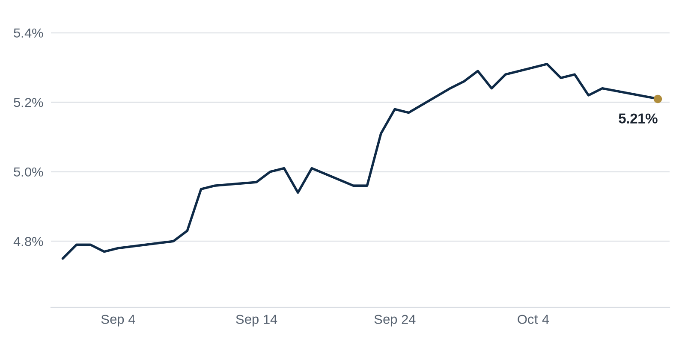

> **Review before publishing:**
> - reits: prices from Alpha Vantage only, not cross-checked (no second source; set TIINGO_API_KEY)
> - editor: fixed: The Terra $507M TYKO Capital Miami Beach construction loan already ran in the Oct 12 Debt Markets section; same deal repeated within the last 3 issues.
> - editor: fixed: Source is only the headline (raises red flags); the specifics about the bidder's ability to close and unnamed observers questioning funding and intentions ar...
> - check/long_sentence: 32 words: **Why it matters:** a landlord who borrowed cheaply...
> - check/long_sentence: 37 words: A Wells Fargo executive warned that sustained higher...
> - check/long_sentence: 31 words: **Why it matters:** an investor cannot treat "the...
> - check/long_sentence: 31 words: The Business Journals **Why it matters:** office-to-residential conversion...
> - check/budget: Term of the Day: 72 words (budget 50)
> - check/missing_link: https://news.google.com/rss/articles/CBMiogFBVV95cUxNSkU1UWZpV2FHWHByY2w5VXIwQVI2YXM5dlBqWTRJTElTS1VBWnQyUW1MQXZfenh4YzFLQ21YWDdVT1hTYm1MTVlfNFhRTFp4dDVpaFloOE5iYXBuTVMwWGVLTmE3VVNLaUtzZXd4dHFiOE04SURjc2VUWGZLQ3M5ZmFHVUhJSnBqcHNETTItaTVnTXIwUFNLaXJNTlB0RDNOR1E?oc=5
> - check/missing_link: https://news.google.com/rss/articles/CBMi9gFBVV95cUxOeGMwM0VXWHYtWjVISVVFN0cybnAwRWlUbkMzLVc0c2RTZThYR3FqdlFzcmdMM1BhTFdMcGZyRjk0Zy1PRXNWNVFpdHhIVTRPdlFXOUJOX3FoTTFralRoNVVVZWRBTXlIZ1I4cnVLUmJUeF9EckcxOEtHOHRjemJ2SllBb1BBUWZzQnN1TjhqeDRPb2VuOU5QdmkwdjY4UGk2OHJDM0JJWDhrZWVlLUpXYmROWWhsUzQ5WVJyOEl2d3FtSndaNWhoOFhndlZIWkc4ZVlzOFFUSmRDeFZQYV96RGNEa003b1FTQ1VOUjlFM2Q3TFFJc0E?oc=5
> - check/missing_link: https://news.google.com/rss/articles/CBMitAFBVV95cUxOY0VNbV9FYnZrWkRhNUkxUVI5WVNDUTdVMWdDUkVNTVo0aFRYdng5UmFnR1czdnh2ZDd4RnZHOV9HY2hqLTNGZHdOY2JYMmZIQkxacTBHYkxzQkF1cXZ6Z2RvTXN6QU1VbnNLUUV6ekxPbEh5SGxsWGt5VW5EM0hRZkN2Y2MzR1lkZFptRGdMT3NnUk9jMFhhTW53SEgzcjdGSEtXa2lVSDdFTkFWMF8xWTQzU1k?oc=5
> - check/model_number: Term of the Day: 4%
> - check/model_number: Term of the Day: 6%

## The Brief

- Apartment rents are recovering slowly just as low-rate loans come due, squeezing owners who must refinance. [GlobeSt.com](https://news.google.com/rss/articles/CBMiqwFBVV95cUxNZF95MDlqMkJLU1hRMzRWSW1xNmpCTVpLQlliZkxmbWoySlRzemRFOEVSYjJ5MnUxYXJKOFZmeHlSZlVfeHozMVVhNy13YXVVOVJXRmZWazd3clM2MnZCTmRWTmZBNDdkZUNPLVNVUk9yVndscy1BMkdCUXBYaTkzVXZlR05lc2ZTRTE5aE9Od0RRZGZ5YkdIQ1RvNTJRUU1YTFJaTFJtbi1RU3M?oc=5)
- Inflation sped up in September as gasoline prices surged, raising the odds that rates stay high. [Connect CRE](https://www.connectcre.com/stories/inflation-accelerates-to-3-7-in-as-gasoline-prices-surge/)
- A Wells Fargo executive warns that higher interest rates will keep pulling commercial property values lower. [The Business Journals](https://news.google.com/rss/articles/CBMiqwFBVV95cUxPXzNET3czeGhWUGJGZ2xfSjd1V1RQMVVxczN0S09vNGpRYS1SRkVidHF4ZEtKWnJSRnVNaXFjbmw5NjRhOEE3REYxbHc2NUMzU3YzaXNvb0dWbWVwQTVQc0l6ajJiQUNRNTFDdXVpWnllZ0xuLU9ZdUEtaFFHa2RfSE1CMTFxOTZ2Mm5iZFp0dzhkUmM2dVZNQjY5clprWHdYeHZsM2o5bC1Cekk?oc=5)

## The Numbers

*Rates as of Oct 13 close.*

- **10Y Treasury:** 5.21% (-3 bps)
- **5Y Treasury:** 5.00% (-2 bps)
- **SOFR:** 3.89% (+2 bps)
- **Fed funds:** 3.75% to 4.00%
- **Next Fed meeting (Oct 28):** Polymarket's top outcome is No change 57.0%
- **REITs:** VNQ $91.14 (-0.2%). Best: PLD +0.8%. Worst: EQIX -1.3%.
- **REIT yield vs. 10Y:** VNQ yields 3.80%, -141 bps vs. the 10Y.

**What it means:** Rates barely moved, so borrowing costs sit about where they were. Today's levels still make financing pricier than during the cheap-money years. That steady backdrop at least lets buyers and lenders price deals with some confidence.

**Why Prologis (PLD) moved:** No company-specific news today; it may have moved with other warehouse REITs.

**Why Equinix (EQIX) moved:** No company-specific news today; it may have moved with other data center REITs.

## Debt Markets

A lender has started foreclosure on a vacant $350 million office campus in West Los Angeles. The buildings sit empty, and the lender is moving to take control rather than keep waiting for the owner to land tenants or new financing. [Westside Today](https://news.google.com/rss/articles/CBMinwFBVV95cUxOV3dfU0hGX2VUb0JoYnJUQnkxdjR3MmdZX2ZkYjZ1ZXhlejNJV1R0T1NCMy1OUHZJUk1maV9XYWd5TVBxNnFib1h2VnZUczI1emFtWWJ0eDFMdWU2cnh5dDBFaTR3UUVmSVVYNm9OVVZvLXhyUkJLQlZDUWRmdEJsYlFDMXcxSmpVeU1hV1dGYVkwX2lGSWFQdEpzR2RWNHM?oc=5)
**Why it matters:** when a lender forecloses on empty offices, it would rather own the building than hold a defaulted loan. Nearby owners also get a lower sale comp to contend with.

Trepp reported that the CMBS special servicing rate rose seven basis points in September to 11.49%, its highest level since February 2013. Special servicing means a loan has been handed to a workout specialist because the borrower is in trouble, so a rising rate points to more distress working through the system. [Trepp](https://www.trepp.com/trepptalk/cmbs-special-servicing-rate-september-2026)
**Why it matters:** bondholders who bought CMBS (bonds backed by pools of commercial mortgages) face bigger potential losses, and that makes new loans costlier to arrange.

**Distress Watch:** A North San Jose office campus has fallen into default on an $80 million loan, per [The Real Deal](https://news.google.com/rss/articles/CBMingFBVV95cUxNT000RlZUQnBkaHo4ZXpmMWc3SWtaX3k1Ti1SWG9aVmVXalhrS0RzMHRobl9jTUd4dUZsQklpMFpTSXJKSTg1Tm0xU0diWDBrb0lpbG43U2ZYVnFXbnp4eXBDcEZWU3lOd0paY24zMWZsYUdVTU9Qbk4wNjNiRXBPNld2TU9YVnNfcGFuWU8wMjA1Ykotc3pVemwtazZXZw?oc=5). Default means the borrower has stopped making payments, which puts the lender in line to take the property.

## Top Stories

### Multifamily's slow rent recovery meets a refinancing wall

Apartment rents are climbing back only gradually, while loans taken out during the low-rate boom are now coming due. Owners who have to refinance face higher borrowing costs and rents that have not recovered enough to cover them.
**Why it matters:** a landlord who borrowed cheaply three years ago may owe more each month after refinancing than the building earns, which can force a sale or a fresh cash injection. [GlobeSt.com](https://news.google.com/rss/articles/CBMiqwFBVV95cUxNZF95MDlqMkJLU1hRMzRWSW1xNmpCTVpLQlliZkxmbWoySlRzemRFOEVSYjJ5MnUxYXJKOFZmeHlSZlVfeHozMVVhNy13YXVVOVJXRmZWazd3clM2MnZCTmRWTmZBNDdkZUNPLVNVUk9yVndscy1BMkdCUXBYaTkzVXZlR05lc2ZTRTE5aE9Od0RRZGZ5YkdIQ1RvNTJRUU1YTFJaTFJtbi1RU3M?oc=5)

### Unsolicited $2B bid for a 93-hotel portfolio draws doubts

An unsolicited $2 billion all-cash offer for a collection of 93 hotels has raised red flags.
**Why it matters:** sellers who get a surprise, possibly unfunded offer can waste months chasing it, while a credible bid would set a price marker for the whole hotel sector. [The Real Deal](https://news.google.com/rss/articles/CBMipAFBVV95cUxOLVhTeWI3c0Y3c2dGTThqRkgzbzBxTzRTa2hJTndzRXJ0ZHROYktLTE9BSy1XRW9jcWJpbWlTR2xGeER4SngyMU9CVEhhVVRyZ015cUxaVjByV2dmSkZYVG5WMEFJRTh6eEM2N0NRR3kzN1JlN3ZtZW9oRmFDdmoyeFh0MVMxQUtuUWo2cldydzFLUE82QUZiSWlTcXpCUE4xTXpraA?oc=5)

### Inflation speeds up to 3.7% as gas prices jump

Consumer prices rose 0.6% in September and 3.7% over the past year, up from 3.4% in August, the Bureau of Labor Statistics said Wednesday. Gasoline jumped 9.1% and drove over half of the monthly gain. Core prices, which leave out food and energy, rose 0.3% for the month and 2.6% over the year. Shelter, the biggest piece of the index and the one tied most closely to rents, rose 0.4%.
**Why it matters:** this is the last big inflation report before the Fed meets on Oct 28. A hotter reading makes a rate cut less likely, which keeps loan costs high and puts pressure on property values. [Bureau of Labor Statistics](https://www.bls.gov/news.release/cpi.nr0.htm)

### Wells Fargo exec: higher rates will hurt CRE values, 'it's just math'

A Wells Fargo executive warned that sustained higher interest rates will drag down commercial real estate valuations, calling the effect "just math." Higher rates raise the return buyers demand, which lowers what they are willing to pay.
**Why it matters:** owners counting on a quick rate cut to rescue values may be disappointed, and lenders could ask for more equity when loans come up for refinancing. [The Business Journals](https://news.google.com/rss/articles/CBMiqwFBVV95cUxPXzNET3czeGhWUGJGZ2xfSjd1V1RQMVVxczN0S09vNGpRYS1SRkVidHF4ZEtKWnJSRnVNaXFjbmw5NjRhOEE3REYxbHc2NUMzU3YzaXNvb0dWbWVwQTVQc0l6ajJiQUNRNTFDdXVpWnllZ0xuLU9ZdUEtaFFHa2RfSE1CMTFxOTZ2Mm5iZFp0dzhkUmM2dVZNQjY5clprWHdYeHZsM2o5bC1Cekk?oc=5)

### Sun Belt multifamily recovers, but unevenly

Sun Belt apartment markets are returning to normal at very different speeds as oversupply from a decade-long building boom clears metro by metro. Some markets have absorbed their new units, while others still have too many to fill.
**Why it matters:** an investor cannot treat "the Sun Belt" as one bet, because a strong metro may be leasing up while a neighbor still cuts rents to fill empty units. [Commercial Observer](https://commercialobserver.com/2026/10/sun-belt-multifamily-market-2027-2028/)

**Coffee chat talking points:**

- With September inflation running at 3.7%, that Wells Fargo warning about rates dragging on values looks less like caution and more like the base case. [Connect CRE](https://www.connectcre.com/stories/inflation-accelerates-to-3-7-in-as-gasoline-prices-surge/)
- The CMBS special servicing rate just hit 11.49%, so a single North San Jose default is really a symptom of a wider office-debt problem. [Trepp](https://www.trepp.com/trepptalk/cmbs-special-servicing-rate-september-2026)
- A Four Seasons resort trading at a 6.2% cap rate tells you buyers will still pay up for trophy hotels, even while an unsolicited portfolio bid is getting side-eye. [REBusiness Online](https://rebusinessonline.com/braemar-hotels-resorts-to-sell-four-seasons-resort-scottsdale-for-372m-as-part-of-self-managed-reit-strategy/)

## Market Watch

### Sun Belt

High Street Residential broke ground on a 435-unit apartment project in Dallas, converting vacant office buildings into housing. Turning empty offices into apartments puts idle space back to work where demand for homes is strong. [The Business Journals](https://news.google.com/rss/articles/CBMiqAFBVV95cUxNZTk3Q19hNzk3WVdEY3diZjhXdUVDNkRuNzl5VU5NaDBNc3V3OVFCQ0hianI0T0FtNlllb2dYc3l2VGNPQlZLY3ZNT1doSm1BVlVkWnpWSEl6SDBGOGRseG55SXBPMjdNbml6S1NPbC1VOEtRMUdONEVOYUpHVndER1RWNmZXQVU5NWQxTC1TWTc4S2NZRGl1Z0tLSWFCZm1EandmalZyblg?oc=5)
**Why it matters:** office-to-residential conversion lets a city cut office vacancy and add housing at the same time, and gives owners of dead office buildings a way out.

### West Coast

Anderson Family Properties secured a $550 million refinancing for its 940,000-square-foot Century City office campus in Los Angeles, with Wells Fargo leading the deal. It ranks among the largest U.S. office financings of the year. [Commercial Observer](https://commercialobserver.com/2026/10/anderson-refi-century-city-office-la/)
**Why it matters:** a major lender refinancing trophy offices signals that top-tier buildings can still attract debt, even as weaker offices struggle to find any.

### International

The World Economic Forum signed a 15-year lease for 58,131 square feet at the Durst Organization's 825 Third Avenue in Midtown Manhattan. The Switzerland-based nonprofit will take more than three full floors of the 40-story tower. [Commercial Observer](https://commercialobserver.com/2026/10/world-economic-forum-lease-durst-825-third-avenue/)
**Why it matters:** a long lease from a stable tenant gives the landlord steady income, which makes the building easier to refinance or sell.

## Quick Hits

- Electric power is now the top factor in choosing sites for factories and data centers, ahead of tax incentives and talent. [Bisnow](https://www.bisnow.com/news/national/economic-development/access-to-power-now-the-no-1-force-shaping-us-site-selection-decisions) Developers now chase locations that can deliver lots of electricity, because power-hungry projects cannot open without it.
- Apartment rents are forecast to rise across all 50 major U.S. markets. [GlobeSt.com](https://news.google.com/rss/articles/CBMinAFBVV95cUxQdEJhUHA4dGJDdUQ4b2dnTy1PM1hOM1RyelZ4c19tNkxLX0pIb2NUWUJCVjM3OG1nRktqWFhvWmVFRDc1Y24zTnN6aU44QW4xMk5XVjBaWmxOcGFHRGNEQm1QNTRVM1ozcnZLc0ZNQ0k2SzNET0Nia2RUYnhHYmtkSWk1RkplME5WeEZzZDdrbFJVUmRqTVFvWHM3QVk?oc=5) Broad rent growth helps landlords cover their costs, but renters everywhere can expect to pay more.
- Russell Galbut scrapped three Live Local Act projects in Miami Beach amid opposition to the state law. [The Real Deal](https://news.google.com/rss/articles/CBMinwFBVV95cUxNVzNBMVFDQ3d3RTBublBrZmxlNjNhX0FId2tRX2VWNjF1NG01TTI0bGJCTGNySDk1LV9OVndyWjlYc0VsNGtBeFlMdkhHZHhCdUtib1A0S2l5TVpZNGJXZUJHbF8wTnFzdUVjTUR5ZjhWVUY0S0V6OVdHcExlcUdyQXN5ZkhUcnBHZFZWYkg2a0ZfMkRud09ZZ3NZTENJc2s?oc=5) The Live Local Act lets developers build denser housing by overriding local zoning, and local pushback can still stall those plans.
- Rising rents drove a surge in Manhattan multifamily sales in the third quarter. [The Real Deal](https://news.google.com/rss/articles/CBMiqAFBVV95cUxOVDhtejVkVFA1eEJjYkI5dG9VQ01iVXFMVmxuN1NKcURoQ2hOV0Vpblk0Qnlad1VKYWM3d3V2ZV93NFo5TmJVVkd2dHpPZ3dXRHE1WllOaDRlTU15NGd4R1RKc1hOWC1oX3Exd3FzdFZmaWExOF9YLS1fXzBpWjBKRkZSSGRhUHlWY2Z1ck80cXFJNEpjQUdqSk5ld21BN1BaRWJxVWFVSjE?oc=5) When rents climb, apartment buildings earn more, so investors compete harder to buy them.
- Braemar Hotels agreed to sell the Four Seasons Resort Scottsdale for $372 million as part of a self-managed REIT strategy. [REBusiness Online](https://rebusinessonline.com/braemar-hotels-resorts-to-sell-four-seasons-resort-scottsdale-for-372m-as-part-of-self-managed-reit-strategy/) Selling a trophy asset lets a real estate investment trust raise cash and simplify how it runs its portfolio.
- Taco Bell signed Orange County's largest office lease in five years. [The Real Deal](https://news.google.com/rss/articles/CBMilAFBVV95cUxNNDFMb2pvVExHN21DaldEUVllY1JXUERTdHpnS0M4LUxmOEZNTkpISTZGOWs0Y2E1aUVSb2ZkLXVRZE5TWEhfTFctU1RUX2s2WnUxcWhaMGdLQWhwLXhVVklkaU12Z3p2N2hVRjhDcS1YcFNacDkxQ2pOWTlhTjVYTHd1MzdPN3NWc1FJSWkxeHpoQ01I?oc=5) A well-known tenant committing to office space is a rare vote of confidence in a market still working off empty desks.

## Term of the Day

**SOFR:** short for the Secured Overnight Financing Rate, the benchmark most floating-rate commercial real estate loans are priced off. A lender quotes your rate as SOFR plus a margin: on a loan priced at SOFR plus two points, if SOFR were 4%, you would pay 6%. When SOFR rises, floating-rate borrowers owe more each month, so the choice between a fixed and floating loan comes down to where you think SOFR heads.

For informational purposes only. Not investment advice.
