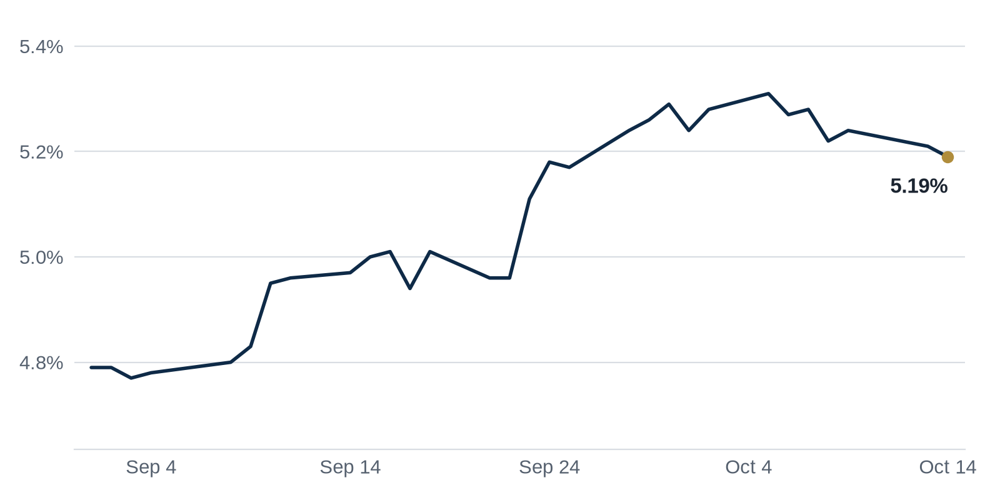

> **Review before publishing:**
> - reits: prices from Alpha Vantage only, not cross-checked (no second source; set TIINGO_API_KEY)
> - editor: fixed: Same CMBS special servicing story (11.49%, highest since 2013) is already covered earlier in Debt Markets via Connect CRE; this Yahoo paragraph is a within-i...
> - editor: fixed: Source only says Google will move Fulton Market staff to Thompson Center; it does not state the building is historic or that Google is redeveloping it.
> - check/long_sentence: 34 words: **Distress Watch:** A foreclosure suit was filed against...
> - check/missing_link: https://news.google.com/rss/articles/CBMinwFBVV95cUxNNnJ6MjZSbW1naDlmYXhBWmx5LTE5OTNXQnc3SFNFd09OM2JsUlRnRjVEejh1Nkw2cGt6V1YzWWloUFFkdW5zdUtBUjJuX2hoc1l4SFl4RjU0WnF0YThPN2JCdmtSZ190YWt4QUhOV1JiM05FbVVyM2M5dktOUjVuRTVpTzY4V2dnN0NsZU5PdDd1a1JpaWNJdlFTZmQ3Skk?oc=5
> - check/missing_link: https://news.google.com/rss/articles/CBMimgFBVV95cUxPM0hnSF9iU09hb2lZbXNHNjZXVXhxSHJQUy1LdGFyajNRVU9FWFhLOFdNczQ5S09zcTNmZm45R1g3emRnMjhma1hsZ1VQUjZMTHAyak1YbGtwM0xKek15eHFkalhkTGFkTmZkZVdpYktYeU1BNW1KNDFRZXRlUDA0V0YxUXFWbnE2WW96MGhaNGJoLTE0UnM0b1Vn?oc=5
> - check/missing_link: https://news.google.com/rss/articles/CBMimwFBVV95cUxNaWtGczZ1c3oxdlBjNVJTUmRPOG4tWkVzdDJOdHg1S2Rya08wMzQ0SG1kS0syY3d2TUFrbnl1OHl5ZkpybkFCa0VxaXlua1Jzb0FiY2VydWhGX3VuazdaNk1EU0lUb01HajJPbXVzamFUTnZJbDRRYzZiV3ZsaHRlZnNsZDRaQmw1Ty16b24zMTRJY25PN2NjbTFzWQ?oc=5
> - check/repeat_in_issue: linked 3 times: https://www.bisnow.com/news/chicago/office/chicago-office-tower-sells-for-550m-to-zara-founder-amancio-ortega
> - check/repeat_in_issue: linked 3 times: https://www.connectcre.com/stories/producer-prices-jump-1-3-largest-monthly-increase-since-march-2022/
> - check/unsourced_number: Coffee chat talking points: 2013,

## The Brief

- Zara's billionaire founder buys a Chicago office tower, a rare big-ticket bet on downtown offices. [Bisnow](https://www.bisnow.com/news/chicago/office/chicago-office-tower-sells-for-550m-to-zara-founder-amancio-ortega)
- Sweden's EQT agrees to buy US manager Stockbridge, expanding its reach into American property. [Connect CRE](https://www.connectcre.com/stories/eqt-to-acquire-stockbridge-adding-us16-5b-in-aum/)
- Wholesale prices jumped last month, a sign inflation and borrowing costs may stay sticky. [Connect CRE](https://www.connectcre.com/stories/producer-prices-jump-1-3-largest-monthly-increase-since-march-2022/)

## The Numbers

*Rates as of Oct 14 close.*

- **10Y Treasury:** 5.19% (-2 bps)
- **5Y Treasury:** 5.00% (0 bps)
- **SOFR:** 3.88% (-1 bps)
- **Fed funds:** 3.75% to 4.00%
- **Next Fed meeting (Oct 28):** Polymarket's top outcome is No change 73.5%
- **REITs:** VNQ $90.35 (-0.9%). Best: WELL +0.9%. Worst: HPP -10.3%.
- **REIT yield vs. 10Y:** VNQ yields 3.80%, -139 bps vs. the 10Y.

**What it means:** Rates were little changed, so a new loan costs about what it did last week. Deals still turn on finding a price that pencils at today's levels, not on any fresh market move.

**Why Welltower (WELL) moved:** a reported refinancing for the WELL office building in Bay Harbor Islands points to lenders still funding well-located offices, which can lift sentiment for office-heavy REITs. [Citybiz](https://news.google.com/rss/articles/CBMi1wFBVV95cUxQaThSR3c4QTB0UHRXNjNlVDVMOWVNZmxhS19VNDR5TTlyT2VqaHQxOWdDZDBMNFJTRmxDRXowcElGU1ZTRGpDRUNiTmd2RWhnOHhIOWFyRy1vcGpJUlpvNXRSZWFiQjJTcERBRWFpQmJscVdpM3Vldl85Y251c1B3N095SW51ejI2T01jWFVXLTktWEFpV0tnaGlEM2M0NzRWdFJaSEwzOS1lMUZwU3lNb2NsaFhaWDZRaUNSbkRPdWpMV2tVdHY4Zlg2UDltMDNhcXRNQmFZTQ?oc=5)

**Why Hudson Pacific Properties (HPP) moved:** No company-specific news today; it may have moved with other office REITs.

## Debt Markets

The share of CMBS loans in special servicing rose to 11.49% in September, its highest since February 2013, Trepp reported. Special servicing is where a troubled loan gets handed to a workout specialist, so a rising rate means more borrowers are missing payments or heading toward default. Retail led the climb to 13.84%. [Connect CRE](https://www.connectcre.com/stories/cmbs-special-servicing-rate-climbs-to-new-post-2013-high/)

**Why it matters:** more loans in special servicing means lenders expect bigger losses, which makes new CMBS debt pricier and harder to get for the next borrower.

S2 Capital put together a $1.2B package of refinancings and loan modifications to steady a stressed apartment portfolio. A modification is when a lender changes loan terms, like extending the deadline, rather than forcing a sale. [GlobeSt.com](https://news.google.com/rss/articles/CBMiugFBVV95cUxOOFh3azRJMzBIazNRY3h3RTNrQ2F6dE02bGsybXNGMUdLdzE1R2JsczJ5UlBYcDZKRUpXZ1pxZXlDWEpxaUZrajBOcElVZjV2ZHJTa1NlenJxSFRMV29NX3NWTWlueVRGWDdKUElZWEFUdDJRQ1dJZTRaMG9kMFVMcDFlS2hOZi01eXJSaHBRRmJ2TkZUTE1jV2lRR3JxdkY5RXZmSmk4Z2VTc3h0cnA0YTZxY3BjRFFOeGc?oc=5)

**Why it matters:** workouts like this let owners avoid foreclosure, buying time for apartment values to recover before loans come due.

Anderson closed Los Angeles's biggest refinancing of the year, a $550M deal on a set of office towers. A refinancing replaces an old loan with a new one, often to lock in terms before the old loan matures. [The Real Deal](https://news.google.com/rss/articles/CBMinwFBVV95cUxQelNwdnBybnVNLVllc0dSODh3eFZIVXR6YzVHQWVqTVdmYWVpSDRhakJ0bWVxSV9GQVJ0eV9Kc1R0bGJYczJSLU1YUndiSGtqVVdrMzFVRFlxUWpuNV9SQnZSRTFiOThGZFpPMExfT0p3S1hSTUlsU1dXWHFVSFM5NFpVZnBSYU44OVMzWjJSOUYyQ0EwdUtFNm5BN3RsRFE?oc=5)

**Why it matters:** a large office refinancing getting done tells other office owners that lenders will still write big checks for the right buildings.

**Distress Watch:** A foreclosure suit was filed against Cannon Hill Capital Partners over a stalled Penn Plaza life sciences project, a planned 156K SF lab and office building that never got off the ground. [Bisnow](https://www.bisnow.com/news/new-york/office/foreclosure-cannon-hill-quinlan-development-life-sciences)

## Top Stories

### Zara founder pays $550M for a Chicago office tower

Amancio Ortega, the billionaire behind Zara, bought a Chicago office tower for $550M. Only two larger full-building office trades have closed nationwide in 2026, making this one of the year's biggest office deals. [Bisnow](https://www.bisnow.com/news/chicago/office/chicago-office-tower-sells-for-550m-to-zara-founder-amancio-ortega)

**Why it matters:** a deep-pocketed buyer paying up for a downtown tower gives other Chicago office owners a fresh, high comp to cite when they sell or refinance.

### EQT agrees to buy Stockbridge and its $16.5B in assets

Sweden's EQT AB agreed to acquire Stockbridge, a US real estate manager with roughly $16.5B in fee-generating assets under management. The base price is $375M, with up to another $175M payable over the next four years. [Connect CRE](https://www.connectcre.com/stories/eqt-to-acquire-stockbridge-adding-us16-5b-in-aum/)

**Why it matters:** a big foreign manager buying a US platform signals that global investors still want exposure to American property, which supports demand for deals here.

### Google consolidates Chicago staff into the Thompson Center

Google said it will move all of its Fulton Market employees into the Thompson Center. The shift pulls workers out of one neighborhood and into a single revamped hub. [The Real Deal](https://news.google.com/rss/articles/CBMiowFBVV95cUxQVmtXSFVlNW4wMzR2U0RMdXdkV2xhTnhhZEVSakZRUGlEY3pQQ08wZ2d3QzJDMkRHOGVENGRLR1NIT1dsaUxUMXYtdElhSWgzbE53MVNPTVpCMDNfMGQyd09LYjBVRVlnYWFoenh0czF2bFNfQ1BzdkVXRjFfeXR5djZLRTBzUUdQa2pMMXZrajJBMGZhYUVGS2dhbVFjNnpiOThF?oc=5)

**Why it matters:** when a major tenant empties one set of offices to fill another, landlords in the vacated area lose a key renter and face new vacancy.

### Producer prices jump 1.3%, the most since 2022

Wholesale prices rose 1.3% in September as energy costs spiked, the biggest monthly gain in more than four years, the Bureau of Labor Statistics said. That followed increases of 0.5% in August and 0.2% in July. [Connect CRE](https://www.connectcre.com/stories/producer-prices-jump-1-3-largest-monthly-increase-since-march-2022/)

**Why it matters:** the Producer Price Index tracks prices businesses pay, so a sharp rise warns that inflation may stay firm and keep the Fed from cutting rates soon.

### Bridge hands back the keys on two Texas properties

Bridge gave back two Texas assets to its lender rather than keep funding them, a move known as handing back the keys. It signals the owner no longer sees a path to profit on those deals. [Multifamily Housing News](https://news.google.com/rss/articles/CBMijAFBVV95cUxQNC10cnBtRFNZZUFMTHhWaTg1SXczTVVlSlpCaHJQd3FYTmRKUVJlT09nTDMyTGpDRE1Oc1lmRFBkMklnVTUwNzN4S005dmxUdjE4ZWZ5ZUQzWkZscFpIT191YUpRd2s2Q3VzWlVUdmNOamZnNnRBOXZKeDV6cnZUUjhLeE1uN0J0elZEbA?oc=5)

**Why it matters:** owners walking away from Texas apartments hands losses to lenders and drags down values for nearby comparable properties.

**Coffee chat talking points:**

- Zara's founder paid $550M for a Chicago office tower even as Google consolidates its Fulton Market staff into the Thompson Center, so trophy offices still trade while tenants reshuffle. [Bisnow](https://www.bisnow.com/news/chicago/office/chicago-office-tower-sells-for-550m-to-zara-founder-amancio-ortega)
- CMBS special servicing hit 11.49%, its highest since 2013, which helps explain why an owner like Bridge is handing back keys on Texas apartments. [Connect CRE](https://www.connectcre.com/stories/cmbs-special-servicing-rate-climbs-to-new-post-2013-high/)
- Producer prices jumped 1.3% in September, so landlords already squeezed by insurance should expect construction and operating costs to stay high. [Connect CRE](https://www.connectcre.com/stories/producer-prices-jump-1-3-largest-monthly-increase-since-march-2022/)

## Market Watch

### Sun Belt

High Street Residential is betting $69M on converting vacant Dallas office buildings into affordable housing. Office conversion means turning empty workspace into apartments, a way to reuse buildings that tenants have abandoned. The developer is pressing ahead even as it calls the market turbulent. [The Real Deal](https://news.google.com/rss/articles/CBMiywFBVV95cUxPQXBnalhCOFY2T3BGVExib1FRdWpSZDlyY19UZFhBRFBTa0xKUGo0NDY2VE5YNnFPWl9XaDRCRnRhMHFsbWE0SUZIa0RxZHdoNWpwZzhaM3NFZmVXRW1mLXlscVJ5cHpHUlU3WnRHZzZEWDY3Xy1kR0lfR3FISHNlYi02MnRNamVveUt2OE5wVEhVdGlEX0t6T1d6NDVKTS1wZ3p0RHdsdG5BVWd1VVdERnptOFhMc1NxWTBiWjFycDhmOXZ2NUVBdFBBbw?oc=5)

**Why it matters:** turning empty offices into homes cuts office vacancy and adds housing, a win for a city with too much of one and not enough of the other.

### West Coast

San Francisco posted the biggest comeback in the return-to-office race, though its office market is still far from a full recovery. Return-to-office tracks how many workers are back at their desks, which drives demand for office space. [The Real Deal](https://news.google.com/rss/articles/CBMiogFBVV95cUxPY1NZakpPa3hCRW4xTENRZEgxVkRFNHhNdHk3NUl0ZVppOWFERnBCc1hjQlBCSERKZGtxLUI0a0pKbW5lYmRUMkVBYUxnWENNNWZIZVhWSzduTEQwRmxWM0tLcUdpR0s2bmU1RDI1Rm1jVUp5Nlg1SE9zZE1hdGJXc1NBZGNLN1pjTEdFVE55LXh3N0RpMHV4YmdYd3QyY1lvSXc?oc=5)

**Why it matters:** more workers back at their desks lifts demand for San Francisco offices, giving landlords there a reason to expect leasing to improve.

### International

A Singaporean investor bought out its Chinese partner's stake in Sydney's tallest tower. The deal hands full control of a marquee Australian skyscraper to the Singaporean group as the Chinese owner exits. [Herald Sun](https://news.google.com/rss/articles/CBMi8gFBVV95cUxNbUdfUjZONG5nSUgxRTVDRHBTTWdXenJjRzBLeGRFQnFESTRObVRYLU1hZkEyVzRzOEQ4cnFXMjhKdDdMSWJ4Y24xd25IR2J2X09MSVlpVkJHT2FMVk5EZXhiMUpoemdnbVV6QmNKemdZTER4QWtJUWZiVjhOdl9NUkQ2N0s5NXZBMENFZFprem1VbWplZWNGREd0LXp5ODJYNnNIcUk4dTl1MVF5S1ZwcFc4Q3h0RUJfbXhXX1B2Q3FEbmNQRkdteTVBanJWRTctOWdxT283T0dXMnF0M1RnUXRYVnJoaWg2dWJVSjNmY1Ywdw?oc=5)

**Why it matters:** a Chinese owner selling a prize Sydney tower fits a pattern of Chinese capital pulling back from overseas property, leaving room for other global buyers.

## Quick Hits

- Rate volatility is keeping many commercial real estate deals frozen in 2026. [Mortgage Professional America](https://news.google.com/rss/articles/CBMiuwFBVV95cUxOYUJ1VjNIMmt1cXdXQ2NaVml2dFVQUXVLY0QxeXZOR0RZM0hJTFVCVDhhN1BpcnBpVWR4eG1YZUZJRU5iajlhX1E2WmM0N085NHBQeEFpcGdWUlZHdE1GTG96M21PeHpPbHdZTDBKS0NlREFsekNHbkh3cjlaZ2VxUW1SQXZSc1lHUkczQXVtZ3JyS2ZHV3F2ZUVqTmJrUzNEQTVmRWVxcmVBME85Z1hjT1JPU2d1TjFFWTQw?oc=5) When buyers and sellers cannot agree on where rates are headed, they stop trading, so fewer deals close.
- Insurance is taking a bigger bite out of apartment revenue. [Commercial Observer](https://commercialobserver.com/2026/10/insurance-apartment-revenue-cred-iq/) Rising premiums eat into the cash an owner keeps, which lowers what the property is worth and what a lender will finance.
- A Kennedy Wilson joint venture bought One South Market, part of a combined $380M purchase of two downtown San Jose apartment towers. [Bisnow](https://www.bisnow.com/news/san-francisco/multifamily/2-san-jose-multifamily-towers-fetch-combined-380m-kennedy-wilson-brookfield) Big buyers paying up for apartment towers suggests they expect rents and occupancy to hold in that market.
- Grady is advancing a $1B hospital plan in South Fulton, projecting up to $6.8M in annual tax revenue for Union City and 1,880 full-time jobs. [Bisnow](https://www.bisnow.com/news/atlanta/healthcare/more-details-emerge-on-grady-s-1b-south-fulton-hospital-plan) A major hospital anchors new jobs and nearby development, which tends to pull in housing and retail around it.
- BKM is pushing into Florida with a $174M industrial buying spree despite a market it calls turbulent. [The Real Deal](https://news.google.com/rss/articles/CBMiowFBVV95cUxQNDZuN2RFZEtVRXY1NHpneVpham1sV0lTaFVMMHBSSXAtVFN1dE84aWFJemVFRHI0MWFqbWEyRWstb2NIbVFPWkJ3dzljRm8zZzNaZEdYV0ViU1hzUVc5b282M3QwV2NXYldVeXFyZS1GZkRCclpzM1JBMHpua2xLOG5TTlVEdWRlNGNDa002VUM0eWs4RldudE10MjlrNUczbm1R?oc=5) A buyer loading up on warehouses signals confidence that Florida tenants will keep needing storage and distribution space.

## AI Infrastructure

Federal regulators at FERC rejected PJM's "bring your own capacity" plan, which would have required new data centers on the nation's largest power grid to supply their own electricity. The decision leaves it unsettled how fast the strained PJM grid can take on more data center load. [Bisnow](https://www.bisnow.com/news/national/data-center-power/federal-regulators-reject-power-cuts-to-data-centers-that-dont-bring-their-own)

**Why it matters:** developers chasing data center sites lose clarity on who pays for new power, which can slow projects and the land deals tied to them.

## Term of the Day

**Promote:** the extra slice of profit a deal's manager (the general partner, or GP) earns once its investors clear an agreed return, called a hurdle. Say investors put up the cash and are promised an 8% return first. After that, the GP might keep 20% of further profits as its promote, a reward for running the deal well.

For informational purposes only. Not investment advice.
