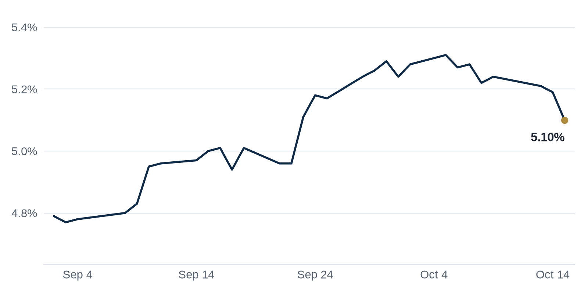

> **Review before publishing:**
> - reits: prices from Alpha Vantage only, not cross-checked (no second source; set TIINGO_API_KEY)
> - editor: hold: Lead Top Story and The Brief bullet 1 (EQT buys Stockbridge for $375M, $16.5B assets, $175M bonuses) repeat yesterday's Top Story with the same figures and n...
> - editor: hold: Deals of the Week relists the Zara founder's $550M Chicago tower (1 North Wacker), which was yesterday's lead story.
> - check/long_sentence: 57 words: [CHECK] Editor hold: Lead Top Story and The...
> - check/long_sentence: 41 words: **Why it matters:** A foreclosure (when a lender...
> - check/long_sentence: 39 words: **Distress Watch:** Lenders accuse Nord Group affiliates of...
> - check/missing_link: https://news.google.com/rss/articles/CBMitwFBVV95cUxQMEExZmlQUHVFN1hhWXl1Q1VtXzRNdkhmRkFDNEx3X3pxZjhOemloamdnZHFjb2Q2RExmNUMzOW9Kb0ZJLTRVOGgyNnFHSHVUQnJwdWl0M2NoazZlbGYzal9ZUmZjcjMyNEZIM05Jb1dub2VsNHBsc1dUWVk5UGRTZ3d3aGdqaVV5RXBSeHVCWkJuRXFtSEtxblMzQmpWZ3dFeW12bTBENzJSd1dJbjVIOTZlRXI2Ulk?oc=5
> - check/missing_link: https://news.google.com/rss/articles/CBMilgFBVV95cUxOUDktdlRiUDNaRXdORS1IbVJJRzBUMTdqVG81OUFqam01dUFFbjZLQWxPaXNqS2dwT0F3bjVNQWs1ZjM0QmpNb1MzdEhPRVpqYzJ2WjhrWnlRaElxcW1LLVkzVEdLelJPVDNiVE0tbVpUcGVtbm9WN1Izd0xRTEpkbFE1OVItQjhPNUplZWVWSXg5aTAtaUE?oc=5
> - check/missing_link: https://news.google.com/rss/articles/CBMigAFBVV95cUxNX21QbVdWQXJ0UVNqQTBVOHpKV0dkLWNZV3E0S0hzNUprTXhUa0RFQ3F4djFYdUZVdHFuOEZLYUZMcnE3VERGN1lfSDNROVlHRXFnVUNndm1zOWJ2LWJTdkdpR1B6SDNwajlmN1VjSXBCSE5XRUVrZ0UzWHN4dGl5MQ?oc=5
> - check/missing_link: https://news.google.com/rss/articles/CBMirAFBVV95cUxQZVIweW1jZDUzRnNONFc1UDMzOW5EUGstR1h1di1JUENXcVpYZUpYd2hmQUhZWXY1NWw1ajFKeFFFQXlnUXpvMEZrenFfY19McjdmdnJhSk1hVjBXcWV6YXRWaXpOaUtHWkNoRUh6M2RpeDVoOUdrT0kwUHYxemJ1YmZjUlZQM0JHT1FuMEJKTGJxU0ZIWVFyWll0a0J2MWdHZ3BBM0ZGbmlGTEx6?oc=5
> - check/missing_link: https://news.google.com/rss/articles/CBMimgFBVV95cUxNWTZmcjg3SHFVX1FwcE1OYTFvSUh5bXBndVhFWWpUaUF0QWhrNVNRT3l2cDFZY0dQbHliWUZ4VWQtS3laTnZ2VDNrQjFXNUdIWThhQl84VkpTNUxYT1RCMEZ6eEt6SjItc1ZnenptMUJSWHRDRXFQN01Jc2hZc1R0STJOR1R6VkF2SDRuOHJUZ2dPd1lpNHhKMnFB?oc=5
> - check/missing_link: https://news.google.com/rss/articles/CBMi2AFBVV95cUxPNW5ZamRCSHE1V2hFNWdtSjJkSnM4Z2pEMkxHc2traUQtY0k4eTdiZmVjLUNpa2c2bWVmTnpfbV9nYTNISWFfQ2F0bnhIYUJmdnYyem5UWUlNc0l0aGNvUUNnLWlZOW9WX2xiNUR5enlZTmRoNFpJcUw5ZHJoeGJ1ZFpqb3FyQXdUOTdwRlJDMXlfUVB5S1ZEaHdsdW5Cdlc1cXJEWnVScENPcVItblBuWE9sOWJJQWpnMDIzZFRUZFpabGVjMEZjS0JTakFyak1uMmVJLThranM?oc=5
> - check/repeat_in_issue: linked 3 times: https://commercialobserver.com/2026/10/eqt-real-estate-acquires-stockbridge-375m/
> - check/repeat_in_issue: linked 3 times: https://commercialobserver.com/2026/10/prologis-development-acquisitions-industrial-data-centers/
> - check/unsourced_number: Coffee chat talking points: 2027,
> - check/stale_data: Bank CRE loans last updated 2026-09-30

[CHECK] Editor hold: Lead Top Story and The Brief bullet 1 (EQT buys Stockbridge for $375M, $16.5B assets, $175M bonuses) repeat yesterday's Top Story with the same figures and no new angle; a reword cannot make it fre...; Deals of the Week relists the Zara founder's $550M Chicago tower (1 North Wacker), which was yesterday's lead story.

## The Brief

- A Swedish private equity firm is buying a big U.S. property manager, a sign foreign money still wants American real estate. [Commercial Observer](https://commercialobserver.com/2026/10/eqt-real-estate-acquires-stockbridge-375m/)
- Manhattan office space is filling back up as AI firms, banks and law firms lease again, easing a long office slump. [Crain's New York](https://news.google.com/rss/articles/CBMirgFBVV95cUxPcGxvZW94S0ZmTDhrMDYtbGJVVzQ5SXAzWEc5a2k3NFJ3TUhLdzFwWGtpUGZ6ZjVjdEYtbFVvWkY2STNER00takxmU3AwczhOYnBFdDd0dy1QZXg2RzVIYmFXcEdIdS05WlphcUlRMzNGM3hjZDc1dnlSYWxJN2Z0U01UaW9BS2pTV3hXck9GSmxwQWh1eVE5dUNHbldwRERNbWR0bC1Cd0hvZ0pKcVE?oc=5)
- A large apartment empire is collapsing into foreclosure amid fraud claims, a warning sign for stressed multifamily lenders. [Bisnow](https://www.bisnow.com/news/houston/multifamily/nord-group)

## The Numbers

*Rates as of Oct 15 close.*

- **10Y Treasury:** 5.10% (-9 bps)
- **5Y Treasury:** 4.91% (-9 bps)
- **SOFR:** 3.89% (+1 bps)
- **Fed funds:** 3.75% to 4.00%
- **Next Fed meeting (Oct 28):** Polymarket's top outcome is No change 86.5%
- **REITs:** VNQ $91.44 (+1.2%). Best: BXP +3.4%. Worst: PLD -2.7%.
- **REIT yield vs. 10Y:** VNQ yields 3.80%, -130 bps vs. the 10Y.

**What it means:** Treasury yields barely moved, so borrowing costs for new loans sit about where they were and buyers face the same deal math as last week.

**Why BXP moved:** No company-specific news today; it may have moved with other office REITs.

**Why Prologis (PLD) moved:** Prologis warned investors that higher interest rates could slow buying and selling, which likely cooled enthusiasm even as its warehouse leasing stayed strong ([Commercial Observer](https://commercialobserver.com/2026/10/prologis-development-acquisitions-industrial-data-centers/)).

## Debt Markets

Fannie Mae raised its forecast for the average mortgage rate to 7.5% for 2027, signaling it expects borrowing to stay expensive for years. Rates that stay high keep squeezing anyone who has to refinance a loan signed when money was cheaper. ([GlobeSt.com](https://news.google.com/rss/articles/CBMilgFBVV95cUxPLTNZQmd4eDBPcXBzRU5tTmdqV2NydDQ3YWlsX1BzZF9xckctbUp6OEJSRUxGSm1GV1BTMFZVbjQ0X29uSlBYSmRGRGFzd1VIdDFJN1ZLQkFfRVlla25hRjlkQWpPR2treHlZLXNJS0Q0M1A3YjVlY3phQUJObVE2UXplc3FubjExNVVLS3c0SXRzN1MteXc?oc=5))

**Why it matters:** borrowers and buyers should plan for pricey debt into 2027, not a quick rate relief.

PNC and US Bancorp both reported more commercial real estate lending, extending a run of loan growth at large banks. That suggests big banks are cautiously turning the lending tap back on after a tight stretch. ([CoStar](https://news.google.com/rss/articles/CBMivAFBVV95cUxOaWwtbFVUTWtPM0lxLWVrRW9NUkxzdEhwREJUUVcxai1fZHhwMGlrd2E1YkFrMDdMcnBMSEdYYThlZkNGMF9zLVBURTJBZnJDY2NvZ1RnWklZWVpkY3VMWFdKR1FPSW1MRWpBdWtPRkdBT3REbGRpazVwOUVJeWxjcjg0QkRYY0VrYUdxYm1IVHlwMG9pMEhXcDdLalNzdVBWMkF4RjR6dVQ0VFhTUzZUN1FGRDV0eFFvcXBqZg?oc=5))

**Why it matters:** more bank lending gives property owners more places to shop for a loan when it comes due.

The Federal Reserve's Beige Book, its survey of regional business conditions, flagged rising pricing pressures as CRE investors weigh rate risks. The report points to costs climbing even as deal-makers stay cautious. ([GlobeSt.com](https://news.google.com/rss/articles/CBMipwFBVV95cUxPdlhxZG8yUGdUcjlEWktOR0J0WFFieXZoT25hT042azBCSUV6V2c2eHVmUktvUUhzTnhNVGpqZHBFNjZVT3diTmRMVEoyY29JNGNpc2hTNjUxYkg5WXY2ZGduZUZXVUFIaG1naHhNQi1xcDhHTnpPQ1J4bFktdzBtV1N3Sk5WbUtPeTQwVFdoUkJaSnNyS2c5ekZnSFY3cjlmRThia2hfYw?oc=5))

**Why it matters:** higher costs plus caution make lenders pickier, so weaker deals may struggle to get financed.

Oakland's waterfront apartment complex has been foreclosed on after its owner failed to keep up with the loan. The lender seized the property, a sign that the building's income could no longer cover its debt. [SiliconValley.com](https://news.google.com/rss/articles/CBMisAFBVV95cUxQYjJjMWxqUURRM3JheWFwNDJaS1NMQTVWY2N3SFQ4QzFXQlVpTGtySjNMZV9UR3pvSDhvNVZ2THJOWEphUW5NcFo5blFhd2o5SEpUN1pRS2tlVm00WXNaYVR6LWJJa3ZXOGE1RFB4cXVwLWszN2RkaDlROS1PZVM4UkdwbDBOdDhZRXJ4UEVteWJncmJKb09QMUNCQWwwMElJZDktRlZwTTdFcFhqd1FRVtIBtgFBVV95cUxNWERVTmJ0RTVJaklwcHIyZi1ZOUZSVGh0LS1mNHdKaURDczl0TVBzU3JnUnkzWF9sMnFiUFlrLVhueU5CNW05NHJ6dXNDeDk3TXczcHFVQjkteXJIdThVaV9XR2FCSG1CUngzWXlMLVU3M2xpWGJkaTBGbXZsWTVUbUMtVWREYl9waHlQSmsxLW43MHFsMnNoWTRDN0NoRnc0NUptdk93QkthODlzWVFBWjlrYVl1UQ?oc=5).

**Why it matters:** A foreclosure (when a lender takes back a property because the loan was not repaid) means the owner loses the building and the lender is stuck trying to recover its money, a warning for anyone lending against apartments.

**Distress Watch:** Lenders accuse Nord Group affiliates of pocketing rents and faking insurance as the firm's 4,000-unit multifamily portfolio falls into foreclosure and bankruptcy, with a federal judge telling one affiliate to "get out of the damn property." ([Bisnow](https://www.bisnow.com/news/houston/multifamily/nord-group))

## Top Stories

### EQT buys U.S. manager Stockbridge for $375M

EQT Real Estate, the property arm of Swedish private equity firm EQT AB, agreed to buy Stockbridge for $375 million. Stockbridge is a U.S. real estate investment firm managing $16.5 billion in assets. The deal adds an option to pay out $175 million in performance bonuses over the next four years.

**Why it matters:** a big foreign buyer paying up for a U.S. platform tells sellers that deep-pocketed investors still believe in American property, even with rates high. That supports valuations for other managers looking to sell.

[Commercial Observer](https://commercialobserver.com/2026/10/eqt-real-estate-acquires-stockbridge-375m/)

### Prologis plans to build and buy more as industrial recovers

Prologis, the world's largest warehouse owner, told investors it expects to break ground on more projects and buy more property as the industrial market recovers. CEO Dan Letter said the company signed 60 million square feet of leases in the third quarter, though higher rates could slow transactions.

**Why it matters:** when the biggest warehouse landlord leans back into building and buying, it signals that demand for logistics space is firming up. Tenants may face less empty space to choose from, and that can push rents higher.

[Commercial Observer](https://commercialobserver.com/2026/10/prologis-development-acquisitions-industrial-data-centers/)

**Coffee chat talking points:**

- EQT's $375 million bet on Stockbridge shows European money still wants into U.S. property platforms even with borrowing costs high ([Commercial Observer](https://commercialobserver.com/2026/10/eqt-real-estate-acquires-stockbridge-375m/)).
- Prologis signing 60 million square feet of leases in one quarter tells me warehouse demand is holding up despite the rate drag ([Commercial Observer](https://commercialobserver.com/2026/10/prologis-development-acquisitions-industrial-data-centers/)).
- Fannie Mae now sees mortgage rates near 7.5% into 2027, which explains why even Prologis is warning higher rates could slow its deal pace ([GlobeSt.com](https://news.google.com/rss/articles/CBMilgFBVV95cUxPLTNZQmd4eDBPcXBzRU5tTmdqV2NydDQ3YWlsX1BzZF9xckctbUp6OEJSRUxGSm1GV1BTMFZVbjQ0X29uSlBYSmRGRGFzd1VIdDFJN1ZLQkFfRVlla25hRjlkQWpPR2treHlZLXNJS0Q0M1A3YjVlY3phQUJObVE2UXplc3FubjExNVVLS3c0SXRzN1MteXc?oc=5)).

## Market Watch

### Sun Belt

Class A office space, the newest and highest-quality buildings, drove record office rent growth in Miami. Tenants are paying up for top-tier space while older buildings lag behind. ([GlobeSt.com](https://news.google.com/rss/articles/CBMijgFBVV95cUxPNkxzVzFPOXY2WmFqNE9rUFJPR1QtY2JsQTNwMnZCOFhxSWU0YXJDbXE1alNrdy1Fd1lGMWNLZ1dEQ2ttczZsUTVJQmhEcmJQakNLMkJndkx0T25PdnBpSVdqTmtYUXlHZFpJN09KdURtUHNkaU9DWHc3eU9jVTNCT0tOSTR2ZkJVTE82b3lR?oc=5))

**Why it matters:** landlords with new Miami towers can charge more, while owners of older offices risk losing tenants to the shiny buildings.

### West Coast

Higher rates are squeezing CMBS refinancings, a New York tower sale fell apart, and a borrower shrank the debt on a California mall, CoStar reported. CMBS loans are property loans bundled and sold to investors, and they are getting harder to refinance as rates stay high. ([CoStar](https://news.google.com/rss/articles/CBMi2AFBVV95cUxPNW5ZamRCSHE1V2hFNWdtSjJkSnM4Z2pEMkxHc2draUQtY0k4eTdiZmVjLUNpa2c2bWVmTnpfbV9nYTNISWFfQ2F0bnhIYUJmdnYyem5UWUlNc0l0aGNvUUNnLWlZOW9WX2xiNUR5enlZTmRoNFpJcUw5ZHJoeGJ1ZFpqb3FyQXdUOTdwRlJDMXlfUVB5S1ZEaHdsdW5Cdlc1cXJEWnVScENPcVItblBuWE9sOWJJQWpnMDIzZFRUZFpabGVjMEZjS0JTakFyak1uMmVJLThranM?oc=5))

**Why it matters:** when a loan is too costly to refinance, owners must put in more cash or risk losing the building, which is how distress spreads.

### International

Western Sydney Airport is driving a $34.6 billion Aerotropolis boom, a planned business and logistics hub built around the new airport. Developers are betting the airport will pull in warehouses, offices and housing. ([CommercialRealEstate.com.au](https://news.google.com/rss/articles/CBMiswFBVV95cUxOdzNFU3pPNVNpdTlnVGdHTzNDcXgyWm5zOG1JX3gyWEh3a19hZVRxMF9vZXBpc1ZZXzBUUW5fLW1UcGdmU2FqM0FzMnN6M3EyWWVPbEVtSXQzRWRLSFQxX1BxWEExd2JQZUNuVW9Hc2I1eTk1M3REQURDcU5jLUNQMDRuYXRObjRNMFdzOE54b3JoMi15QS1pTUlFN3NtOUdNRFg3OGNSOEVGcVk2b3Y2cC1BSQ?oc=5))

**Why it matters:** a new airport hub creates fresh demand for land and buildings nearby, a chance for early developers and a risk if the growth arrives slower than planned.

## Quick Hits

- Manhattan office availability is nearing 2019 levels as AI firms, banks and law firms lease space again ([Crain's New York](https://news.google.com/rss/articles/CBMirgFBVV95cUxPcGxvZW94S0ZmTDhrMDYtbGJVVzQ5SXAzWEc5a2k3NFJ3TUhLdzFwWGtpUGZ6ZjVjdEYtbFVvWkY2STNER00takxmU3AwczhOYnBFdDd0dy1QZXg2RzVIYmFXcEdIdS05WlphcUlRMzNGM3hjZDc1dnlSYWxJN2Z0U01UaW9BS2pTV3hXck9GSmxwQWh1eVE5dUNHbldwRERNbWR0bC1Cd0hvZ0pKcVE?oc=5). Availability measures how much space is open for lease, so a drop means the long office slump is finally easing for landlords.
- JPMorgan's Chicago office renovation is costing the bank over $800 million, Jamie Dimon said ([Bisnow](https://www.bisnow.com/news/chicago/office/jpmorgan-chicago-office-renovation-costing-bank-over-800m-dimon-says)). A giant employer pouring money into its own offices is a vote of confidence that workers will keep coming in, which helps the surrounding downtown.

## Deals of the Week

- Amancio Ortega, the founder of Zara, closed on the 1 North Wacker office tower in Chicago for $550 million. ([The Real Deal](https://news.google.com/rss/articles/CBMilwFBVV95cUxNYW44eGtidk56Q2IzdmFLUHhCSjZoQVZtTXhnbk5RTlFjTFF5THJzZF9sUm5xZmN4VzlxYjJtbG1udWRPTzhiZnBqbDFDUkxqakp5Y2podG95NXJvTkwxTnpFQWM1TTRtSnpHZU8xWkczZGNZaTNoVEZqT1E4eF9BS3dYdUQ4RzNwb0lnY24ydGFFZExHVHFF?oc=5))

## AI Infrastructure

Blackstone has built a roughly $200 billion data center portfolio to anchor its artificial intelligence bet. That makes it one of the largest owners of the buildings that house computer servers. These centers need huge amounts of power and land. Owners of land near cheap electricity and fiber gain a new class of deep-pocketed buyer, while nearby tenants and utilities may end up competing for the same power. ([CRE Daily](https://news.google.com/rss/articles/CBMikAFBVV95cUxNR3hBVzhVRHVscHo2S0NCQndmUEc1R0piWFU4enpiTVRoVXJhbnpjN1hIRVRBNVBMckxLV3dhQjAxMjhWNG9mNjVlX0pmNmZUeTg1aW1uNWVhelgxdmZrUUxLZ3MxdVNmanR4OXVYaExCQ1VYM3ZuZTFFS1lVU3RoRmNoaGNJVXdLOVo0NTk4Nng?oc=5))

## Term of the Day

**Interest rate swap:** a contract where a borrower trades a floating interest rate for a fixed one. A landlord with a floating-rate loan can swap into a set payment, so a sudden rate spike does not blow up the budget. The bank on the other side takes the floating payments in return.

For informational purposes only. Not investment advice.
