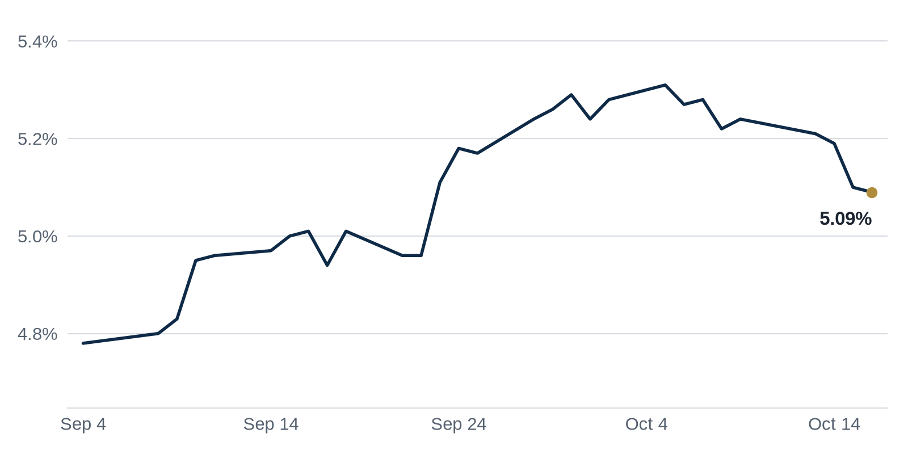

> **Review before publishing:**
> - editor: hold: Repeat: the Ortega / One North Wacker Chicago $550M purchase (today's lead Top Story, plus Coffee chat point 1) was already covered two days ago in previous...
> - editor: hold: Repeat: the EQT acquisition of Stockbridge Capital (today's Brief bullet 2, a Top Story, and Coffee chat point 1) was already covered two days ago in previou...
> - check/long_sentence: 71 words: [CHECK] Editor hold: Repeat: the Ortega / One...
> - check/missing_link: https://news.google.com/rss/articles/CBMiwgFBVV95cUxOYTloMTlodVo4UjR0Mk13LWN4dGFMckRLLVl6aWpQdDBRT3FKS3pYVFNvWU00OW9YdEh0eTJYS1d4VUdQaUptdDBSOUp2TFpCd0w1SU03eGI3NlRtTjdEalpMY1Ffbk9RT2NkLUFkcnpHUWJWbTM5c2VrQmZKZENLcVFYUExxUUQydy0zUUpCc1U5YkstU1Z5REFHX0ZiV0lLXzRLd2ZNUGdKR0NIV0U3MXZFbWJkR3BMQzN5blVJd2taQdIBxwFBVV95cUxNR1U4dHZuaF85dHRIQnJnQngyMHl0cnBlbjNHYUlIdGlMM0VsdzU1bE41RlUwaWRjd1dTcV9pYml6RTlHcXlFbWF3NTNuOVd1cEVrazN2V2JxaHp5ZC11TzRCUGRTZzdSbDNhaFJUZ21fUXgybG9fR2NLbnplcFZQQjQ0RDhQUURDaElTVnRrUkJud0xtRFRjaEhUMTJvajQ2LUpkeHg1ak9fWlY3UVpZMG5taHNyUW5DdWhnNHVhM3ZsSWE3Nllj?oc=5
> - check/missing_link: https://news.google.com/rss/articles/CBMiggJBVV95cUxQRDRJcjVMSkVhMG4wRGpvR2o5ZlJMQlVaRUtmd05QYThSR051UVU1UFI5akp2X2U5allUZXZqdjNFWHZEckN1YlZoQjBreWljYkFhUko1M1RjM28yLWtWd3UzQW1VTlNkQUo1a1JHS2RVNlhRb1E1OVd5d0JnZFdKQmI2VzNJdWdlTTFtSkJiakxqeDBMclpuVWJSSU9LMjF6SzhFeDduM19vZ1JCYjhLQ3V2VTJDbzRoR0pra29VTzZCVTVMWV9rdGlYMTBPUEtKYWJiUGI1Q0hTQVZhZVVFWFVzMTZFUjRfYmZpclZGUkM1T3ZqbVBQVlVUbkNPNHRCTVE?oc=5
> - check/repeat_in_issue: linked 3 times: https://www.bisnow.com/news/national/capital-markets/newmark-179b-low-rate-real-estate-loans-face-refinancing-risk
> - check/stale_data: Bank CRE delinquency last updated 2026-04-01

[CHECK] Editor hold: Repeat: the Ortega / One North Wacker Chicago $550M purchase (today's lead Top Story, plus Coffee chat point 1) was already covered two days ago in previous issue 2's Market Spotlight (the Zara fou...; Repeat: the EQT acquisition of Stockbridge Capital (today's Brief bullet 2, a Top Story, and Coffee chat point 1) was already covered two days ago in previous issue 2's Brief and Week in Review (EQ...

## The Brief

- A new report warns that a wall of cheap pandemic-era real estate loans must refinance at today's higher rates. [Bisnow](https://www.bisnow.com/news/national/capital-markets/newmark-179b-low-rate-real-estate-loans-face-refinancing-risk)
- A European investment firm is buying a U.S. real estate manager, a bet that American property values have bottomed. [The Real Deal](https://news.google.com/rss/articles/CBMimAFBVV95cUxQd19XR0w2aDZlNWU0Q1dLUVBvYUxCRWVkNEg5Ump3dDBkRl95R0hqXzNOYW9iVVBDM29McXV3YldhRUZMNi1Dd3RQN3Z2YWxVYk1OUWlsTEYtUzNKejJOc0tsajR6ZWF1dktERE9rSFBpcThqYkg5QU1HaXI0a0VHNkpvdWJpU2d4X2dWLVh1bkZDSngxNkhvWQ?oc=5)
- San Francisco office sales are rebounding as artificial intelligence firms snap up space downtown. [The Business Journals](https://news.google.com/rss/articles/CBMiowFBVV95cUxOV2RnVkJMb0NhRkV1NnRkTzBBQW9sNFI3UUxJU2VFWTl3MS1BT0xaLUJLSGtmcDJ3cnpGTFE1aS1WWDF5N2lxWVlhVHJJV0JUc01PcHNlQXV3bERjbWl6d2ZoY3NNMDlITGhfRFViYVNudGZtN2VZOVR6M3BOZnpzNkVVM0E5dERJMFoyTVRoQ1c1MzVNVGVXLWZOTWU3WWM2UGpv?oc=5)

## The Numbers

*Rates as of Oct 16 close.*

- **10Y Treasury:** 5.09% (-1 bps)
- **5Y Treasury:** 4.89% (-2 bps)
- **SOFR:** 3.88% (-1 bps)
- **Fed funds:** 3.75% to 4.00%
- **Next Fed meeting (Oct 28):** Polymarket's top outcome is No change 85.5%
- **REITs:** VNQ $91.76 (+0.3%). Best: DEI +1.7%. Worst: HPP -7.8%.
- **REIT yield vs. 10Y:** VNQ yields 3.80%, -129 bps vs. the 10Y.

**What it means:** Rates were little changed, so borrowing costs held roughly where they have been. Buyers and lenders can plan deals against a steady benchmark rather than a moving one.

**Why Douglas Emmett (DEI) moved:** No company-specific news today; it may have moved with other office REITs.

**Why Hudson Pacific Properties (HPP) moved:** No company-specific news today; it may have moved with other office REITs.

## Debt Markets

A $302 million CMBS loan on the Hyatt Regency Waikiki Beach Resort was sent to special servicing, per a Morningstar alert. The owner of the 1,230-room Honolulu hotel missed its final maturity payment. CMBS loans are bundled property mortgages sold to bond investors; special servicing is where a troubled loan goes to be worked out. [Commercial Observer](https://commercialobserver.com/2026/10/cmbs-loan-hyatt-regency-waikiki-beach-resort-special-servicing/)

**Why it matters:** The bond investors who hold that loan now face losses or a slow workout. Even trophy hotels can struggle to pay off debt taken out before rates rose.

SL Green locked in a $2 billion refinancing for 245 Park Avenue, a Manhattan office tower, replacing its old loan with new debt. Landing financing of that size signals lenders will still back prime Midtown offices. [Citybiz](https://news.google.com/rss/articles/CBMirwFBVV95cUxOWi1CanJzbmxkZms3WHdpVnhYRXpIVlctNkg3alVLam1iSTNkZHdGTlp6LUNMRkNYdTZTMlhNUmtoaFZLUklYcnF1RjRacjh1RzVmSFhVRi05azBxZ1M0N3A0V2VndDZlcFRRaHE1c3hFclE2MVdNcm1IR1pETWs3UWs1akZ4bzBoZ0llVy1DVVl2TUlUMHV1OTdNek40QkFkd1dIdVI5ZXJxOWZZUFk4?oc=5)

**Why it matters:** A completed refi tells other office owners that top buildings in strong locations can still raise debt, even when the broader office market looks shaky.

The multifamily refinance gap, the shortfall between what maturing apartment loans owe and what owners can borrow now, hit $6.8 billion after a September rate increase. [Yahoo Finance](https://news.google.com/rss/articles/CBMimgFBVV95cUxQcEtMUkI3ZjVJZC05c1VoZkZQTEQtOTEzTnZzcDNoWW43OWNIRng5cUFIcFZMbmlNV2N4ZExublBzeklHOTdQWi1qSWxNamhKQVkyRGtaUjhqT0xwREotanBrYmlrQmM2UEwyY2hjUC1pbkJLSHhwRWcxQVZtMU9tenlZSWVTME1lMFJpN1RDTVdqbDdWTjF3bzdB?oc=5)

**Why it matters:** Apartment owners who borrowed cheaply years ago may have to inject fresh cash to refinance, which pressures returns and can force some to sell.

**Distress Watch:** Trepp reports that CRE CLO multifamily loans from 2021 and 2022 hold 12.2% of the balance in the top five states but 80.2% of the delinquent balance. CRE CLOs bundle short-term property loans and sell them to bond investors. [Trepp](https://www.trepp.com/trepptalk/cre-clo-multifamily-delinquency-2021-2022)

## Top Stories

### Ortega buys Chicago's One North Wacker for $550M

Spain's Ortega family bought the One North Wacker office tower in downtown Chicago for $550 million.

**Why it matters:** A deep-pocketed foreign buyer paying $550 million gives Chicago office owners a fresh comp to point to when they sell or refinance. [GlobeSt.com](https://news.google.com/rss/articles/CBMiigFBVV95cUxQZUtOSHhtS3ZPZWZJeENjV1ZEYlNLT0ZjRjJic1lnaU5nME4xdC1uYUVWbmgyMm5JZU1pMlhzellwb19ra3ItQXJxNFRIT1d4ejNBckZsVEhoVl9PX25MUHlRTE8yTkxCSlRyblVibzdFdWxPQVVaazRHOFNBVDJ4MUxzUlJsazNwV0E?oc=5)

### Newmark flags $179B in cheap loans facing refinancing risk

Newmark says $179 billion in low-rate real estate loans must soon refinance at higher costs, with 78% of real estate debt now carrying rates above 10-year Treasurys. That reverses the cheap-money math that supported many purchases.

**Why it matters:** Borrowers who locked in low rates years ago face bigger payments at maturity, so lenders should expect more extension requests, workouts and forced sales. [Bisnow](https://www.bisnow.com/news/national/capital-markets/newmark-179b-low-rate-real-estate-loans-face-refinancing-risk)

### EQT to acquire Stockbridge Capital for up to $550M

European investment firm EQT agreed to buy U.S. real estate manager Stockbridge Capital for up to $550 million. Buying a manager, rather than a single building, is a bet on a durable pipeline of American property deals.

**Why it matters:** A large foreign firm expanding into U.S. real estate suggests overseas capital sees value here, which could bring more buyers and support prices. [The Real Deal](https://news.google.com/rss/articles/CBMimAFBVV95cUxQd19XR0w2aDZlNWU0Q1dLUVBvYUxCRWVkNEg5Ump3dDBkRl95R0hqXzNOYW9iVVBDM29McXV3YldhRUZMNi1Dd3RQN3Z2YWxVYk1OUWlsTEYtUzNKejJOc0tsajR6ZWF1dktERE9rSFBpcThqYkg5QU1HaXI0a0VHNkpvdWJpU2d4X2dWLVh1bkZDSngxNkhvWQ?oc=5)

### S.F. office sales near $3 billion on AI demand

San Francisco office transactions are approaching $3 billion this year as artificial intelligence companies lease and buy space downtown. That is a sharp turn for a city whose office market was among the hardest hit after 2020.

**Why it matters:** Rising sales and AI tenant demand give San Francisco landlords a reason to expect higher occupancy, which helps rents and the value of surviving buildings. [The Business Journals](https://news.google.com/rss/articles/CBMiowFBVV95cUxOV2RnVkJMb0NhRkV1NnRkTzBBQW9sNFI3UUxJU2VFWTl3MS1BT0xaLUJLSGtmcDJ3cnpGTFE1aS1WWDF5N2lxWVlhVHJJV0JUc01PcHNlQXV3bERjbWl6d2ZoY3NNMDlITGhfRFViYVNudGZtN2VZOVR6M3BOZnpzNkVVM0E5dERJMFoyTVRoQ1c1MzVNVGVXLWZOTWU3WWM2UGpv?oc=5)

### Tyler Perry plans Atlanta entertainment district

Filmmaker Tyler Perry plans an entertainment district at Fort McPherson, a former Army base he owns in Atlanta. The project would turn surplus government land into a mixed-use destination tied to his studio.

**Why it matters:** Converting a closed base into an entertainment hub can lift nearby land values and give the surrounding Atlanta neighborhood new jobs and foot traffic. [SuaraGarut.ID](https://news.google.com/rss/articles/CBMilgFBVV95cUxOaVRoNm5qSjdQeW9ZN3Z6c04zRjl3YlB2OGl6NkFMcG1sbndaX3B4dFZLWnQ0YlUyNUc3THBRcVlnQUs1SmVsZjJhVTlMelBRUk04VWRnbkp5R190WUV3dDk3T1dqdmFvajNIZDJNa003ei1jQVpiWVFBazF4WHM0UnpZZ0xzQlRQN3FCclRPaVhOVkxpdHc?oc=5)

**Coffee chat talking points:**

- Ortega is paying $550 million for one Chicago office tower, the same price EQT is paying for an entire U.S. real estate manager. [GlobeSt.com](https://news.google.com/rss/articles/CBMiigFBVV95cUxQZUtOSHhtS3ZPZWZJeENjV1ZEYlNLT0ZjRjJic1lnaU5nME4xdC1uYUVWbmgyMm5JZU1pMlhzellwb19ra3ItQXJxNFRIT1d4ejNBckZsVEhoVl9PX25MUHlRTE8yTkxCSlRyblVibzdFdWxPQVVaazRHOFNBVDJ4MUxzUlJsazNwV0E?oc=5)
- Newmark says 78% of real estate debt now sits above the 10-year Treasury, which explains why apartment owners already face a refinance gap. [Bisnow](https://www.bisnow.com/news/national/capital-markets/newmark-179b-low-rate-real-estate-loans-face-refinancing-risk)
- Google, Nike and TikTok each signing 1 million-square-foot leases, alongside falling Los Angeles industrial vacancy, show warehouse demand still outruns available space. [The Business Journals](https://news.google.com/rss/articles/CBMimAFBVV95cUxONFZfN2NfNXVwdlhtbTlyaExDZi1aSmwtN2VCaHFiaE1rVjZVYjB5aWZKZ01jM2x2ZWUtVWt6NWxVNjdjWUtYMXczRHB5UXBNb1ZEVURpbUhrV0R4RlFxOVMwWHNhRkpac0hkc2lmbkU3eWJrSG81aUtpSXBiT3RHZXhBMkxtM3QzWkJjbi1xRi1QczJVWmNpcQ?oc=5)

## Market Watch

### Sun Belt

A group including Radnor Property Group, the City of Atlanta, Spelman College and Morehouse College broke ground on The Den at Eight50 West, a $147 million student housing development. The project adds beds near Atlanta's historically Black colleges. [PR Newswire](https://news.google.com/rss/articles/CBMikgNBVV95cUxOUnAxM2V4OVotUURHTEpMSXRfRGNPcnpjd2tubzdrV1ZLb0dNRmY5czRPMGdNREFSY2hwWFRUSzBKOGhoMERjQ0RKeEVoSUl6NV9ZVFdnc21kTkZWUk9QZ2U3VUl6V2J0eGVUckV0ZXdBZ1hFZ2p1LU43UWdXcU5tdGQ2aUFIUnhRTjE5ckNEWlNjQmlDYmplNTM2emZaaXRTSmxhNEhGa0d0MHIzVkw4XzB0UGoxYXpBeXdFUEpaNG42LVMzckoyN2s1cUNxRE1FbVN0RlNtSUU4VDRNVWVlbnpfZ1UwejY2bHlZYXplekpybF9HSC13MnZjS2Y0WHNTdXNUOHAxRWdLNWdVcmt0TE9jODZHSG9aYUhOMmc0T292ZmRWMkFlVXFxRVVmTk80UDRIMUY0cTdsU2JqMlg3bEVYeGlCTGJVYWt3bV9kSU9Uc1RTQmtVaWVnVVRseE1KMUNnaXNHbENKSHhDY2NnY2EtcFRFenlPaVpZMUQxRFJGN0g3U3dwOWtBdVpvUW9adGc?oc=5)

**Why it matters:** New purpose-built student housing gives students more supply and gives investors steady, enrollment-backed rent in a growing Sun Belt city.

### West Coast

Essex Property Trust seized an Oakland apartment complex through foreclosure, taking the keys from a borrower who could not keep up. It is the latest multifamily foreclosure in the Bay Area. [The Real Deal](https://news.google.com/rss/articles/CBMinAFBVV95cUxQRkx1MU00YVJ6M19fWGlGUHdUVExLSXJUcWdoVkpKaUZpSDZHZTZscC1scHFaTlB4d0E0bTg1UWhhdEZSdWN5NmVCUDh4SE5sZ0l3aHJiakFZcmE3VnVWbkFab0hPOXc5TWZCeHhwdndWOU8tSzAyemFCTjJDY3RVOFNBRm5FR2JUcmdxQjZUTnBsVWlPM0t0cGIweXM?oc=5)

**Why it matters:** When a large landlord forecloses rather than renegotiates, it signals that some Bay Area apartment values have fallen below what owners owe.

### International

Talk of fresh European Central Bank rate hikes has put Europe's fragile real estate recovery back under scrutiny, Bisnow reports. Higher rates there would raise borrowing costs just when investors hoped a recovery was taking hold. [Bisnow](https://www.bisnow.com/news/europe/economic-development/ecb-rate-hike-talk-put-europe-s-real-estate-recovery-back-under-spotlight)

**Why it matters:** Pricier debt in Europe could stall deals and property values there, which matters to U.S. firms and funds with European holdings.

## Quick Hits

- Google, Nike and TikTok each signed 1 million-square-foot industrial leases. [The Business Journals](https://news.google.com/rss/articles/CBMimAFBVV95cUxONFZfN2NfNXVwdlhtbTlyaExDZi1aSmwtN2VCaHFiaE1rVjZVYjB5aWZKZ01jM2x2ZWUtVWt6NWxVNjdjWUtYMXczRHB5UXBNb1ZEVURpbUhrV0R4RlFxOVMwWHNhRkpac0hkc2lmbkU3eWJrSG81aUtpSXBiT3RHZXhBMkxtM3QzWkJjbi1xRi1QczJVWmNpcQ?oc=5) Huge tenants committing to warehouse space signals that demand for distribution buildings remains strong.
- Prologis raised its 2026 development outlook to $5.75 billion. [Yahoo Finance](https://news.google.com/rss/articles/CBMinwFBVV95cUxORXFjU242dmJMUjhta0FxOTZhaVl0NWF0ajVZUHpFSkh4eHV6eUlhVkxMQ2pZU3pkZC1oUmRSSFI2NGdSalgyb0FqWHhSdFZta2xEbk5ub0tPaldTSHk4NzV6TzJFQzd4Vzd2TjNDNjRWZUNkbGdKdWVLWUJMQndJcklkZk1IZ1ZiNmZiQmkyWEdZSERmSDZteTZjcWhnOGc?oc=5) The largest warehouse owner building more space shows it expects tenants to keep needing it.
- Los Angeles County industrial vacancy fell for the first time in two years. [Commercial Observer](https://commercialobserver.com/2026/10/la-industrial-vacancy-rent-leasing-q3/) Falling vacancy means landlords regain pricing power as empty space fills back up.
- BXP sold an 11% stake in the 343 Madison Avenue office project in Midtown Manhattan. [Commercial Observer](https://commercialobserver.com/2026/10/bxp-sells-stake-343-madison-avenue-office-avrs-partners/) Selling a piece of a big project lets a developer share both the cost and the risk with a partner.
- Site Centers will stop trading on the NYSE as it winds down. [Bisnow](https://www.bisnow.com/news/national/retail/site-centers-to-stop-trading-as-it-winds-up-operations) A retail landlord returning cash and closing up shows some REITs see more value in selling off than operating.
- Bank activity pushed Manhattan prime retail availability to another record low. [GlobeSt.com](https://news.google.com/rss/articles/CBMiowFBVV95cUxPU3k1SHZCb2h5RWtPV2hsMXV2WG1PQ0F4U1dXb0NhRWRHR2QydUp2N1h2aWZ3Q09GNUlFRTN3NFh3eXhhb2tNZm5PdHlRWGlnUFJ5QkFFdExNRnA2cmVrMzZ1emVwSUs4RFNZY3FLbkFrNEM1b21pYk16OW1hLUNjY3hKaWVHUlMxcEZQNVFrODhjMmpqUS1fUFViR1d5ODgyZUFr?oc=5) Scarce prime storefronts let landlords on the best corridors push rents higher.

## AI Infrastructure

A Senate bill, the Bipartisan American Affordability and Jobs Act, would give data centers a faster path to electric power. It would speed up construction of the grid infrastructure they need. The tradeoff is that it could raise power costs for the developers building those centers. Data centers are the warehouse-like buildings that house the servers running AI, and power is their biggest constraint. Faster approvals help developers break ground sooner, but higher electricity bills eat into returns. [Bisnow](https://www.bisnow.com/news/national/data-center-development/senate-bill-offers-data-centers-a-faster-path-to-power-but-at-a-price)

## Term of the Day

**Rent roll:** a property-level list of every tenant, what they pay, their lease terms and when each lease expires. For a 20-unit building, the rent roll shows which units are occupied, each rent, and which leases end next year. Buyers and lenders read it first, because it reveals the income and the risk behind a property.

For informational purposes only. Not investment advice.
