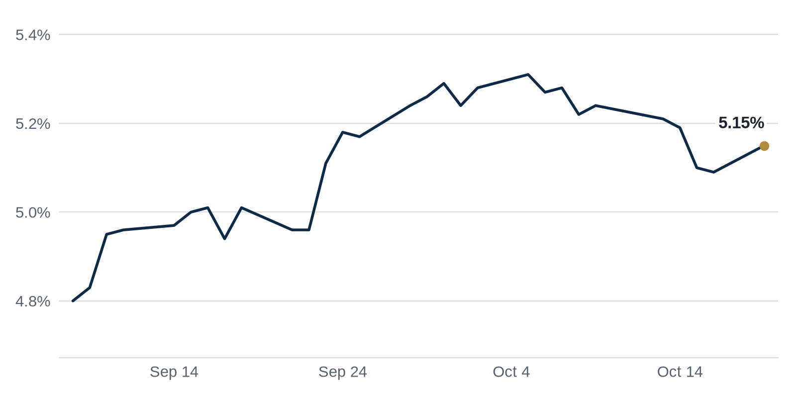

> **Review before publishing:**
> - reits: prices from Alpha Vantage only, not cross-checked (no second source; set TIINGO_API_KEY)
> - editor: fixed: Source (id 4021) is headline-only and never names storms, rebuild costs or reinsurance as the drivers; these specific causes are not supported.
> - check/long_sentence: 35 words: **What it means:** Rates were little changed, so...
> - check/long_sentence: 34 words: **Why it matters:** When an owner cannot pay...
> - check/stale_data: Bank CRE delinquency last updated 2026-04-01

## The Brief

- Homebuilders are the least confident in years, and price cuts still are not luring buyers back. [GlobeSt.com](https://news.google.com/rss/articles/CBMirgFBVV95cUxPVHZBSE5MWWhJZllkeUZCWGc3cUtxVnVrN3JNdEwxeTludlVJODdWYVRMcVVnRmNpQlk4ajZFVjM4eElRQmRWMW1YSUVhTXlUVERKcjBfdW5xRW5hamNlWEh2alUwM1FneTI1REFMUm03TmVtYVd2RGhEZE9VeWQ4RTJSeHFBREVlbFlCV2tYMHNyV3dieVpHX013M21qS2pBcE83WG8wUVR0Zkw2Tmc?oc=5)
- A large share of apartment loans coming due cannot refinance without owners first adding fresh cash. [Commercial Observer](https://commercialobserver.com/2026/10/multifamily-debt-refinances/)
- Brokerage CBRE is buying deeper into data centers, betting demand from artificial intelligence keeps filling them. [WSJ](https://news.google.com/rss/articles/CBMiwgFBVV95cUxPM0I3SDR1N2xmZ3FSVWZ5VkpxcVV3NXduSmQzdXRiX2psZFBxc2V5Y05ISVg4Ti16Y1BHOTVGYTVuQzM5ejVYS3h0Z0M0WUVqbXpSbHNKZVFMaVk1eGlJOUdYSzI5a3BaWUpOeVlFV1p0dUdYN3cyN3RYMkczM2VTdTFXSTFXbnV5ei1lVFZWLWZ4c1lxSHZPQkk1YkM0NGowQ08yc2tielFiZUdDU2F1RVRRbmdvSFloajRCS0ZxV0RYQQ?oc=5)

## The Numbers

*Rates as of Oct 19 close.*

- **10Y Treasury:** 5.15% (+6 bps)
- **5Y Treasury:** 4.94% (+5 bps)
- **SOFR:** 3.87% (-1 bps)
- **Fed funds:** 3.75% to 4.00%
- **Next Fed meeting (Oct 28):** Polymarket's top outcome is No change 85.5%
- **REITs:** VNQ $90.71 (-1.1%). Best: STAG 0.0%. Worst: HPP -12.4%.
- **REIT yield vs. 10Y:** VNQ yields 3.80%, -135 bps vs. the 10Y.

**What it means:** Rates were little changed, so borrowing costs sit about where they have been; today's levels are still high enough that buyers and sellers keep haggling over price rather than rushing to close.

**Why STAG Industrial (STAG) moved:** No company-specific news today; it may have moved with other industrial REITs.

**Why Hudson Pacific Properties (HPP) moved:** No company-specific news today; it may have moved with other office REITs.

## Debt Markets

Nearly a third of maturing apartment loans cannot refinance without fresh equity, with about $6.8 billion in new cash needed to clear loans written at 2021 and 2022's low rates. One example, a 767-unit tower near Wall Street that was 94 percent full, shows how even healthy buildings face the gap. [Commercial Observer](https://commercialobserver.com/2026/10/multifamily-debt-refinances/)
**Why it matters:** owners must either write big checks or sell, so expect more forced sales of otherwise sound apartments.

Major banks are taking larger losses as they clear problem commercial real estate loans off their books. Nonaccrual balances, loans that no longer collect interest, are falling as lenders write them down. [Bisnow](https://www.bisnow.com/news/national/capital-markets/big-banks-take-bigger-cre-losses-as-they-clear-problem-loans)
**Why it matters:** banks cleaning house now free up room to lend again, which could slowly reopen credit for borrowers.

Rising Treasury yields are testing borrowers who hoped falling rates would bail out their loans. Higher yields push up the cost of any new debt they take on. [GlobeSt.com](https://news.google.com/rss/articles/CBMiqAFBVV95cUxOWWtCQjRMUHpTWUZVVXhtUGtqNkwxT1B4VjRrN2F6VWZldjRkYU41Z1NlUTA3RkF0RFFTRGNGbHVmbF9yUlhDR0x6WTNWbzFwOFd6MXRHaVAySzhLcjUxdVhaRVk0dF9DMkNDMjhtdzNMWGdBRUtDdFloYXF6OFV6UzhCVk9za0dEY2hUdUlXbHpfdDZramp6UEhybXVjb1ZQQUtuLXlaWjM?oc=5)
**Why it matters:** borrowers counting on cheaper refinancing may find rates stay high, forcing tougher choices when their loans mature.

AmTrust is set to lose Illinois Center, its Chicago office complex, in a foreclosure auction after defaulting on $285M in debt. A foreclosure auction lets lenders sell a property to recover what they are owed when the borrower stops paying. [The Real Deal](https://news.google.com/rss/articles/CBMinAFBVV95cUxNOTROYmNoTXlVSUh4Qy1Leks2cU96bEp6aDl0M2xHY0dWR0tZMkZIQmhxV0NyV1pLMUVTZl9fTk94aWJabURBVF9PY2J5SGVFUlRuMndJTmRsOTV1QXhWZFJIYjNNTEw1OWp5dHliakxNbTRocjBwM1lFTURfWlFjeTRGTHJiM1N1NEZUaHFuSVBFV19sdmEwRDM4UVg?oc=5).

**Why it matters:** When an owner cannot pay its loan and loses the building, the lender eats the loss, a warning sign that older city office towers are worth far less than their debt.

**Distress Watch:** Blackstone's $1.3 billion CMBS loan has moved to special servicing, the team that handles troubled loans, a sign distress is reaching even large institutional owners. [The Real Deal](https://news.google.com/rss/articles/CBMimgFBVV95cUxPd3phWXprQThFRE4wQ2FIdjVyNzlaczhHamZMOXZEUGpLcnhGVW9pLVM0U1k5TnF6NEk0dGl6clRSd181SXI1OHMwbk5NdE9scmNnY0ZZbmw3ZTJIclUxampUYTFvbWJPYUoyc2lHWnEwNmdNSmFjdW9pVE0xa05sbEs1UWNJdlJIdTNia3UyU0wxaXgycFY3YnhB?oc=5)

## Top Stories

### Homebuilder confidence sinks to a 14-year low

Builder sentiment fell to its lowest level in 14 years, and price cuts are not pulling buyers back into new homes. High mortgage rates and sticker shock are keeping shoppers on the sidelines.
**Why it matters:** builders who cannot sell will slow new construction, which tightens future housing supply and keeps rents firm for apartment owners.
[GlobeSt.com](https://news.google.com/rss/articles/CBMirgFBVV95cUxPVHZBSE5MWWhJZllkeUZCWGc3cUtxVnVrN3JNdEwxeTludlVJODdWYVRMcVVnRmNpQlk4ajZFVjM4eElRQmRWMW1YSUVhTXlUVERKcjBfdW5xRW5hamNlWEh2alUwM1FneTI1REFMUm03TmVtYVd2RGhEZE9VeWQ4RTJSeHFBREVlbFlCV2tYMHNyV3dieVpHX013M21qS2pBcE83WG8wUVR0Zkw2Tmc?oc=5)

### A landlord allegedly pledged the same equity twice

Investors claim Mike Kohan double-pledged $200 million in equity, including Chicago skyscrapers, to raise money from more than one set of bond buyers. The suit says the same collateral backed competing claims.
**Why it matters:** lenders rely on clean collateral, so if one owner can pledge a building twice, bond investors may demand tougher checks and higher rates on everyone.
[The Real Deal](https://news.google.com/rss/articles/CBMiogFBVV95cUxOakRzOWJWZHZXZFVvSzRJWl8wWTI3VlZFZDl1MU9IMjZNWEFZNjRxVlhhUVYzOVVfbF9ESVFCTnBtTkswRUh5Zk1UVjBhdVlRSmVzTUIwYndzcWhFVDBkcnpCMmdpT0RRRmp5YUg4Sl9BMmt4SGZCSmphdEM0VnBVTDZjWEYzRXg3aEtUalVrMFFIdlZoYmpiV0hiX3BfQ1E0OWc?oc=5)

### NYC retail is busy, but storefronts stay empty

Foot traffic and leasing demand in New York are strong, yet many street-level stores sit vacant. Landlords holding out for top rents and slow build-outs are leaving space dark.
**Why it matters:** empty storefronts cut a building's income even in a hot market, which can lower its value when the owner goes to refinance.
[The Real Deal](https://news.google.com/rss/articles/CBMiXEFVX3lxTE9yWk5VZGpUM2tfQTk0eVlHZ1FXYWd6LUlfZlJMYWpFcURReFV3ZjNkSEVxM3ZpQjRIdUlSTnVLUVZuMmI4ejVkTlBuU0gxdkM4Z1puckdKZWVaX3Zj?oc=5)

### Apartment insurance costs outrun rent growth

Insurance premiums are rising faster than revenue for apartment owners across 30 states.
**Why it matters:** every extra dollar of insurance is a dollar of lost net income, which squeezes owners already fighting flat rents and high loan payments.
[GlobeSt.com](https://news.google.com/rss/articles/CBMimgFBVV95cUxPSWdpS1VNTVJ4YXk2VUxIUktobl82TWI0eUlwSXZHaWJUQXhEMTNDRWQtanpFb3dKYW50RG9kaTBUNjFoUnotSlZaQzNaZlNHdlp3Z2x3YkViQVB0cXQ3eUtybmhPV0gwRjFmeXJoMGxYOTNhYjIyb09JUUl0S2phV0pOOGQycDlUeUVPNTcyQ1QxVl9adTRWTzBR?oc=5)

### Real estate fundraising drops 31%

Money raised for real estate funds fell 31 percent as investors steered capital toward residential and industrial deals. Office and niche strategies are drawing far less.
**Why it matters:** less fund money means fewer buyers for large assets, so sellers may have to cut prices to get deals done.
[GlobeSt.com](https://news.google.com/rss/articles/CBMitAFBVV95cUxPbjIybFNHcnpiUnhxdXJMbTQ5QzRFX1VoSFcyMElYakpqMWVQeExKcE5WMThqeDBWZmNQRlNzY1pKbThPZmFYNmxaRGtyVS0wR0trU09qR25JR1pYS05pdU13ZWlsNXRTWk9RMUxSd3VvYlJfN3lWb1Zjd1Z6Uk8zRXRvOERHZ0hENFdISm9RUVFLbGtGdUEtWTlOMVRnMUFvLWdUbjZpMmJwSm5lNFVLeUJDOUQ?oc=5)

**Coffee chat talking points:**

- Distressed sales jumped 26 percent last quarter, led by apartments, which lines up with the wave of pandemic-era multifamily loans now coming due. [Bisnow](https://www.bisnow.com/news/national/capital-markets/distressed-sales-jump-26-driven-by-discounted-apartment-deals)
- Real estate fundraising fell 31 percent this year, so even as distressed deals pick up, there is less new money chasing them. [GlobeSt.com](https://news.google.com/rss/articles/CBMitAFBVV95cUxPbjIybFNHcnpiUnhxdXJMbTQ5QzRFX1VoSFcyMElYakpqMWVQeExKcE5WMThqeDBWZmNQRlNzY1pKbThPZmFYNmxaRGtyVS0wR0trU09qR25JR1pYS05pdU13ZWlsNXRTWk9RMUxSd3VvYlJfN3lWb1Zjd1Z6Uk8zRXRvOERHZ0hENFdISm9RUVFLbGtGdUEtWTlOMVRnMUFvLWdUbjZpMmJwSm5lNFVLeUJDOUQ?oc=5)
- Mike Kohan allegedly double-pledged $200 million in equity, the kind of sloppiness that tends to surface once higher rates expose weak deals. [The Real Deal](https://news.google.com/rss/articles/CBMiogFBVV95cUxOakRzOWJWZHZXZFVvSzRJWl8wWTI3VlZFZDl1MU9IMjZNWEFZNjRxVlhhUVYzOVVfbF9ESVFCTnBtTkswRUh5Zk1UVjBhdVlRSmVzTUIwYndzcWhFVDBkcnpCMmdpT0RRRmp5YUg4Sl9BMmt4SGZCSmphdEM0VnBVTDZjWEYzRXg3aEtUalVrMFFIdlZoYmpiV0hiX3BfQ1E0OWc?oc=5)

## Market Watch

### Sun Belt

Houston's apartment market is bracing for a wave of foreclosures as investors wait for prices to bottom. Higher rates and thin equity have left many pandemic-era buyers stuck in deals they can no longer carry. [Bisnow](https://www.bisnow.com/news/houston/multifamily/-let-s-just-get-this-over-with-houston-multifamily-braces-for-foreclosures-capitulation)
**Why it matters:** forced sales set low comps, so patient buyers may scoop up Houston apartments cheaply while current owners take the loss.

### West Coast

A loan on a distressed downtown Los Angeles office tower owned by Brookfield sold for $115 million. Buyers of discounted debt often aim to take control of the building itself. [The Real Deal](https://news.google.com/rss/articles/CBMiigFBVV95cUxPbnNQaXZXNUMxT1lVYW5xTWVKMmZYcjc2MmpjdG82U1FzRS04dmhZSTZ1Y0JlcjFoUU9wbGxqdHFPX2FaU0RuWnJaSWE0SWktbDVET3U5UGRrdWN2VzI1d1o4aHI5Q3BPeGxjdVI0OUtUWlVaQWgwYXB2aVR4c29KcDlqbnIwVWpFZXc?oc=5)
**Why it matters:** selling the loan at a markdown resets the tower's value and signals how far distressed office prices have fallen.

### International

Developer Mohamed Alabbar unveiled plans to invest up to $17 billion in Syria. The bet targets rebuilding in a market opening up after years of conflict. [Middle East Construction News](https://news.google.com/rss/articles/CBMinwFBVV95cUxOTFZOdWFaR1gyV19YcS1NRjVmZFB0Z1U4Y0NCRTZOYjU4MVRvS29Cd2E1V01LZEdqa1JGcW5BdHpPalg2N2NVbFBxTDNBcFdPNmF4OG81RGdCeGxGclJ3NEVsZWRJeHV6S2tjc1dYcmZPaEFsZlZCZlgwaENud2NmbTdRMVlnR2RXOU56dms5eDUtMXZYOFQ4U0UwdVl3RnM?oc=5)
**Why it matters:** large reconstruction bets abroad show where some developers see growth while many US deals stay frozen.

## Quick Hits

- Silver Creek sold a 2-million-square-foot Illinois warehouse to Michelin for $151 million. [REBusiness Online](https://rebusinessonline.com/silver-creek-development-sells-2-msf-industrial-facility-in-illinois-to-michelin-north-america-for-151m/) Large tenants are still paying up for distribution space near major highways.
- AI firm Databricks is expanding to five floors at 5 Bryant Park in New York. [The Business Journals](https://news.google.com/rss/articles/CBMiogFBVV95cUxPV0FsZllUbjJjQV81WllKTHZmMkJmeDRiVjByLS1XMnEtNU54VkxIMl9JSWRNcHgwVHlwZFNsVHdNb2dYbzdNY2hKV2NqdkxISHEtVS16cnhpY0FhU0k3c1lnZXNETlJNU0pVU25IMW1hX2pJUk9lZjY1RHhldnFsOTB0VTk5Tmg2OTNxaEdseF9KNWVncTA0ZFpQM2VPM09Fb3c?oc=5) Fast-growing tech tenants are quietly filling premium office space that others left behind.
- A 30-story office tower could soon rise next to Goldman Sachs' new Dallas campus. [Dallas News](https://news.google.com/rss/articles/CBMitwFBVV95cUxNYkVCbkRUU0tsSF9QYTByTmNWYmtUSk1GMmx2V2RsemQwVnEyZjJ6cEt3VFlySDNXUTR3cGZ6XzlNOGVMSXZPZVcwWlNOZDk2OUFGOG1ucVBtbkJoamRBLUxkVXZxVW4wMkU4NXo3SkdpS0gwQVV0anVjOEllZlJRU1BuNGxreXVaNjB5SXA0cGdfQUJYMzdBTlJjMEpZaDVJRXpOOWc5M1podEZndHN3aXpNRllVVk0?oc=5) New towers get built where a big anchor tenant all but guarantees nearby demand.
- Seniors housing occupancy reached 90.1 percent while construction hit its lowest level since 2012. [Stock Titan](https://news.google.com/rss/articles/CBMitAFBVV95cUxNM3ozTnhiYVc0Q044bkFQeUVOMFltWGljRTdCUUlyREl1aVlTRjM4eENNTlJXZG10UFpOdzJWMXFmM29zRnpCME5FUWdES3Rlb0sxSHFtUFliaV9xSUhJQ1lPNm1MUjVVWG1Zd3ZhdFBwOXRWYUJ0WXJ1V0RacWd3cjg1SWdYZWZYOURTdE1SSEZYNkt1VXctSElPOC12Y05GNkYwR0M2c3IycXpjQTVHc1VhcFo?oc=5) Little new building means existing senior housing owners face less competition for residents.
- Marquee Oakland properties are changing hands for pennies on the dollar. [The Business Journals](https://news.google.com/rss/articles/CBMipgFBVV95cUxOcnoxZ3k3TkFsMXVKNmJ0b05peGtjNnlzNXhtLXRsOWZuSkgwa29CdFhwZXpPWmNReGttam83MmZWRDJYZHN3Z0ZaSXB4alB3aXNjV1IwMDI3MkxKSGRNcFlINlRFYTFWb2h6S2hZWWRvWVdiY0tsenNUekFObDVuNUdINGhyUUVidkNvNGd0dVIyS1VMZlQzdS1aRnFGQUNnRXIwTXRB?oc=5) Steep discounts show how far values can fall when a city's office demand dries up.
- The Fed sees the AI boom adding to inflation, though others may bear the cost. [U.S. News - Money](https://news.google.com/rss/articles/CBMi2AFBVV95cUxObFRkQ1FRNUZtVTJQQ0NZcXZVeUJTekhQMXdDbElQR3hsSDNWeVJ4MzhiRHY2Z3Z3TlEybzY0a2FYMkNKZ1dhLVVMbDNMcFdSSlc5YU11eV9CMTRXcG5ROHUwa05kWlR5THliMjZBZnhxSGtLcExhN1RJeHR3WjZtVXY3QlRMMHhsMkRBdlRsaWFpTFNxbDczdkV0TE5lN21PcG1zcmdPcldDZnhLUFdIdVFOVWxUVXRCTXRaRUNFNzVqX2RNenBma1Jhc0h1ZHQyZUFuM25OSHc?oc=5) Stubborn inflation makes the Fed slower to cut the rates borrowers want lower.

## AI Infrastructure

CBRE, the largest commercial real estate brokerage, is deepening its push into data centers with a $1 billion deal. The move expands its ability to build and run the warehouse-sized buildings that house the servers powering artificial intelligence. Investors and landlords chasing AI demand gain a bigger partner, while traditional office brokers get another sign of where the growth is heading. [WSJ](https://news.google.com/rss/articles/CBMiwgFBVV95cUxPM0I3SDR1N2xmZ3FSVWZ5VkpxcVV3NXduSmQzdXRiX2psZFBxc2V5Y05ISVg4Ti16Y1BHOTVGYTVuQzM5ejVYS3h0Z0M0WUVqbXpSbHNKZVFMaVk1eGlJOUdYSzI5a3BaWUpOeVlFV1p0dUdYN3cyN3RYMkczM2VTdTFXSTFXbnV5ei1lVFZWLWZ4c1lxSHZPQkk1YkM0NGowQ08yc2tielFiZUdDU2F1RVRRbmdvSFloajRCS0ZxV0RYQQ?oc=5)

## Term of the Day

**Special servicing:** the specialist team that takes over a troubled CMBS loan (a mortgage bundled into bonds and sold to investors) to modify it, extend it, or foreclose. When a borrower stops paying, the loan leaves its normal servicer and lands here. Bondholders gain a dedicated workout team; the borrower loses easy flexibility.

For informational purposes only. Not investment advice.
