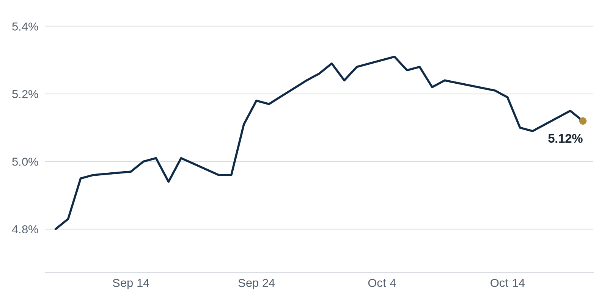

> **Review before publishing:**
> - reits: prices from Alpha Vantage only, not cross-checked (no second source; set TIINGO_API_KEY)
> - editor: fixed: Source title/summary ('Here's why') never state the reason, so 'for a renovation' is an unsupported fact.
> - editor: fixed: Removes the same unsupported 'renovation' assumption not found in the source.
> - check/long_sentence: 31 words: **Why it matters:** a joint venture lets UDR...
> - check/missing_link: https://news.google.com/rss/articles/CBMipgFBVV95cUxOSjZlb3A0YUhrMlE4TjVpWTRUaXNwYy1ZZHF6cC1SQTBjZ0NBNGFycWVfWXl0ZlFnUk05OGF4VjMyX1h2dXExYUI4T3M4azc3X2M3WEszMGpsMGR6SzM5NllObmQzdkt2WERWWUNqLXpoN3pCSmNRaVJwZkY4bFd0LV9HRVNqdVIzR0t3RUNyeHpURk1ENU14WVB2RmRlU0laLXFXa0pB?oc=5
> - check/missing_link: https://www.trepp.com/trepptalk/denver-multifamily-watchlist-credit-stress
> - check/repeat_in_issue: linked 3 times: https://www.connectcre.com/stories/apollo-udr-forming-2-billion-multifamily-joint-venture/
> - check/repeat_in_issue: linked 3 times: https://commercialobserver.com/2026/10/cbre-acquisition-data-center-onnec-group/
> - check/stale_data: Bank CRE delinquency last updated 2026-04-01

## The Brief

- Apollo and UDR are pooling apartments into a joint venture, spreading risk while freeing up capital for both. [Connect CRE](https://www.connectcre.com/stories/apollo-udr-forming-2-billion-multifamily-joint-venture/)
- CBRE is buying a data center equipment maker, deepening its bet on the buildings behind the AI boom. [Commercial Observer](https://commercialobserver.com/2026/10/cbre-acquisition-data-center-onnec-group/)
- Immigration raids are draining construction crews, slowing projects and raising costs for the developers who hire them. [The Real Deal](https://news.google.com/rss/articles/CBMiogFBVV95cUxQdEQ1TTdwd0lfUFlXcy03OWFLOW5GVlYwcXlUWURJVUJLd1hhLUJaZXh2TF92UTVCRkl4eUlmQmQ5MmpQRFNJMEZZUGlmdnJBZ0F4aUxwM0ZaVGh3RVZRVFpLeFNaMXVZQ05JamVhMTRULTZOTXQzZFJ5YkN1SVhVN3RUd24taHVzTXF6WmZHbkhKN0ZWU1BTYkFycHpfUk5sLUE?oc=5)

## The Numbers

*Rates as of Oct 20 close.*

- **10Y Treasury:** 5.12% (-3 bps)
- **5Y Treasury:** 4.94% (0 bps)
- **SOFR:** 3.88% (+1 bps)
- **Fed funds:** 3.75% to 4.00%
- **Next Fed meeting (Oct 28):** Polymarket's top outcome is No change 86.5%
- **REITs:** VNQ $92.28 (+1.7%). Best: HPP +5.1%. Worst: VICI +1.2%.
- **REIT yield vs. 10Y:** VNQ yields 3.80%, -132 bps vs. the 10Y.

**What it means:** Rates barely moved, so borrowing costs for new loans look about the same as last week, and buyers can underwrite deals without guessing at a fresh swing.

**Why Hudson Pacific Properties (HPP) moved:** No company-specific news today; it may have moved with other office REITs.

**Why VICI Properties (VICI) moved:** No company-specific news today; it may have moved with other casino REITs.

## Debt Markets

A $1.3 billion Blackstone commercial mortgage-backed securities (CMBS) loan, now carrying a $517.7 million balance, entered special servicing after missing its October 2026 maturity. Special servicing means a troubled loan gets handed to a specialist who negotiates a workout or forces a sale. [Commercial Observer](https://commercialobserver.com/2026/10/blackstone-sun-belt-multifamily-cmbs-loan/)

**Why it matters:** even the biggest owners are caught by Sun Belt apartment stress, so lenders there are likely to drive harder bargains on refinancings.

Northwind Group closed its third real estate credit fund with $1 billion in commitments, double its original $500 million goal, and has already originated $1.5 billion in loans. The fund is a pool of private money that lends directly to property owners. [Commercial Observer](https://commercialobserver.com/2026/10/northwind-debt-fund-ran-eliasaf/)

**Why it matters:** private lenders are stepping into gaps that cautious banks left, giving borrowers more places to find money, often at a higher price.

Webstar admitted a nearly $19 million accounting error on its $3.8 billion Forge Atlanta project and fell further behind on its loan. The error raises doubts about its ability to raise the funds the development needs. [Bisnow](https://www.bisnow.com/news/atlanta/commercial-real-estate/forge-atlanta-developer-admits-19m-accounting-error-falls-further-behind-on-loan)

**Why it matters:** a bookkeeping mistake can rattle lenders and freeze a megaproject, leaving a city with a stalled site instead of new buildings.

**Distress Watch:** a Loop office-to-residential conversion at 330 S. Wells St. is set for a foreclosure auction next month, after a judge ruled its $28.2 million mortgage was in default. [Bisnow](https://www.bisnow.com/news/chicago/capital-markets/loop-office-to-resi-conversion-foreclosure-auction)

## Top Stories

### Apollo and UDR launch a $2 billion apartment venture

UDR and Apollo will form a long-term joint venture built around a 19-property, 7,059-unit apartment portfolio valued at about $2.0 billion. Apollo is investing roughly $1.34 billion of equity for a two-thirds interest. [Connect CRE](https://www.connectcre.com/stories/apollo-udr-forming-2-billion-multifamily-joint-venture/)

**Why it matters:** a joint venture lets UDR cash out part of its portfolio while keeping a hand in management, and it signals big investors still want apartments despite high rates.

### CBRE buys data center supplier Onnec for $610 million

CBRE acquired Onnec Group, a London-based data center equipment provider, in an all-cash deal, with up to $400 million more to come based on Onnec's growth. The buy extends CBRE's push into the physical plumbing of data centers. [Commercial Observer](https://commercialobserver.com/2026/10/cbre-acquisition-data-center-onnec-group/)

**Why it matters:** a services giant buying the gear supplier shows firms want to own more of the AI buildout, beyond brokering the leases around it.

### Immigration raids are draining construction crews

Builders say immigration raids have thinned their workforces, with one firm reporting that its crews are gone. Fewer workers means slower jobsites. [The Real Deal](https://news.google.com/rss/articles/CBMiogFBVV95cUxQdEQ1TTdwd0lfUFlXcy03OWFLOW5GVlYwcXlUWURJVUJLd1hhLUJaZXh2TF92UTVCRkl4eUlmQmQ5MmpQRFNJMEZZUGlmdnJBZ0F4aUxwM0ZaVGh3RVZRVFpLeFNaMXVZQ05JamVhMTRULTZOTXQzZFJ5YkN1SVhVN3RUd24taHVzTXF6WmZHbkhKN0ZWU1BTYkFycHpfUk5sLUE?oc=5)

**Why it matters:** labor shortages push up building costs and delay delivery, which squeezes developer budgets and can slow new supply in tight markets.

### Manhattan office leasing is strong, but landlords still sweeten deals

Even with Manhattan office leasing running hot, the concessions landlords offer are at an all-time high. Deal sweeteners include months of free rent and money to build out a tenant's space. [The Real Deal](https://news.google.com/rss/articles/CBMisgFBVV95cUxOVURhNnl0Y0lxUDZsdmZTT0NGQS1JYmZUNDdEZU9feUhodUFSMWxabHNHWTh5Z2xGWlFsU3pZcGJjaE5IaEFuei04ZEVDaF9maEE4UkhxZGoxZ0daeEZyb0lCMVNfVW03RzVub0J4YlZzUGdxOXNQU0s4NUtnNVYzUWppeTBkWkpZMXR2S2FZZWZwdW1YLU4xTkM3QlA1M2owNGYyaE1lM1gyREhnQ1FPejhn?oc=5)

**Why it matters:** headline rents can look healthy while landlords quietly give value away, so a tenant's real cost may be far below the sticker number.

### The Plaza Hotel will close for four years

New York's landmark Plaza Hotel is set to close for about four years. A shutdown that long pulls a famous property off the market for an extended stretch. [The Real Deal](https://news.google.com/rss/articles/CBMiggFBVV95cUxPRXdqNzBCNkNhQ2dqNWowdU1OaVBRMjhzRGNURHFqYW9feklnU1U2TnMtOW1wUHIzOExLTXZtUTZvcXZvbk9FX1NHVEx1S0hPVmV2bDlpVVMwSFQ5d1ZOdDB3MFBjVmpoTi1yTzBWdEpCQjhNVnNrNWtmU21wUXo5NkpR?oc=5)

**Why it matters:** a multi-year closure means lost room revenue now, a bet the owner expects to pay off once the hotel reopens.

**Coffee chat talking points:**

- Apollo's $1.34 billion apartment bet comes the same week a big Blackstone apartment loan hit special servicing, a split between buyers and stressed owners. [Connect CRE](https://www.connectcre.com/stories/apollo-udr-forming-2-billion-multifamily-joint-venture/)
- CBRE paying $610 million for data center gear, as industrial leasing hits a four-year high, shows the AI buildout is reshaping who owns what. [Commercial Observer](https://commercialobserver.com/2026/10/cbre-acquisition-data-center-onnec-group/)

## Market Watch

### Sun Belt

An Orlando developer walked away from a $200 million buyout in West Palm Beach, ending a planned purchase. Backing out of a deal this size points to a buyer rethinking price or financing. [The Real Deal](https://news.google.com/rss/articles/CBMimwFBVV95cUxNNGUxT0Fnd29YbEFkaF9yVzZ6R01jWVA2c0dRNU9PLTRUQVVkV3dEQ1MwWE9QaDNHRXgtX0pBUGpoUnBFa0w0Uk02TzN6UGtwN0lOYkdjQ29kd2RpOU10QmJlYWpyd2h4Y0k5ZGhkWnlBQ2c5aVViOGlKazY1djI1RHlCNTA4ZXZ3U0ZpV0lYN2ZpalkyaXZZbXdqTQ?oc=5)

**Why it matters:** when buyers abandon large deals, it signals sellers may need to cut asking prices for transactions to close.

### West Coast

A debt deal on a downtown Los Angeles office tower is being read as a turning point for a battered office market. The transaction centers on the loan behind a troubled building. [grihik.com](https://news.google.com/rss/articles/CBMinAFBVV95cUxPMEhTT3pCV3hGVTBhMFY1blZaU1V0cUtoVERtMnRLVXJFa3N6RXRFVHdseGFSWUU5d05tbnhadmV1VFdBNEY5Z2R1T2prZFNhVl9jLWdFWF9jMEpGNjRxVjlkc1BqQzBEVWRQdng5VzJsSEVzSVhjakxiQXMxc3lDU3dWYnAwcWRWV3RQbVNUbmJPdE9mTl94bTBzdGE?oc=5)

**Why it matters:** fresh capital moving into downtown LA office debt hints that some investors think prices there have fallen far enough to buy.

### International

Canada's count of approved-but-unstarted homes is climbing even as housing starts slide. Projects are getting the green light but not breaking ground. [Storeys](https://news.google.com/rss/articles/CBMiZkFVX3lxTE0xWWJydkdaZDNuN1k4UTJnVVA3VjluR1ZKMTVPbm90eWdXQWs3R1Jmb1BRSkl6RnpmZnRRN3BtZmhGYnFlQ2pDY2hQVFJqaXF2dU1xNklmZXRCS1JoX3VDWGRFaFlpUQ?oc=5)

**Why it matters:** approvals that do not turn into construction mean higher costs or financing trouble are holding builders back, which keeps housing supply tight.

## Quick Hits

- A Blackstone unit preserved a Florida affordable-housing portfolio in a $370 million deal. [Multifamily Housing News](https://news.google.com/rss/articles/CBMiowFBVV95cUxQNXpFdTlUVVNjM2tIRHNWV0duYzR2ZlBCZ3FyOExIdVVScERoNGJNZE53QkRDM2NVbzZuVWNualp4dDhpUFBXMnFuVXp5Z0xkeV9BeVdQUUZlQVhiRnpKdFJiMHFZcjN3RDE0U0NjMFJDWW1RdDQ5QU5YVEhvejc4dGFwWS1aWXRVaDhmdm5fb2VXUDd0cWN4UVVnZ2FYU0Jpa0Jn?oc=5) Keeping units affordable means the tenants living there avoid the rent spikes that often follow a sale.
- Twilio is shrinking into a smaller headquarters while saying it stays committed to San Francisco. [The Business Journals](https://news.google.com/rss/articles/CBMipAFBVV95cUxNZEJQRVhiZlRxWU1XRUxDY0x5YnFUZVVUQThYanlZTHFNLUpxa0JhVHNZSWw1dEFiX3Z2aloyeG5YRUk2WXFleE9iNFYyTGRWYXVxMGFrMTd1a0FabWotMmRqWDF1TC1NZWFXRUpXeDNnRWJ6azB0Y0FZRmt2VWJOamo2SUs2U3pwN3llVS1ZaENNYzBaN2lGbzVnUXYzQmdKYm4zSA?oc=5) A remote-first company taking less space shows how hybrid work keeps trimming office demand.
- PSP Investments and Nuveen Real Estate launched a $790 million U.S. retail joint venture. [Citybiz](https://news.google.com/rss/articles/CBMitAFBVV95cUxNMFR3V1NfQTZzUlZoOWxUb3o4ZmtLcVpyZzJFdTRibmE0T3ItaHFReDFaNEZxanNCVnVUc2J4el9SNzBDdjE3Ml9mSDBod2JBaDVQMV9WRkdocmtVanNjU3VWRjFWWkhqTmRoRl9xeXkzZXBoZFRFbWlGamNFdnYzeVlWTkREME1SV0JITWpGbmFyY0lvclh2RUllYnNYZFlLOG5XZl9pa3k5YnlWT1otZFR5d0Q?oc=5) Large investors teaming up on shopping centers suggests they see retail rents steadying after years of doubt.
- Seattle's largest luxury apartment development is preparing for its first tenants. [The Business Journals](https://news.google.com/rss/articles/CBMiogFBVV95cUxQYjNTODU1R1l0R0hGakdfaTIycnd6VGdLMzE4NlZKRVVEZ1pKendMMThrUlpjNHl4LTJnVWZUYnlCWXhPZG96dFpIV1Y0NnB2cFdxWl9odDJ3OFRvcHY3eTNxd1AtV2RlMDRMMHUwaWE3OURaSGg0c21BNzBNVzZmeUplQWJtdzNIWEZqOWRXQ2ZFVEdlWmRnekpEcmF2UlA2a3c?oc=5) A new high-end tower opening tests whether renters will pay top rents in a slower downtown.
- Broadview Real Estate plans a 32-story trophy office tower near Houston's Uptown and River Oaks. [The Business Journals](https://news.google.com/rss/articles/CBMipwFBVV95cUxNbUtCd3lIRVVHaW9WV3lvbi1ZY0VwUWtYMTF4WXFDdXd4MTlHVmhrTnJDMVEwX3FGcEZDS0J6Q0cydExYQVJsa0E2Vk8wNS1fZG5JWmh0WEZGcXgtU283ZWlGc3pTUk5mTU45QThSNG85NDVuUU8yc1ZpV0lJVFc0QWpTT1lNZ0dfMjN6NHhBcW9VVEtYb1ByNmRHelR3dlE4clloMjlvUQ?oc=5) A trophy tower is a top-tier building, and planning one signals confidence that tenants will chase the best space.
- A BGO joint venture acquired a 160,000-square-foot cold-storage asset in Miami. [CommercialSearch](https://news.google.com/rss/articles/CBMikAFBVV95cUxPWkdPVmt5cGhKRnlMc0tQYVRiczFHZ1h4RzVEMDROZlJhWlBiWkh3OUFCWER2YVBkdEJhUG9McDN1Y0tNSjNsR0M2Q1liLWVKNnJZdzRTZTYzNDNZSVc0VkE3WVl5Y3RWanlNTnVvTEtkTEhmajlUQWprZ0dQTi14WWNZcnRvTmRVcGZZWkM2dVo?oc=5) Cold storage is refrigerated warehouse space, and investors like it because online grocery and food delivery keep demand steady.

## AI Infrastructure

U.S. industrial leasing hit a four-year high as demand for AI infrastructure, the warehouses, data centers and power-hungry buildings that run AI, picked up speed. Tenants tied to that buildout are absorbing large blocks of space. [Institutional Real Estate, Inc.](https://news.google.com/rss/articles/CBMirAFBVV95cUxNVVM0MGlMb3hiT2xLSnFPUV9MZHRzd3VJTmg1TUlaelN4eGFubUFMOFhSbm5FcnhrdDE1ajlhZVF5ckpQSTgtM0JMLXlNdkUtWm11eVl4Q3M0QVpEeHhXc0FpeHhNR0s0SWZOb2NBcWtYd2IxbFk5OWhMQjhncW85eVZVQ2huN1F2WEE0d05KZUdjTzlaTkhUS3Z4RWhaVE9GOUNyTDBsT1BCZVBD?oc=5) Warehouse owners and industrial landlords gain from the extra demand, while tenants face tighter space and firmer rents.

## Term of the Day

**1031 exchange:** a tax rule that lets a property owner defer capital gains taxes by rolling the sale proceeds into a similar property. Sell a $3 million building for a $1 million gain, reinvest in another, and you push the tax bill down the road. The seller gains flexibility; the government waits for its money.

For informational purposes only. Not investment advice.
