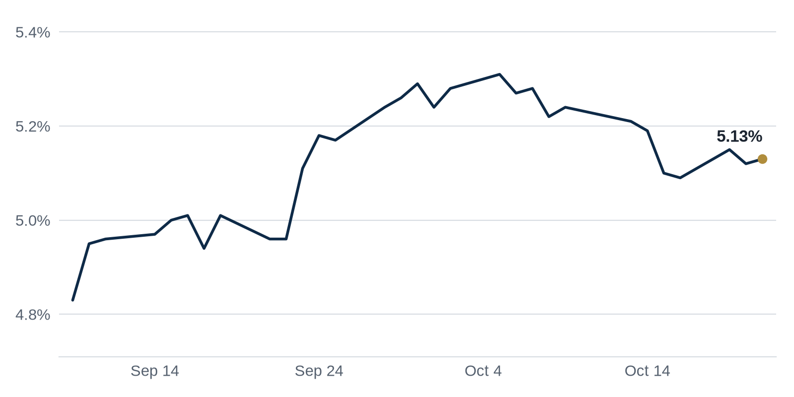

> **Review before publishing:**
> - reits: prices from Alpha Vantage only, not cross-checked (no second source; set TIINGO_API_KEY)
> - editor: fixed: Same 350 Park Avenue $3.3B Griffin deal already covered in the first Debt Markets paragraph (Commercial Observer); this GlobeSt item repeats it within the sa...
> - check/long_sentence: 43 words: **Distress Watch:** Trepp reports that as of August...
> - check/long_sentence: 31 words: **Why it matters:** When a lender forces a...
> - check/budget: Term of the Day: 66 words (budget 50)
> - check/missing_link: https://news.google.com/rss/articles/CBMiowFBVV95cUxOR3A4MW0zWEt6VXJvUUkzcTcweW9HWjY1dTFPMTlWWU1md0dRUDg5TUxBYjJlUUZLMExEYVJMdzNoM3dzcU5RXzBqUEFYUEFodjZNYlJtbmJqU2RFTkprQ2xESzlTdkdXd2xaLTNkdGRXRi1La3NEMVZFY3puRWNQYWtGY3Z1SDNNZFl1NHoxXy14dmdTdzRaUDhxUE42UlZrNjJn?oc=5
> - check/missing_link: https://news.google.com/rss/articles/CBMimwFBVV95cUxNX0JSa1FZODZ1TjZzcmlwM2gxNm55Yjh4cUNNN2QxTzJKWnFMblhXRTVnTnYyS1YyeTN1M0dRd2pqYkNjdWlpX3RHMTUtbVNoWnRuV01PUkppcmZidDljN1VyNW94YUxaN25tV0YyYmlacDR4dmp6NlZmdUxoTW9qWV9YT1YyQnVDREVJaEpjY3ktVWpJaTluQVNrUQ?oc=5
> - check/unsourced_number: Debt Markets: $635.82 billion
> - check/stale_data: Bank CRE delinquency last updated 2026-04-01

## The Brief

- A major project broke ground on the Chicago site where an earlier megaplan collapsed, testing big-project demand. [The Real Deal](https://news.google.com/rss/articles/CBMiogFBVV95cUxOMXJHajhrMThWZEdra1FwWUk5eXRwa0gyaHYtRWJ4UHc2b2tYQ1ljbTlXNEhNT1F2UWxOTmlIbm9xOVpSemdFNjRKbGxQVGJ4UWYySnFZb2dZNEM0M0kxcnZqSUlFTjl0dFhXOXpvVTVoS05tUDk0TURxM1E5dzA1dXRjdHVTbndmTy1FTHViMGhBWS1FZVpSMnVPSmY3a1VHWUE?oc=5)
- Silicon Valley office leasing hit one of its strongest quarters on record, a sign tenants are back. [The Real Deal](https://news.google.com/rss/articles/CBMipAFBVV95cUxPRHp3RmdhRVlqOEctcEFsd05BZW5KOW9jWVJRQmRjUzZ2X0JDM29BYWVpblcyaTZUdmROajYtX1hUQkt0QkUzYnZiejVOaDEteDNuTGJ5QmF2VjNnMDNUelFQaWxZMXJPUExmN1pVdW5VenJXYWhKbE1YVHozcGJnRGM1dVVicGhKTjg4cC1jMkszWnVXUTdoVEVxUjYzOE15YWRWaQ?oc=5)
- Ken Griffin locked in a huge construction loan for a new Midtown Manhattan tower, showing big lenders still fund trophy offices. [Commercial Observer](https://commercialobserver.com/2026/10/ken-griffin-citadel-350-park-manhattan/)

## The Numbers

*Rates as of Oct 21 close.*

- **10Y Treasury:** 5.13% (+1 bps)
- **5Y Treasury:** 4.95% (+1 bps)
- **SOFR:** 3.88% (0 bps)
- **Fed funds:** 3.75% to 4.00%
- **Next Fed meeting (Oct 28):** Polymarket's top outcome is No change 91.5%
- **REITs:** VNQ $91.49 (-0.9%). Best: UDR +1.8%. Worst: ADC -3.9%.
- **REIT yield vs. 10Y:** VNQ yields 3.80%, -133 bps vs. the 10Y.

**What it means:** Rates barely moved, so borrowing costs for new loans and refinancings sit about where they did yesterday, giving buyers and lenders a steady number to underwrite against.

**Why UDR moved:** No company-specific news today; it may have moved with other multifamily REITs.

**Why Agree Realty (ADC) moved:** No company-specific news today; it may have moved with other retail REITs.

## Debt Markets

Ken Griffin, in a joint venture with Vornado Realty Trust and Rudin, landed $3.3 billion of construction financing for a 66-story office tower at 350 Park Avenue in Midtown Manhattan. The loan arrives months after a public feud between Griffin and New York's mayor. [Commercial Observer](https://commercialobserver.com/2026/10/ken-griffin-citadel-350-park-manhattan/)

**Why it matters:** Lenders writing a check this size for ground-up office means they believe top-tier Manhattan space will lease, even as older towers struggle.

Related refinanced Manhattan Plaza with a $750 million loan, replacing old debt on the large residential complex with a new mortgage. [The Real Deal](https://news.google.com/rss/articles/CBMimgFBVV95cUxOclFWRWZyWFpiREtLMkp0N2xHMndDZHBGN0w2dEJwekdCcHZSeW5XMXpXUjJjeGhUaGcwRlZFSkhTSVRPRlVQbGVIYjNGd3VoVk9ENVNOcnlaa1JibFpVWEo3QlBJcHk1aXJ0amh6NWhFc0F1VFN4dnBoQS1VYUhxblVTdEVUaEtqODdUWlQ2TlVzaVEydkJIWWF3?oc=5)

**Why it matters:** A clean refinancing on a stabilized apartment property shows lenders still favor multifamily when the building has steady occupancy.

Genting Americas scored a $500 million loan to refinance the mixed-use Omni Center near Downtown Miami, three years after failing to sell the neighboring 15-acre site for $1.2 billion. [Commercial Observer](https://commercialobserver.com/2026/10/genting-miami-omni-center-wells-fargo/)

**Why it matters:** Refinancing buys an owner time to hold a property instead of selling into a weak market, keeping the asset off the distressed pile.

**Distress Watch:** Trepp reports that as of August 2026, $11.6 billion of the $635.82 billion universe of securitized multifamily loans was delinquent, and half of that sat in private-label CMBS deals (bonds backed by loans Wall Street packaged rather than Fannie or Freddie). [Connect CRE](https://www.connectcre.com/stories/private-label-cmbs-accounts-for-half-of-delinquencies-in-securitized-multifamily-loans/)

## Top Stories

### $3B Foundry Park breaks ground at former Lincoln Yards site

Developers broke ground on Foundry Park, a $3 billion project on the Chicago riverfront where the earlier Lincoln Yards plan stalled out. The restart revives one of the city's most watched development sites. [The Real Deal](https://news.google.com/rss/articles/CBMiogFBVV95cUxOMXJHajhrMThWZEdra1FwWUk5eXRwa0gyaHYtRWJ4UHc2b2tYQ1ljbTlXNEhNT1F2UWxOTmlIbm9xOVpSemdFNjRKbGxQVGJ4UWYySnFZb2dZNEM0M0kxcnZqSUlFTjl0dFhXOXpvVTVoS05tUDk0TURxM1E5dzA1dXRjdHVTbndmTy1FTHViMGhBWS1FZVpSMnVPSmY3a1VHWUE?oc=5)

**Why it matters:** A stalled site restarting tells other Chicago developers that lenders and the city will still back large, long-horizon projects.

### Silicon Valley office leasing notches second-highest quarter ever

Silicon Valley recorded its second-highest office leasing quarter on record, a sharp turn for a market hit hard by remote work. The demand points to tenants committing to space again. [The Real Deal](https://news.google.com/rss/articles/CBMipAFBVV95cUxPRHp3RmdhRVlqOEctcEFsd05BZW5KOW9jWVJRQmRjUzZ2X0JDM29BYWVpblcyaTZUdmROajYtX1hUQkt0QkUzYnZiejVOaDEteDNuTGJ5QmF2VjNnMDNUelFQaWxZMXJPUExmN1pVdW5VenJXYWhKbE1YVHozcGJnRGM1dVVicGhKTjg4cC1jMkszWnVXUTdoVEVxUjYzOE15YWRWaQ?oc=5)

**Why it matters:** Strong leasing lets Valley landlords fill empty space and push rents, which makes refinancing their buildings far easier.

### Blackstone's LivCor sells Rampart Village apartments for 33% less than 2018 price

Blackstone's LivCor sold the Rampart Village apartment complex for 33% less than it paid in 2018. The sale marks a sizable loss for one of the market's largest owners. [The Real Deal](https://news.google.com/rss/articles/CBMimAFBVV95cUxQbFBnR2QxQkxac2ZlSEMzSGJGVV9uVmpRUkotckVqU3c0RzRjaU1UZ1JrdGlUTFlNZnd2bGxYWEI4NHVSbUFhZ1JCdGlyZUpNMkhMX1dEaENFNDI5RVNnbGNNMmUwclRXbGFOckk1RXBrcmlKcFhzZjZjUVctSmxyWllQSU50Z3liX19MM1IwU0pUNTFVUjZzTg?oc=5)

**Why it matters:** A marquee seller taking a loss sets a fresh, lower comp that nearby apartment buyers and appraisers will point to.

### Johnson revives corporate head tax as $882M budget shortfall looms

Chicago Mayor Johnson is reviving a corporate head tax, a per-employee charge on larger firms, to help close an $882 million budget shortfall. The tax would raise the cost of keeping workers in the city. [The Real Deal](https://news.google.com/rss/articles/CBMipwFBVV95cUxQNlcxRC1xbDN4SWgtbTZCVUFUcTBhMG82M09KbjRVck12ZmJDeU9aX01ZYzFXUkN2Qi1vMGZodnlVeUUxa0RyeFBRT0pjN1h2cG84Sk05YnlodWViR05jMzc0RC1iQmVBd2lyRDNIYk1zWnZ5ekdEY0p5ZXUza2RZMWd1N2dSVEhHQUFxdURfYkJZUVBBVUZ4M05HOWsxRlhRMjRQWi10OA?oc=5)

**Why it matters:** A tax tied to headcount raises the cost of a downtown office, which can push tenants to shrink space or leave.

### Real Capital, Dunton Commercial buy at Denver Tech Center as office market hits bottom

Real Capital and Dunton Commercial teamed up for a bargain purchase at the Denver Tech Center, buying office space they believe is priced at the market's floor. The duo is betting values have stopped falling. [The Real Deal](https://news.google.com/rss/articles/CBMirwFBVV95cUxQNmZuRjVfSDA0Y2pzTXlPeWtNRmFCbS1KUkM5OFgxV1JyVlB0TWlnclkxTkZtaEdwdjhRUEE2R0g5ZXotbGMwcmNnLWZMbm00SkN5c0w5TXgyREV6WmZ6d0loNDVwUFVvVUpwaFZiaHFRUzllYmozTkxYSnlHVEwyanNkUWpUV0hfZy0wdHhwWUlYeFpwVWRSQnhQTDRmS1BFY0J0cDhfZXVTTHZQZUFv?oc=5)

**Why it matters:** When opportunistic buyers start calling a bottom, they give struggling Denver office owners a comp and some hope of a floor on prices.

**Coffee chat talking points:**

- Chicago is courting major new development even as an $882 million budget hole revives a per-employee head tax, raising downtown occupancy costs. [The Real Deal](https://news.google.com/rss/articles/CBMipwFBVV95cUxQNlcxRC1xbDN4SWgtbTZCVUFUcTBhMG82M09KbjRVck12ZmJDeU9aX01ZYzFXUkN2Qi1vMGZodnlVeUUxa0RyeFBRT0pjN1h2cG84Sk05YnlodWViR05jMzc0RC1iQmVBd2lyRDNIYk1zWnZ5ekdEY0p5ZXUza2RZMWd1N2dSVEhHQUFxdURfYkJZUVBBVUZ4M05HOWsxRlhRMjRQWi10OA?oc=5)
- Blackstone's LivCor sold Rampart Village for 33% less than it paid, while a Denver team calls office the bottom, so losses and bargains are landing together. [The Real Deal](https://news.google.com/rss/articles/CBMimAFBVV95cUxQbFBnR2QxQkxac2ZlSEMzSGJGVV9uVmpRUkotckVqU3c0RzRjaU1UZ1JrdGlUTFlNZnd2bGxYWEI4NHVSbUFhZ1JCdGlyZUpNMkhMX1dEaENFNDI5RVNnbGNNMmUwclRXbGFOckk1RXBrcmlKcFhzZjZjUVctSmxyWllQSU50Z3liX19MM1IwU0pUNTFVUjZzTg?oc=5)

## Market Watch

### Sun Belt

Trepp reports that $3.04 billion across 130 performing floating-rate agency multifamily loans in Texas, or 25.3% of that performing balance, shows a debt service coverage ratio below 1.0x. That means the properties' reported cash flow is not enough to cover their loan payments, even though the loans are still current. [Trepp](https://www.trepp.com/trepptalk/texas-multifamily-floating-rate-loan-stress)

**Why it matters:** A coverage ratio under 1.0x is an early warning, so Texas apartment owners with floating-rate debt may need to add cash or sell before loans go bad.

### West Coast

A lender is pushing for the sale of a Sun Valley studio owned by Blackstone and Hudson Pacific that now sits completely vacant. The move suggests the lender wants out rather than waiting for a tenant. [The Real Deal](https://news.google.com/rss/articles/CBMimwFBVV95cUxQUHdkb055WHJlT3VvdHNZcXdQMjhWTFF1dWY2eUcyNDkxZjB0MjcyX3VPLV9tdFNoQVBmZ0MwZ3lONkRwTzdxTXJ2QUI2WjAwOVNVeDRfSlowMk0zNTUxR0dJRzIwejdsSFFXOS1vcXFhdXpWanhOdjZMOXlDT1czaDVDTFpfUXlyWFlNR2IxZlYzV19BWU52UmFJdw?oc=5)

**Why it matters:** When a lender forces a sale of an empty building, it signals they have given up on a quick turnaround and will accept a lower price to exit.

### International

Canadian office availability fell to 15.1% as the pipeline of new construction shrinks. Fewer new buildings means existing space gets absorbed instead of competing with brand-new supply. [Connect CRE Canada](https://news.google.com/rss/articles/CBMirwFBVV95cUxQWC1SUUxTa2YzYmZBbXFPYmtxNVJFel9WYnAtb1d0RFZ5cC1jeFRmZXdFTWxEVEVJUGszY0I3WElXZGdVeTQycFFaZEpicUhqZ2ZGZXl6V0hKeVN2SmFqRHBTSmg1LW5GdVVUMXhkTDFacEsyMEJXc3A4eGdEWE5BRWdwQ2ZILXFCZnRVQVU3UXp1UFQ2Y3VSV0JLdHBHdC1feTJRUE1Relo1ZzRZTlNN?oc=5)

**Why it matters:** Falling availability with less new construction gives Canadian office landlords room to hold or raise rents as tenants compete for fewer options.

## Quick Hits

- Regency Centers is deepening its Dallas footprint through grocery-anchored neighborhood centers. [The Business Journals](https://news.google.com/rss/articles/CBMipwFBVV95cUxPS040Vi02TXQ4WWVjaGFwU1BjbjZtOUN6cC1kNjg0QldXVHlWa0wzdHhSX0ZuUk9vaFlxbnF6UlZ5djBoV2kxRl9mQ0k3S3FUM2tQY1AzQVIxTm1PZndGMFc5emhNV3M0RWtQWGduWktqR3p2TzRxb2IzcFl3UVdXMkdGNWlud1Q4MHJXV05JU3F3UnFGZno5UjBsbHRrbVJMNVdzWTg4SQ?oc=5) Centers anchored by a supermarket tend to hold up in downturns because people shop for food in any economy.
- The Broe Group is entering Southern California as part of a billion-dollar multifamily push. [PR Newswire](https://news.google.com/rss/articles/CBMi3wFBVV95cUxOMWJrUkljVzJlcXZlUWVMc2Y0ckxZd184WFdVNVc2dFBRRDhVeVZaX25UMTJmcjcySGRBUG8yM3lNdDNRN3RLbFNKVWpIbDNpNmR0TE82ZllIT3BNRWNYeHFJSi1aaWdMbjFkdGp5WUk4dGpJdFFUOEdfdXpYRXY3VTFNUllyaUxnTkliTnk1NmxPVGtxbzR3YzJyTVJLbmY1SmZZUzRRQnQ0LWVwOWJHZ3RMcmEwVlFzWXQzUy01YlpDV2FEMlV0Y1V1X05UbmFTaTJwc2lHemt0YlRRM3RF?oc=5) A new large buyer entering a market usually means it sees rent growth ahead that current owners may be underpricing.
- Hudson Pacific Properties cleared a major hurdle for a downtown San Francisco office-to-residential conversion. [The Business Journals](https://news.google.com/rss/articles/CBMirgFBVV95cUxOdkpRNnBWMTA1XzBSckVzeTF4cWViNDloQWd4YXFkR2p5ajBNWjg4d1p4UVRORFJtQ1BKNWExUFBoM0k3XzNXUjNXU0Q2SzRvb3VENlBCcno4dFFQdHhIVUl6QjRLeWVrOExGZXk4Mm56b011ZkJ2NHJVaHlqdS1TU1VKcE5IYzZvMG5WbHZmdGpfTHFpRVNJNTZpMmJqMG9xZHVPR1Z1Q2Z2Q2lySEE?oc=5) Turning an empty office into apartments can rescue a building's value when office demand is too weak to fill it.
- Manhattan investment sales dipped in the third quarter but still ran ahead of last year's pace. [Commercial Observer](https://commercialobserver.com/2026/10/manhattan-investment-sales-third-quarter/) Even a slowing sales market can be healthy if deals are still outpacing the prior year.
- Los Angeles County multifamily sales jumped this year while rents and occupancy held flat. [Commercial Observer](https://commercialobserver.com/2026/10/la-multifamily-investment-rent-q3/) Rising sales with flat rents mean buyers are paying for expected future income, not today's cash flow.
- Multifamily owners are leaning on operating savings to protect income as rent growth stalls. [GlobeSt.com](https://news.google.com/rss/articles/CBMinwFBVV95cUxNQTh2c1ZCZXJILWtMOHJLS3hIUkgtUWwzRTVnTmxFbzQ0YXk1RWlFNzRsbC1kNzVEWnlNQVhwcXQwajhTU0JjYm1rbEROb09qVEhmUWpxZFhGbEZBVFlQSERVV0NUQmhIYzhPVzBRekhGUlFiOFFfRWZrQmFyekVnMDR6VndxTE9Hbmg4TUU4bGdQUHl3aFFjTGFmaXBfbnc?oc=5) When landlords cannot raise rents, cutting costs is the main way left to defend profit and loan coverage.

## Term of the Day

**Sale-leaseback:** a deal where a company sells a property it owns, then signs a lease to keep using it. The seller frees up cash tied in the building while staying in place as a tenant. For example, a retailer might sell its store for $10 million and lease it back for 15 years. The buyer gains a steady rent; the seller gains capital to spend elsewhere.

For informational purposes only. Not investment advice.
