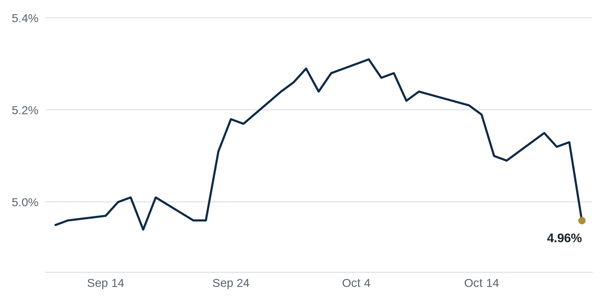

> **Review before publishing:**
> - reits: prices from Alpha Vantage only, not cross-checked (no second source; set TIINGO_API_KEY)
> - editor: fixed: Repeat: the Loop office-to-resi conversion foreclosure ran two issues ago (330 S. Wells, previous issue 2's Distress Watch); same event, new outlet.
> - editor: fixed: Source says COPA passed City Council and heads to the mayor's desk; it is not yet law.
> - check/long_sentence: 32 words: **Why it matters:** When a building's biggest tenant...
> - check/long_sentence: 32 words: **Why it matters:** Dressing financing up as a...
> - check/missing_link: https://news.google.com/rss/articles/CBMilAFBVV95cUxQUUYyakN2SlFFQmFmMGdJb3NHVWpiVWlMYmxYZU1RMmpKUGgycURDNG5wME9Qb0x2RmhpQnVfbzFZYnRTNG9oeUhoS1NaZXNxM2Y0VXZkNHhaYTktekQ5RHp4dDZSUkR5R2FyQUtIcy1iSF9Ec1JBSFVFUk1JdE1BT1JkVHJZMGY5dFp5VDU1UW9PZllY?oc=5
> - check/missing_link: https://news.google.com/rss/articles/CBMikwFBVV95cUxOd1ZnQ2h3aTlSZE53LXBWTVhXYzJWTWd2X2pvLVJTQ1NZelRiZ005dFpDS3V0MWhfU1Z1TDFZVkotTEF4Tkl0UUdFaDhGSFROUTV0Z05DZWJnMlpxYlk0UkZGaUNQb19nZHB4SzZxamZKSTNpYXE5WGxEVWs3S28xRmNMVXp5S3ZjVTdXWVlRa1JvU00?oc=5
> - check/missing_link: https://news.google.com/rss/articles/CBMiugFBVV95cUxPamdXSV9NaWNZNjVuNjJ2TU9aSDE2bm5id2lGcTNtazZZOV81Nkxscjk4dTAtb29sbFdIT29OU3l0QjVIcE42ZEVETmM3S0tKSUoyUlVZQzhyZzVNeDhtMlJCR3ZNOVdQXzk0U3RnNmxJeUNrLWZjdzR4cTJmbjl2WVljSVJMMXZsSmJ4N0xsUzgtcnNQbE8zSmJ4MmpwcUFwbDdKVWtzVWc5aUd5U3pWZ3VLMk1HbS1sY2c?oc=5
> - check/missing_link: https://news.google.com/rss/articles/CBMiogFBVV95cUxOLXNiMzZoVmM3STZwVnk4RGI1TU5QcDhBdzRtRW9yb25nazdNbVV0Qkt4MDFMYzJuWldxazNPY3FVMnZycDg0Njc0dFRLNmRBdVdneUtaWXR6UEdNUkJKV0pNXzFadGQ4U28wQ1lkZ1c0SXNBNElrRU4xN1owQ2U5MkU0NllVR0Q2MlNzT0JydldvM0RyR3V3ZENQLTAwRTBVVXc?oc=5
> - check/missing_link: https://news.google.com/rss/articles/CBMingFBVV95cUxOVi1la1NFazlpYkQ1clJiZEQ3UkhOa0NmbkxZVDVJeGNud2szQXNOX1UyeEtNSS1tQmZJUkstRnEyYUpKbnFYT3E1V2NJZ2J0QlJXQmxzZVBKWUlpdjUtTmoxTnBmd2JDaG5KTzhZUmc0a0VvM1h5YVBocXVRUkR4R0w5WUpEMFNYZlc3Yk1lRDBNem1hM1VoVHdzY092Zw?oc=5
> - check/repeat_in_issue: linked 3 times: https://commercialobserver.com/2026/10/blackstone-earnings-third-quarter/
> - check/repeat_in_issue: linked 3 times: https://www.bisnow.com/news/new-york/multifamily/copa-passes-city-council-heads-to-mamdani-s-desk
> - check/stale_data: Bank CRE loans last updated 2026-10-07

## The Brief

- Ken Griffin, Vornado and Rudin got the green light to move ahead on a new Park Avenue office tower. [The Real Deal](https://news.google.com/rss/articles/CBMilgFBVV95cUxQRkd3ZHZrR1o0dzIzcW5ONmRyY3JSZTI0UVI1WV9vUkxLbTgydXJtNEVNQnRROXhVdjhRNFRVZ1gybHZSR2hSOFIxX2xJVDIwVlpjVmVPN2FmQ1ZKSTV2ZDA3QXRkcTRyTVUxZ3lGR1VsRUQ0UDhkVHM2d3NqQkhuMTEzT2Zpc2NzbHkyQzVmM1VQNVVOSUE?oc=5)
- Blackstone's quarterly profit slipped as pricier debt squeezed its property arm, a warning for landlords everywhere. [Commercial Observer](https://commercialobserver.com/2026/10/blackstone-earnings-third-quarter/)
- New York's City Council passed a bill letting nonprofits buy troubled apartment buildings first, changing who owns distressed housing. [Bisnow](https://www.bisnow.com/news/new-york/multifamily/copa-passes-city-council-heads-to-mamdani-s-desk)

## The Numbers

*Rates as of Oct 22 close.*

- **10Y Treasury:** 4.96% (-17 bps)
- **5Y Treasury:** 4.78% (-17 bps)
- **SOFR:** 3.90% (+2 bps)
- **Fed funds:** 3.75% to 4.00%
- **Next Fed meeting (Oct 28):** Polymarket's top outcome is No change 92.5%
- **REITs:** VNQ $92.65 (+1.3%). Best: HPP +11.8%. Worst: EQIX -4.3%.
- **REIT yield vs. 10Y:** VNQ yields 3.80%, -116 bps vs. the 10Y.

**What it means:** The 2-, 5- and 10-year Treasury yields all made notable moves this week, so this was not a quiet day for rates. Lenders price most commercial loans off these yields. When they move this much, borrowing costs and refinancing math shift fast. Buyers then push for higher cap rates to protect their returns.

**Why Hudson Pacific Properties (HPP) moved:** No company-specific news today; it may have moved with other office REITs.

**Why Equinix (EQIX) moved:** No company-specific news today; it may have moved with other data center REITs.

## Debt Markets

A Trepp analysis found $802 million of securitized debt tied to Chicago-area office buildings where a major tenant's lease expires well before the loan comes due. It counted 48 leases across 30 properties, with the typical lease ending roughly 20 months before loan maturity. [Trepp](https://www.trepp.com/trepptalk/chicago-office-tenant-lease-expirations)

**Why it matters:** When a building's biggest tenant can leave before the loan matures, the owner may struggle to refinance, and the lender is left holding a weaker, emptier property as collateral.

Apartment REIT UDR set up a joint venture with Apollo that, according to GlobeSt, works more like a loan than an outright sale of its properties. The structure lets the landlord raise cash while keeping a stake. [GlobeSt.com](https://news.google.com/rss/articles/CBMimwFBVV95cUxNdC1OU0VfQ2JzUUgzWlE3eEkyS2hLUU85NmhrQzlQWXNDWHBqaUZ5VVFYSkVVRjRMQXpNbUxVaXJPelk4c081R0lkSXYzSXNQNnFydDRpTDlqQ3Q5TmRNZ1N2ZHhyYk5iaGhacExYTEpGU2dYTVBfMUQ2Ny1USEljNXdmZVN1RmRvOEg2Z3FZRE0xaVpWTUVZcVdaaw?oc=5)

**Why it matters:** Dressing financing up as a partnership lets an owner pull out cash without selling at today's low prices, a sign landlords would rather borrow than lock in a loss.

## Top Stories

### Griffin, Vornado and Rudin get the go-ahead at 350 Park Avenue
Ken Griffin, Vornado and Rudin are moving ahead with their plan for 350 Park Avenue, one of Manhattan's most closely watched development sites, The Real Deal reports. The green light clears a project that has been in the works for years. [The Real Deal](https://news.google.com/rss/articles/CBMilgFBVV95cUxQRkd3ZHZrR1o0dzIzcW5ONmRyY3JSZTI0UVI1WV9vUkxLbTgydXJtNEVNQnRROXhVdjhRNFRVZ1gybHZSR2hSOFIxX2xJVDIwVlpjVmVPN2FmQ1ZKSTV2ZDA3QXRkcTRyTVUxZ3lGR1VsRUQ0UDhkVHM2d3NqQkhuMTEzT2Zpc2NzbHkyQzVmM1VQNVVOSUE?oc=5)

**Why it matters:** A hedge fund anchoring a brand-new Park Avenue tower signals that top-tier Manhattan office space is still worth building, even while older buildings sit half empty.

### Blackstone's Q3 profit fell as higher rates hit property
Blackstone's third-quarter distributable earnings dropped 9.2 percent from a year earlier to $1.72 billion, or $1.32 a share, though results still beat Wall Street forecasts. The firm blamed part of the decline on its commercial real estate arm facing higher capital costs. [Commercial Observer](https://commercialobserver.com/2026/10/blackstone-earnings-third-quarter/)

**Why it matters:** When pricier debt dents even Blackstone's earnings, smaller landlords and funds with less cushion are likely feeling sharper pain.

### New York clears COPA, giving nonprofits first dibs on troubled buildings
New York's City Council passed COPA, which gives nonprofit groups the right of first refusal to buy more than 2,000 of the city's troubled apartment buildings, Bisnow reports. The bill now heads to Mayor Mamdani's desk. [Bisnow](https://www.bisnow.com/news/new-york/multifamily/copa-passes-city-council-heads-to-mamdani-s-desk)

**Why it matters:** Private owners of distressed buildings may see their pool of buyers shrink, while tenants could gain a path to nonprofit ownership and steadier conditions.

**Coffee chat talking points:**

- Blackstone's distributable earnings fell 9.2 percent even as it beat forecasts, so the rate squeeze is reaching the biggest owners, not just small ones. [Commercial Observer](https://commercialobserver.com/2026/10/blackstone-earnings-third-quarter/)
- COPA could give nonprofits first crack at more than 2,000 troubled NYC apartment buildings, reshaping who buys distress just as lenders press other owners to sell. [Bisnow](https://www.bisnow.com/news/new-york/multifamily/copa-passes-city-council-heads-to-mamdani-s-desk)

## Market Watch

### Sun Belt
Saks Global asked Dallas for $126 million in public support to keep its flagship Neiman Marcus store downtown, The Real Deal reports. The request shows a struggling luxury retailer leaning on a city to anchor a key property. [The Real Deal](https://news.google.com/rss/articles/CBMiowFBVV95cUxOaHNyMXNoTjV5UnlReXhxREdURmJkY0ZVdjFaYURoRmFKMjN2RzV5WHhtUlV0d3VJXzd1YXBkazh6VkJ2dll6Y1hzSEd0Wlh4MG5kSGJWRUJCU1FzaXlIUHRTb3lsRjdKQzJmX2hHUndXQXVvQ1BkdGx2UUI1akcxclUwek5WOUpnaEJ2aUJ6cFJMM3pZd0EzeXppa0hfZ1pHSUtR?oc=5)

**Why it matters:** If Dallas pays to keep the store, it protects downtown foot traffic and nearby property values; if it refuses, a large retail space could go dark.

### West Coast
Los Angeles County multifamily sales climbed 44 percent year over year to $3.3 billion, The Real Deal reports, a sign buyers are returning to apartment deals in the region. [The Real Deal](https://news.google.com/rss/articles/CBMikAFBVV95cUxPSnh6V1BEcmNfYzFCTjA5RHJlaEpzOHgyb3VnM1dPbHhBRDBKcUE2cWpVZTJqV3ZnZW9POTlJUW9KOVZYaFhTVkV0X25pQ0MwM2h6WUppWFhyRS1zV1VnN2JJREtVWTdnRDZIZUkyOEM0Mm5ncHZyOXFvVDcyeDQzeXY5cG9ZSjFia2FMeUx6dy0?oc=5)

**Why it matters:** More deals closing means buyers and sellers are agreeing on prices again, which gives apartment owners clearer values to point to when they refinance or sell.

### International
Developer Tim Gurner unveiled a $1.75 billion plan to remake Geelong, Victoria's second city, pitching a Dubai-style waterfront precinct, the Australian Financial Review reports. [AFR](https://news.google.com/rss/articles/CBMiwAFBVV95cUxNTm5HcFN5Z3U5WncxX0JFZERxRWh1QUVVb2lYUVBrYXFpUDhtdlFtd2JLSmJFYWhLcmV0dWR4N3huakl6ZDFHVWQwVFBCNDZmVnF1SWs4aGRNaDc3ZXo3SFVHVnRHZ1A2TFdhdUFTbEg4RE56WDItSl9JUTd6aG5TVjJxaFMxVGloZGRQR1FCN0hWOHlfZ051YTBKNUZJeXpQZ19EcVVSekcyQ3Q5U2c2eVkzY2hYaXk3d2xaWi10TkY?oc=5)

**Why it matters:** A bet this size on a smaller city tests whether investors will fund ambitious projects outside the biggest metros while borrowing stays expensive.

## Quick Hits

- CBRE beat earnings estimates with $2.05 in core quarterly EPS, yet its shares slid about 3 percent as leasing lagged. [Commercial Observer](https://commercialobserver.com/2026/10/cbre-q3-earnings-leasing/) CBRE earns fees for arranging leases and sales, so slow leasing signals tenants are still hesitant to commit to space.
- SL Green's roughly $2.5 billion plan to sell properties ran into higher interest rates that cooled buyer demand, Bisnow reports. [Bisnow](https://www.bisnow.com/news/new-york/office/sl-green-q3-earnings-office-leasing-interest-rates) When rates climb, buyers can borrow less, so even Manhattan's largest office landlord draws fewer and lower bids.

## Deals of the Week

- SL Green sold 10 East 53rd Street to Jeffrey Kaplan's Meadow Partners for $312.2 million in August, part of a disposition strategy that lifted its third-quarter cash flow. [Commercial Observer](https://commercialobserver.com/2026/10/sl-green-realty-q3-earnings/)
- Tishman Speyer and Bouwinvest launched a joint fund targeting top-tier U.S. office properties, and its first purchase was Manhattan's Chrysler Building. [Commercial Observer](https://commercialobserver.com/2026/10/tishman-speyer-bouwinvest-us-office-fund/)

## Term of the Day

**Mezzanine debt:** a loan that sits between the senior mortgage and the owner's equity. It gets repaid after the main lender but before the owner, so it carries higher interest to match that extra risk. On a $10 million purchase with a $7 million mortgage, mezzanine debt might cover part of the remaining gap.

For informational purposes only. Not investment advice.
