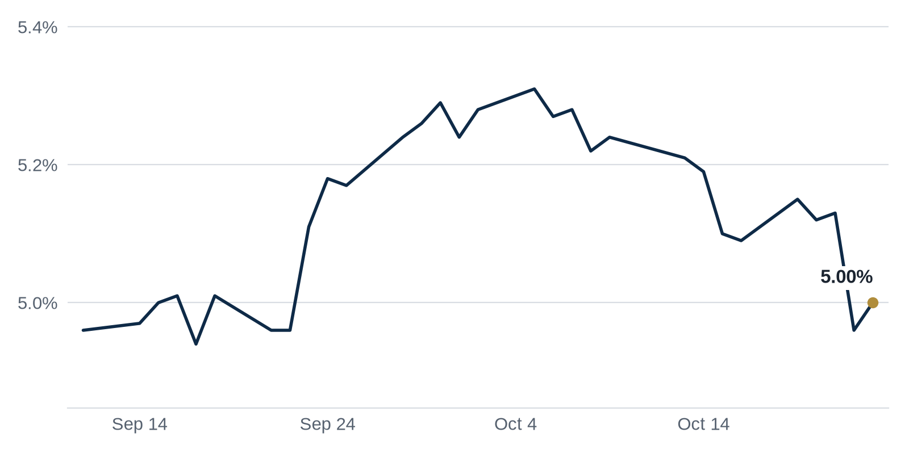

> **Review before publishing:**
> - editor: fixed: COPA passing was a Top Story in the Friday issue (last 3 issues); repeating it here is a repeat angle.
> - editor: fixed: The source title/summary does not state Broe is Denver-based; place not in source.
> - editor: fixed: Superlative 'country's largest data center market' is not stated in the source title or summary.
> - check/long_sentence: 32 words: **Why it matters:** fewer closed deals mean fewer...
> - check/long_sentence: 32 words: **Why it matters:** Northern Virginia landlords and power...
> - check/long_sentence: 31 words: The Real Deal **Why it matters:** an out-of-state...
> - check/missing_link: https://commercialobserver.com/2026/10/community-opportunity-to-purchase-act-passed-mamdani/
> - check/missing_link: https://news.google.com/rss/articles/CBMiqAFBVV95cUxOcDBUZHVwbkdRUnpBU2ZGSVF1dFpDM2JRUXpuT2podmpZWWhJNnlXcTY4OFdIcVpfWTdsdjVxVGp0QmNpLWVySXJQaFdDU0pEdm1pb0xnZWRTOFBLTkFPRkh3QkFWNzFBQy1YLUMydjlKN1h6M3RfSmkxX3ZWSXlvOXRFTVVFRXVLVHRkUUtua1dOVmRLcXViTm9oTmZ1WjJ4bGowMUYzYXc?oc=5
> - check/missing_link: https://commercialobserver.com/2026/10/cmbs-sasb-conduit-2026/

## The Brief

- Blackstone is marking down building values as higher rates make selling harder, a warning sign for other landlords. [GlobeSt.com](https://news.google.com/rss/articles/CBMingFBVV95cUxNV1Bzci0tTGpwZjdVMDdzUS0yME1zZzlNNTVrc1NXcXBDT3VUcWNJWDFWSG5rV05fMGtZY3owTGNWcDJ2b004WElybGN1RzJPN1hzZmlocEZTeUV5Wm8xLXA5VE9mZER5LTVCY0d3RnVLYk5pZWVqaFJtUGpVclUyZXlLaUFtbEwtNlRndFpnTXJ1QWliRG05QnBTRHkyZw?oc=5)
- Washington moved to block large investors from buying single-family homes in bulk, changing who competes for houses. [Bisnow](https://www.bisnow.com/news/national/affordable-housing/treasury-introduces-rule-blocking-institutional-investors-from-bulk-buying-homes)
- Amazon walked away from a Northern Virginia data center site, a sign even AI demand has its limits. [The Real Deal](https://news.google.com/rss/articles/CBMipwFBVV95cUxONU1oNFlFbGQ0Rk5aTGZXWmo1c2xQa1dPU3U5MEZ1TnBhVU1ObHJZeE1Bd0hBN0dtVGdpMEc5czFjQUZlSU95a3FkNkJNREN4TWY0YzBHd3N6RXJ2UVgxR3ZzSTFKdGZPWWZlR29SRTdFQTllRTBUSzRLNktRMWtkeFJGSWJFcWR6V00zdFM2V3J1azhZUG9XaW5ydGsyX0FxdXVFVTRTZw?oc=5)

## The Numbers

*Rates as of Oct 23 close.*

- **10Y Treasury:** 5.00% (+4 bps)
- **5Y Treasury:** 4.82% (+4 bps)
- **SOFR:** 3.92% (+2 bps)
- **Fed funds:** 3.75% to 4.00%
- **Next Fed meeting (Oct 28):** Polymarket's top outcome is No change 92.5%
- **REITs:** VNQ $92.69 (0.0%). Best: HPP +4.0%. Worst: ESS -1.5%.
- **REIT yield vs. 10Y:** VNQ yields 3.80%, -120 bps vs. the 10Y.

**What it means:** Rates were little changed, so borrowing costs for new loans sit about where they did last week. Buyers face the same math on financing a deal as they did a few days ago.

**Why Hudson Pacific Properties (HPP) moved:** No company-specific news today; it may have moved with other office REITs.

**Why Essex Property Trust (ESS) moved:** No company-specific news today; it may have moved with other multifamily REITs.

## Debt Markets

CBRE warned that deals are being repriced and capital markets are slowing. Repricing means buyers and lenders are lowering what they will pay or lend because rates have stayed high. Sellers who expected last year's prices are being met with weaker offers. [GlobeSt.com](https://news.google.com/rss/articles/CBMimwFBVV95cUxONVYySTU5emNyalFSWDhwTi1mMU14ci1UQU9FZ19WOS0yVU1UbnFpb2x2WGJiRnU1VG5Ga2Y0V216UnFocmhvQnVLa3FubFBnNjRGTEEwaTJuRnJKYmRKMFlsT2Y0RjNxWHN6Qkc3NnlpNVJCcE1ONWhxMHRnTC1hOXZLOEkwZEIzYWxSZm8xRkpQOVlTMjJGQmYwNA?oc=5)
**Why it matters:** borrowers refinancing now face tougher terms, and some sellers will have to accept less or wait.

Apartment developers who borrowed cheaply a few years ago face a refinancing crunch as those loans mature at higher rates. Refinancing means replacing an old loan with a new one, and the new one costs more. [Scotsman Guide](https://news.google.com/rss/articles/CBMijAFBVV95cUxQRGJPLXBaaEVGd2NLdGJTa2FmaFhNRHhaWG5PSWZTUjZqN2t5LWlHamdpZmg5ZmIzMjk1YXAxeXF4OU1PUU8wbGstZ0tUQnk4dlVfbG8xVnZLV1V6TGlUUWpxYVNlSWkycFhlUkdrVi1HMEI3ODg0S2FiWURGb2RDbldPNjFvODZhVDg4RQ?oc=5)
**Why it matters:** owners may need to put in fresh cash or sell, giving well-funded buyers a chance to pick up apartments at a discount.

KDC is seeking $3.5 billion in credit tenant lease debt for AT&T's headquarters. A credit tenant lease loan is backed mainly by the rent from a strong tenant rather than the building itself. [Yahoo Finance](https://news.google.com/rss/articles/CBMiiwFBVV95cUxOSWZjZDBwX1Rrc1Y5WWpGSTB1MjFEczNUQW1pUzQwVTFHSXlBa3lnaGJ1ZG80dnNpY1JPWW16NDcxVlhQdDU1aVdDS2hwNWxpWC1FRVJ1dVNfSU9Tb2tQbUl1QmVCbjNZNUhZQVlMYVRPRmdnS04xOGlmS2FlVGl3UGVXX0I1d1VUSlM4?oc=5)
**Why it matters:** lenders will still write huge checks when a dependable tenant signs a long lease, showing credit quality now drives who gets funded.

**Distress Watch:** Trepp reports $2.24 billion in securitized seniors housing debt across 156 loans reaches hard maturity between November 2026 and December 2027. A hard maturity is a loan with no extension options left. Agency-backed loans make up more than 95% of the balance. [Trepp](https://www.trepp.com/trepptalk/seniors-housing-faces-2.24-billion-in-hard-maturities-through-2027)

## Top Stories

### Blackstone marks down property values

Blackstone cut the carrying values on some holdings as higher interest rates make it harder to sell buildings at the prices it once expected. The report frames it as rate pressure squeezing the firm's exits.

**Why it matters:** when a major owner like Blackstone lowers its own marks, lenders and rival funds read it as a sign values have further to fall. That makes refinancing harder for everyone. [GlobeSt.com](https://news.google.com/rss/articles/CBMingFBVV95cUxNV1Bzci0tTGpwZjdVMDdzUS0yME1zZzlNNTVrc1NXcXBDT3VUcWNJWDFWSG5rV05fMGtZY3owTGNWcDJ2b004WElybGN1RzJPN1hzZmlocEZTeUV5Wm8xLXA5VE9mZER5LTVCY0d3RnVLYk5pZWVqaFJtUGpVclUyZXlLaUFtbEwtNlRndFpnTXJ1QWliRG05QnBTRHkyZw?oc=5)

### Treasury moves to block bulk home buying

The Treasury Department and President Trump introduced rules to limit institutional investors from buying single-family homes in bulk. The move targets large funds that have bought houses to rent them out.

**Why it matters:** fewer big buyers competing for houses could ease pressure on first-time buyers, but build-to-rent operators and the funds behind them lose a growth channel. [Bisnow](https://www.bisnow.com/news/national/affordable-housing/treasury-introduces-rule-blocking-institutional-investors-from-bulk-buying-homes)

### NYC investment sales cool in Q3

New York City investment sales pulled back in the third quarter after $16 billion in volume, as rate swings made buyers and sellers slow to agree on price. The slowdown followed a busier first half.

**Why it matters:** fewer closed deals mean fewer fresh comps (recent sale prices used to value nearby buildings), so owners trying to refinance have less evidence of what their property is worth. [GlobeSt.com](https://news.google.com/rss/articles/CBMisgFBVV95cUxNVzQzRGd2WnZSX0c5ZWhwVlF0cHBpYURJaWF1b0VwQ0F6bVpiN1Y5TklKZ0JLaFFCamlXcWRfQ013aHNfaVJyMHhSTXItaW81cHdjSENkY05FZFZKZ1VkeFdqUVAxVHllRW9yUmw1elg3dmpWN3V5YWlzUzFqSXhXNkhMZnNSYVFpUFRxQkdlNUUzVTJnTlNXLXJWVjI1QUUydlVraExsWk41YTIwUEJGZGZR?oc=5)

### Amazon drops Northern Virginia data center

Amazon backed off a Northern Virginia data center plan months after buying the site.

**Why it matters:** Northern Virginia landlords and power utilities counting on endless data center demand now see that even the biggest tenants will pause, which can cool land prices in the area. [The Real Deal](https://news.google.com/rss/articles/CBMipwFBVV95cUxONU1oNFlFbGQ0Rk5aTGZXWmo1c2xQa1dPU3U5MEZ1TnBhVU1ObHJZeE1Bd0hBN0dtVGdpMEc5czFjQUZlSU95a3FkNkJNREN4TWY0YzBHd3N6RXJ2UVgxR3ZzSTFKdGZPWWZlR29SRTdFQTllRTBUSzRLNktRMWtkeFJGSWJFcWR6V00zdFM2V3J1azhZUG9XaW5ydGsyX0FxdXVFVTRTZw?oc=5)

### Audi plans $4B Georgia plant

Audi intends to invest about $4 billion in a manufacturing site at the 1,534-acre Middle Georgia Megasite in Peach County, near Interstate 75. It would be the first venture at the state-owned site.

**Why it matters:** a plant this size pulls in suppliers, warehouses and workers, so industrial and multifamily developers near the highway gain a reason to build. [Connect CRE](https://www.connectcre.com/stories/audi-building-4b-plant-in-c-georgia/)

**Coffee chat talking points:**

- With Blackstone marking down values and NYC sales pulling back after $16 billion in Q3 volume, buyers look like they are waiting for cheaper entry points. [GlobeSt.com](https://news.google.com/rss/articles/CBMisgFBVV95cUxNVzQzRGd2WnZSX0c5ZWhwVlF0cHBpYURJaWF1b0VwQ0F6bVpiN1Y5TklKZ0JLaFFCamlXcWRfQ013aHNfaVJyMHhSTXItaW81cHdjSENkY05FZFZKZ1VkeFdqUVAxVHllRW9yUmw1elg3dmpWN3V5YWlzUzFqSXhXNkhMZnNSYVFpUFRxQkdlNUUzVTJnTlNXLXJWVjI1QUUydlVraExsWk41YTIwUEJGZGZR?oc=5)
- Audi's $4 billion Georgia plant shows factory capital still flows freely even while office and data center bets are cooling. [Connect CRE](https://www.connectcre.com/stories/audi-building-4b-plant-in-c-georgia/)

## Market Watch

### Sun Belt

Publix has gone on a retail buying spree topping $100 million, expanding its South Florida footprint. It is buying shopping centers it used to just anchor as a tenant. [The Real Deal](https://news.google.com/rss/articles/CBMimwFBVV95cUxQZnZCbng0RzF0ZHVsSWV3UEFBZjVvb280emVDZVdhNDhhT2RnWnhyQ3dnWGE2MHhFRk5RTkZhVUpHSlN2NkJDMFJCZHU4ZFZoYXpyaUJqQ2Mtb1NseWVBUktPSVBfM044NzdPdi11bHE3VW9jQ2ZfQnhyVFBjZGNxUVNpWDMwT3pyWGdIQmUxWFdUVVRmVVlHNE9OSQ?oc=5)
**Why it matters:** when a grocer owns the whole center, it controls the tenant mix and rents, and rival landlords lose a reliable anchor to lease to.

### West Coast

Broe entered Southern California multifamily with a $148 million apartment purchase from Greystar. The deal marks the firm's first move into the SoCal rental market. [The Real Deal](https://news.google.com/rss/articles/CBMikgFBVV95cUxOUjBrclBzTjk3eHJoQjlEZjRSdW5JOUw5aWhFUzZWMF9ZajU1UDlOZXdpOVhNR0tQVmhhX3BSRExYRmtJY3BlaXZreTVMRGpIQ2pMMWZlUDlVMTZjbW03cXZXUlVMem9rM05QYkFHa2RrMElXWkpsek5DVE9jdzY0dG9BSHJZbmhWZ1NIdXkyamVWQQ?oc=5)
**Why it matters:** an out-of-state buyer paying up for SoCal apartments signals investors still see rent growth there, which gives local owners a fresh comp to lean on.

### International

A group of Singaporean investors bought Sydney's Salesforce Tower for $864 million, a lift for Australia's office market. The purchase ranks among Sydney's larger recent office trades. [AFR](https://news.google.com/rss/articles/CBMivgFBVV95cUxQNnV1aGhMUkZPeHdPRElER1EyRGlRQWxrSUxzV3AzVUpGc3hvMDVSWTlzT1YzdVZ2RVBZTjVyTVpFRV81S2NhYU5abklLbEM0Y2dBR2IzMnI0NThTaXNBQTdtMTRzSTZDenpnaGJtT19jeTNiQU9LMEUyTDZIMndIeV90NEhEUFlEMHpqeWZua2x1TC00OFF4QVVKdDZNVEhxU1lGb2hCOGtac01nbjRkR0RGSlBRSW1SMUdtTWJn?oc=5)
**Why it matters:** a large cross-border office purchase suggests overseas buyers think Sydney values have bottomed, which can lift confidence in other gateway-city towers.

## Quick Hits

- Downtown Seattle office leasing hit an 8-year high. [Axios](https://news.google.com/rss/articles/CBMilgFBVV95cUxPYXVFZVVTYTliOTRLQU9xN0x3YTV6d2EwMkQwdzFVNHpycEsxNnVYMHFzOXFkeVVGN0lVVlhCcHlfOTRWdExyeV8yanc3b0loZ3VFNHpIS3VibmhFcHVCTWwtbzNPSWVyWUZHSHlHTFFEaU01NlYyOU05a3JRWVBEWk1tbE8yQV9qOHk5dTU1T1JhZzVYZlE?oc=5) More tenants signing space downtown suggests companies are pulling workers back in, which helps landlords fill empty floors.
- SL Green's Q3 FFO rose to $122.1 million on Manhattan sales. [Yahoo Finance](https://news.google.com/rss/articles/CBMiiwFBVV95cUxNOXZLczdXcUNiaktWRldkbmZkYlpzdHZrWGNIS3RKZkdWOUYzRlZMU0NxbWN3R3RSVDU0TmJKX1hpZU5iVzhUVDU0UmJJZUVVQmoyeUlwaktPZzBZRllHRXlHanJKZjdRd0s1WUsxMnlBX1B6bVNONVNFbFR6SHp4SGUza0gtWmpTM1ZF?oc=5) FFO (funds from operations, a REIT's main profit measure) rising shows the landlord is still earning even in a slow market.
- Commercial Observer's Sunday Summary says the market is slowing and speeding up at the same time. [Commercial Observer](https://commercialobserver.com/2026/10/sunday-summary-market-slowing-down-speeding-up-how-about-both/) Mixed signals mean investors should judge each property type on its own rather than call one trend for the whole market.

- BKM Capital is pressing ahead with a $3 billion light industrial buying spree. [Bisnow](https://www.bisnow.com/news/national/industrial/bkm-capital-partners-3b-light-industrial) Its appetite for small warehouses signals investors still believe in steady demand for local distribution space.
- Apartment concessions now appear at nearly one-third of properties nationwide. [GlobeSt.com](https://news.google.com/rss/articles/CBMiqAFBVV95cUxQQ2p6Y0F5V3EyQmhkc09zOTR4NzhaZWc2Yl9uSFpyWFo0Y25yNVF0cTJ4bjlLRDJjVDFjeE1KbmRmYnA3Ti1uZUV3cTdvdHVaRUY2andFU3lPTndYaUt2aktJS3NkWnNpWjY5UzVOcUlSMGYyVWRHVmgzZkpmLXhvemdBVFp3N3JvOVFVQWFpUU9GTVV0TjF0Yy1tb3FhaVZqT2tLeW5pbTg?oc=5) Concessions (free rent or perks to sign a tenant) spreading means landlords are competing harder, which helps renters and warns owners.

## AI Infrastructure

The Wall Street Journal reports that a once-obscure corner of commercial real estate is now riding the AI boom. Demand for the space and power that AI computing needs has turned a quiet niche into one of the market's hottest asset types. [WSJ](https://news.google.com/rss/articles/CBMiwgFBVV95cUxPT01JcnVxaWtJSkFvcUpJV3U1RFlhbWZ2MmNORldJbmpCTy11Wk92Z0ZUeUduQUdNNXlzRFdLQkotWHdjNnR5dTBUa3RvNnV6ZlFBUTNpUzRIRWlPczNGbS0zMHN6MXhZMUgyNERISXNKMW13bTZhYkdLRzg4aHdDLUMxcUJxZDNPNW5RZXF6QlU0SmJaZFlVa0Y0N2VXbTg0UDdZM1lhaUFkamJfUmdoSlRaTV9pcFhHQXV2eUJNT3duZw?oc=5) Owners of these sites gain pricing power, while tenants and utilities absorb the cost of the extra power and construction.

## Term of the Day

**Class A, B, C:** a simple grading system for building quality. Class A is the newest, best-located space and charges the highest rents. Class B is older but solid. Class C is dated and cheap. A landlord who renovates a Class C building up to Class B can raise rents and win better tenants.

For informational purposes only. Not investment advice.
