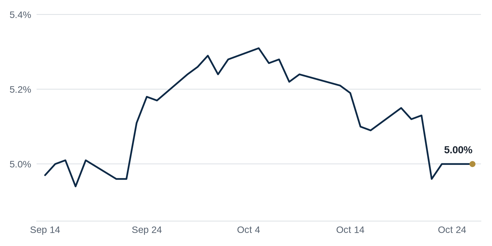

> **Review before publishing:**
> - reits: prices from Alpha Vantage only, not cross-checked (no second source; set TIINGO_API_KEY)
> - editor: fixed: Source title says only 'mixed-use project'; 'entertainment and hospitality' is not in the title or summary.
> - editor: fixed: 'experiential' and 'supply-constrained' are characterizations not supported by the source title/summary.
> - check/missing_link: https://news.google.com/rss/articles/CBMimAFBVV95cUxQRGVmSjl5SGx1UUJ0bElLX3U0WEpPbjFOLU9qSFp5NlA4dDRvUVdVU25GOEZHS2ZfTmVFcmhKc2lkSTRzcEZHZmotcktZdHpocTJWbkFGN2dqbG9DeFY5TFo5eWZZM1ZnU3BZekRiNFB4OFJ4WnpVRzVyY0RmdHFsWTBMUWxHTzQ5LVRBZ3dHWXNjSk9xV2ZtSA?oc=5
> - check/missing_link: https://www.bisnow.com/news/south-florida/capital-markets/madison-realty-capital-fortune-international-st-regis-sunny-isles-beach

## The Brief

- A Texas county is sweetening incentives to win a giant Tesla solar factory and its industrial demand. [The Real Deal](https://news.google.com/rss/articles/CBMiowFBVV95cUxQN3F0eWJ2cXcxZ3dYcWlJX0poVTV4R1I3S2dNWnVaX1ZYN21PenlvSGh1dnRTM0lvT3o4Y2l5X1lVeEF4U3laSWltSjJfSnJiSm1VOE5kbDBpZGJ4Qmdpb2xCQlppX2ozaGhTSGp1ZnUyZjZmWWo0RUZvV3JoVkZaOWhRbEJXQld6U0Z2STNvMzJCNkZYcjVuS3VMcDQ4dmdpVzFr?oc=5)
- A wave of maturing commercial mortgages is opening the door for lenders sitting on cash to deploy. [CNBC](https://news.google.com/rss/articles/CBMijgFBVV95cUxOTGpXSWQ2cDVKaVA5ZXBPOUljYmtIeXR2dmN0MV9OTzF4TXo4a3g4NDBqYkp4ZXRvYlBZVkwzZjhRYWM3cDJHbzY0NGtod2NValdnMm01WXJZVUNYT0s1bllwY3paNy1OUEgweFZUUEtGYUhNYndoNkRCWXF4amxCb3FITGFpNmxnQ2lOQUZB0gGTAUFVX3lxTE4zb21zWTZkU1l4QlNCNXJrbXZqOU1fNzE3UVBFd01LT3dzeWJ3MFlla0xSQXVRTGxncEgyS2s4aXRzZU1TRUV6MEp1cHhIQ3J6Uk0xOWxaU0Foc2RzMjZmbUpyVjRmZ01Ta3BwVHNiUTB1aVBnZ0ppbVNzTElZT2hEWEdzV0lXZmZpRE1xdmNZQnVKYw?oc=5)
- An AI firm is buying more San Francisco office space from Meta, a rare bright spot downtown. [The Business Journals](https://news.google.com/rss/articles/CBMingFBVV95cUxPSFFMbWo4dWJ4YkhoNDFiYjAzVGRUUk5zX1RoM1NqbDQ3bWplYklXOWgxX05Lcy1DeEk1M0FJeDVkemlQV1Q5TElwZFE0eno0ZERRZi1Gc1ZQYkN2Ny1kUmlxM3IwcUFPQncxMjVvVHR6dUZKd1owQUZPNjQxbEJIX0VTYzd1Y2d6bC0tcUZDMUtLTkt1V1d5T0FRZ1k2dw?oc=5)

## The Numbers

*Rates as of Oct 26 close.*

- **10Y Treasury:** 5.00% (0 bps)
- **5Y Treasury:** 4.84% (+2 bps)
- **SOFR:** 3.93% (+1 bps)
- **Fed funds:** 3.75% to 4.00%
- **Next Fed meeting (Oct 28):** Polymarket's top outcome is No change 94.2%
- **REITs:** VNQ $93.17 (+0.5%). Best: HPP +3.4%. Worst: ESS -1.1%.
- **REIT yield vs. 10Y:** VNQ yields 3.80%, -120 bps vs. the 10Y.

**What it means:** Rates were little changed, so borrowing costs are holding steady and buyers can price deals off a level they already know.

**Why Hudson Pacific Properties (HPP) moved:** No company-specific news today; it may have moved with other office REITs.

**Why Essex Property Trust (ESS) moved:** No company-specific news today; it may have moved with other multifamily REITs.

## Debt Markets

Fortune International Group and Château Group secured a $463 million construction loan from Madison Realty Capital for the St. Regis Residences in Sunny Isles Beach, Florida. The package refinances existing Bank OZK debt and funds two 62-story oceanfront towers. [Commercial Observer](https://commercialobserver.com/2026/10/madison-realty-st-regis-condo-sunny-isles-fortune-international-chateau/)

**Why it matters:** construction lenders will still write large checks for luxury condos in strong coastal markets, even with financing expensive.

A big stack of commercial mortgages is coming due, and investors tell CNBC they see a chance to buy loans and assets at a discount. The idea is that owners who cannot refinance will have to sell. [CNBC](https://news.google.com/rss/articles/CBMijgFBVV95cUxOTGpXSWQ2cDVKaVA5ZXBPOUljYmtIeXR2dmN0MV9OTzF4TXo4a3g4NDBqYkp4ZXRvYlBZVkwzZjhRYWM3cDJHbzY0NGtod2NValdnMm01WXJZVUNYT0s1bllwY3paNy1OUEgweFZUUEtGYUhNYndoNkRCWXF4amxCb3FITGFpNmxnQ2lOQUZB0gGTAUFVX3lxTE4zb21zWTZkU1l4QlNCNXJrbXZqOU1fNzE3UVBFd01LT3dzeWJ3MFlla0xSQXVRTGxncEgyS2s4aXRzZU1TRUV6MEp1cHhIQ3J6Uk0xOWxaU0Foc2RzMjZmbUpyVjRmZ01Ta3BwVHNiUTB1aVBnZ0ppbVNzTElZT2hEWEdzV0lXZmZpRE1xdmNZQnVKYw?oc=5)

**Why it matters:** borrowers who cannot roll over their loans may be forced to sell, handing cash-rich funds cheaper entry points and squeezing current owners.

Single-asset, single-borrower deals made up 76 percent of 2026 private-label CMBS issuance through September, with money rotating out of office and retail into apartments and hotels. CMBS bundles mortgages into bonds sold to investors. [Commercial Observer](https://commercialobserver.com/2026/10/cmbs-sasb-conduit-2026/)

**Why it matters:** when bond buyers prefer one large, well-known building over a pool of many loans, smaller and weaker properties find it harder to get financed.

**Distress Watch:** The Worldgate Centre in Herndon, Virginia sold for $28.2 million at a competitive foreclosure auction. [The Business Journals](https://news.google.com/rss/articles/CBMiowFBVV95cUxPX1B4eXhScnJ1cXRtajdsdEFDaXJMTkc4TjlDWnUtTEhWNllPUndGLUhJckhXbEtyRE9hZlhsMEhyUUtZZWo3bWlmQUpVVnBUanhqTl9NZENHeENkVjVFUVBneHZ2NFR0bnZSR0UwQnhubE9XUjZXMzNHUTNacHBpUGlFU0FvR1lpNENITC0yMnd5ZEFZM0Eyem1hTzJHLV9OOWN3?oc=5)

## Top Stories

### Texas county courts a $10B Tesla solar plant

Fort Bend County, Texas is sweetening its incentive package to land a $10 billion Tesla solar factory. Local officials upgraded their pitch to beat out rival sites.

**Why it matters:** a plant this size pulls in suppliers, warehouse demand and workers, which can lift land values and industrial rents across the county. [The Real Deal](https://news.google.com/rss/articles/CBMiowFBVV95cUxQN3F0eWJ2cXcxZ3dYcWlJX0poVTV4R1I3S2dNWnVaX1ZYN21PenlvSGh1dnRTM0lvT3o4Y2l5X1lVeEF4U3laSWltSjJfSnJiSm1VOE5kbDBpZGJ4Qmdpb2xCQlppX2ozaGhTSGp1ZnUyZjZmWWo0RUZvV3JoVkZaOWhRbEJXQld6U0Z2STNvMzJCNkZYcjVuS3VMcDQ4dmdpVzFr?oc=5)

### Trepp: prices steady, credit under pressure

Trepp and Commercial Real Estate Direct's Q3 2026 Quarterly Data Review finds property prices stabilizing while credit conditions tighten again. The report tracks where market momentum is holding and where it is meeting resistance.

**Why it matters:** steadier prices give buyers and sellers a clearer floor, but tighter credit means refinancing a maturing loan still gets harder. [Trepp](https://www.trepp.com/trepptalk/q3-2026-quarterly-data-review)

### $600M twin towers pitched near Dallas's Katy Trail

Jonas Woods and the Ignite-Rebees founders proposed a $600 million two-tower project near the Katy Trail in Dallas. The plan adds a large mixed-use development to a popular stretch of the city.

**Why it matters:** a bet this big says developers still see tenant and buyer demand in the Sun Belt despite high construction costs. [The Real Deal](https://news.google.com/rss/articles/CBMikgFBVV95cUxPQzlGdmZiQXpMaWc1b0xhZmd3ZVA4RjNlaW4yVTB4ZmVJbFpTNXpXQ2dCVFhvSkRZTVBTbWVmZ3A0WDA2MkhvNmc2Si1kbXU4cXl4TGdwekVkTXBSQ3J2UHhmT1d5RXY4SDhaQjFiUnVUem0xbDhiMFQxVTUzYjdCcU81TFRDOUNELUktS3U4WFRzUQ?oc=5)

### Anthropic buys more SF office from Meta

AI company Anthropic is acquiring additional San Francisco office space from Meta ahead of a potential record IPO. The deal expands its footprint in a city still working through heavy office vacancy.

**Why it matters:** a growing AI tenant soaking up space is a rare win for a downtown market that has struggled to fill its towers. [The Business Journals](https://news.google.com/rss/articles/CBMingFBVV95cUxPSFFMbWo4dWJ4YkhoNDFiYjAzVGRUUk5zX1RoM1NqbDQ3bWplYklXOWgxX05Lcy1DeEk1M0FJeDVkemlQV1Q5TElwZFE0eno0ZERRZi1Gc1ZQYkN2Ny1kUmlxM3IwcUFPQncxMjVvVHR6dUZKd1owQUZPNjQxbEJIX0VTYzd1Y2d6bC0tcUZDMUtLTkt1V1d5T0FRZ1k2dw?oc=5)

### GID and StepStone close $985M warehouse deal

GID Industrial and StepStone Real Estate closed a $985 million transaction for an 8 million-square-foot industrial portfolio. The sale is one of the year's larger logistics trades.

**Why it matters:** institutions paying nearly a billion dollars for warehouses signals they still expect logistics rents to keep climbing. [Citybiz](https://news.google.com/rss/articles/CBMizgFBVV95cUxON1ljcUdKQXZfMDkwdWlRV0ZWRGxOZUpYR0pYNTNlWUJFTDVwVnhjZUNUU091Q0FheFg3TlV3OTZ5cU9PQTRqMnVKRlVqMl9ZbW05MmVzOVlYeWFCR2NkVEhzREJNbDdkbFZDbjVQMmhMUGVZSnJSWUFnanJkRnZUVjNtOFRrX2ZZdkZnaWY0OHJ2VEgtb3NGcUZhQnhERGtocWdjdjlicEpaLUJVSHJ1ZWZLSS1Zbi1KaXpWN2Fha0tXOWdfeGZnb05hdlN0dw?oc=5)

**Coffee chat talking points:**

- Capital is crowding into trophy assets: SASB deals are 76 percent of 2026 CMBS issuance, the same flight to quality steering tenants toward prime office. [Commercial Observer](https://commercialobserver.com/2026/10/cmbs-sasb-conduit-2026/)
- Industrial keeps drawing big checks: GID and StepStone closed a $985M warehouse portfolio while Amazon's same-day push reignites last-mile demand. [Citybiz](https://news.google.com/rss/articles/CBMizgFBVV95cUxON1ljcUdKQXZfMDkwdWlRV0ZWRGxOZUpYR0pYNTNlWUJFTDVwVnhjZUNUU091Q0FheFg3TlV3OTZ5cU9PQTRqMnVKRlVqMl9ZbW05MmVzOVlYeWFCR2NkVEhzREJNbDdkbFZDbjVQMmhMUGVZSnJSWUFnanJkRnZUVjNtOFRrX2ZZdkZnaWY0OHJ2VEgtb3NGcUZhQnhERGtocWdjdjlicEpaLUJVSHJ1ZWZLSS1Zbi1KaXpWN2Fha0tXOWdfeGZnb05hdlN0dw?oc=5)
- A fintech just signed for 460K SF in Midtown South while Anthropic buys more SF office, a sign office demand is splitting toward quality tenants. [GlobeSt.com](https://news.google.com/rss/articles/CBMirAFBVV95cUxQck1VazRVaDh6NTNMSWc3bkVXTE1ITVlaVnBYYkZReWdaWTljZThZWmZ4RXozZnZkbWFxQ19tTUFXZEQteEk2Ri10a1RDWjExQ1U3eHNId0xrNnd2dFFSSHBhbENuOWstNjhZNUNPOFNhVDZIX2dKU3ZuNloyNzY2Q2J3OFJ4UG9Ea29OS2l6YXh6Tm5mNUpmZ2txd1ZEOGdvZUgtRzFfYzR3Y3It?oc=5)

## Market Watch

### Sun Belt

Driftwood, Merrimac and MV Real Estate landed a $145 million loan for the Riverside Wharf mixed-use project on the Miami River. The financing pushes forward a mixed-use development on the waterfront. [The Real Deal](https://news.google.com/rss/articles/CBMingFBVV95cUxPc09qWVlSd1doYlpZd1ZkelVNUFZyMDluNFFUaXI2dFVGRXVZMmJNZGYxcF9HVkVEeUN2M1dDMjM4Q09Rek45UUxPblZYcmFMeW04OGhLcWJoTk1LRTZGZVlJS3ZUWFp0Tk05bnd6NlRZMUVNZGpsOEU5a05JcjVCclFraUgtUG9qZ2hjN256YWo5TklENzZvY1dSM1ZUQQ?oc=5)

**Why it matters:** fresh construction debt in Miami shows lenders still back mixed-use projects in waterfront spots.

### West Coast

Security Properties paused new development as construction costs surge, the Business Journals reports. The firm is holding off on starting projects until budgets pencil out. [The Business Journals](https://news.google.com/rss/articles/CBMipgFBVV95cUxNcXNCbi1UcWI2ZW45VDRxUi1HU0kzVUMxSE15bEdyWDNoOVV6LTFOamdCVFlEbDIxX2p0VTFlOUMyaEdRSHpvczdYMzdKZG9aWHl2TkxKd1FkNnRhcHNwZTlMQU5BTlFMbVR5VzF4SXBSTmlFUVJwUElyTUVKOXhGSzVLYWlGS0pKRk5YWDNmeXVBai1MWENzcEg1bWFXXzRoQTB3bzh3?oc=5)

**Why it matters:** when an active developer stops breaking ground, fewer new apartments follow, which can keep rents firm in tight West Coast markets.

### International

India office gross leasing hit a record 61.06 million square feet in the first nine months of 2026, according to a new report. Global firms keep filling Indian office towers. [ET Realty](https://news.google.com/rss/articles/CBMi6wFBVV95cUxOX3B5Qk9UTHFvOGUxczBtbkxUanpaTm4yZkYxSzhBbzRYbkNTUklsejNXQTRTN3g1cFM5YnBEYWV4amhLdmt2cGVBaDFmb2dXbWQ1dzMtSjM0Z29qdUw0Q2hEV1BWZVp4ZXhpTHRXVVhvNmxiZmVzbWNhSUhvSkdXc1ZvcmZjSm01QTlCUGNSaFZKQXU1OXhCTkVsOUNJX0ZlLVF2bU1BV3dXeHVVNVQ5OURUTGJmakhKWktoeXdiNjhQQTFWYVRvWkFHRUo5MWJLXzVhcmg5cURrMlZjUmUxOEswX3pROGotNkRn0gHwAUFVX3lxTE9IU1BpWVgwU2pQN1BQWlp4bXMtcnhEVENxSTgySWkyd3pGWmZlUGdxN2xtZ1lFcGFMRlRhbDUtaWRKVlc4b2xwb2Fuc1JSNTZzbmpaMnBiTmZyNFl3UDV5aG1PV2hGeGo5UW0yMEVaQmdiNlgzd0NERzUzcDFqMnpXU2dtQnpTYmtTWHN4QnhGajhpcmpEc2M1QWhNVlBqTTNXY2U5bFA1M3FPck9ZeEFEXzhBSDZSb3NVSmNvQ1h5RVd4djJ6czQ3cTRPOFBBSnp5anFVTnNMdFpHWlFIOWYwVXZSbmpQV1JSb0x4Q19Udw?oc=5)

**Why it matters:** record leasing abroad shows global occupiers are expanding where the U.S. office market is shrinking, steering some investment capital overseas.

## Quick Hits

- Amazon's same-day delivery expansion is reigniting demand for last-mile logistics space. [Commercial Observer](https://commercialobserver.com/2026/10/amazon-same-day-delivery-logistics-real-estate/) Last-mile warehouses sit close to customers, so faster delivery means landlords near cities gain tenants.
- LMF Commercial, a Lennar lending subsidiary, has closed and begun laying off staff across several offices. [Commercial Observer](https://commercialobserver.com/2026/10/lmf-commercial-shuttering-lennar/) One fewer lender in the market leaves borrowers with fewer places to shop for a loan.
- Developers secured 10 TSMC suppliers for the $7B Halo Vista mixed-use project in Phoenix. [Bisnow](https://www.bisnow.com/news/phoenix/industrial/developers-secure-10-tsmc-suppliers-for-7b-halo-vista-mixed-use-project) When a chipmaker pulls its supply chain nearby, a desert site turns into an industrial hub almost overnight.
- A fintech firm signed for 460K SF in another Midtown South office expansion. [GlobeSt.com](https://news.google.com/rss/articles/CBMirAFBVV95cUxQck1VazRVaDh6NTNMSWc3bkVXTE1ITVlaVnBYYkZReWdaWTljZThZWmZ4RXozZnZkbWFxQ19tTUFXZEQteEk2Ri10a1RDWjExQ1U3eHNId0xrNnd2dFFSSHBhbENuOWstNjhZNUNPOFNhVDZIX2dKU3ZuNloyNzY2Q2J3OFJ4UG9Ea29OS2l6YXh6Tm5mNUpmZ2txd1ZEOGdvZUgtRzFfYzR3Y3It?oc=5) A large lease in a trendy district shows some companies still want premium space to attract staff.
- Rockpoint listed its downtown San Francisco offices as investor interest in the market heats up. [The Real Deal](https://news.google.com/rss/articles/CBMisgFBVV95cUxNUHd0NzVqaVUxc3RzQUdIODRsNnNJMXNkb3VGdG4yc001QXkybjlneFB1eTVIWUZpT2wyX0NhME9TNkd1U2pYampZdlRvVTZzTktSUm9tZlRWYkp2aFdMZm5LNnJsSHlqMFBVc0xyVnY0SGxnX3B5bmhOakRXdC1JYWtoRi1sS0ptVi1QUFRPcVdwUW5nLTZHZTlLUEtJYjZGenZGVzcwaFNHUHZvbHBUWjF3?oc=5) Owners testing the market suggests buyers are returning to hollowed-out city cores hunting for bargains.
- A Treasury proposal clarifies which single-family home purchases stay open to large investors. [GlobeSt.com](https://news.google.com/rss/articles/CBMivwFBVV95cUxOLW9FZEFaaXpNaEU4c0hjTWpXcGxEZk1KbWFUUWxvRXlHek9zUHJnT3NSelgtalp3MTF2eHRhUE1OcnBWLVhPSmZZNnNJTWJhdElIUm42U0R6Rm9vVXRIZkRId29qd2xPWDJsXzJ6RTZOZTZFVGZqRU8wNU5FbVpjTGVQSXlBT0RjUlZGalhVRTFqRWNrT001Tms5SGNnV0c2aWJDNkhjYUFzYi16SVkxY2QyUUEtWkdJaV9GSVcyVQ?oc=5) Clearer rules tell big landlords where they can keep buying houses, shaping who owns entire neighborhoods.

## Term of the Day

**Positive leverage:** when a property's income yield is higher than its loan's interest rate, so borrowing lifts your return. Buy a building that yields 7 percent with a 5 percent loan, and every borrowed dollar earns the 2 point gap. When the loan costs more than the yield, debt instead drags returns down.

For informational purposes only. Not investment advice.
