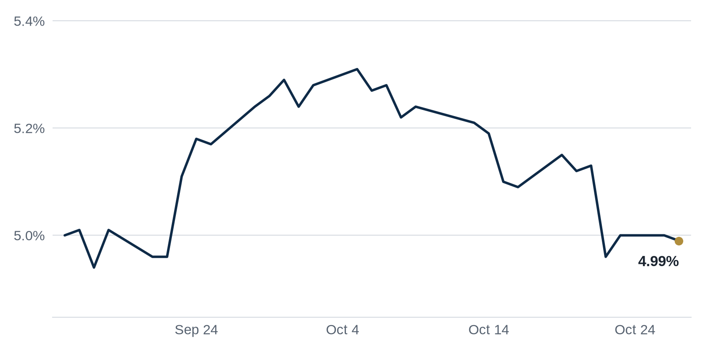

> **Review before publishing:**
> - reits: prices from Alpha Vantage only, not cross-checked (no second source; set TIINGO_API_KEY)
> - editor: fixed: Source title ('4 Firms Steer...') says only 'firms', not specifically 'law firms'; drop the unsupported qualifier.
> - check/long_sentence: 37 words: **What it means:** Rates were little changed, so...
> - check/long_sentence: 32 words: **Why REIT_DOWN_NAME moved:** Welltower, the largest senior housing...
> - check/long_sentence: 31 words: **Distress Watch:** A 32-story Boston office tower at...
> - check/long_sentence: 33 words: **Why it matters:** Landlords selling rent-stabilized buildings now...
> - check/missing_link: https://news.google.com/rss/articles/CBMizAFBVV95cUxPaXVnLWlxNGRkUnFfRzM0Ym5OU0pHYUVrUG1rbmFaU1Byc0t5R1hxV1VuS2JTZ051SWVRbzZVWEtzVkI0MDlocVc5MEE2UWV5R3VuQjEzWWJFREI2QVdNczFkd2dtaVd2OXZzM1NXT2FpaVh2S00yVlZSNHF3ZmtpZlFrOVFOTGlTd2pvZjhoWElDNkR6R1o4a292OGo3LTdUeTBJR3loYTZ5SmZyTnNoT3VVNVU2THRyN2g0LVdhX0VmZndWNnUzWTBRYU0?oc=5
> - check/missing_link: https://commercialobserver.com/2026/10/kkr-jv-alexandria-campus-point-by-alexandria-megacampus/
> - check/missing_link: https://www.bisnow.com/news/national/life-sciences/alexandria-s-underwhelming-q3-sees-reit-selling-megacampuses-amid-industry-struggles
> - check/unsourced_number: Coffee chat talking points: 2022,

## The Brief

- New York City passed a law letting tenants and nonprofits buy apartment buildings first when owners sell. [Commercial Observer](https://commercialobserver.com/2026/10/copa-new-york-city-multifamily-investment/)
- San Francisco again leads the country in office demand, with leasing growth now spreading beyond tech tenants. [Boston Real Estate Times](https://news.google.com/rss/articles/CBMipAFBVV95cUxOZF95UjVldFdFZDJwVDgzWGcyaUV0OTJfNVFmSl93TE9BeW9WXzlSUHIyZ1lWRWNJNVZDa21XbEQ1UnpkTk8yYkgwZFQ2TGItS1lYcXJpM1FIempIOURjb2dNYVJvZVBEdy1SajRUT3NkRW5xOFFyaVhKazNwdTQwYTV6VTdDWWwxOHhoZmQ3cUt5cEdoRFh3d2pQemJVSnVyWGZZcw?oc=5)
- A major investor took a stake in Alexandria's San Diego life science campus as the sector cools. [Citybiz](https://news.google.com/rss/articles/CBMixgFBVV95cUxOMEx5R05FNVBvREZoREhjNDg5eG9GWXBiMDJ2bzBKS0FKSGpBN3dkendScUlPZ2pfTEphR3JaclQxM3dIV3ZxTDAwMURlUkczZ1hyOGU3Y09nbUR5Q04yMG5aT2Y3QmwzR003V2wyUXZEdTVoNG9Bc2ctZmlVaEViR3h1TWlwd29vZHUzTXcxLTNIOFp4c01tMFZqd0VHUjgtbVoxVXBSZjBNblFFR2VBNGhZUHpoVnEtZUh6cWtuenFONXZEVkE?oc=5)

## The Numbers

*Rates as of Oct 27 close.*

- **10Y Treasury:** 4.99% (-1 bps)
- **5Y Treasury:** 4.82% (-2 bps)
- **SOFR:** 3.95% (+2 bps)
- **Fed funds:** 3.75% to 4.00%
- **Next Fed meeting (Oct 28):** Polymarket's top outcome is No change 95.3%
- **REITs:** VNQ $92.39 (-0.8%). Best: EQIX +3.3%. Worst: WELL -5.8%.
- **REIT yield vs. 10Y:** VNQ yields 3.80%, -119 bps vs. the 10Y.

**What it means:** Rates were little changed, so the cost of a new loan looks about the same as last week, giving buyers and lenders a steady backdrop to price deals rather than a reason to move.

**Why Equinix (EQIX) moved:** No company-specific news today; it may have moved with other data center REITs.

**Why Welltower (WELL) moved:** Welltower, the largest senior housing landlord, reported a strong quarter on rising occupancy and more acquisitions, so the slip likely reflects investors who had already priced in good results. [Commercial Observer](https://commercialobserver.com/2026/10/welltower-q3-earnings-senior-housing/)

## Debt Markets

Commercial mortgage delinquencies climbed in the third quarter, with loans bundled into commercial mortgage-backed securities (CMBS, bonds backed by pools of property loans) leading the rise. The trend points to more owners falling behind on payments. [Mortgage Professional America](https://news.google.com/rss/articles/CBMirgFBVV95cUxPbUdIOVluS1FIVU5QbWd4NGMtclNCcWxldVN6eFl6T1BFQXd6QVBacHJsYi03dnh2b1NSTnR1NHBZREt2NHE5WHluLXRQeXZHWTB0eHJXc09Md1pKQWk1YzdTUWJjbTBkcTNZY0UxbmphT0xYSUJsc3BhQm1WZXpaOEE5VFJSZjVkVG5RbWo1NW53ODNpb3RscDVzUFk0NGktckZ0S1BfY0hLQkZkNFE?oc=5)

**Why it matters:** More missed payments push lenders to tighten terms, so owners with loans coming due face a harder time refinancing.

Lenders are getting far more selective about data center loans as the sector grows, scrutinizing where a project sits and who is behind it. Stricter standards could reward strong operators and squeeze weaker ones. [Commercial Observer](https://commercialobserver.com/2026/10/data-center-financing-risks-2026/)

**Why it matters:** Operators without creditworthy tenants may find it tougher to borrow, which could slow the data center building boom.

Savanna and Deutsche Bank are still pushing off the foreclosure sale of 521 Fifth Avenue, two years after the $242 million CMBS loan on the Bryant Park office tower defaulted. Savanna had paid $381 million for the building in 2019. [Commercial Observer](https://commercialobserver.com/2026/10/savanna-deutsche-bank-521-fifth-avenue-foreclosure-sale/)

**Why it matters:** The delay shows how long distressed office workouts drag on, leaving lenders holding bad loans for years.

Office loans bundled into CMBS (commercial mortgage-backed securities, bonds backed by pools of property loans) are struggling to pay off when they come due. Only 12.8% of maturing office loans are getting paid in full, while retail loans are nearing a 90% payoff rate. The split shows lenders still trust stores far more than office buildings. [Yahoo Finance](https://news.google.com/rss/articles/CBMilAFBVV95cUxPd3p4aTZUUzBTeU5naXlzWlBTaVVNUE5rampGZzA1UXlRU2w5MGV1SkFXaDBsM1kzNTNSZkFvRE9zODYxaE5mcjNRd3c0bXNCQzRERnI4NW81blJ0TGR0QnpYbV96MlBSS2dwLWRWbkdUdklBWUFlU0NULWRTcTJaU1FaYXBJUEc4dHR3VVRxZ3M1dUZT?oc=5)

**Why it matters:** Office owners whose loans are maturing may struggle to refinance, so more of them could be forced to sell cheap or hand buildings back to lenders.

**Distress Watch:** A 32-story Boston office tower at 100 Summer Street sold at a foreclosure auction for $260 million, with owner Rockpoint casting the sole bid to hold onto the building. [Bisnow](https://www.bisnow.com/news/boston/office/rockpoint-holds-onto-downtown-office-tower-during-auction-for-260m)

## Top Stories

### New York City passes COPA, but the impact may be modest

After six years of stalled drafts and lobbying, the New York City Council passed the Community Opportunity to Purchase Act. It gives tenants and nonprofit groups a first chance to buy apartment buildings when owners put them up for sale.

**Why it matters:** Landlords selling rent-stabilized buildings now face a new step that could slow sales and favor tenant-backed buyers, though many expect the day-to-day market to change less than the headlines suggest. [Commercial Observer](https://commercialobserver.com/2026/10/copa-new-york-city-multifamily-investment/)

### Mamdani's rent freeze takes hold

Mayor Zohran Mamdani's rent freeze took effect Oct. 1, leaving rent for about 1 million New York City households frozen. Landlords are already feeling the pinch, and a lawsuit challenging the freeze is working through the courts.

**Why it matters:** Frozen rents cap landlord income while taxes and repair costs keep rising, which can push older rent-stabilized buildings toward default. [Commercial Observer](https://commercialobserver.com/2026/10/new-york-city-rent-freeze-mamdani-lawsuit/)

### San Francisco reclaims the office lead

San Francisco has retaken the top spot in US office demand, and the leasing growth is now spreading beyond the tech firms that drove earlier rebounds. The shift suggests more varied tenants are signing space.

**Why it matters:** Stronger, broader demand in one of the hardest-hit office markets gives owners there a reason to hold rather than sell at a loss. [Boston Real Estate Times](https://news.google.com/rss/articles/CBMipAFBVV95cUxOZF95UjVldFdFZDJwVDgzWGcyaUV0OTJfNVFmSl93TE9BeW9WXzlSUHIyZ1lWRWNJNVZDa21XbEQ1UnpkTk8yYkgwZFQ2TGItS1lYcXJpM1FIempIOURjb2dNYVJvZVBEdy1SajRUT3NkRW5xOFFyaVhKazNwdTQwYTV6VTdDWWwxOHhoZmQ3cUt5cEdoRFh3d2pQemJVSnVyWGZZcw?oc=5)

### KKR backs an Alexandria life science campus

KKR invested $475 million for a stake in Alexandria's Campus Point life science megacampus in San Diego. The deal landed the same week Alexandria reported a softer third quarter for its lab-space portfolio.

**Why it matters:** A major investor committing fresh capital signals that large buyers still see long-term value in life science real estate even as the sector cools. [Citybiz](https://news.google.com/rss/articles/CBMixgFBVV95cUxOMEx5R05FNVBvREZoREhjNDg5eG9GWXBiMDJ2bzBKS0FKSGpBN3dkendScUlPZ2pfTEphR3JaclQxM3dIV3ZxTDAwMURlUkczZ1hyOGU3Y09nbUR5Q04yMG5aT2Y3QmwzR003V2wyUXZEdTVoNG9Bc2ctZmlVaEViR3h1TWlwd29vZHUzTXcxLTNIOFp4c01tMFZqd0VHUjgtbVoxVXBSZjBNblFFR2VBNGhZUHpoVnEtZUh6cWtuenFONXZEVkE?oc=5)

**Coffee chat talking points:**

- A West Loop office tower facing a $310 million foreclosure shows even mostly leased buildings can struggle once their debt comes due. [The Real Deal](https://news.google.com/rss/articles/CBMimgFBVV95cUxPTDJIRVllVEpZckNSZ2xmOENSYmFDb1hkZklDT2xrbVF2b1B6aHJHSVFsUzhHT3o4YUhRazg5a0RmVThnQTlLSXAtU3BqaS02cUFjQ1AyRFdpeVVOeDNweTU3S0ROZ0toVUZLdm1JVkctSGZraEl5bE5oaEJYcjE1WGJyaC1GQUFnekFmSHVFQXdrSXpLQTZnS3d3?oc=5)
- CRE sales volume hit its highest third quarter since 2022, even as office towers keep selling through foreclosure, a sign the recovery remains uneven. [GlobeSt.com](https://news.google.com/rss/articles/CBMilAFBVV95cUxQR2p1YXNVZGNYR05OREpnc3IzSVBLbFFHQWFKZktHVURIaE1oNVZ4RmFpZkN5YUhWR1BvRkN2OGpPeTNtQ25kWkJDOXZPTWJlTnc5QXV4ZVhyNnlxbGIxaTNpbVpuaTJsNXREWDQ1ajdPdWZKR3hPSDVqaHk1XzhTMWFNN2U1SjlUSm9zdk8xdlJ3aE1a?oc=5)

## Market Watch

### Sun Belt

Microsoft paid $95.5 million for farmland in Dallas County, the kind of large land purchase tech firms make to bank sites for future data centers. The buy adds to a run of tech land-grabbing across Texas. [Business Record](https://news.google.com/rss/articles/CBMijwFBVV95cUxOenQ3dVlFVlhfZElKZTd2ODByQWo0MGdmS1VFNXl5LXpmWTBqVkZsaGRtaTBqN0o0c0hTR0Q3UHYtQzdidXkzc3FyVVkxM25tRTJzd0dYUUc3cU5UbzhxSHB3clhZanVFOFpQalMwd2JRcGpUd3JMc190NFVwVE1PaE5OMENXcW5xLXVENVFtSQ?oc=5)

**Why it matters:** Tech buyers paying up for raw land push up nearby land values and signal where the next wave of data center demand is headed.

### West Coast

The latest Emerging Trends in Real Estate report for 2027 lays out nine takeaways on where investors and developers see opportunity and risk next year. The annual survey is widely watched as a read on industry sentiment. [Bisnow](https://news.google.com/rss/articles/CBMi7AFBVV95cUxPczMwOXRUS2dKckNoNGk2MkphUVFBUTJfVDRaZHBVMGxVUVhQTzdwVkxrNXMwR3lrQ0lndDk0NzJSTC1VWC1EdEV1ck55MkxsNzI2V2g2TUdGeWtFeUlHZkp3d2Rqb2djSkxCRTBvZVhOTnhyQzZTM3pLcDFRSkY5d3RGTFhKTk5qU2Z2TGg2N1AtMXJ3RTlKU2owRFBKakF0MHkwakZNR1dtbTB6SzF1UWVZcVVBeHFlN19DN3A4OGRBNS0zTkRucmx3Q2RtaGppV0tZRHJNTHhrVFF2SFE2MTJwejRENFc5a00tcQ?oc=5)

**Why it matters:** The report shapes where capital flows next year, so owners and lenders use it to gauge which property types will stay in favor.

### International

Japan's Takenaka Corporation is under contract to buy One Broadway, the trophy office tower held by Rockwood Capital and Midtown Equities, for $170 million. Newmark brokers negotiated the sale. [Commercial Observer](https://commercialobserver.com/2026/10/takenaka-one-broadway-rockwood-harrison-midtown/)

**Why it matters:** A foreign buyer paying up for a marquee Manhattan tower shows overseas money still treats top US office as a safe place to park capital.

## Quick Hits

- Rising interest rates are stalling the pace of San Francisco multifamily deals, even with rents climbing and supply tight. [Bisnow](https://www.bisnow.com/news/san-francisco/multifamily/high-interest-rates-beginning-to-stall-pace-of-multifamily-dealflow-in-san-francisco) Higher borrowing costs make apartment purchases harder to pencil out, so buyers and sellers stall until the math works again.
- Commercial property prices posted their strongest annual gain since December 2025. [GlobeSt.com](https://news.google.com/rss/articles/CBMinwFBVV95cUxPRU04ZVREMGp6ODJHaUVlYzNhT2FMOXFaOTg4TmNPSmc1b042Q3pWNzFCZ1djaG1fcFVWQ3FIOEdKcEk0ZDl6YzkzLXVNTUtFZHY1ZjJDcTFnZFNRZWJrR0gwYjJTTVFWMGZjY0pzUHlMaUI2WnB0QmRrNkNKOXVGQWtheGJIWWE4VWdfamdrSUc5eUhYclMyQjJjb1U5RVE?oc=5) Recovering values give owners more equity to refinance against and nudge sidelined sellers to list.
- The Alexander brothers were each sentenced to 30 years in prison, with the judge calling their conduct monstrous. [The Real Deal](https://news.google.com/rss/articles/CBMipgFBVV95cUxQZ2xDRk5NQzRnZ09TZGh0SlhQSnpNZTBKeUJfcTJ3NTdwSHNGTFlsaWQxYnVYME5wX0o5QW1UdXF4dWVLVmhxTkdrZGcydkxWckVOcnowQ3YyWTBpRm1IZ3pLM2NldWlRaThrcVYxcThXaUt4bDYtOFFSYUpCVDROVk90WFdhdWRPdzQtNGxhMC1CNkhIUXFIZHNrR2xMLURNa0lNc2p3?oc=5) The sentencing is a reminder that fraud by prominent real estate figures carries heavy criminal penalties.

## AI Infrastructure

Four firms structured a landmark $63 billion financing to fund AI infrastructure, one of the largest such deals to date. The structure pools capital to pay for the data centers, power and equipment that AI systems run on. [Law360](https://news.google.com/rss/articles/CBMivwFBVV95cUxQaGp1US1yWU9HWlY3bEtzS1dQSmRqbkI4OE04NTVxcld6c29QZldZSmMtc3VGMW1FNC1wOWhJSjRMelBxcXh2d2Fpdk00czVxa1NIWDdFajVmbjBwdHhNZlp4d0N5b1J6a1daT0Q3QmliMFBCNEhZNHpzTWdPbFd3MDE2bFZYNm5RbUphV3JEa3UwMWs5R1ZrajJzbmNkRXBYalpWM0h6djlZV2FMQWZkWVpZNTRPWDIzTVU3YnJYRdIBc0FVX3lxTE1NQjRFcXlTS2p6M0FTY1FDMjN0MXFsUVpvWWV0b2ZUY21QY296V2xhLTdGSmdaYTV6N2dGZmV2RTJaOFVEdGVxWDE1UXFPRDBVRUFldG5ib1RpOHBQdlFKSGVyWUE1MThnancxQzdoUm85TUE?oc=5) Data center developers gain cheaper, larger pools of capital, while the banks and investors behind the structure take on the risk if AI demand slows.

## Term of the Day

**Trophy asset:** a top-tier, iconic building in the best part of a city that commands the highest rents and sale prices. Buyers accept a lower return because the quality and location are rare. One Broadway, under contract for $170 million, is the kind of prize that foreign buyers chase.

For informational purposes only. Not investment advice.
