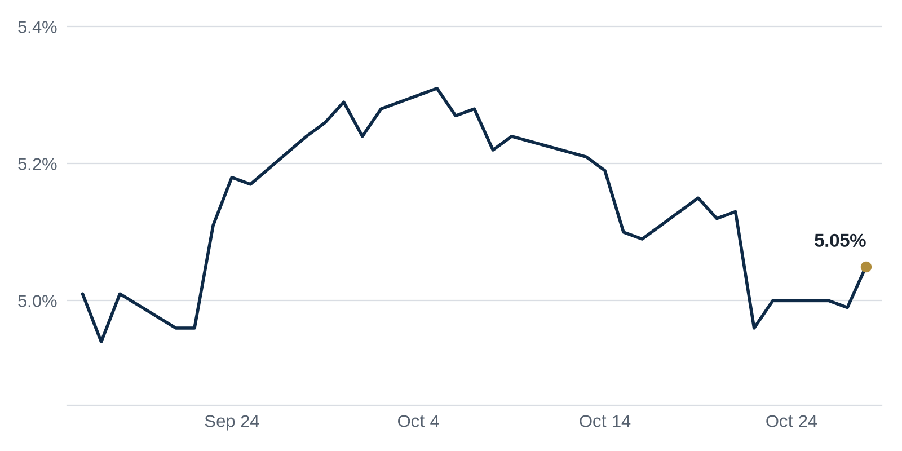

> **Review before publishing:**
> - reits: prices from Alpha Vantage only, not cross-checked (no second source; set TIINGO_API_KEY)
> - editor: fixed: Same MBA Q3 2026 commercial mortgage delinquency survey led yesterday's Debt Markets section; it also duplicates The Brief's third bullet (same Connect CRE l...
> - check/long_sentence: 31 words: **Why it matters:** Less new bond issuance means...
> - check/long_sentence: 43 words: **Why it matters:** A construction loan (money a...
> - check/long_sentence: 31 words: **Why it matters:** When a marquee tenant downsizes...
> - check/missing_link: https://news.google.com/rss/articles/CBMihwFBVV95cUxPdV9Ib0JFTUJpTHJKRW9obzBqRmVzcTFpZlJSWkN6cERDQm9MUUpfc29KV2lrck14enNpVnN0S0JmMnFqZC1fRm1GUWtSTGlaSWUyNFY4NVdBLWpRQUhxUFh2dnV5Rk9Uc1hSYWEyYUJyVFVqUWxxdVZSZzNYTkVOZTZUVzBxMlE?oc=5
> - check/missing_link: https://news.google.com/rss/articles/CBMirAFBVV95cUxNWXBvS3N6VVR0eW00azA4a193bWxrcy00MEMxV0JiUVdDOW1vU0U5Y0lHckdCRzRxSnVwTVZ0SEVWNXdlVUNuTl9aeEdQZGY3Wjh0Yk9xWVRHUWs5N2pGWXZsU0pJNmNIbHlobkVqU3BGMklzZlR6V3BfMEoxYWdlUFh4NGR5Z0J6NjllYWFzemhENTltYnBWRmNtMXJtQkh4NWMtZklWOU1QMXVO?oc=5
> - check/missing_link: https://news.google.com/rss/articles/CBMitAFBVV95cUxOcjBuX3hWR2stcmVVcU9mT0Z5YU8teHBsZmhqV1RKUHVUSjJRc2l6bEF6dUJMMi1BdGhvVkc2Y3pUTlM3TzJIN1hvX19GTjB6bWdnNDNCS0FtMzZEVUw2MkdBakRFYVpvaEZ5MW5KaUNuRGVGbEtZVzc2X0lUdEJObURha2l2MWtLYVhYWmJlend6aXRkU0hmdWZ2dlJzUmdhY1JaaHlmQ21ZLUJfSG1mQXdzeks?oc=5
> - check/missing_link: https://news.google.com/rss/articles/CBMiogFBVV95cUxPQkttVldzZjBNOFVhUzlRT0RiclBIengyOGxkZG0tYVNFeHZ0cEtSWHE1OWhnalU4WF9WbWxMZzh5WmhNc3NfZktiSFhhMVcwNWtuX3JKWTVNMFFRUDFvT2QzaGduWUtJSFBuU1RucUFqTmxxa3RPd1YtemZ6Rk5vbE9oX25nMlVxZHVwWjZWRW11UTIwTUZGVTZpUGFlTF9nU2c?oc=5

## The Brief

- The Fed held rates steady but hinted at a possible December hike, keeping borrowers on edge. [Commercial Observer](https://commercialobserver.com/2026/10/fed-interest-rate-pause-kevin-warsh/)
- JPMorgan's new Park Avenue tower carries a record price tag, raising hard questions about how to value trophy offices. [GlobeSt.com](https://news.google.com/rss/articles/CBMitgFBVV95cUxPb2VrUlJ2cmlSdTQ5QmQ1UHdveXVlaTZGNlo3N3ZybzJ5bFJWS3Z5TDB2ckRyRFVFRXJpSlhaY29VQ1lkaHNVY0VpeEp5cW5NOEJIdmFublZuXzBqZ0N6dDItc05vVnNnR3FURXF4QzVVeEhWaWMxMTQxOFVFS09FSmF2TkxOOG5EWmdFcWMzZy1XcnRYV250b3ZqaVB6UW85NkI5R3NlVkdFUWQzNFZjVnpqMmYzQQ?oc=5)
- Commercial mortgage delinquencies rose again last quarter, a warning sign for lenders and office owners. [Connect CRE](https://www.connectcre.com/stories/mba-commercial-mortgage-delinquencies-increased-in-q3-2026/)

## The Numbers

*Rates as of Oct 28 close.*

- **10Y Treasury:** 5.05% (+6 bps)
- **5Y Treasury:** 4.85% (+3 bps)
- **SOFR:** 3.94% (-1 bps)
- **Fed funds:** 3.75% to 4.00%
- **Next Fed meeting (Dec 9):** Polymarket's top outcome is 25 bps increase 75.5%
- **REITs:** VNQ $91.79 (-0.6%). Best: BXP +1.0%. Worst: ESS -4.9%.
- **REIT yield vs. 10Y:** VNQ yields 3.80%, -125 bps vs. the 10Y.

**What it means:** Rates were little changed, so borrowing costs today look much like yesterday's, and buyers can price new deals without bracing for a fresh jump in loan rates.

**Why BXP moved:** BXP, the largest Class A office owner in the country, beat revenue estimates after closing two large building sales, which reassured investors about office landlords. [Commercial Observer](https://commercialobserver.com/2026/10/bxp-revenue-earnings-q3-sales/)

**Why Essex Property Trust (ESS) moved:** No company-specific news today; it may have moved with other multifamily REITs.

## Debt Markets

A loan tied to a Blackstone-owned office tower in Frankfurt is set to trade at a deep discount, meaning buyers will pay well below the loan's face value. [Bloomberg.com](https://news.google.com/rss/articles/CBMitAFBVV95cUxOcjBuX3hWR2stcmVVcU9mT0Z5YU8teHBsZmhqV1RKUHVUSjJRc2l6bEF6dUJMMi1BdGhvVkc2Y3pUTlM3TzJIN1hvX19GTjB6bWdnNDNCS0FtMzZEVUw2MkdBakRFYVpvaEZ5MW5KaUNuRGVGbEtZVzc2X0lUdEJObURha2l2MWtLYVhYWmJlend6aXRkU0hmdWZ2dlJzUmdhY1JaaHlmQ21ZLUJfSG1mQXdzeks)

**Why it matters:** When a loan sells below what is owed, the market is saying the building is worth less than its debt, a bad sign for European office values.

High borrowing costs broke a stretch of steady CMBS issuance, the bonds that pool commercial mortgages, while hotel loans led the quarter's payoffs. [CoStar](https://news.google.com/rss/articles/CBMipgFBVV95cUxPem83TWhsVnJURWlEd0RHT1lzR0VIN2Nyall1SUdYeERGNFJwWmdJcXBpbDlEOGtyOHZQQ3dkRE9nNmJtMVIxX3Q2dkN5eENEbVZuVGNaYzhKUV9FY1dvaWg3dl96Y1BoVDFlOXh5NGZ4VndNRGFscURLcWxUSElwYkxKT1Z2NTZDczFrQXZzZjFYMGI0SjlIU0pFdklKWUtQQnVad3RB?oc=5)

**Why it matters:** Less new bond issuance means less fresh financing for CRE, while hotels paying off loans shows that sector is still throwing off enough cash to clear its debt.

Faena Residences Miami has landed an $817 million construction loan from TYKO Capital to fund the project. The financing covers the cost of building the luxury residential tower before any units are sold. Private lender TYKO Capital is backing the development ahead of completion. [PROFILEmiami](https://news.google.com/rss/articles/CBMiygFBVV95cUxQODJZa3dJZld6U3hVYjVMb0c4dWZ5SXdQTXdBWEsxTTRMVW9PUVI3eW5sMnNlV0hhWkNvUTVsSV9YSTgwbkJHV1Y0cnM0cHFnV1Z1OWIyNDF0X3FES0ktdHZMQW5qVFA2YjVRUEVKVXhTeHJIMExVdTR1dW9sT0JDeHotd0M4N245RmhvNUZmQ0NmNFNSa0VKTG83bnJJVVFMQU9oMmV3ejFVRzRFS0N0am5oS3BSTUN5Zmp2TGRtOHpIWnI5VjBlMVFn?oc=5).

**Why it matters:** A construction loan (money a lender gives to pay for building, repaid once the project is done or sold) this large shows private lenders still trust high-end Miami condos, which helps other developers there argue they can get funded too.

**Distress Watch:** A lender took back a Judiciary Square office building in Washington at a foreclosure auction; the property is slated for a 500-unit residential conversion. [The Business Journals](https://news.google.com/rss/articles/CBMiqwFBVV95cUxPR01tdTJEb19VeXRlS3BmblFLcUppZUROdTM4VVUweDg1WjBCbHBKWkctQWZEV3RqU0pEUklIRHA3WklqN3JLaUZ0ZTJXczNUZUlWZUE3S3AteXRrNk90SFpjZ0FsWmNySjlMSkNucmJ2dFpFSWpzTTBDU3BseTlJUTY1M1JFRWcwVl8tZDRuT0U0QW1yWnBPZmd6V0Y4VGdRc0M2MnV6Nk5zdlE?oc=5)

## Top Stories

### Fed holds rates, but a December hike is in play

The Federal Reserve paused Wednesday, holding short-term rates six weeks after its first hike since 2023, in a 10-2 vote. Chair Kevin Warsh urged patience, pointing to last week's AI credit selloff, while the market braces for another hike before year-end.

**Why it matters:** Borrowers get a short reprieve, but a December hike would push floating-rate loan costs higher. Owners planning to refinance should not count on cheaper money ahead. [Commercial Observer](https://commercialobserver.com/2026/10/fed-interest-rate-pause-kevin-warsh/)

### JPMorgan's $6B tower raises valuation questions

An estimated $6 billion price tag on JPMorgan's new 270 Park Avenue headquarters in Manhattan is prompting questions about how to value a single office tower. The figure dwarfs what most offices fetch today.

**Why it matters:** When many older offices sell at steep discounts, a record cost for one trophy tower leaves appraisers and lenders without clean comparable sales. They have no easy way to judge what such a building is really worth. [GlobeSt.com](https://news.google.com/rss/articles/CBMitgFBVV95cUxPb2VrUlJ2cmlSdTQ5QmQ1UHdveXVlaTZGNlo3N3ZybzJ5bFJWS3Z5TDB2ckRyRFVFRXJpSlhaY29VQ1lkaHNVY0VpeEp5cW5NOEJIdmFublZuXzBqZ0N6dDItc05vVnNnR3FURXF4QzVVeEhWaWMxMTQxOFVFS09FSmF2TkxOOG5EWmdFcWMzZy1XcnRYV250b3ZqaVB6UW85NkI5R3NlVkdFUWQzNFZjVnpqMmYzQQ?oc=5)

### Prosper approves $2B Venice-inspired community

The Texas town of Prosper greenlit a $2 billion, Venice-inspired master-planned community, though the project still faces major hurdles before anything gets built.

**Why it matters:** A large approval signals developers are still betting on Sun Belt growth. But the remaining obstacles show that financing and permitting now decide whether big plans ever break ground. [The Real Deal](https://news.google.com/rss/articles/CBMilAFBVV95cUxPVTN4THdHMUt0Uld5Y0hBaVJaR1ZyaXhIanUyOFA4OWNSQjB6VjNhaUdYc1pmckw1TUROVlQ5VUdqR2Znck94dGJjc19kUnBCcGlPa0ZXdE56NWVyOE1CNlVwbWg3eUw4a3pDbzJXbkd3NGs3MmI2MnROMmh1b1BGQ1NscFVTOXk2X0gxbk1nWU5EMjNn?oc=5)

**Coffee chat talking points:**

- The Fed's 10-2 vote to hold, with two members pushing for a hike, tells borrowers rates could still climb before December. [Trepp](https://www.trepp.com/trepptalk/the-federal-reserve-holds-as-the-case-for-another-hike-builds-at-the-october-fomc-meeting)
- JPMorgan's 270 Park tower now carries a $6 billion estimate, a reminder that new trophy offices still command huge sums even while older towers sell at discounts. [The Real Deal](https://news.google.com/rss/articles/CBMikwFBVV95cUxPeXZjdGRuenNVSWxXdkZCc3V2aFVsUm14MnpqcGJ2cjdma0VweHdTVjR3UE8ycjNGVm9TYVphd1NEaHM1UnFaYklSWFNFR2IydWlqYXdIbUFYNTB3cXNTeXhmdlFBTFhtTk5GREk3LTlnTFA1M0M3YS1ZWHNETHlVWFJESWQ2bDNudzdqNm05UHFHT1k?oc=5)
- Tyko's $817 million loan for Miami's Faena towers is Florida's largest-ever construction loan, showing lenders still back luxury condos even as Europe's offices slump. [Commercial Observer](https://commercialobserver.com/2026/10/fortune-international-miami-faena-condo-tyko/)

## Market Watch

### Sun Belt

Tyko Capital provided $817 million, Florida's largest-ever construction loan, for a two-tower Faena-branded waterfront condo project on the Miami River. Fortune International Group and KAR Properties are the developers, and each tower will rise 68 stories. [Commercial Observer](https://commercialobserver.com/2026/10/fortune-international-miami-faena-condo-tyko/)

**Why it matters:** A record construction loan means lenders still see strong demand for high-end Miami condos, giving other Sun Belt luxury developers a fresh comp to point to.

### West Coast

Accenture plans to shrink its footprint at San Francisco's Salesforce Tower in 2027, giving back space in the city's tallest building. [The Business Journals](https://news.google.com/rss/articles/CBMimwFBVV95cUxOSjlKVXkwNGFnTTRZV1hTNkJwbTh6ODZ3cHBxUFJrODlHbE1rVlJoamNBeWliZlVqMXliVFNZY0hyRlpFZTNJbHlwTXdnNmhyb21DR1lWeGZINGlHUDUzYUlxRVlzaG5PUHZMVHhEejNyZjVncXRQMzVSSUlvWDBqZkJqM3E3UjVLSGNtLXVVYTBfem4xaUZQTzRxZw?oc=5)

**Why it matters:** When a marquee tenant downsizes in the best building in town, it adds vacant space and pressures landlords to cut rents to keep the floors they still have.

### International

Europe's commercial property downturn is deepening as rising borrowing costs squeeze values across the region. [Global Banking & Finance Review](https://news.google.com/rss/articles/CBMiogFBVV95cUxPQkttVldzZjBNOFVhUzlRT0RiclBIengyOGxkZG0tYVNFeHZ0cEtSWHE1OWhnalU4WF9WbWxMZzh5WmhNc3NfZktiSFhhMVcwNWtuX3JKWTVNMFFRUDFvT2QzaGduWUtJSFBuU1RucUFqTmxxa3RPd1YtemZ6Rk5vbE9oX25nMlVxZHVwWjZWRW11UTIwTUZGVTZpUGFlTF9nU2c)

**Why it matters:** Higher rates abroad push property values down, so European owners and lenders face losses, and US funds holding European assets feel the hit too.

## Quick Hits

- A new buyer has emerged for the troubled San Francisco Centre mall. [The Real Deal](https://news.google.com/rss/articles/CBMiogFBVV95cUxPbDNyY1BJZXUybUpJdHExemNvT2VuSUI0a3JkLUxUWXVuRGttR19YS2t5aEk4bVMxazJjOGV6YTdpc1RocEpGMUY4SHhqN05WTVJnZlZtZmRCWmJ1U01HRXVlU0d3MnBiZ0pGaFdwdEdJU1lxRzFJa1gtcTJaWXV1elVCemVxdG1GcjNpalB1b1d1cXloWXJBSFFQdnFSNXlhSkE?oc=5) A fresh bidder for a struggling downtown mall hints that some investors see value worth salvaging in distressed city retail.
- San Francisco reclaimed the lead in office demand as growth broadened beyond tech. [Business Wire](https://news.google.com/rss/articles/CBMizAFBVV95cUxPaXVnLWlxNGRkUnFfRzM0Ym5OU0pHYUVrUG1rbmFaU1Byc0t5R1hxV1VuS2JTZ051SWVRbzZVWEtzVkI0MDlocVc5MEE2UWV5R3VuQjEzWWJFREI2QVdNczFkd2dtaVd2OXZzM1NXT2FpaVh2S00yVlZSNHF3ZmtpZlFrOVFOTGlTd2pvZjhoWElDNkR6R1o4a292OGo3LTdUeTBJR3loYTZ5SmZyTnNoT3VVNVU2THRyN2g0LVdhX0VmZndWNnUzWTBRYU0?oc=5) When demand spreads past tech firms, a city's office recovery rests on steadier, more varied ground.
- CoStar agreed to acquire an aerial imagery company for $730M, though its stock fell sharply on the news. [Bisnow](https://www.bisnow.com/news/national/technology/costar-to-acquire-aerial-imagery-company-for-730m) A data giant adding imagery tightens its grip on the property information that brokers and owners rely on daily.
- Extell tapped Hyatt to anchor a planned Times Square supertall. [The Real Deal](https://news.google.com/rss/articles/CBMimwFBVV95cUxNZktiazAxRkNzUDFVVWw4TVhLX0xQTVk0WmF6T0JFZ0Q4anZ5eDVUdHEtejlFOEVGRVgtdTdXRXpncFIwSUh1bDNnRlo3VHg5ZFZKTUMwWjc3U3ZwMm5KR3N0SWJFSmhLeDYyNXhjRE9kUk9PVVhWX09kT2wyRTBYRkJGUHlJQ3RpbjZXU21DX2daUDVmbFA0SHQyTQ?oc=5) A branded hotel anchor helps a developer secure financing and reliable foot traffic for a massive new tower.
- Analysts say CRE's next building cycle could be years away. [GlobeSt.com](https://news.google.com/rss/articles/CBMihwFBVV95cUxNc3JOVjROODNfaEZDdjUyaWVUdXctTGJnQ29WYnRGcWNnQUg3ZTdCd0NzNFNwcVNJTVF6WFRmcVpZMF9NT0htY2ZRRWZVeFR3TlJ2c1RaUUVwdGNqOVRTYkdIeFJfMTc4SjVaNmlWNWF6T1U1OVE5aFdrbHpzQV9fdWNZeFlYMDQ?oc=5) If new construction stays on pause, existing buildings face less competition, which can firm up rents for the owners who already hold space.

## Term of the Day

**Negative leverage:** borrowing to buy a property when the loan rate is higher than the property's yield (its yearly income divided by its price). Instead of lifting returns, the debt drags them down. If a building yields 5 percent a year but the loan costs 7 percent, each borrowed dollar earns less than it costs, so leverage hurts the buyer.

For informational purposes only. Not investment advice.
