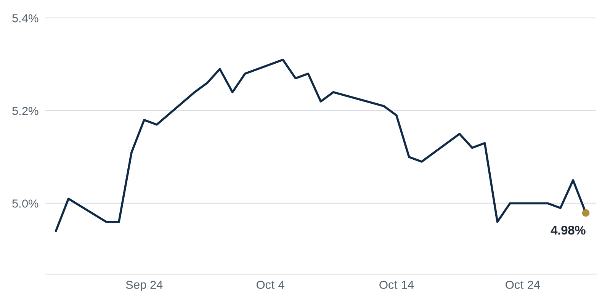

> **Review before publishing:**
> - reits: prices from Alpha Vantage only, not cross-checked (no second source; set TIINGO_API_KEY)
> - editor: fixed: Same Acore $1.1bn fund is already covered one paragraph above (Law360); this Alternatives Watch item repeats the identical deal and why-it-matters within the...
> - editor: fixed: This is the same $817M Miami luxury condo construction loan run in yesterday's issue (Faena Residences, TYKO Capital); repeating it via a new outlet is exact...
> - check/long_sentence: 31 words: **Why it matters:** cutting the dividend means the...
> - check/missing_link: https://news.google.com/rss/articles/CBMiowFBVV95cUxNQS02Y0RaVnEzLWdEUWlXY0s0SE5FVDlWWm9yNFA2RERTNUdjMjROLUdHSEFsck84Y01JbTN3QjFra29TQ3BVdXhWUkdkVVpHMFR6aU9ZNGxwY1VXbGNCZmh5Ym92ZU1Zb1JpX2JGd1B3Tm0wQjlYeERDX0x4dURLZGlNWVFUcHlsT1pFVW5CdzV2YUg0NVE5dnVuZlpyYlVYMFc4?oc=5
> - check/missing_link: https://news.google.com/rss/articles/CBMipgFBVV95cUxOdnRmNGpZNzlremdOTzNORkpIek90MUxrcEwtOUp0SHl2Q0kxMV9ZbFA4Nmt6ZzVIRlNvMlVpM2NHQmR4bWtpNUxqN1BOX2VDd253YV9oX0lRbV80Sll0QW5LRzdkM0JTREkwZW8xUkh6RklwTGtOMGYyc0JSVDFZMmt5NWZyb0FJeFdGNXRtU1Y1emFKTEhFXy1CdjdyOVBhWS1feTFB?oc=5
> - check/missing_link: https://news.google.com/rss/articles/CBMiqgFBVV95cUxNSFh0ZVpKV095VG9qckN0a1FfMDlDb1I5UnFEd2ZlNllxTkRESUdwbmpUTTc2UXBzcFlGTnZYVXRZb1hPbDQtNmVQbkxKTjZHcU02OE9HVkhfN29WN2tDSk90YktkWkpRNmFhd3JkSlNVMGtEb21lbXdWMzZSZURUNXNSemhyREktb3piMU51VzFlUmg0ODc1czNGbzEtb1MyZW5YcktHQXI3d9IBvgFBVV95cUxNY1E5UU13WHM5OGxXNm5pclR0VFJDcVBIUkdrXzRHT3pvUElGVFJBRG15WXhiMnZkNFotVW5lci1kay0xdlRSQUlkS1RFS0hzYXFndlMzMWw5SUZONDdKNlRxcW41cEk3Vklvc0FrVkNoX2VfUjllZ2JuSE5tdDBjTjk5N2tLMHpQTzU4Q3pXekttWHhhZElGNVZIY2dMUFVEMU9YdjluY2lZeWdZYlFwY1ZzMFV4aDN3UUhUN1lR?oc=5
> - check/repeat_in_issue: linked 3 times: https://commercialobserver.com/2026/10/blackstone-mortgage-trust-q3-earnings-office-loans/
> - check/repeat_in_issue: linked 3 times: https://www.bisnow.com/news/national/multifamily/battered-mortgage-reit-shares-plummet-arbor-suspends-dividend
> - check/stale_data: Bank CRE loans last updated 2026-10-14
> - check/empty_heading: Deals of the Week

## The Brief

- Blackstone's big property lender booked a steep quarterly loss as old office loans soured, worrying investors. [Commercial Observer](https://commercialobserver.com/2026/10/blackstone-mortgage-trust-q3-earnings-office-loans/)
- A battered mortgage REIT suspended its dividend to save cash as rising debt costs squeeze its borrowers. [Bisnow](https://www.bisnow.com/news/national/multifamily/battered-mortgage-reit-shares-plummet-arbor-suspends-dividend)
- The Fed plans fewer rate meetings and less guidance, leaving markets with weaker signals on where rates head. [GlobeSt.com](https://news.google.com/rss/articles/CBMipgFBVV95cUxOZUhRNlU1MnN6ckctcXhCVkRBVmZlY1o5TGM0NkMxNFFja3F5WVQ2ODNiell2MDYzRk9FVWE1VEVneGpGWnAtdEk5S0JSWkdkVXpEQUlCMllKc0pfYlUxTG1kMjcwRWpqeUFNVDZoWGVlc3ZWT2NwUXROZkdqN0c3a2JDY01QNXZrOEtvYjFvOGRCWkVDaGl5LTJ3cEZTVkxydkRtRG5n?oc=5)

## The Numbers

*Rates as of Oct 29 close.*

- **10Y Treasury:** 4.98% (-7 bps)
- **5Y Treasury:** 4.78% (-7 bps)
- **SOFR:** 3.94% (0 bps)
- **Fed funds:** 3.75% to 4.00%
- **Next Fed meeting (Dec 9):** Polymarket's top outcome is 25 bps increase 72.5%
- **REITs:** VNQ $93.87 (+2.3%). Best: VICI +4.3%. Worst: HPP +0.6%.
- **REIT yield vs. 10Y:** VNQ yields 3.80%, -118 bps vs. the 10Y.

**What it means:** Rates barely moved, so borrowing costs for new loans and refinancings sit about where they were last week. That gives buyers and lenders a steady backdrop rather than a reason to reprice deals.

**Why VICI Properties (VICI) moved:** Investors reacted to Vici Properties' third-quarter earnings and uncertainty over its master lease with Caesars. Rising capital costs are also weighing on net-lease REITs, which own buildings leased to single tenants. [Commercial Observer](https://commercialobserver.com/2026/10/vici-properties-earnings-caesars/)

**Why Hudson Pacific Properties (HPP) moved:** No company-specific news today; it may have moved with other office REITs.

## Debt Markets

CMBS (commercial mortgage-backed securities, bonds backed by pools of property loans) saw special servicing climb to its highest level since the financial crisis. Special servicing is where troubled loans are sent to be worked out or foreclosed. [The Real Deal](https://news.google.com/rss/articles/CBMimwFBVV95cUxPNEhGdF8xZFJOb0Z3OEhUdXNGNVlUV1NVWEl4Vy0tbXN0YlBqZHFZaWFKMF9WSDR6SzlFcUxmS3BGZGJWNVZmbTd2VjRybER3M3BnLUtaRTZzekVTT3NUaDZPN1RMLVRJSnhsTzNJMHE5OVdKV1hSNWhadXlIRmdDRi1EMWlmMW91ek1QMU9ZU2ZVbHAydHUwcHVvQQ?oc=5)
**Why it matters:** more loans in special servicing means more landlords cannot pay, so bondholders face losses and refinancing gets harder for everyone.

Acore Capital closed a $1.1 billion real estate credit fund as it builds out a wealth platform. The money gives it fresh firepower to lend against commercial property. [Law360](https://news.google.com/rss/articles/CBMijgFBVV95cUxNaHh1TlBTdWlhZWZVUHpLUU0zTjVoNTBTS2lNVWQyQ0VobkFHdWNOZ0dRNlRuYXlOUXE1cUJ3cnZITDlwZUZMMkk1VUVoWTRpWVBQT3ZhS2ZZcDVMUnB2UkhTUGlHa1N0bHh5LUNQcDU4MFhRdVVndVFGN1JZV08zTFJoZEdHcDJ4TzFURWRR0gFzQVVfeXFMTlEzeGhieFRqdlBoRVBYZk9QUWtMYktaS2QyWHFFNVlFLW9Zb1pyN2h1aHBBelhOeU5mRmt1N0w5NTNoSGZCOXhsUm5VZGpDSkd2Z1pQbGVxNHVmYjNsY2tiQUd1NDZjbUYtS1pqNVlJOWJWTQ?oc=5)
**Why it matters:** fresh private lending capital gives borrowers who cannot get a bank loan another door to knock on, though these lenders usually charge more.

Rockpoint reclaimed a Downtown Boston office building it had earlier lost to foreclosure. The investor is stepping back into an asset after the original loan went bad. [The Real Deal](https://news.google.com/rss/articles/CBMisgFBVV95cUxNb000dE41LTJwUDE1NXVxdnAyeV9yTUgtQkVSeTZFN3hHTFE1RVMzZ1h2UHJ3SnU3TjVoVnpKMU5uNW5GUWVreVNFb0dLelZ4ZW9KMFNrMWJGRVJPQU5DY0c2aDU2UGZsNDl5dkx0YXNJTXJDNHp1Tmp2LXE2dWV0QW1LOTdSUG5mWU9hcDkzRExPMy1qN2FxLWUyU0hmdmhDaFM0WWtubzdyaHhHREdNSDBB?oc=5)
**Why it matters:** an investor taking a building back signals it still sees long-term value in Boston office, even after a default.

**Distress Watch:** GlobeSt reports rising distress in multifamily (apartment) loans is handing investors a lower basis, meaning a cheaper price per unit than a year ago. [GlobeSt.com](https://news.google.com/rss/articles/CBMinwFBVV95cUxOQ1VzVnF6WGF6R0dST2xQZ2twQ3dyc0k3aExGOXFCdWtQQXFQRjhaVFNwaGVyb0hob1VmRkgzdWxrbVNxN3BycmRrckNRVmZQMDVyeVA5M0daV0N3QkQ2Ui1Mb0t6bkJlbWpJZzhrUkdDMzJSd0gyazlLZlFyOTR3VlpWUDVyTS1ibHBqWDBXQ1lvdFZMWFhiX1I5XzBBZlU?oc=5)

## Top Stories

### Blackstone's property lender takes a big office hit

Blackstone Mortgage Trust (BXMT), a company that makes loans against commercial buildings, reported a net loss of $327.6 million for the third quarter of 2026. That is roughly four times its second-quarter loss. Leadership blamed expected losses on troubled office loans made before 2023.
**Why it matters:** when a major lender writes down old office loans, it signals more offices may default. That makes fresh office loans harder and costlier for landlords to get. [Commercial Observer](https://commercialobserver.com/2026/10/blackstone-mortgage-trust-q3-earnings-office-loans/)

### A mortgage REIT suspends its dividend

A battered mortgage REIT (a company that invests in property loans rather than buildings) suspended its dividend to preserve cash after losing $85.4 million in the third quarter. Losses have widened this year as higher debt costs squeeze the borrowers it lends to.
**Why it matters:** cutting the dividend means the lender is bracing for more missed payments, so income investors lose their payout and the move points to wider stress in apartment lending. [Bisnow](https://www.bisnow.com/news/national/multifamily/battered-mortgage-reit-shares-plummet-arbor-suspends-dividend)

### Fed plans fewer meetings and less guidance

The Federal Reserve plans to hold fewer rate-setting meetings and offer markets less forward guidance about its next moves. Forward guidance is the Fed's practice of hinting where rates are headed.
**Why it matters:** fewer signals mean borrowers and investors have less warning before rates shift, so pricing loans and timing deals becomes a guessing game. [GlobeSt.com](https://news.google.com/rss/articles/CBMipgFBVV95cUxOZUhRNlU1MnN6ckctcXhCVkRBVmZlY1o5TGM0NkMxNFFja3F5WVQ2ODNiell2MDYzRk9FVWE1VEVneGpGWnAtdEk5S0JSWkdkVXpEQUlCMllKc0pfYlUxTG1kMjcwRWpqeUFNVDZoWGVlc3ZWT2NwUXROZkdqN0c3a2JDY01QNXZrOEtvYjFvOGRCWkVDaGl5LTJ3cEZTVkxydkRtRG5n?oc=5)

**Coffee chat talking points:**

- Blackstone's $327.6 million office-loan loss and the Fed's plan for less guidance together mean office borrowers face more risk with fewer rate signals. [Commercial Observer](https://commercialobserver.com/2026/10/blackstone-mortgage-trust-q3-earnings-office-loans/)
- A mortgage REIT losing $85.4 million and cutting its dividend, alongside rising multifamily distress, shows apartment lending is now a soft spot. [Bisnow](https://www.bisnow.com/news/national/multifamily/battered-mortgage-reit-shares-plummet-arbor-suspends-dividend)
- Industrial leasing hit its strongest quarter since 2022 even as property lenders post losses, so tenant demand and credit stress are diverging. [GlobeSt.com](https://news.google.com/rss/articles/CBMirgFBVV95cUxOeGdyZVlXeFBvcUF4aXpKdk9CbnZLOXBmNGNsMzZRdUl6TktSbHQ4SjBDTWI3aGowZHB3QXk4T00xQkdkNllBcmtCeWFWdzV1d1MtSEZyQ3BvT2xGU0hiWTJQaVRRQjVhd081NzdzWUlkZjF4SlRRSDIyLVNaUWtSODQtUElkaGxNSGtDT21SbUgzMnhQZzkwX3o0ZDNyM0NnNW1IWHBVYl9MVnlLWFE?oc=5)

## Market Watch

### Sun Belt

Indeed listed its namesake tower in Downtown Austin for sublease, adding space to a market already working through an office glut, while Meta slowly absorbs some of the excess. A sublease is when a tenant rents out space it no longer needs but is still on the hook for. [The Real Deal](https://news.google.com/rss/articles/CBMikwFBVV95cUxQclhsSDhBanFCZzE0QVBpaDZYU3JacnI5R2cxUjZYX3R6djJIbkt0VVlyUGpMMDJRcy1uTDNDU2tBeWhtNU5zbjZjaHRWeWdrYVpsa0RvMXlmYi1PS2xCT3ZQaUZlZ2Fua3I3YWV0VHBJYl9ScnZTZG1CdnRKamJiUUdTdFhRdS1jVkZkUTlEWUV0X0U?oc=5)
**Why it matters:** more sublease space pushes Austin office rents down, which helps tenants shopping for deals but hurts landlords trying to fill buildings.

### West Coast

Related California, Kilroy and other real estate donors are funding the campaign against San Francisco's affordable housing measure. The ballot measure would change how new housing gets built and paid for. [The Real Deal](https://news.google.com/rss/articles/CBMioAFBVV95cUxPMEoyVkNQVldScm9oZnk5aHpqSTAwM2ltWVAyY0lJVXBXY3V2YVJndkFVb2l5TzRiR2VndHV3eEZHM1NBdGx5SG1XY3N4aGFfNWFsQXlENVI1UGYxRkhRczg2OHR4VjgwQ2JpdnRsUTJZemRlYjB1bldtWjl6dGlCNzZMWUxaSkoyMDZWMjdCXzlkMTJadThMQzBjUHh4TmFD?oc=5)
**Why it matters:** developers are spending to shape the rules because a measure can decide how much housing they can build and what it costs them.

### International

Higher interest rates are forcing property deals across Europe to re-trade, meaning buyers return to the table to renegotiate a lower price before closing. Deals struck at older, cheaper borrowing costs no longer pencil out. [Finimize](https://news.google.com/rss/articles/CBMikgFBVV95cUxOT0ZLZklEMzBXMEc3WHM2R3p2am1VaUxOTFFiNkFSeXVwWk5HUzlrM3V5Nm9NYk1pWDR2eGI1VzFjQV9pQzFIM1dXc2lfdlMzUUNaLU90V3Rkbm9EZXVRTnhIeDJwT25PaS1QZmYtVzRYbjR3b25wQ3I2Tnp5VEdrSGtlSFd2TE5RVjhOMXREalFRUQ?oc=5)
**Why it matters:** re-trades mean sellers accept less, so buyers using debt gain leverage while owners who bought high face losses when they sell.

## Quick Hits

- Industrial demand hit its strongest quarter since 2022 as large leases surged. [GlobeSt.com](https://news.google.com/rss/articles/CBMirgFBVV95cUxOeGdyZVlXeFBvcUF4aXpKdk9CbnZLOXBmNGNsMzZRdUl6TktSbHQ4SjBDTWI3aGowZHB3QXk4T00xQkdkNllBcmtCeWFWdzV1d1MtSEZyQ3BvT2xGU0hiWTJQaVRRQjVhd081NzdzWUlkZjF4SlRRSDIyLVNaUWtSODQtUElkaGxNSGtDT21SbUgzMnhQZzkwX3o0ZDNyM0NnNW1IWHBVYl9MVnlLWFE?oc=5) Big tenants signing warehouse leases means companies still need space to store and move goods, which supports rents for industrial owners.
- Real estate interests built a $229 million war chest for the midterm elections. [The Real Deal](https://news.google.com/rss/articles/CBMimgFBVV95cUxOOG5kcDVhVUtWMFdyNDZ3el9QVHY0ck5kdWlLTEVvaGFtaGUtTEhRZGlqUzNQR0MtZnVEN25NNU00X0J1YUNzY1RNeHlSRVQ3UUhhQ00wbWtjb2JlcktJOFhOMmxYV1hDTDJiYkN1M2hEbDVfR1hsUEJycFdua3Y1dl9FOUR2MkR5Z2tNSTV3Y1FINDBfcnZqSnJB?oc=5) The industry spends heavily on elections because new laws can change what owners pay in taxes and what they are allowed to build.
- Ken Griffin's deals and Tyko's construction loans keep Miami among the top real estate markets for 2027. [The Real Deal](https://news.google.com/rss/articles/CBMijwFBVV95cUxPcEVmM1BYTlNWV01lbXRQYjFnbzdLcnppSVhsYW0wYnJydFUtdWw1WGc4WW5tNGxQaTVqbDNLSWRYeTZjTEo4TjBSSjVZblExdG5obzRSUUxpbGdnWXFlTzA3ZDBOUEItWlJpalpNY0hjeG9MWHl3dm1xb1k0bG1seWtOWUc3RkVlSkVPYnliaw?oc=5) Steady big-money bets on one city signal that lenders and investors expect growth there, which keeps construction and prices moving.
- Chicago's budget proposal could end a transfer tax exemption for commercial property in major development zones. [The Real Deal](https://news.google.com/rss/articles/CBMipwFBVV95cUxQd2FxWllTYmVZZXB4WmJrM3NQQmNsdE5NNXJUczNXaXNQZkx0aGZ4NUtVTVUtdTBqalNhY2FRN1ZpbjhlZWItWGNWSHljY3ZsR1pnVWtGYjE5UEFxWGx1bXBybFdZT1pvbHp0a0FuN0tsSkhfZmJjWk0xMVVuYlJXSklsYnJmQVg4TjctUHBQY3lSYU93ZzBmcDVkQ0QwWVY0cUNoYmtDdw?oc=5) A transfer tax is a fee paid when a property changes hands, so ending the break would raise costs for buyers and sellers in those zones.

## AI Infrastructure

Equinix, a data center REIT, raised its 2026 outlook for the third straight quarter after record demand. It reported $533 million in annualized gross bookings in the third quarter, up 35 percent from a year earlier, as artificial intelligence and cloud computing need more server space. [Commercial Observer](https://commercialobserver.com/2026/10/equinix-data-center-ai-q3/) Data center owners and their investors gain as AI tenants sign long leases, while local power grids and nearby communities bear the strain of fast-rising electricity demand.

## Term of the Day

**Core:** the lowest-risk way to invest in real estate, buying stable, fully leased buildings for steady income rather than big gains. A core investor might pay $100 million for a fully occupied office in a prime city. They accept a modest yearly return and count on reliable rent instead of betting on a turnaround.

For informational purposes only. Not investment advice.
