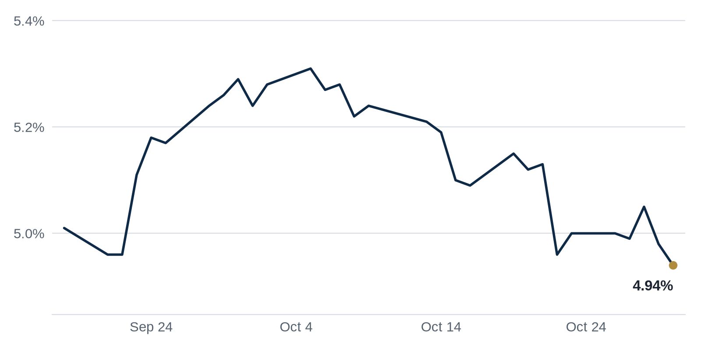

> **Review before publishing:**
> - editor: fixed: Arbor dividend suspension was a Top Story in the Oct 30 issue; repeat from last 3 issues.
> - editor: fixed: Same Arbor dividend-suspension story ran as a Top Story on Oct 30; removing the repeated lead leaves CoStar as the fresh Debt Markets opener.
> - editor: fixed: Duplicates the TPG/ACORE raise already in the Coffee chat talking points, and the ACORE $1.1B fund was reported in the Oct 30 Debt Markets section.
> - check/long_sentence: 32 words: Weil, Gotshal & Manges, a white-shoe law firm...
> - check/missing_link: https://www.bisnow.com/news/national/capital-markets/tpg-acore-raise-billions-for-opportunistic-real-estate-funds
> - check/missing_link: https://news.google.com/rss/articles/CBMikgFBVV95cUxNaDRjWlVIdkhZVXhqal8tY0FjNTRITGRyemhjaTBkRzB3ZnFTbnNkQzBZQzU3T05xRXZEYkkwMVZ6dER3WXdmbVBBZlNiRnJIazJZblZCcUNvaTFFcTM5MG83eGNXRVRndXNaWC11MmRxNVIwWDJhV3FndnFLTVRKa3JCUGZPNmhFVmdfOTh1ckRjUQ?oc=5
> - check/missing_link: https://news.google.com/rss/articles/CBMipAFBVV95cUxNQmt6MDA4cDhZMmpRcVh4cFZ4eElwb0tiWkIzZnVZV3pHdnNYcXRTUndsYS1aaHVlU3pRUmVXampUR0NUS2RnRXBXTXoxanNUWm1zd2NWcmFVTFBOQXhKLWlYNDl1SVdqR1VVV1Y5V3R4ekpLaFl2VmRNWGZ3WWJQaDBGcTFIVmJVWXoxZF82TVpxdVdaNVk4alpqQjA5RHRMWm9LQg?oc=5
> - check/unsourced_number: Market Watch: $31 billion
> - check/coffee_chat: no number: TSMC is weighing as many as six North...

## The Brief

- Taiwan's top chipmaker is eyeing a large Texas expansion, pulling factories, suppliers and jobs toward North Texas. [The Real Deal](https://news.google.com/rss/articles/CBMimAFBVV95cUxOeDNZdVY4QXNUZy1faHBucmhpN1BJZDBpek1WOElOS3hWM090ODEySDdHZ0JWRTVZUHhpWjNYX1NYTHoyUUVPTzZXdWdnSURjanZsX3JwU2E4UHNjLVhUREtSRnNtM0Y3VE1rSm0xWVAzR01Gdk1JdUdVREFWVXFQc0FmVWNlOWVWdThldTJzS3F6NzhGN2ZhWQ?oc=5)
- A storied Manhattan law firm is winding down, freeing prime Fifth Avenue office space into a tightening market. [Commercial Observer](https://commercialobserver.com/2026/10/weil-gotshal-gm-building-bxp-office/)

## The Numbers

*Rates as of Oct 30 close.*

- **10Y Treasury:** 4.94% (-4 bps)
- **5Y Treasury:** 4.71% (-7 bps)
- **SOFR:** 3.95% (+1 bps)
- **Fed funds:** 3.75% to 4.00%
- **Next Fed meeting (Dec 9):** Polymarket's top outcome is 25 bps increase 73.5%
- **REITs:** VNQ $93.94 (+0.1%). Best: SPG +0.9%. Worst: HPP -5.0%.
- **REIT yield vs. 10Y:** VNQ yields 3.80%, -114 bps vs. the 10Y.

**What it means:** Rates were little changed, so the cost of a new loan or a refinancing is about where it was last week, keeping deal math steady for now.

**Why Simon Property Group (SPG) moved:** Simon Property Group, the largest US mall owner, agreed to buy a Seattle retail center, a sign it still sees value in top shopping destinations. [CommercialSearch](https://news.google.com/rss/articles/CBMilwFBVV95cUxQN2pWcFR4NWl0ZlhocDBxdXlGLUlGNFlLUVdURjNBc2pzUG8xM2RWZWxJMUxJQUlpUmttVTFXYmFkdEZXTWJxbEtkVU02YWFfS3FnQ2M2MFNEZ04xWGp3eUkxNkZUREF0RVRSem5pVGxqejZhUDFtNjR0ZUo0Z1poNHN4blhuSXpTY080ZmM2Smt3Y1JCWFlJ?oc=5)

## Debt Markets

CoStar reports that stress on commercial real estate loans is building across the market. Lenders are watching rising missed payments as older loans reach their due dates. [CoStar](https://news.google.com/rss/articles/CBMiiwFBVV95cUxQbmlvd0NOUkREWms3RjE3cEVkZ2cxdGVyUS1LN2ZOQ05jSUpaS2p1b2FFMWg5dThaODM4Mk1zb2JOeWhoWDZ5UGlTTF9Xbi1sZm9JMWZEQlNWazlTZ0M0dFFiQU5ucWI3YURtYTV4enNrQ2dvYldlVVJEdXJual9XRl91bmhfYkh2dW1Z?oc=5)

**Why it matters:** more stressed loans means banks and bond investors grow cautious, which tightens credit for every borrower seeking money.

A growing wall of loans coming due in 2026 is testing owners who borrowed when rates were low. Those loans now have to be refinanced at today's higher rates, raising monthly costs. [Big News Network.com](https://news.google.com/rss/articles/CBMi0wFBVV95cUxNcXlmSUh3Y1AxWE1lZUVzS25sNHQyNy1UOXh4bWZTQTk5dVhKeXhpSURZZXhidThlVHAwczNmcG00aE5JOV9hbGp0SC1wYUZyVVNkUHZIdEJsTWE3WGR3eFV5b2lSV2lXSlJsWUFzX0pXTTFhZHNlMmJ4RldSU2hONlgybHNRcmVoVVZoLU9KeVd0cjEydDZZVTlFNldoVElvSmVuUExya3pvUWI0Zkp6aTc0SXI2aDZmOTF0ME5wZExSVi1vOWlNOFZUTDFiajNYeHVZ?oc=5)

**Why it matters:** owners who cannot cover the higher payments may have to sell or hand back the keys, pushing more distressed property onto the market.

The share of distressed loans inside CMBS (bonds backed by pools of commercial mortgages) climbed to 11.2%, according to a new report. The trouble is spreading, with Los Angeles and Chicago now showing more of the stress. These are properties where owners have fallen behind or landed in special servicing. [Yahoo Finance](https://news.google.com/rss/articles/CBMijgFBVV95cUxQV0lvd0VTNVo4OGhiNU5HcHg0SGFHTmExVVJ2Q2JjNXhqNFRTZkJia2lUdmdPcTFyWnBZeDc4WlZKUk5qenR1VXY4TWZtc1pmUkpiVXFHb2I1c3NiWEdteVZjRk5IUk9kN0FYcHpMOXpMcXFsZ1ZiaC16cy1jYjhSM0dFdzlOcmIyOVFqcVhR?oc=5)

**Why it matters:** When more of these mortgage bonds go bad, the investors who bought them lose money, and lenders get warier about writing new loans in cities like L.A. and Chicago.

**Distress Watch:** the national CMBS distress rate (the share of bundled commercial mortgages in trouble) edged up to 11.2 percent in October from 10.9 percent a year earlier. Even a Philadelphia building that is 99.5 percent leased carries a strained $205 million loan. [Commercial Observer](https://commercialobserver.com/2026/11/cmbs-distress-2026-2/)

## Top Stories

### TSMC eyes Sherman for a $45B Texas expansion

Taiwan Semiconductor Manufacturing Co. is reportedly looking at Sherman for a $45 billion expansion that could grow North Texas into a major semiconductor hub. The move would add to a region already drawing chip suppliers and workers. [The Real Deal](https://news.google.com/rss/articles/CBMimAFBVV95cUxOeDNZdVY4QXNUZy1faHBucmhpN1BJZDBpek1WOElOS3hWM090ODEySDdHZ0JWRTVZUHhpWjNYX1NYTHoyUUVPTzZXdWdnSURjanZsX3JwU2E4UHNjLVhUREtSRnNtM0Y3VE1rSm0xWVAzR01Gdk1JdUdVREFWVXFQc0FmVWNlOWVWdThldTJzS3F6NzhGN2ZhWQ?oc=5)

**Why it matters:** a plant this size pulls in suppliers, workers and housing, so landowners and industrial developers near Sherman gain a long runway of demand.

### Dana Point Ritz-Carlton sells for $600 million

The landmark Ritz-Carlton resort in Dana Point, California, sold for $600 million. The sale of the oceanfront Laguna Niguel property marks one of the larger hotel trades of the year. [Los Angeles Times](https://news.google.com/rss/articles/CBMiugFBVV95cUxPNHJCd1VJcHFFOUQ3UlA5VlZ3ZDd5M21aM1J5bXVmVW1kcTNicWNBcXFzZXQ1aDhwRE5HYUkxMGZ0bnN2eWdHTnBHOFhFeUhieHJyYzJ3OW9rOGpZNVV5SHRkYy1VSTFqQ01NR3FjY2dQTFhFRXZGeDYwd2NYT0RJbTk1RFBXNEpONWNtb25FZFlyRHF4MXlpZ2xJZTAtb04wVWcxam9vd041ZW5HVGRXdmgzeklFY3dBU0E?oc=5)

**Why it matters:** a big resort trade at a firm price gives other coastal hotel owners a fresh comp to point to when they sell or refinance.

### Bellevue Collection sale could fetch multi-billions

The Bellevue Collection, a large mixed-use retail and office complex near Seattle, is on the market and expected to sell for what one estimate calls multi-multi-billions. A sale that size would be one of the region's biggest ever. [The Business Journals](https://news.google.com/rss/articles/CBMipwFBVV95cUxOQ0JjNURaZzlsMExLdldxaWh4UFpEVHcxUEx3djJ5ZVVpU2hLb05BNEc3eUNhdU00YzVuZ3NHd2RwSTIwOERmMllZX0lhc0Y1VE5nck02aWtZS0s1VEVET2JOSk4wbldvT3plWG5fVVRFV3NDWWFONVVhekhpRjFaSndNTDEzSTFxYjdMaEJVTmR1ekI2MEJvWUs0UW5sSHQzY2VuV1BHQQ?oc=5)

**Why it matters:** a trophy sale at this scale tells buyers that deep-pocketed investors still want prime Pacific Northwest real estate, which supports values nearby.

### Weil, Gotshal's wind-down frees GM Building space

Weil, Gotshal & Manges, a white-shoe law firm founded in 1931, said it will wind down, leaving around 447,000 square feet across 11 floors at BXP's General Motors Building at 767 Fifth Avenue. BXP owns 60 percent of the 50-story tower it bought in 2008. [Commercial Observer](https://commercialobserver.com/2026/10/weil-gotshal-gm-building-bxp-office/)

**Why it matters:** a landlord like BXP loses a large tenant, but with Manhattan leasing strong, it has a shot at re-leasing the trophy space without deep rent cuts.

**Coffee chat talking points:**

- TSMC is weighing as many as six North Texas chip facilities, so industrial land near Sherman could stay bid for years. [Bisnow](https://www.bisnow.com/news/dallas-ft-worth/industrial/taiwan-semiconductor-manufacturing-co-could-expand-in-north-texas)
- Between the $600 million Ritz-Carlton sale in Dana Point and the Bellevue Collection now on the block, trophy West Coast assets are clearly trading again. [Los Angeles Times](https://news.google.com/rss/articles/CBMiugFBVV95cUxPNHJCd1VJcHFFOUQ3UlA5VlZ3ZDd5M21aM1J5bXVmVW1kcTNicWNBcXFzZXQ1aDhwRE5HYUkxMGZ0bnN2eWdHTnBHOFhFeUhieHJyYzJ3OW9rOGpZNVV5SHRkYy1VSTFqQ01NR3FjY2dQTFhFRXZGeDYwd2NYT0RJbTk1RFBXNEpONWNtb25FZFlyRHF4MXlpZ2xJZTAtb04wVWcxam9vd041ZW5HVGRXdmgzeklFY3dBU0E?oc=5)
- TPG and ACORE just raised $6 billion for distressed real estate, a bet that the 2026 maturity wall will force more owners to sell. [Yahoo Finance](https://news.google.com/rss/articles/CBMioAFBVV95cUxOSEh6X2RyZXA5aXFWS1d4SkQ1UksxdnR0ZHdFZG16X2Y2OFVZMkF3Skl6eTBXYkFoNWp0dXptSW4wc0NQZXZiUXV3eHpERFh2eWVyeUZkaWNzTGExUmRtZm9YNzdRRjllQkhOZXU0ajdiUGUwX0RPMnZtVW1FUnNIV2o3am9ZQlh2TVJzcHlLNkc3NHVaN2ptUS1sVk52SG9P?oc=5)

## Market Watch

### Sun Belt

TSMC's growing campus around Phoenix is helping fuel a $265 billion wave of new homes, shops and offices across the city's suburbs. The chipmaker's hiring draws workers who need places to live and spend. [Yahoo Finance](https://news.google.com/rss/articles/CBMilwFBVV95cUxNMm9sUERQd0JxR1M2OEJTMko5N0RReU9GZ0p1a1JhRm41RjZVUS1XSzBIY2FwQVZZazFsN2UxQ3RyVHJXSUFfQzhFRkhPSERGSGJaTDVudVFZSS15T0hNcGNEeEtQcFpscWkwTEl3X29PVnZUTW5pSURSd0FDSS1SN3BDSDVrOXkyWkpEaVdoczMwckhPWU5F?oc=5)

**Why it matters:** when a single employer anchors a region, local apartment and retail owners ride its growth, but they also carry more risk if that employer ever pulls back.

### West Coast

Ares Management raised $31 billion in the third quarter as investors poured money into its real estate and infrastructure funds. The fundraising shows large managers are stocking up on cash to deploy. [Prop News Time](https://news.google.com/rss/articles/CBMi5gFBVV95cUxQUV9iNl9xRnlDaUlYaXlhRFNhYkhQVWhaMzAzT0FLRFFCelpRRzc3c1ZMX28tS2ktQzJicnloLXVVREMzVzZGUHJFaUpyUTVCOEhsWC1aRmdEa0NXekNaQXpfQll5RUhFcVRpajhRTndBRWc2MlYwbjJRY1pXcjBNQ3lUMnBoUlExWEtpVzNRLXh3Wk00UExpMlJJcl9Rbm9jdzJGSDEtVlVyV1BEbnBETXFkWnVCOWw5aEJjRUV0eTQ3TTdDbkgtZUVUVEUzZUFGRTNkRkNSUUlpT3p2WGFGNFhTU2JTdw?oc=5)

**Why it matters:** fresh capital at a big manager means more buyers and lenders ready to act, which can put a floor under prices for sellers.

### International

European commercial property sales fell to a three-year low as higher borrowing costs forced sellers to cut prices. Buyers and sellers are struggling to agree on value. [Prop News Time](https://news.google.com/rss/articles/CBMi2AFBVV95cUxPRVBsTFhmWWxub2xaYTNSMWU1bDQ1M0F2M2h0bUQzNVZxRjBOUzlNT3RGZmYwYlRwbXNnTFVjdjIxZlMwLVZTLXVfOTkyUFZONm0tbVE5eG1haUp2Y2lMdmVLbmZNLWJSYkUwTzNnM2w0WmNNeTJQU19nWnB5ZDBKc0VUUUNUdlFBQjlMdnkyQ201NjVVeUFNdVBJVXRqVW1HUERlUzJZd0NUcFQtcFhSb3Y3bG0tTXNjbm5nVWdMVFRRZVgyenZWbGZOemh5aHN3UlJULVJ0Q0E?oc=5)

**Why it matters:** when deals slow because prices must fall, owners who need to sell face losses, and the gap between buyer and seller hopes can freeze a market.

## Quick Hits

- Cousins Properties is buying into Morgan Stanley's planned $1.2 billion Dallas high-rise. [The Real Deal](https://news.google.com/rss/articles/CBMingFBVV95cUxQRXJCM3JRYXlubEd5eF8yMFVPbnRwQy1Xc3RDdThRajJxTTNfLU1mMkpvQlhvdHF1a28tb1ZmaWRLZTh2dmNEc1F3eFVlcTJ4RFRPa19LdkxfOEpEdFpESnZYdnR2TkM2SkstdEtISFpWTkw1VDZHeFRXN0Q1TUVfbkVGV09DWHhxSlNwajhVZkdUY1V0Zm1HVFN1M2ktZw?oc=5) A REIT taking a stake signals confidence that top-tier Dallas office space can still attract tenants.
- Manhattan office rents have turned a pre-pandemic corner. [The Real Deal](https://news.google.com/rss/articles/CBMilwFBVV95cUxPTllSYXVHeGpkUEtmNDg4TzNzSEU3d0VackZSSUlidVdBZ3d2R3M5RDNFNWhadVRjamZ0dXA5ZTJtX2pGNUFwd3VtVnNmcjNRSWI4bVBQU2R1OTluNGItYzVubnJPSFJuQ05YSy1JeUNXazBYRHlGRXdlb0xSajFiTXVnMjFpb2x3c2JLNlpZbDk1TEl6VG40?oc=5) Rising rents reward landlords who held on through the downturn and tell tenants cheap space is getting harder to find.
- Gencom and White Bridge bought the InterContinental hotel in downtown Miami for $300 million. [The Real Deal](https://news.google.com/rss/articles/CBMinAFBVV95cUxOZGM5VThRTFE0Tm9XY3M1Z2hHRG40UEJuemNsX0owSTNaLU9weThFUUFrLWl3VUNQX3U2Ti02YTlSeUw4QkVpSmxJYVpHcUpvT1ZEZTBqOEotSVhnalRwdTF5eFJhcGdTTXRqQ3hWaDYxZFUwUUNPT3UxT2tDNW50alRBNHg5c2FNYkZIVGxLc3Z2ZzJ0bEtfY19XeXQ?oc=5) The purchase shows investors still bet on Miami's steady flow of business and leisure travelers.
- King Yuan Electronics is advancing a $1.3 billion chip testing facility in Fort Worth. [The Real Deal](https://news.google.com/rss/articles/CBMimgFBVV95cUxQamhsQ0w0ZXc5NEUzY3NmZ295NU1qeU1VRVhRVnlCMkNmQW5xeFBhMm1pMm9QTjdTTUxuTzhjVGdxMnFxMkVTSGtkcGZIMWQwcGVfX0sxeDh1WEN3M1ZoZjBpdUtFSTBHYjJYUUVIcll2Zm1yYlN3dGpkTk53R3ppSzYwUkdLWWkwSlJuYkhoZ0dfNzhNOGJnVHFn?oc=5) More chip-related building deepens North Texas as an industrial cluster, which supports demand for nearby warehouses and worker housing.

## AI Infrastructure

The rush to build AI data centers is piling up risk on Wall Street, according to Forbes. Lenders and bond investors have financed a wave of power-hungry server farms, betting demand keeps climbing. If that demand slows, the owners of these specialized buildings could struggle to repay, and the banks and funds that lent the money would take the hit. Developers and utilities gain today from the building boom, but late lenders face the most exposure if the boom cools. [Forbes](https://news.google.com/rss/articles/CBMivAFBVV95cUxQZS04SHZ4TDhUOGNsQlprLXlyV2Z4cEZKX3N4cWNWcVdpTVpiN05vbjExUjZBbW1TamtYN1pMTXBiV0ktZ1FxbWJuX2w4Y1pXT0hkbUZLcTdER1Q0WC1qa1BwRVpiYXZxSHQ2aDU2SnVGeHZEazBiM210WkhkTTlRN29paHNZOUcwVzlqU2N1YlcydmFoXzZnUEpZdlBuNzJqQXlPZmw2VDlmdWk1em1mVE9ETmlRc1FzVnVjMg?oc=5)

## Term of the Day

**Permanent loan:** long-term financing on a finished, stabilized property, meaning one that is leased up and earning steady rent. For example, after a developer finishes an apartment building and fills it with tenants, they replace the short-term construction loan with a 10-year permanent loan at a lower rate. The steady income gives the lender confidence to lend for longer.

For informational purposes only. Not investment advice.
