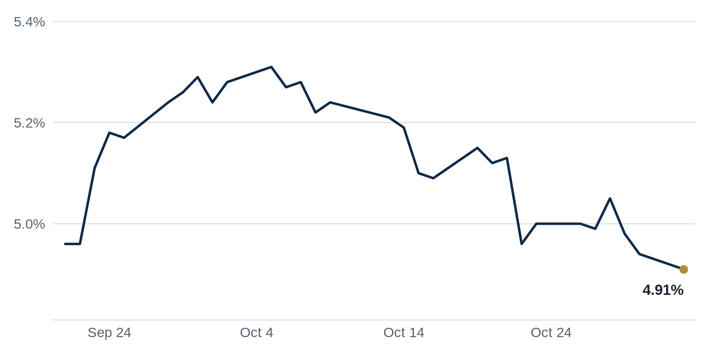

> **Review before publishing:**
> - reits: prices from Alpha Vantage only, not cross-checked (no second source; set TIINGO_API_KEY)
> - editor: fixed: Fact sheet/prior issues show the market's top outcome is a rate hike, not cuts; this claim is unsourced and contradicted by our own Fed odds.
> - editor: fixed: Source only says the economist forecasts four or five hikes; the market itself expects a hike, so 'expectation of cuts' is wrong and not in the source.
> - editor: fixed: The source only reports the dividend suspension and $85M loss; it does not attribute the loss to borrower distress.
> - check/long_sentence: 32 words: **What it means:** Rates were little changed, so...
> - check/long_sentence: 36 words: Trepp reported that the CMBS delinquency rate (the...
> - check/long_sentence: 32 words: Law360 **Why it matters:** big institutional buyers paying...
> - check/long_sentence: 32 words: The Business Journals **Why it matters:** a $5.2...
> - check/long_sentence: 36 words: Connect CRE **Why it matters:** buying a defaulted...
> - check/long_sentence: 31 words: RENX **Why it matters:** building rental apartments instead...
> - check/missing_link: https://news.google.com/rss/articles/CBMilAFBVV95cUxNT3RkcV84M1R1WFNySVYyMFhJd01QOE95SGFtOUtRX3d2anZKNWFlT3dhLURKUjZycDJVdjh4eGpkNW0xNUFaR2VYQ2ZfenJXT1E0WV9jNndkTlpCZWx2emV5RWppbm9zQ2dndVFweFMzVkJoNmRWNUNLY0xpV291djRxMlY4RUJ6QTVOM1I5RXdLeUdM?oc=5

## The Brief

- An economist now expects the Federal Reserve to raise rates several times. [GlobeSt.com](https://news.google.com/rss/articles/CBMiowFBVV95cUxNRGhHTlh4b3hITkoxM1RqWVA5dXI1VGIyMzJVRjZ6WHlBVEotV2YzQ1FpeGd3UDJGSUpsdm1OcnVzbDBsdUNXNzJndVRLR2lDcDE1TzB6NFAyeU14Wk5mNkkxRXl4bUdUSG14bThQbWtwb2M5dE9FY1BGV0plcUcyazlNTFFZZ2I4WXFGOXc2UXY1cWh4R21nT2xhZUxfN2VfMWk4?oc=5)
- Developers are handing back the keys to a nearly finished luxury tower in downtown Los Angeles instead of completing it. [WSJ](https://news.google.com/rss/articles/CBMiugFBVV95cUxPRl9KTnRYWUhlSW5BY3cydWtRZ3l6WDA1ZXJhRzFLRjg1ck5zQ0lmWkxUaDlJX0RMelJ5ZHRPN2JuODB0alRBUEpoQzByREw1ZVJfbHVZYkkzVnR4Q0xNcVlLSzB5Vk5keGlPckk2ZnJRSHR3NklyTWVBT0J3c1B0WVRrT0gwR3c5N0xQeVJJa2lVNGc4aEk1cTBaVVc0dHR0WjFUWHUwb1V6QWotNC1MWGkxVzR2dUZiMnc?oc=5)
- Manhattan office leasing is booming again, pushing tenant demand back toward its strongest pace in decades. [The Real Deal](https://news.google.com/rss/articles/CBMikgFBVV95cUxNaDRjWlVIdkhZVXhqal8tY0FjNTRITGRyemhjaTBkRzB3ZnFTbnNkQzBZQzU3T05xRXZEYkkwMVZ6dER3WXdmbVBBZlNiRnJIazJZblZCcUNvaTFFcTM5MG83eGNXRVRndXNaWC11MmRxNVIwWDJhV3FndnFLTVRKa3JCUGZPNmhFVmdfOTh1ckRjUQ?oc=5)

## The Numbers

*Rates as of Nov 2 close.*

- **10Y Treasury:** 4.91% (-3 bps)
- **5Y Treasury:** 4.70% (-1 bps)
- **SOFR:** 3.95% (0 bps)
- **Fed funds:** 3.75% to 4.00%
- **Next Fed meeting (Dec 9):** Polymarket's top outcome is 25 bps increase 73.5%
- **REITs:** VNQ $95.06 (+1.2%). Best: VICI +2.2%. Worst: HPP -6.4%.
- **REIT yield vs. 10Y:** VNQ yields 3.80%, -111 bps vs. the 10Y.

**What it means:** Rates were little changed, so today's levels tell borrowers the cost of new loans is holding steady rather than easing, leaving refinancing plans about where they stood last week.

**Why VICI Properties (VICI) moved:** No company-specific news today; it may have moved with other casino REITs.

**Why Hudson Pacific Properties (HPP) moved:** The only company-specific news was a report that Hudson Pacific cut a last-minute check to Xavier Becerra. [The Real Deal](https://news.google.com/rss/articles/CBMilAFBVV95cUxORkdmb3RFWjQxYXVyTnppbGQzTzY3dlBWckpiOEFxMTBLNWh4YXVYaVNFbEo3OUZTb3hTNmpieDJfWVRNeDF2bTlPUnc1RkJUT2dPTmpQZjVieV8yVWQ4YXgzeW1aWDAzdU5OVlEzVU1aU0xkZGZ6SE9vRlprSWJRdzltejd3MEp6Nlk3Y3NsbU50TG1u?oc=5)

## Debt Markets

Arbor Realty Trust suspended its dividend after reporting an $85 million quarterly loss. Arbor lends heavily to apartment owners who borrow at floating rates. [The Real Deal](https://news.google.com/rss/articles/CBMipAFBVV95cUxNQmt6MDA4cDhZMmpRcVh4cFZ4eElwb0tiWkIzZnVZV3pHdnNYcXRTUndsYS1aaHVlU3pRUmVXampUR0NUS2RnRXBXTXoxanNUWm1zd2NWcmFVTFBOQXhKLWlYNDl1SVdqR1VVV1Y5V3R4ekpLaFl2VmRNWGZ3WWJQaDBGcTFIVmJVWXoxZF82TVpxdVdaNVk4alpqQjA5RHRMWm9LQg?oc=5)
**Why it matters:** when a major multifamily lender cuts its dividend, it signals stress among apartment borrowers and makes new bridge loans harder to get.

Blackstone is refinancing the note from its AIR Communities purchase with a new $3.3 billion loan. The move swaps short-term acquisition debt for longer-term financing on a large apartment portfolio. [Multifamily Housing News](https://news.google.com/rss/articles/CBMikgFBVV95cUxNUWRvbFM2cWtLLVFaZHN5VXE1T3NEcm9PQzdWUlBmZFhTR2RWYk9vLW43UHNXU2VNNmtGVFdEaW1KUFBjNTBjUHVkYmpGbXl0QjhFb2pQUmlHMm55MGp0SDBFMC1HM3h2a3NxUG9yZ0dubTlzYWd1eDEwc2xRRXpPTFJ2MVhCWVNPaEhHcXEzS1E1Zw?oc=5)
**Why it matters:** locking in a $3.3 billion loan shows lenders will still write big checks for quality apartments, even as weaker borrowers struggle.

Northwind Group provided a $231 million construction loan to convert the office at 675 Third Avenue into 450 apartments in Midtown Manhattan. The loan also refinances existing debt on the building. [Commercial Observer](https://commercialobserver.com/2026/11/northwind-metroloft-david-wener-675-third-avenue/)
**Why it matters:** financing an office-to-residential conversion gives an underused tower a second life and adds housing where demand runs high.

Trepp reported that the CMBS delinquency rate (the share of commercial mortgage loans bundled into bonds whose borrowers are behind on payments) fell 15 basis points in October 2026 to 7.87%, down from 8.02% in September. The drop came largely because a $975 million loan backed by showroom properties in High Point, N.C., and Las Vegas returned to current status. [Trepp](https://www.trepp.com/trepptalk/cmbs-delinquency-rate-drops-15-basis-points-in-october-2026).

**Why it matters:** Fewer late loans is a good sign for bond investors, because it means the properties behind their bonds are paying as promised, lowering the odds of losses.

**Distress Watch:** S2 Capital faces a $75 million foreclosure on a Phoenix property that was left out of its recent billion-dollar refinancing. [The Real Deal](https://news.google.com/rss/articles/CBMilwFBVV95cUxNbHFXZHBCR1JuY1gyZ3hnSjNSTTVicGV2UUJBU1o3UXdBOGYzZFQxQjU3NUVoLVlXQXdLXzFqRVBKRkd3RXl3S2pqSEFYVnZFSFhPLTFJdWJEUm9TN2lKV2ZLOFpmeXJRVGN0aHpSdThrSjJrY21zelcxR0UtbV9kZWNiNDZ3X1hKU0Y5TTlHdVZ0QjdXcGF3?oc=5)

## Top Stories

### Brookfield and Canada's pension board close $5.2 billion warehouse buy

Brookfield and the Canada Pension Plan Investment Board closed their $5.2 billion purchase of LXP Industrial Trust, a REIT focused on warehouses. The take-private hands two of the world's largest investors a big portfolio of logistics real estate. [Law360](https://news.google.com/rss/articles/CBMimwFBVV95cUxOdUpTcFlJbHpFaDhGQ0ozenFUeTAyNks5czVMaS1uTmNNTFpDQTk4MkZrLV9sM25YX0RZNlkxMmQ5Sm04MEM0dzMzSVRqS1lfR3lxOGFKR1JkTjc4d09IcDd1TjdCejVJR3N2YVZUejlOLTZKSHlaTkZNRWE3eUNsSGUzbXFWYUprR0c5Z0VPcXJOdVZxWmxncjV1TdIBc0FVX3lxTFBUVmlsb1VWMmczV2Y2NXIzUFJMbFByZkdUVnZDNkxFV1M5aTloTE50X2JCZk9mR2FZU0VvQi1MUExrU0MtN0phWm03Z2hBQWxnZFRuUko3bVp0UEQwV0RYVFV3UExUcWtDTFdjVGF6cnNUbWM?oc=5)
**Why it matters:** big institutional buyers paying $5.2 billion for warehouses signals they expect industrial demand to keep growing, giving other warehouse owners a fresh comp to cite when they refinance.

### An economist bets on Fed hikes, not cuts

An economist at Renaissance Macro says the Federal Reserve could raise interest rates four or five times. [GlobeSt.com](https://news.google.com/rss/articles/CBMiowFBVV95cUxNRGhHTlh4b3hITkoxM1RqWVA5dXI1VGIyMzJVRjZ6WHlBVEotV2YzQ1FpeGd3UDJGSUpsdm1OcnVzbDBsdUNXNzJndVRLR2lDcDE1TzB6NFAyeU14Wk5mNkkxRXl4bUdUSG14bThQbWtwb2M5dE9FY1BGV0plcUcyazlNTFFZZ2I4WXFGOXc2UXY1cWh4R21nT2xhZUxfN2VfMWk4?oc=5)
**Why it matters:** if the Fed hikes instead of cuts, borrowing costs rise, which makes refinancing commercial loans harder and lowers the prices buyers will pay for buildings.

### Manhattan office leasing is running like it is 2000

Manhattan office leasing is moving at a pace not seen since 2000, The Real Deal reports, as tenants compete for the best space. The open question is whether the surge can last. [The Real Deal](https://news.google.com/rss/articles/CBMikgFBVV95cUxNaDRjWlVIdkhZVXhqal8tY0FjNTRITGRyemhjaTBkRzB3ZnFTbnNkQzBZQzU3T05xRXZEYkkwMVZ6dER3WXdmbVBBZlNiRnJIazJZblZCcUNvaTFFcTM5MG83eGNXRVRndXNaWC11MmRxNVIwWDJhV3FndnFLTVRKa3JCUGZPNmhFVmdfOTh1ckRjUQ?oc=5)
**Why it matters:** strong leasing fills empty towers and supports rents, which helps landlords who have struggled to refinance office buildings since the pandemic.

### A South Florida real estate firm sells for $5.2 billion

A South Florida real estate firm was acquired in a $5.2 billion deal, The Business Journals reports. [The Business Journals](https://news.google.com/rss/articles/CBMipwFBVV95cUxQQ09RUDhYRlMyRGFNOWYzMFdQd21UWlZNc2ZSallBVjhsc3NhUk1kQm1tM0ZwNUZHS0lDQUFsanY1OUpMRHYxUkR2T3NsdFdKb3hFT0RrZjdybWNWQmpsaFFLVUpocHBrZkxIVjZlTjRmdWVEQXh2NndoZVpORHlHTXBqQ3Mtb3VCSXFwWUR4Z2dPYUs4ckZOblRtbGdrWjJmM0VzVDk1NA?oc=5)
**Why it matters:** a $5.2 billion acquisition shows investors still see South Florida as a growth market, which can lift property values and draw more capital to the area.

### Developers walk away from a $600 million L.A. tower

The developers of a $600 million luxury tower in downtown Los Angeles are walking away rather than finish it, the WSJ reports. [WSJ](https://news.google.com/rss/articles/CBMiugFBVV95cUxPRl9KTnRYWUhlSW5BY3cydWtRZ3l6WDA1ZXJhRzFLRjg1ck5zQ0lmWkxUaDlJX0RMelJ5ZHRPN2JuODB0alRBUEpoQzByREw1ZVJfbHVZYkkzVnR4Q0xNcVlLSzB5Vk5keGlPckk2ZnJRSHR3NklyTWVBT0J3c1B0WVRrT0gwR3c5N0xQeVJJa2lVNGc4aEk1cTBaVVc0dHR0WjFUWHUwb1V6QWotNC1MWGkxVzR2dUZiMnc?oc=5)
**Why it matters:** when developers abandon a $600 million building, their lender takes the loss and nearby owners get a warning sign about weak demand for luxury units downtown.

**Coffee chat talking points:**

- Manhattan office leasing jumped 54% month over month in October, back to its pre-pandemic average, so the recovery in big-city offices looks real rather than a one-month blip. [Commercial Observer](https://commercialobserver.com/2026/11/manhattan-office-leasing-october-2026-colliers-report/)
- Blackstone just lined up a $3.3 billion refinancing even as Arbor suspended its dividend, which shows lenders are splitting sharply between strong and weak apartment borrowers. [Multifamily Housing News](https://news.google.com/rss/articles/CBMikgFBVV95cUxNUWRvbFM2cWtLLVFaZHN5VXE1T3NEcm9PQzdWUlBmZFhTR2RWYk9vLW43UHNXU2VNNmtGVFdEaW1KUFBjNTBjUHVkYmpGbXl0QjhFb2pQUmlHMm55MGp0SDBFMC1HM3h2a3NxUG9yZ0dubTlzYWd1eDEwc2xRRXpPTFJ2MVhCWVNPaEhHcXEzS1E1Zw?oc=5)

## Market Watch

### Sun Belt

Cross Ocean Partners and Lincoln bought The Colonnade, a three-tower, 1.08 million-square-foot office campus on the Dallas North Tollway, and plan a $100 million makeover. The prior owner, Fortis Property Group, defaulted on a $223 million loan in 2024 and lost the property to receivership. [Connect CRE](https://www.connectcre.com/stories/cross-ocean-lincoln-buy-1m-sf-dallas-offices-plan-100m-makeover/)
**Why it matters:** buying a defaulted office campus at a discount and spending to upgrade it is a bet that renovated Dallas space can still draw tenants, setting a price other owners will watch.

### West Coast

Seattle is breaking the pattern seen in other cities, where only the newest offices stay full, GlobeSt reports. Prime space there is holding up better than the broader market would suggest. [GlobeSt.com](https://news.google.com/rss/articles/CBMiiwFBVV95cUxNeGJCMmpVVnBPM2F6TjRPemxvWGEwRUZ5WTQwZnFHZm1kQTNWZGxWanlJVTVVdVV2aVpZUHA0YVdTdjVZZjdGMGVTQkN0ZnVYWjY5TXdDXzJWS0JXWi1FNnZuWVRoYW9udUsyOUczcUhJUlJfdkZhOTdJc2xNc0ZwR0JmNFdfQ3BEUTI0?oc=5)
**Why it matters:** if top Seattle offices stay leased, landlords there have an easier time covering their loans, which steadies values across the local office market.

### International

Woodbourne and Address are partnering on a 50-storey rental tower at 88 Isabella in Toronto, RENX reports. The project adds purpose-built rental housing to the city's downtown core. [RENX](https://news.google.com/rss/articles/CBMicEFVX3lxTE1ZQktFTV84STNoV0ZjNllLVUFwSkRBUHA5STA3QmZORTV0NUhfdDFKUVN1dXdjcnpqQlVHdTc4WDB0ZThCQUowSEtrdm1sczJRSTNZSE53WjRVR1NZN1RVUHhzS2t3R3VwQUdFbVlENjQ?oc=5)
**Why it matters:** building rental apartments instead of condos means the owner keeps the tower and collects rent long term, a bet that Toronto renters will keep filling new units.

## Quick Hits

- Nuveen acquired a $445 million, 13-property grocery-anchored retail portfolio across California, Colorado and Washington. [Commercial Observer](https://commercialobserver.com/2026/11/nuveen-acquires-445m-retail-portfolio-across-three-western-states/) Grocery-anchored centers draw steady foot traffic, so investors treat them as safer retail bets when the rest of the sector wobbles.
- Tishman closed the sale of a Soho office building for $133 million. [The Real Deal](https://news.google.com/rss/articles/CBMilwFBVV95cUxQcXMyNVVjX0xGZTVrdTZGSE5rZUdGQ0M3X0ktV0lUYUNnMDY1bU1fal9uQVRDWGg2N0ViUnl5MHZIcnNDMG5tX25hWkRTNDRvRklkUXRVaUpnVEM5QjhyUHJCbDhhMEQtVDNsdnl1UFVqem9yeDRPcEFqZEx4VnM0aHlLVVRZT3JKMVlNMHk4UGlMUFE3WnRR?oc=5) A completed office sale shows some owners are cashing out of older space while buyers hunt for a bargain.
- A proposed rent freeze is scaring away government-backed lenders. [The Real Deal](https://news.google.com/rss/articles/CBMimwFBVV95cUxQejVFZ21jVTFYX216cXE2RVR1Z20yOFI5QVkxVmZ4Q2RaRzRFZjBOOFNJdFZxc0pDSXVhVkpvQjN0aHk0bk5JTTRFblJad3FsblNwSE4tME9ZdVFHSlltNzBENUpicGEwdS0taGVXaS1vb1ROUGFUdFBiWDdmRHRXV3VSa05CM184aTI2M1ZOWExqdjBaV2ZYRE8yNA?oc=5) When a city caps rents, landlords earn less, so lenders that rely on government backing grow wary of financing those buildings.
- Jeff Bezos' AI firm is nearing a 180,000-square-foot lease at the former Gap offices on San Francisco's Embarcadero. [The Real Deal](https://news.google.com/rss/articles/CBMipgFBVV95cUxPSlVqQ0FvN2gxd0tpTkVzVEpiNUFQQ2dubkZQbjJhdFptV3V1TEtEWGlieGRMakJiY2V4SWxMUGNNXzhnUTcxb25MaEpOTk5FQnZ1U2Y1ZUVIQi00VVIxTnVCTmsydndpVjZQUlZvT09SeVZlN0ZjM2dsMVJhZ3BOSnVJN2lFa2Zfc1o0dGM1R1dvS0RHUWZ4Yk50NVVmalRtUE9zUTBR?oc=5) A fast-growing AI tenant taking a large office suggests tech demand is helping San Francisco's office market recover.
- Prologis plans a nearly 4 million-square-foot warehouse campus on a former Joliet casino site. [The Real Deal](https://news.google.com/rss/articles/CBMipgFBVV95cUxPZDQ2VmhRcE8yVVNnS0h1dkU3bDBGOUJnUHhKdXlJRHoyOFF4OFRQSlRvVVM3NmkzWjJ2UEpneXBWRVVvaUZrZnhhSDRac0FQOThocUpyelRLcllWei1CcHQtdzRWZklrY09jeFJZdEFVRmItalBVU1BHSV9xM0tVSnlkUm5uMF8zc1dOYm9mU2pCZHdSRWZWeHNGVk5NcTdEcXJHTGFn?oc=5) Turning a shuttered casino into warehouses shows how much developers prize land near major shipping routes.

## Term of the Day

**Value-add:** a strategy where an investor buys a tired or underused property, spends money to renovate it or manage it better, then raises rents to lift its value. For example, a buyer might pay $20 million for a half-empty building, invest $5 million in upgrades, lease it up, and sell for more. The extra value is the reward for taking renovation risk.

For informational purposes only. Not investment advice.
