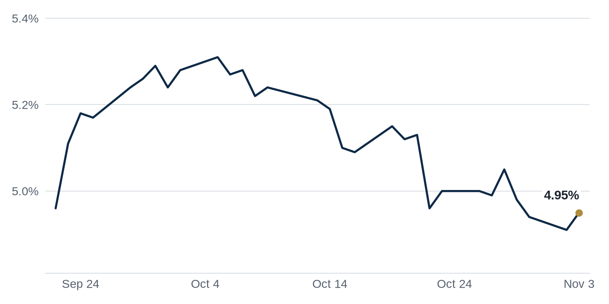

> **Review before publishing:**
> - reits: prices from Alpha Vantage only, not cross-checked (no second source; set TIINGO_API_KEY)
> - editor: fixed: Duplicate of the first Debt Markets paragraph: same Brookfield $600M downtown LA apartment tower walk-away story, just a different outlet (Citybiz vs WSJ).
> - check/long_sentence: 32 words: The Real Deal **Why it matters:** lower, more...
> - check/long_sentence: 31 words: Bisnow **Why it matters:** when large investors pay...
> - check/missing_link: https://news.google.com/rss/articles/CBMinAFBVV95cUxPQUhianM1OExkLW1qTzR6bm83YW5sN0tpajRuTnJNYjd4Y2FxdUdjajM3bHZ3SFE3RVI1ZDNKNTgzQVY1dkRubHlPRVh5aVMtdjhGTlhMa2Jxd3RybXhPZTNBVGxDdVRTbnpBSS0zbEpadWZpWjEtR19mX2dKX3RYXzVSSDJNWndKS01jVFhKYWNldXBTU1daMTQ1Vkc?oc=5
> - check/missing_link: https://news.google.com/rss/articles/CBMikwFBVV95cUxOU21hTDB0SXFicW14VmNpTWNBNTJmQmkxYjBuNkxzWUJiM3ZCZ0lyQjlVV2FrY1BPUWIwUG9KamkxOGJQR1lGSS1DZmpRV0JGT0I5cWdWODlnVHRlUGx4dUFjcjAxS09DcmtkcVhLOHc5dHhuVTdORDAxaDVwMkJJLUoyT1FVSktPRldQWUtxWTdQejQ?oc=5
> - check/missing_link: https://news.google.com/rss/articles/CBMiuAFBVV95cUxNalFoU0Q2OS1sd1dKN0EwLVBWdWxWVldkSTNhb3hnai0xOFRYakllNTRGc20zcHFja3U0eGxjNzNfQl8yWGNrZE14Nzk4R214ZWNwSkhVZjZXWFlCbV9MaURpQzQ5UlZOemV6aGNvLThJeVhDQnJRLVljbzVONWV0SEZZT3lEN0JDWXNzQnVvV1ZBVjJvbFlHa0pTcTk3TV9DTkZ0ckw3YXVIZG94RkowbVc2WGt5VzNm?oc=5
> - check/missing_link: https://news.google.com/rss/articles/CBMinwFBVV95cUxPM0FZdGItdjB4VDM1aXM4WWMwVHFhOHdlSUtRVFdlcG1qaDg0X0kzS0V1WkVjMncxWEh2MVB0STNtcEViU0Q1YjJ5dmE0RV85NDJQNmtNXzRZcEo4RHRTeXhfLU90dklmWHpOM1VXdDlzV1pqeXRNTWxXeldsSTRURnFCUkpBNTQtLUFyaFo2N2NaOWI3dlYwSGhqQ2pzSXc?oc=5
> - check/repeat_in_issue: linked 3 times: https://commercialobserver.com/2026/11/new-york-city-apartment-rents-record-highs/
> - check/repeat_in_issue: linked 3 times: https://www.bisnow.com/news/los-angeles/industrial/southern-california-industrial-portfolio-sales

## The Brief

- Democrats won Congress in Tuesday's midterms, and voter anger at data centers could slow new projects. [Bisnow](https://www.bisnow.com/news/national/economy/the-results-are-in-what-we-know-so-far-about-cres-midterms-shake-out)
- New York City apartment rents hit a fresh record last quarter, squeezing tenants and rewarding landlords. [Commercial Observer](https://commercialobserver.com/2026/11/new-york-city-apartment-rents-record-highs/)
- Large investors poured billions into Southern California warehouses, betting the industrial slump has bottomed out. [Bisnow](https://www.bisnow.com/news/los-angeles/industrial/southern-california-industrial-portfolio-sales)

## The Numbers

*Rates as of Nov 3 close.*

- **10Y Treasury:** 4.95% (+4 bps)
- **5Y Treasury:** 4.74% (+4 bps)
- **SOFR:** 3.97% (+2 bps)
- **Fed funds:** 3.75% to 4.00%
- **Next Fed meeting (Dec 9):** Polymarket's top outcome is 25 bps increase 82.5%
- **REITs:** VNQ $95.01 (-0.1%). Best: DLR +2.4%. Worst: VNO -3.1%.
- **REIT yield vs. 10Y:** VNQ yields 3.80%, -115 bps vs. the 10Y.

**What it means:** rates were little changed, so borrowing costs for new loans and refinancings sit about where they have been, keeping deal math steady for now.

**Why Digital Realty (DLR) moved:** No company-specific news today; it may have moved with other data center REITs.

**Why Vornado Realty Trust (VNO) moved:** No company-specific news today; it may have moved with other office REITs.

## Debt Markets

Brookfield chose to walk away from a luxury downtown Los Angeles apartment tower rather than refinance it, the Wall Street Journal reports. The firm had sunk about $600 million into the Beaudry project, but rising debt costs made a new loan unattractive. [WSJ](https://news.google.com/rss/articles/CBMiuAFBVV95cUxPejZ5dXhXUlYtWF9NZDdPeFYyME9MMS1sNXhfcUpfN3NaeS15Vmx0SVJxYXRHT0VWWEM1a2gwVDVmR21Mb3JEeTJkYk9qN0pkdkNvR1ZvdUt0a3dZVGRVUkNXWXdjVzhRVEdmRzNjVFMyc2x3VjVTbkt5NUxvTUgteWNZMjhYMk5JT0RDa3U5T0xDbzNTYWVzbTlEcVFvMVNxUnRzbjBpdmpqSVFSQUgwTFNtU1BHbmE4?oc=5)
**Why it matters:** when a major owner hands back the keys instead of refinancing, it tells lenders that even trophy buildings can stop penciling once borrowing gets expensive.

Martin Selig Real Estate restructured $500 million of debt tied to its Seattle office buildings, Connect CRE reports. Restructuring means reworking loan terms rather than paying the debt off or defaulting. [Connect CRE](https://news.google.com/rss/articles/CBMitgFBVV95cUxOamdDd01jZVllZ00ydWJuWjV1YkR5ajY1RnpTcWtTRFdEVjFTQVdPWjBJS2ZoUUVzaHoxSFB6UFNxQlBBYS1kSWh0RHdpOWFNajJtZWhzazVteGdDUGNuaEd6YmZfeTBtTXhvcld2Sm1TLVpmRWp6S2pNRy02bkZ0a19XY1pVY0NEQ3Rsa2ZWZC1ZQVBYZGVRRWlSQVR1ZTdGYXYxSl9acVA4dk5obFZhMzlsZGhSdw?oc=5)
**Why it matters:** reworked terms buy an office landlord time, but they also show how hard it has become to refinance aging downtown towers at today's rates.

**Distress Watch:** a ZOM affiliate filed for bankruptcy after a $308 million Arizona court judgment and now plans to sell its assets, The Real Deal reports. [The Real Deal](https://news.google.com/rss/articles/CBMiogFBVV95cUxOMG1nZmJYVFN4Ym1Ba2paWFNGd3NtRkxNVWJKT0EteUlYUEdGTEhTeVdrOVh5ZDFJWjF6cE12OFYzV3YyQzNLWmdCMEdqbGFyczhHN0hjWWozX3dBalkxZFZFU2RQWGVIQmFEYTZ3TnppSDktajg5ZnpZQ09IWGh3bTVLREw4T2pBU2UtUTZ4aDVybU9MX19QU292dFNsRElkdHc?oc=5)

## Top Stories

### Democrats Sweep Congress as Data Center Backlash Grows

Democrats won control of Congress on Tuesday, and Bisnow reports that voter frustration over data centers shaped several races. These projects swallow large tracts of land and electricity, and residents living nearby are pushing back. [Bisnow](https://www.bisnow.com/news/national/economy/the-results-are-in-what-we-know-so-far-about-cres-midterms-shake-out)
**Why it matters:** developers planning data centers now face a tougher political climate, which could delay approvals and raise costs for these power-hungry sites.

### Texas Flips Blue, Clouding the Data Center Boom

Texas elected a Democratic governor and U.S. senator, a sharp political shift for a reliably red state. The new leaders could add rules for the data centers that have flooded Texas, according to Bisnow. [Bisnow](https://www.bisnow.com/news/houston/commercial-real-estate/texas-flips-blue-putting-data-center-boom-on-notice)
**Why it matters:** Texas has been a top market for data center builders, so regulation there would force operators to rethink where they site future campuses.

### Florida Voters Cap Property Taxes With Amendment 3

Florida voters approved Amendment 3, a referendum that limits how much property taxes can rise, The Real Deal reports. The change rewrites a major cost line for property owners across the state. [The Real Deal](https://news.google.com/rss/articles/CBMid0FVX3lxTE8zdzB6YmtXSDduSzVYSWNVMFpOcm43VURSQ0wyWTFwWGZVMU1rdkVlRk1UTGVQWVBoVzc5STNKZGZza3I5T3AzaHNra0xaYnlJbkVJbjVHQUxwVVFrQk9feHRKWHhybXI5NnhudHA1Tlg0TWpaOGtv?oc=5)
**Why it matters:** lower, more predictable property taxes raise a building's net income and can lift values, but they also squeeze the local governments that lean on that revenue.

### New York City Rents Set a New Record

Median asking rent in New York City reached $3,785 a month in the third quarter of 2026, a 4.5 percent rise from a year earlier, Realtor.com data shows. It is the highest rent the report has ever recorded. [Commercial Observer](https://commercialobserver.com/2026/11/new-york-city-apartment-rents-record-highs/)
**Why it matters:** record rents hand apartment owners and their lenders steady income, but they deepen the affordability squeeze that pushes renters and policymakers toward building more supply.

### Big Investors Bet $3B on SoCal Warehouses

Two industrial portfolio sales in Southern California topped $3 billion combined, Bisnow reports. The buyers are wagering that the region's warehouse market is rebounding after a soft stretch. [Bisnow](https://www.bisnow.com/news/los-angeles/industrial/southern-california-industrial-portfolio-sales)
**Why it matters:** when large investors pay up for warehouses, it signals they think vacancy has peaked, giving nearby owners a fresh comp to cite when they refinance or sell.

**Coffee chat talking points:**

- New York rents hitting a record $3,785 a month helps explain why conversion specialists keep chasing Midtown office buildings to turn into housing. [Commercial Observer](https://commercialobserver.com/2026/11/new-york-city-apartment-rents-record-highs/)
- Investors betting more than $3 billion on SoCal warehouses suggests they see logistics demand holding up far better than offices. [Bisnow](https://www.bisnow.com/news/los-angeles/industrial/southern-california-industrial-portfolio-sales)

## Market Watch

### Sun Belt

A Lincoln joint venture bought a 1.1 million square foot office campus in Dallas, CommercialSearch reports. The purchase is a sizable bet on Sun Belt offices while many coastal markets stay quiet. [CommercialSearch](https://news.google.com/rss/articles/CBMikAFBVV95cUxOTTBRcE1EcFM1TGhjeUl0b0NtS1JvRkNHZ0Q4WF96eVBrNVJ1eUNRck1sRjdMS3VOdTBHMTk4WFlBWTJzUnVIU1ZvVEFQTUR4a0s0dXJtZFZ4RUVCMnFKT0JhMzN6aFlzcGRDSDJVajFxc2JTOEgwd1dSZ3IxX240bm15MGpNTWxaZ25MQXBpcnc?oc=5)
**Why it matters:** a large office buy in Dallas suggests buyers believe Sun Belt job growth will keep these buildings leased, a confidence many northern cities still lack.

### West Coast

San Francisco voters approved more money for affordable housing, though a plan to fund it with property-sale taxes remains undecided, the San Francisco Chronicle reports. The transfer-tax piece would hit sellers of pricier properties. [San Francisco Chronicle](https://news.google.com/rss/articles/CBMilAFBVV95cUxNbkJZVUY1MTlyOXI0Z2dHUVAtOC02a0VySWFXbzU5NmprRDVIdkc0X3FBQ2lieGx6UGJsMzNCblltWE41bmxsSGRwQy1fN2kzOXl1aWdLOXhidmp4ODFqdEh2VzBYeFVfM1lmLVQ2ejdVcUd5ZS1nbG8yU2NmeUp1TnNCc0Y2Tkc4dm1NZlZxSmdYSU1i?oc=5)
**Why it matters:** more affordable-housing funding helps renters, but a new tax on property sales could discourage owners from trading buildings in an already slow market.

### International

Analysts put India's real estate investment at $85.5 billion, The Realty Today reports, pointing to strong demand across offices and housing. The figure underscores how much global capital is flowing into the country. [The Realty Today](https://news.google.com/rss/articles/CBMirgFBVV95cUxQT0EzcjlaVE14cTZaeUhTMHZQTnZzQXpHNWowYXBMM1J4QnhKc1VLQ2dBdzJORnVVc1dvTWtjX3RsQkM3amdxd1N5SFUtZk56U2oyZlVkcHRBRHFnYnZXblU5NDBkbnBxWGZfdTNjVktDVnI2S0NzOXVkNTlEaDJ2bGJ6aFVnUHVyY2JpQU5KZS1COGJtSm1zWlFHXzM3X201c0RwSEJUeE93MHdsSlE?oc=5)
**Why it matters:** as investors chase growth in India, some capital that might have gone to U.S. deals heads overseas, adding competition for global real estate dollars.

## Quick Hits

- Insurance has overtaken power as the top factor in CRE investment decisions, GlobeSt reports. [GlobeSt.com](https://news.google.com/rss/articles/CBMipwFBVV95cUxPdjNMUHRpTjV0d2pzOGpKWGJLTVRXdThnM2syRGtDRE1hRV9JSi1YYTVoOElrUmtuZVlTem9pYm9MaURwbVpwd1AyU1dFYlUwTFZRUGI3TzdKaDZVSXFBVHdHXy1iOTlHd1dnTnJybUZIQWl5dklleTVXQTNlZXdLcXQwN1d3TG4xTXVOVVlEajBMRFlWc2IwYUhsMk50Yk1Ld0Qzb05tVQ?oc=5) Rising premiums can make or break a deal's returns, so buyers now weigh coverage costs as heavily as location.
- The Bay Area captured half of the nation's AI office leasing activity, The Real Deal reports. [The Real Deal](https://news.google.com/rss/articles/CBMioAFBVV95cUxQZF9mS0x2S3UxTkU0dUZFYW5QYWtoMnRteUdVbnkzc3VqNS0zekRpRUlQNHZlU1NqUndzSlFzcFc2NS1pMGdBSzlfOVRyOUd4eHVjc0pkbjBlM0haNHRhYTBYN0xpQ1VmY2lZVFVWcHRNZWZCSWx5UDVic2ZRczB2S1Z4MFMzTFltZmIwdkJnX0VCc2N3Y1BHUXlHcHBpQTBh?oc=5) AI companies renting large blocks of space are refilling offices that sat empty, a lifeline for landlords there.
- Conversion specialists secured $231 million for a Midtown Manhattan office-to-residential project, Multifamily Housing News reports. [Multifamily Housing News](https://news.google.com/rss/articles/CBMiqwFBVV95cUxNZVpicTgwbE5ONmZ6cFM5ZTFfOTBOZnZ1WUJ5SXVfSmw5eXRwSUdBZkpLQVNFTThUdzh1MkRocUlfb3NtYzNoTGoyWFAzNVdRcXVNbWZDT0JOY0s5bElnbE1PMi1KU1ZjMjlqemhXcDlobmFMMHlBSlAtRmtCcE1oV2h5UWY4VVkyemlPQnBhQjVjdXg4c0FnNkczVVpZLVd0MXN5amxDa1NaQ1U?oc=5) Turning unwanted offices into apartments gives owners a way to salvage value from buildings tenants have left.
- A 2.7 million square foot campus traded in Houston's largest industrial sale, Yahoo Finance reports. [Yahoo Finance](https://news.google.com/rss/articles/CBMiiwFBVV95cUxNX1FzdjVMNl9LSGd5clJzMWt3eGxIak11UkJYNEt6UlRJX2xwY1hsYmxxNExuY0tRM3hCMXl3ZEF4eFZvYWpCWXZXcDMxQWNGTnpNWmJiQ05YS0ZKTkxnUjB6c2sxd0IybHMyNFZLTXQ1empZWE1LeEMtMWRXMjdBSWx1bzRuamEtMWJr?oc=5) Big warehouse deals show that demand for logistics space in Texas remains healthy despite higher borrowing costs.

## Term of the Day

**Recourse:** a loan where the lender can chase the borrower's other assets, not just the property, if the loan goes bad. On a $10 million recourse loan, a borrower who defaults could lose the building and still owe the shortfall from other funds. Non-recourse loans limit the lender to the property, so recourse shifts more risk onto the borrower.

For informational purposes only. Not investment advice.
