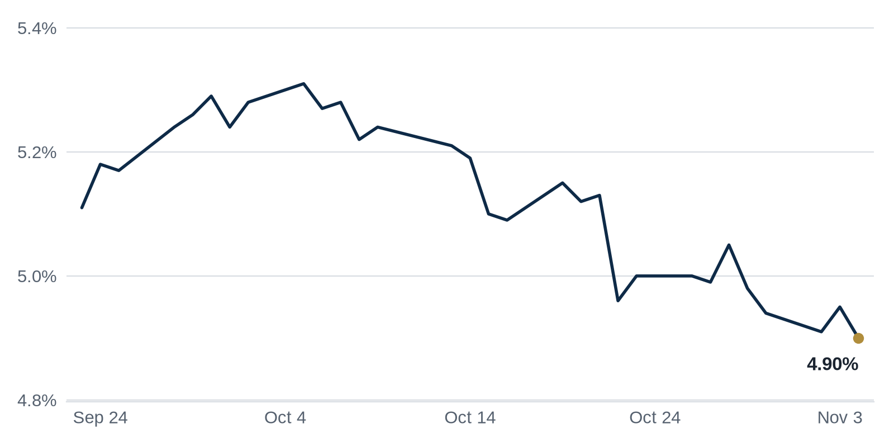

> **Review before publishing:**
> - reits: prices from Alpha Vantage only, not cross-checked (no second source; set TIINGO_API_KEY)
> - editor: fixed: Repeat: the Brookfield Beaudry walk-away was the Debt Markets lead in yesterday's issue (2026-11-04).
> - editor: fixed: Source headline says 'Reschke's LaSalle Street office conversion'; first name 'Michael' and 'to-residential' are not in the source.
> - editor: fixed: 'especially in tech hubs' is not in the source title or summary.
> - check/long_sentence: 32 words: **Why it matters:** A foreclosure on a loan...
> - check/missing_link: https://www.bisnow.com/news/los-angeles/multifamily/brookfield-gives-up-dtla-beaudry-apartment-tower
> - check/repeat_in_issue: linked 3 times: https://www.bisnow.com/news/chicago/office/cushman-wakefield-global-hq-sells-at-45-percent-discount

## The Brief

- Democrats swept Congress on anger over rising costs, putting housing affordability at the center of Washington's agenda. [Commercial Observer](https://commercialobserver.com/2026/11/democrats-housing-policy-congress-2027-midterms-blue-wave/)
- Cushman and Wakefield's own Chicago headquarters tower changed hands at a steep discount, a fresh office value comp. [Bisnow](https://www.bisnow.com/news/chicago/office/cushman-wakefield-global-hq-sells-at-45-percent-discount)
- Florida voters approved deep property tax cuts, squeezing local budgets and clouding the outlook for property owners. [Commercial Observer](https://commercialobserver.com/2026/11/florida-amendment-3-rivani-gramps-getaway/)

## The Numbers

*Rates as of Nov 4 close.*

- **10Y Treasury:** 4.90% (-5 bps)
- **5Y Treasury:** 4.69% (-5 bps)
- **SOFR:** 3.94% (-3 bps)
- **Fed funds:** 3.75% to 4.00%
- **Next Fed meeting (Dec 9):** Polymarket's top outcome is 25 bps increase 67.0%
- **REITs:** VNQ $98.03 (+3.2%). Best: DEI +7.4%. Worst: NNN -0.1%.
- **REIT yield vs. 10Y:** VNQ yields 3.80%, -110 bps vs. the 10Y.

**What it means:** Rates barely moved, so borrowing costs on new loans are steady. Today's levels keep financing expensive but predictable, letting buyers and lenders price deals without bracing for a sudden swing.

**Why Douglas Emmett (DEI) moved:** No company-specific news today; it may have moved with other office REITs.

**Why NNN REIT (NNN) moved:** No company-specific news today; it may have moved with other retail REITs.

## Debt Markets

Refinancing costs for apartment owners have jumped 41% as a wave of loans comes due, according to GlobeSt. Owners who borrowed cheaply years ago now face far larger payments to replace that debt. [GlobeSt.com](https://news.google.com/rss/articles/CBMilgFBVV95cUxPSmVBZFBpUjl5SE4wYVFYcS13MlNxY0RDaWg4dzMwWjAtWFZQcUFRaGhaRnpqeEVlUEdKNm81S2dNYUIwQTV0QWZIM1F3YmM3bkxLV1JWd0Z1UzBIQ3U0Tmhrc3dNcXIxeWpSYmxVM3U5WDhqczZKRmJ6eEQ0QTZqYW5sMjd0dEFuY0twQkVHMUJZbmEwZFE?oc=5)

**Why it matters:** Borrowers who cannot cover the higher payments may be forced to sell or default, feeding more distress.

At Commercial Observer's fall finance forum on Election Day, major players described a calm before the storm, warning that the near future holds plenty of distress to work through. [Commercial Observer](https://commercialobserver.com/2026/11/commercial-real-estate-distress-2026/)

**Why it matters:** When lenders and investors openly expect more defaults, credit tightens and discounted buying opportunities start to appear.

A lender has filed to foreclose on a $236M loan tied to 35 West Wacker, a Chicago office tower, according to a new suit. Foreclosure means the lender is moving to seize the building after the borrower allegedly failed to meet the loan's terms. The filing adds to the list of large downtown office loans now in trouble. [The Real Deal](https://news.google.com/rss/articles/CBMiogFBVV95cUxNUVhpMi1WREhETTgyWXdrRWc5LWtYZ2UteFVyVllNYXFlU3ZVMWlzN1c0dWFEMVNIdE9TVkhRWUpEblp2Sy0zSldlRTFzazlvWXpoWHNOWTlHaVk4OU5EUGhZeVN6a2xKVUhyaWxfWGl1ZHUwa0NLRDlCc3dKTGNMbTBUSFg3NVpUaVNJa0Fxd0QwaWNmYWl2ZktXbWxfd1hVaGc?oc=5).

**Why it matters:** A foreclosure on a loan this size signals that the lender sees little chance of being repaid, a warning sign for anyone holding debt on older downtown office towers.

**Distress Watch:** A historic flatiron building on Market Street in San Francisco has slipped into default. [The San Francisco Standard](https://news.google.com/rss/articles/CBMifEFVX3lxTFAzVERIMTVySHdUejZpOXZjc1ZGTDl5WElDeGh0dEJwRkZHWm5jdm5rQ2Q4UldZYmFxVzhGXzg1eGZjS2FZdTdId21vRmtSOGdOZWJ3VFlTSk1FNmtFTExscjRYaGphVUpnU2dST183aXpIbVZhTGdrOGExVHY?oc=5)

## Top Stories

### Cushman and Wakefield's Chicago HQ sells at a 45% discount

An affiliate of Prime Finance, in a joint venture with Hines, bought the 31-story tower at 225 W. Wacker Drive, which houses Cushman and Wakefield's global headquarters. The sale closed at a 45% discount to the building's prior value.

**Why it matters:** A deep markdown on a trophy Chicago office gives lenders a brutal benchmark for what similar towers are worth, pressuring refinancings across the Loop. [Bisnow](https://www.bisnow.com/news/chicago/office/cushman-wakefield-global-hq-sells-at-45-percent-discount)

### Democrats flip Congress as housing moves to the center

Democrats flipped both houses of Congress on Tuesday, winning seats in deep-red parts of the South, Midwest and Great Plains as voters revolted against rising costs. Housing affordability is now set to dominate the legislative agenda.

**Why it matters:** A new majority could push rent rules, tax credits and zoning incentives that reshape what gets built and who can afford it. [Commercial Observer](https://commercialobserver.com/2026/11/democrats-housing-policy-congress-2027-midterms-blue-wave/)

### Florida voters approve Amendment 3 property tax cuts

Florida voters approved Amendment 3, a far-reaching property tax cut, with 62 percent of the vote, clearing the 60 percent threshold needed to change the state constitution. Supporters say it will slash local government budgets.

**Why it matters:** Lower property taxes cut a major carrying cost for owners, but thinner local budgets could mean weaker services that eventually drag on property values. [Commercial Observer](https://commercialobserver.com/2026/11/florida-amendment-3-rivani-gramps-getaway/)

### Fort Point pays $440M for nearly 1,000 SF apartments

Fort Point paid $440 million for nearly 1,000 San Francisco apartments. The purchase lands as the city's housing market tries to find a floor.

**Why it matters:** A large buyer betting this much on San Francisco rentals signals that investors think apartment values there have bottomed. [The Real Deal](https://news.google.com/rss/articles/CBMiqgFBVV95cUxPN0IyNjdma1pSdjZUOUhKZmhsaUhxTDh1WllvTnZ0a21qNVZlS2xnYzAzdE9MLTBhdkxJM19MQ0lwMENPa3pjRWNDemowd2xwX0lHMWtVUUtGcDVfUU1kSXFMOUMwVHFNNTRTVWxrUGVxR3A4QkxpVGJXdThGSTIteEFWT2J3c1ktcnl5aFY3QnRiU0NFQnB0eHppa1gtVUJ1QmNrVXljZkFCUQ?oc=5)

### Push to end Fannie and Freddie conservatorship gains steam

A post-election push to end the conservatorship of Fannie Mae and Freddie Mac, the government-backed firms that stand behind most US mortgages, is gaining momentum. The two have operated under federal control since the last financial crisis.

**Why it matters:** How these firms are released could change mortgage costs and multifamily lending terms for nearly every borrower. [GlobeSt.com](https://news.google.com/rss/articles/CBMisAFBVV95cUxOMFRfdktReXdHemE0UmxaajhFeE43Yi1FOHZjSGw2NXlHRXFMUFJGbldyNTRBVnhUaGZLMlVvYUJlZzAyU3FoNGhwVVFXNXdFQXdDVWhSTFhYYjFWT1JhUHI1ME9fWXZMdG1WUHNNV0RfbU9yTEFFX1JHWUFBSW5kazdRWTk4RHhFRVRYcDBaWGJnYURmNC1NWG1iWnBfdktPR2N4M1A5NE5ydXQ0cDZwUw?oc=5)

**Coffee chat talking points:**

- Chicago's Loop is ground zero for office stress: Cushman's own HQ just sold at a 45% discount even as lenders chase nearby defaults. [Bisnow](https://www.bisnow.com/news/chicago/office/cushman-wakefield-global-hq-sells-at-45-percent-discount)
- The refinancing wall is the real trigger, with multifamily refi costs up 41% as loans mature, enough to push even Brookfield to hand back a tower. [GlobeSt.com](https://news.google.com/rss/articles/CBMilgFBVV95cUxPSmVBZFBpUjl5SE4wYVFYcS13MlNxY0RDaWg4dzMwWjAtWFZQcUFRaGhaRnpqeEVlUEdKNm81S2dNYUIwQTV0QWZIM1F3YmM3bkxLV1JWd0Z1UzBIQ3U0Tmhrc3dNcXIxeWpSYmxVM3U5WDhqczZKRmJ6eEQ0QTZqYW5sMjd0dEFuY0twQkVHMUJZbmEwZFE?oc=5)
- There are bright spots in the distress data: a $975 million loan returning to current status pulled CMBS delinquency down in October. [Connect CRE](https://www.connectcre.com/stories/large-loans-return-to-current-status-nudges-cmbs-delinquency-down-in-october/)

## Market Watch

### Sun Belt

An Nvidia supplier plans to spend $300 million renovating a $1.3 billion plant in Fort Worth, topping the metro's latest permit list. The investment deepens Texas's role in the chip supply chain. [The Real Deal](https://news.google.com/rss/articles/CBMinwFBVV95cUxONVA4bGcwNVd6dVpETExLRkxIbURwVjc4U242UWMxSUpLcllBT1BnOVkxbE5kRFJBa1RGa3hLQmY3aEgxVHpBaXpvS19wNEVoUDEycXp4QXNOUUhKT1BGM2ItYTMwUXRYQUw0VmE5eE1Wa05KNkxKSVlIV001M21sUldqUHZZWDgxRzVvaTA3WU1Vb3ItRklhTElfc2xISlU?oc=5)

**Why it matters:** Big industrial upgrades create construction jobs and anchor demand for nearby warehouse and housing space.

### West Coast

A Morgan Stanley subsidiary paid $87 million for apartments in south Seattle, pointing to low vacancy and slow new construction. The deal shows investors still chasing rentals in supply-starved West Coast metros. [The Real Deal](https://news.google.com/rss/articles/CBMipgFBVV95cUxOcHZ3Nlg4TUtUUG8ydFl4V1g1UWtqbkg5ajY5WVgyN3dEZ2ZFd1lONkVmamFqUjdLd29hWEhvNGxsV25EM2tWV0Y5V2IyZVdiYzJUVmhoSkJ4VllEU25mZUhxRjBSTVYwaVhFOVVxYWRWcDZERWpBQmJyUWNielZmdFhram5lZ3Q0b1dMdk5QQm5fa1d3bXBZa0FMcjQyd0pGQ3V5eUh3?oc=5)

**Why it matters:** When little new supply is coming, existing apartment owners gain pricing power to raise rents.

### International

Trez Capital and Starwood Capital formed a partnership to originate residential land acquisition and development loans for single-family communities, spanning Vancouver and Miami. The venture expands Trez's lending capacity for homebuilders. [REBusiness Online](https://rebusinessonline.com/trez-capital-starwood-capital-partner-for-residential-land-development-financing-venture/)

**Why it matters:** More lenders funding land and development means homebuilders can get projects off the ground faster.

## Quick Hits

- Mall owner Macerich posted higher third-quarter NOI and revenue on strong leasing. [Commercial Observer](https://commercialobserver.com/2026/11/macerich-third-quarter-2026/) Strong results show top-tier shopping centers are still drawing tenants even as weaker malls struggle.
- A New York appeals court cleared Mayor Mamdani to move forward with his pied-a-terre tax on luxury second homes. [Commercial Observer](https://commercialobserver.com/2026/11/mamdani-appeals-court-win-pied-a-terre-tax/) A new surcharge on second homes could cool demand at the top of the city's condo market.
- A lender that seized a Loop hotel sued to halt Reschke's LaSalle Street office conversion. [The Real Deal](https://news.google.com/rss/articles/CBMingFBVV95cUxQZGViZndna3FWQmdaNHBkNlhvcml3TFlhaGx3bmRhRWFvdk9LWmVzS2JzSTVINGR3eUN4R2p2VG1oclpsSDAxYnBndnFnZjBNYnYyZVJXd2RCN0NRU1dfUFB1ZDBFdHZHb25fZlB6bHktcUxNTWd3bHNYanpWcXo1ZXNFS0x0OGJDN3lid1Q2OFJIVm9FZU9FNk5JbGtfQQ?oc=5) Legal fights like this can stall the downtown conversions cities are counting on to revive empty blocks.
- OpenAI's former Mission District headquarters hit the market as AI firms reshuffle San Francisco office space. [The Real Deal](https://news.google.com/rss/articles/CBMipAFBVV95cUxQTVlWMXprcGJ5WVM1TW5fanotWk51dlN1MUx5RmdiVU51dzA0LXZUSnVIVmhYSFBLQmFVWFVxZGlDM2FpTlctX0c4OEJuWGtuSERSeW1QZXdJYW84LVVyOE9tUXNBN3NNT3JRVE1tSmtNem9IZk1lRmpuSGJOaFgtdUxFM3U1LVE1VFlhbUNJWmFPMnI5RlM0ajJtWExueWxLdzRRUg?oc=5) AI tenants moving around are driving much of the churn in the city's office market right now.
- Adkisson closed Houston's largest industrial campus deal of the year. [The Real Deal](https://news.google.com/rss/articles/CBMinAFBVV95cUxOTW5Tc0twTnBjZDh5TWFienYyM0xHVm1tc29nSE5HVm0zUjFoME5jdkZUX0xPcURkQlB4T3VTd3F5akU4bllWWVpCNGowenRjWTBXY2xpX2w4aWxCR21Lb205RjdvSTE5VUV6VFFaeU16ZU5tU2VmR0UyZkR2NnktMldzbGp1NUxrOU1aLXl4MDRsQjZRMi1SN1NPeFA?oc=5) Large industrial trades signal investors still want warehouse space in fast-growing Sun Belt metros.
- The Real Deal tallied real estate's winners and losers from Election Day. [The Real Deal](https://news.google.com/rss/articles/CBMingFBVV95cUxNbEljOHZKSDhrenRpNXhfYVBVd2l1c0gxYU5ZSl80bm9vbjdOU3FSWFNwdEloeEhodXFOU0xYYU9oLTJRbjcxNmNPbWdldU9DOS1qQVVpQ1FIeklYNzdTektrcGtzYTFiOWpXWktOVlluU29BSXlLWDlCTmNSUGhlYWpjZ1JxSThyT0xNLTNUTm5CS2VsQllEZ3E5YXRjdw?oc=5) Election results shift which policies and tax rules landlords and developers will face next.

## AI in Real Estate

JLL says AI companies are fueling a wave of office leasing, though the brokerage sees limited risk of a bubble forming. In plain terms, fast-growing AI firms are signing leases for large blocks of space, which helps landlords backfill offices left empty since the pandemic. [Institutional Real Estate, Inc.](https://news.google.com/rss/articles/CBMingFBVV95cUxOY1RNajJzaDJ4a2xNdHFtb3NnZTBkV3RsUURiUVd0RXE3ZkV2V2hEZ2g4YW43SEdFVW5XOHJWdGZxejJvczlQb0hvLXBwR1Zzc2dXbkREOVZpOXRYSzFQbmhOYmhJSmIyUU9ZTTVxWm8wcXN4MnBteTJtOXRaRmpqNE9JaTRoZE12clRwX09yRnBiQTN4TlZMWk05aV94QQ?oc=5)

## Term of the Day

**Opportunistic:** the highest-risk real estate strategy. Investors buy properties that need major work (ground-up development, distressed assets, or a full repositioning) and accept the chance of loss in exchange for the biggest potential returns. Gutting a vacant office to convert it into apartments is a classic opportunistic play.

For informational purposes only. Not investment advice.
