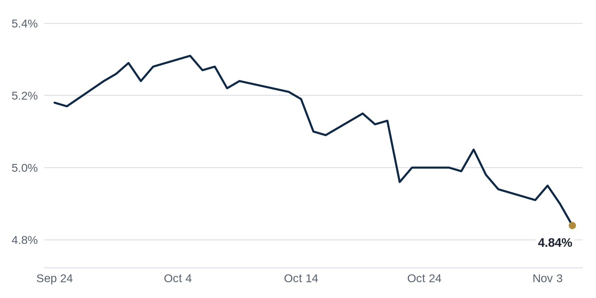

> **Review before publishing:**
> - reits: prices from Alpha Vantage only, not cross-checked (no second source; set TIINGO_API_KEY)
> - check/long_sentence: 35 words: Bank commercial real estate (CRE) lending picked up...
> - check/long_sentence: 33 words: **Why it matters:** Banks are lending more on...
> - check/long_sentence: 34 words: **Distress Watch:** A nearly century-old San Francisco office...
> - check/long_sentence: 32 words: Dallas-Fort Worth kept the top spot for the...
> - check/long_sentence: 35 words: MetLife signed an expansion at the Irvine Company's...
> - check/budget: Debt Markets: 328 words (budget 250)
> - check/missing_link: https://www.bisnow.com/news/los-angeles/office/hudson-pacific-third-quarter-earnings-loss-office-sales
> - check/missing_link: https://news.google.com/rss/articles/CBMisgFBVV95cUxPbXh5d0dDX2MtRjFWa19xU3Y0U29aTS1UeFZVRC1mR2RPeFVFbnFPeTFJTHFYVzZraDBjYkUzUm0tUXZ6TG83WkJTc3haU08yMmMwaFY1UFJWVU5fYWVKaDdJTmd3c2xYcEd0cWdGRVkweDczLVN4czZjZFozdEhRRTZjczB4Z3JCWmVubDJ0NUxQWHJfNVQxektEaEVRb3RaQU5aT3JlRXdHZXZvNkRqeDFB?oc=5
> - check/unsourced_number: Coffee chat talking points: 157,000
> - check/stale_data: Bank CRE loans last updated 2026-10-21

## The Brief

- Vivmark, the apartment giant born from a huge REIT merger this year, turned in its debut earnings report. [Commercial Observer](https://commercialobserver.com/2026/11/vivmark-q3-2026/)
- Dallas-Fort Worth again topped a closely watched ranking of the best U.S. markets for real estate investors. [REBusiness Online](https://rebusinessonline.com/uli-emerging-trends-report-dfw-three-peats-as-top-market-to-watch-in-2027-houston-holds-serve/)
- A new report warns the data center building boom is running short on the power, water and land it needs. [Commercial Observer](https://commercialobserver.com/2026/11/data-centers-blue-wave-resources/)

## The Numbers

*Rates as of Nov 5 close.*

- **10Y Treasury:** 4.84% (-6 bps)
- **5Y Treasury:** 4.59% (-10 bps)
- **SOFR:** 3.92% (-2 bps)
- **Fed funds:** 3.75% to 4.00%
- **Next Fed meeting (Dec 9):** Polymarket's top outcome is 25 bps increase 77.5%
- **REITs:** VNQ $96.23 (-1.8%). Best: ADC +0.7%. Worst: HPP -17.0%.
- **REIT yield vs. 10Y:** VNQ yields 3.80%, -104 bps vs. the 10Y.

**What it means:** Rates were little changed, so borrowing costs for new loans look much like they did yesterday, and lenders have no reason to reprice deals in the works.

**Why Hudson Pacific Properties (HPP) moved:** Hudson Pacific fell after reporting a steep quarterly loss, driven in part by selling West Coast office buildings for less than it paid. [The Real Deal](https://news.google.com/rss/articles/CBMikAFBVV95cUxPbkNxV3dwV3ZwTElMZnFjZXZvSTJfVUNDMGVCYjBVUE1UUkJEWGpuVzl4ZDNJTEUwdDFjYjRYNGFENHJZb3NmU0FxMERPWHJJQ1Fsb3ZscTd0aFk5SndvY3dxV19zRGRpVXlCcFlhWElqMUUzbXpjWDJTalRvbkV3OWh5V2FUcElrNzY5RnczZng?oc=5)

## Debt Markets

A wave of multifamily loans is coming due, with roughly $250 billion of apartment debt set to mature and need refinancing. Many of those loans were taken out at lower rates than borrowers face today. [www.connectmoney.com](https://news.google.com/rss/articles/CBMinAFBVV95cUxOcmNhMXFKRTBLLUVCeGlGLUhzMDM0MHJ6X1UxeTlOX3hCcW9hNUsyd3I5UFQzVjFSODlyczdkZkozWWVQVnJ3LWs1ekFRRVJ1NmFXbmltUTJOYWZidWY4a0pIRXlWbXZFLUxDQXBXNUpnRnpoSk5EcnZZOE5mOXVmR1VMZFozbmo0b0ZXRHlndmtHRUhvcEhCVnh3TnQ?oc=5)

**Why it matters:** Owners who refinance into higher rates will owe more each month, which can wipe out the profit a building was supposed to throw off.

Blackstone agreed to sell a $760 million portfolio of U.S. commercial real estate loans to Prime Finance. The sale moves a batch of property debt from one large lender to another. [IPE Real Assets](https://news.google.com/rss/articles/CBMixwFBVV95cUxQYzB3UlhyUlhXQ2N3SHp5RkFRZVRGUkhNNF9ySlVrUzJxNERDbmFXdGZYOXhvRW9qSzRJTElKZXI5ZFVianc4TGJPZzRiLU4yd2VSMUJXM2RGYk1GNU1MTUUwaVd6SjluTUtEMnQ5Y0s0SUhEU0M0Q0xxUFZMeU9HUk1yeE9NZXdxc3dLU20xekZ5R0V6LXJOWnUzc3R1TzAzV21vTV95VjJzLU9jUnZBcXZiQVVER0djWktSeHYyaUk0TkRZQkdN?oc=5)

**Why it matters:** When a big owner sells loans, it frees up cash to make new ones, and the buyer is betting it can collect more than it paid.

The Midtown office tower at 245 Park Avenue sits behind a $2 billion CMBS refinancing. CMBS means the loan is bundled with others and sold to bond investors. [PERE](https://news.google.com/rss/articles/CBMiuwFBVV95cUxNUUtzaEl6bjB5TXdpeE03Q1c3blBuSHdmMm5zcWpPZnd5dm9xUFdSek1sWUllWjhtN1lqQ19HM3lxLUN4Z01MdFlwWjBsZm5SQS15RjEyaUQxaXlDWG1xQXpuSVZVV1dXOGlLOTJjVGN5UTFkYUNBcDQtRHFkSzdTQXY3RlpnQlBZdE51YjI3YVFSS0ZzRXNZNDcxVzZZc0JEMkNfY01RNWRtZXg5MVFMN1BGM3Q5VnFwQ1Zr?oc=5)

**Why it matters:** A large office refinancing that gets done signals bond buyers will still fund trophy Manhattan towers, even as they shun weaker office.

Bank commercial real estate (CRE) lending picked up in the second quarter of 2026, with origination volume reaching $9.2 billion, up 29% from the first quarter and the highest since the third quarter of 2022. The share of CRE loans that are behind on payments, the noncurrent rate, fell to 1.42%, its lowest since the third quarter of 2023. Trepp frames this as a rate turn landing on bank credit that was already improving on its own. [Trepp](https://www.trepp.com/trepptalk/bank-cre-loan-performance-q2-2026-the-rate-turn-arrives-on-credit-that-was-already-sorting-itself-out)

**Why it matters:** Banks are lending more on commercial property again and fewer of those loans are falling behind, so owners who need to refinance should find banks more willing to say yes.

**Distress Watch:** A nearly century-old San Francisco office tower is at risk of foreclosure after its owners were served a notice of default, the first legal step a lender takes toward seizing a property. [The Business Journals](https://news.google.com/rss/articles/CBMiqgFBVV95cUxNNU9wTVA0d3l5MzM1RkdQMklKX21DR0liamNuVkNVRl9VRWJ2ME9UWkhPbW9MWXV4NHBVcVBTX1Ntekg2Z282UmFnRkNaLVN1OEhUM0dsbXJtTXoyZTZiZHFWMndTelIxbW9oeW1yZy13b3ZkTHVmLUQzUjJ5T2tpaUtFSUwxdUJwZzZ0ZlRMVFI4ekZjdVotM1pLbllUZGRvOE1jVnJyTmFiQQ?oc=5)

## Top Stories

### Vivmark posts its first report card as the country's largest apartment landlord

Vivmark Residential, the REIT (a company that owns income property and trades like a stock) formed this year by the merger of AvalonBay and Equity Residential, reported earnings Thursday. The company called out the integration of the two firms and growth in its first quarterly report.

**Why it matters:** Vivmark is now the biggest publicly traded apartment owner, so its rents and occupancy are a read on how the whole rental housing market is holding up. [Commercial Observer](https://commercialobserver.com/2026/11/vivmark-q3-2026/)

### AI firm Modal Labs takes 157K square feet at a Tribeca office tower

Modal Labs, an AI cloud infrastructure company, signed a 156,763-square-foot lease at Rudin's 32 Avenue of the Americas in Manhattan's Tribeca, per CBRE's October office report. The firm is relocating from Hudson Square.

**Why it matters:** Growing AI companies taking large blocks of space give Manhattan landlords a fresh set of tenants to fill offices that older industries left behind. [Commercial Observer](https://commercialobserver.com/2026/11/modal-labs-lease-rudin-32-avenue-of-the-americas/)

**Coffee chat talking points:**

- Modal Labs just leased about 157,000 square feet in Tribeca, so AI firms are becoming real office tenants, not just data center stories. [Commercial Observer](https://commercialobserver.com/2026/11/modal-labs-lease-rudin-32-avenue-of-the-americas/)
- MetLife is expanding to roughly 500,000 square feet in its namesake tower, a vote of confidence in trophy Manhattan office even as buyers elsewhere push for price cuts. [Commercial Observer](https://commercialobserver.com/2026/11/metlife-lease-expansion-200-park-avenue/)

## Market Watch

### Sun Belt

Dallas-Fort Worth kept the top spot for the best overall real estate prospects for the third year running, according to the Emerging Trends in Real Estate 2027 report from ULI and PwC. Houston held steady at No. 6, while Austin slipped on its ongoing struggles. [REBusiness Online](https://rebusinessonline.com/uli-emerging-trends-report-dfw-three-peats-as-top-market-to-watch-in-2027-houston-holds-serve/)

**Why it matters:** When investors rank a metro highest, more money and new projects tend to follow, which helps local developers raise cash and land tenants.

### West Coast

Leasing by advanced manufacturing and robotics companies is booming in Silicon Valley, filling industrial buildings in the region. The demand reflects firms that need space to build physical products, not just write software. [GlobeSt.com](https://news.google.com/rss/articles/CBMitwFBVV95cUxPNFNobTRGWjlYM25VQVlNS19rRFNkTm9HNFEzLWpqTDhwOUgyQm15S0EwOHNVSS0tUWF3YzBSdGJ6d19yMzhlNWJ2NkdIWW1pVmxHV2h1TThuSDdGMjNfQmRrVU54QXJLZnpLT1V2bzgzTm12UGlNVVJWdFZ1QzZnQnFIY1Bxdy1YNGxKYmJOM0JYLXFPVGdydUtrOTFvczdEdHBDSkVZbS1pTThkMzA4UkUxRlJfSnM?oc=5)

**Why it matters:** New industrial tenants backfill space that goes empty when traditional users leave, giving landlords in a pricey market steadier rent.

### International

Gencom bought the Rosewood London hotel in a deal valued at £300 million, with £225 million of it financed by debt, according to Bisnow's London deal sheet. The purchase adds a luxury London hotel to the firm's portfolio. [Bisnow](https://www.bisnow.com/news/london/deal-sheet/gencom-buys-rosewood-london-in-pound300m-purchase-the-london-deal-sheet)

**Why it matters:** A large financed hotel buy shows lenders are still willing to fund trophy hospitality deals in London, which sets a pricing comp for other owners.

## Quick Hits

- Nithya Raman won the Los Angeles mayoral race, pledging faster housing permits and progress on homelessness before the 2028 Olympics. [Bisnow](https://www.bisnow.com/news/los-angeles/commercial-real-estate/new-la-mayor-nithya-raman-housing-developer-friend-and-foe) Faster permitting would let developers start projects sooner, but her record cuts both ways for them.
- New York lawmakers are planning their next moves on the 485x housing tax break, data centers and dead malls. [The Real Deal](https://news.google.com/rss/articles/CBMiqAFBVV95cUxPTWU0Q0FxN1JvelBlQ2JfQ21Ib1VaeDFnN0I1RkJoaUdMc2lCOUxiWFA3VDJ2NFU0bC0yc1ZOd1BFb0taQTE0STlQMlQ1aTgzWFB4VE9CMVd1QmZUdFFOdktBamtJOFJlMXZQdGRUUXJ4RXpmMC1aZmtROHFXUjZHeTFBUFVMeXlrYXZYdlFUNGxqZ2N2Y3NZY2lqWGd4MDhTcE96ZFlMbDg?oc=5) Tax breaks and zoning rules decide whether apartment projects pencil out, so builders watch these moves closely.
- The Treasury named 6,576 new Opportunity Zones taking effect January 1. [GlobeSt.com](https://news.google.com/rss/articles/CBMiowFBVV95cUxPZXFDTjZQeElGOExIeU9VQ1dYbzI3YzhsbDhKRzRWR29xTWUyM1pOQ0FYUWU3NEdZX2tZSHNFdTl6XzJiWE1KOWtxSDlzdUNQOGwxS2xvMFh6UDI4RVVGQUVTcVZleWJHcUU5NndyOXBiT2g0UWplVmN1a243QlFQWWJDc1RFVDZqbEVJdEhLcGNnTnNsVG11aXg2N3Vrb1BFeFhV?oc=5) Opportunity Zones give investors tax breaks for putting money into designated areas, steering capital toward those neighborhoods.
- Buyers are pushing for price cuts of 5% to 10% as retrades become more common. [GlobeSt.com](https://news.google.com/rss/articles/CBMikAFBVV95cUxNT3dHMWUycWFCbkszM1Y4N2FGZFdRRzFYQWR2LUJCeUIzRk1nVnpyaW1fUDFRTU81ZHpORlItX1hqdU5aVkRWWnZ5VUIwMTIyS1VlbVRHSnFnZnF1U2NkOUU1aTV2b1FjQ0xUNmJrZFNyakdSbzV3OHdRY2VmT3VsdThfeFh5ZWRCMWhsazc5N24?oc=5) A retrade is when a buyer lowers its offer after agreeing to a price, which hands buyers more leverage over sellers.

## Deals of the Week

MetLife signed an expansion at the Irvine Company's 200 Park Avenue, the building known as the MetLife Building, growing from roughly 450,000 to roughly 500,000 square feet on a new 10-year deal, according to CBRE. [Commercial Observer](https://commercialobserver.com/2026/11/metlife-lease-expansion-200-park-avenue/)

## AI Infrastructure

Texas, home to about a quarter of planned U.S. data center capacity, just elected a governor who promised to pause new data center approvals. A new report argues the industry's real limit is not demand but access to power, water and land to build. [Commercial Observer](https://commercialobserver.com/2026/11/data-centers-blue-wave-resources/) Landowners near cheap power and utility hookups gain leverage; developers without them may see projects stall.

## Term of the Day

**Non-recourse:** a loan where the lender can only take the pledged property if the borrower defaults, not the borrower's other assets. Say a sponsor borrows $10 million against an office building. If the deal fails, the lender gets the building, but cannot chase the sponsor's cash or other properties.

For informational purposes only. Not investment advice.
