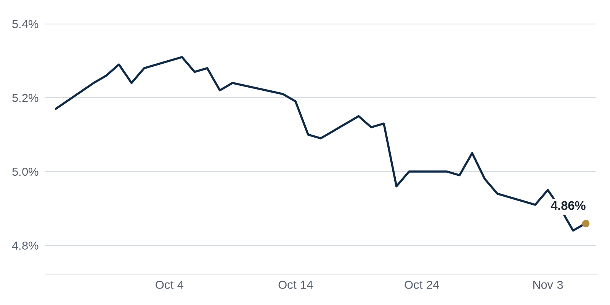

> **Review before publishing:**
> - check/long_sentence: 31 words: **What it means:** Treasury yields barely budged, so...
> - check/long_sentence: 32 words: **Why REIT_DOWN_NAME moved:** Los Angeles office landlords Douglas...
> - check/long_sentence: 34 words: **Why it matters:** A busy leasing year in...
> - check/long_sentence: 34 words: **Why it matters:** When the math breaks, owners...
> - check/long_sentence: 31 words: **Why it matters:** A large lease by a...
> - check/long_sentence: 31 words: **Why it matters:** As banks pull back, borrowers...
> - check/long_sentence: 34 words: **Why it matters:** A large loss at one...
> - check/long_sentence: 32 words: Manhattan is heading for its best leasing year...
> - check/long_sentence: 32 words: **Why it matters:** Friendlier rules make it easier...
> - check/missing_link: https://www.bisnow.com/news/new-york/office/rxr-signs-investment-bank-to-220k-sf-in-fidi-office
> - check/missing_link: https://news.google.com/rss/articles/CBMingFBVV95cUxOdVRuSFhWeEo5Q2k0OW5mS1Y5MGVFN2xBUWFkSE1GSG9mMVM4R3VqLWVMOWVkamFCVjFLVklzNnF1OEFZcG1oMHVSTE1hd1hPSjBfaVFkbUVLbjdGdVB5YU5GYTk1RnRUN2FhLXo1Ylc0U3JjUlIwNm95eW92ZkkxVkh3MU9ENGhYTFZOQ001X1pZSHVFVEFrMG9OSTRVdw?oc=5
> - check/repeat_in_issue: linked 3 times: https://commercialobserver.com/2026/11/commercial-real-estate-family-offices-wealthy-individuals/

## The Brief

- Manhattan office leasing is on pace for its best year in decades, a sign tenants want space again [Yahoo Finance](https://news.google.com/rss/articles/CBMingFBVV95cUxONmsyNm9vb3BjUXFxUDlqR0NYTTktSFJEX3o0a1ZxZ3Etb1IxbjVjcEVLZkNBdUxBN0Vlb1c1aGRKWjZySEQ2cjJGWXA3ZFpxOWwySmNMa2F0MFdQY2pkYnhiV3AxeFBQaUpUSjl0V09fMG9mTjBfQ01LVU9sZXNZV1o0dHhRWlRCYnI4UVBfY2VlWjZUR1lZMG5qU0Z4dw?oc=5).
- Wealthy families and their private investment offices are becoming a top source of money for commercial real estate deals [Commercial Observer](https://commercialobserver.com/2026/11/commercial-real-estate-family-offices-wealthy-individuals/).
- More commercial mortgages are landing with workout specialists, a warning that troubled loans keep piling up [Trepp](https://www.trepp.com/trepptalk/cmbs-special-servicing-rate-rises-25-basis-points-to-11.74-in-october-2026).

## The Numbers

*Rates as of Nov 6 close.*

- **10Y Treasury:** 4.86% (+2 bps)
- **5Y Treasury:** 4.64% (+5 bps)
- **SOFR:** 3.89% (-3 bps)
- **Fed funds:** 3.75% to 4.00%
- **Next Fed meeting (Dec 9):** Polymarket's top outcome is 25 bps increase 80.5%
- **REITs:** VNQ $95.73 (-0.5%). Best: EQIX +1.5%. Worst: HPP -3.1%.
- **REIT yield vs. 10Y:** VNQ yields 3.63%, -123 bps vs. the 10Y.

**What it means:** Treasury yields barely budged, so borrowing costs for new loans are roughly where they were, giving buyers and lenders a steady backdrop rather than a reason to rush.

**Why Equinix (EQIX) moved:** No company-specific news today; it may have moved with other data center REITs.

**Why Hudson Pacific Properties (HPP) moved:** Los Angeles office landlords Douglas Emmett and Hudson Pacific reported earnings that landed poorly, a reminder that West Coast office owners are still under heavy pressure [The Real Deal](https://news.google.com/rss/articles/CBMicEFVX3lxTE9SOFVaS3NOeWViTTVKUTROSFFDUUZkaHZyWnoweGczcUZzYl80VFllVmVPcWNha3l6VkNzS2RyQWs2WTlPM3RnZTZtUzdtUXdhRGZKMkdLTXlhcmt3UFJMMzRta1o1U2l2U2FPTHpHNWc?oc=5).

## Debt Markets

The share of commercial mortgage bonds sent to special servicers (the workout teams that handle troubled loans) rose in October to 11.74%, the highest since December 2012, Trepp reported. Hotels drove most of the jump [Trepp](https://www.trepp.com/trepptalk/cmbs-special-servicing-rate-rises-25-basis-points-to-11.74-in-october-2026).
**Why it matters:** More loans in special servicing means bigger potential losses for lenders and a higher chance owners, especially hotel owners, lose their properties.

ING is reportedly looking to sell about $500 million in data center loans after the midterm elections. The debt includes Project Jupiter, a campus being built under the Stargate initiative [Bisnow](https://www.bisnow.com/news/national/data-center-capital-markets/ing-unloads-500m-in-data-center-loans-in-wake-of-midterms).
**Why it matters:** A bank shedding data center debt suggests some lenders want less exposure to the sector just as voters push back on new projects.

Higher borrowing costs could push apartment owners to cut asking prices even after a strong third quarter, GlobeSt reports. Buyers who use debt can pay less when rates sit higher [GlobeSt.com](https://news.google.com/rss/articles/CBMirAFBVV95cUxQU0tlQ1JjM3p0S1g4U0UxY0VwMHc5QXRMQVZzNDFTRy16ekdZN0RuaHdtbEpiaTVKcC11WGZFeUFwcVM5cUZ2RzVaUDM2QlRKYm81aVRVbGFTbnRma0hiWG1QcEhmcTIyWkN1NXB0UklHZ284UGhjMnZfdkdlNVpJbjVFdDdvbFl5M1pRUEoxU0lPQzEzc24xQml2MFhPUXZHVkxhNS1ISmNkM3hZ?oc=5).
**Why it matters:** If apartment prices slip, buyers get better entry points while current owners watch the value of their holdings fall.

Banks are trimming their outlook for commercial real estate lending growth, citing a rising chance that interest rates move higher rather than lower. When lenders expect rate hikes, they pencil in slower loan demand, because higher borrowing costs scare off buyers and developers. That cautious stance can tighten credit before any rate change actually happens, according to [GlobeSt.com](https://news.google.com/rss/articles/CBMilAFBVV95cUxPazdGR21lRlhuN1g3ZGpSRmw2d2V2emY3NkhBM1pVUFNMNEs2Y1lxSE1VOW45SFVUV1Y0T3JGNVVkZGh4SGRrQ1NUdFMyd2JZLUg0QlNKblR4ZFhBTG9mQkRsUkNqb1E1YWdTekE2WHZNd2FQUEt6T205cHZxc3I0ZVFuS0ZoejI2MjNORldUbXRIRXBC?oc=5).

**Why it matters:** If banks lend less because they fear higher rates, borrowers who need to refinance maturing loans may find fewer willing lenders and steeper terms.

**Distress Watch:** Ellis Partners took over San Francisco's former KPMG Building after $188 million in loan distress, The Real Deal reports [The Real Deal](https://news.google.com/rss/articles/CBMiqwFBVV95cUxQNVl4YUVFdksyX3RoSlhUdzRxYVVsRWFKNkRtLW9Dak15ZFYtdFZuUU1VVWFBNVIydUE4MUhoM29CWkxndjdKakxhQW9uaW0wcS1SR0xFazNxb2kzYUhvX2FqMEJXNV9YUnNCZTczVUhWLUN3cTJqckVJeV9WcHpCNGU5UF9fQVhXQ0NDVWFPMnE2aWk1T2JuWlFqdXZlRkdvQ0ZUbzk3RjkxZFU?oc=5).

## Top Stories

### Manhattan office leasing is headed for its best year since 2000

Leasing activity across Manhattan is on pace for its strongest year since 2000, according to Yahoo Finance. Tenants are signing more space even as the wider U.S. office market stays uneven.
**Why it matters:** A busy leasing year in the country's largest office market gives landlords room to hold rents and makes it easier to refinance buildings that lenders had struggled to value [Yahoo Finance](https://news.google.com/rss/articles/CBMingFBVV95cUxONmsyNm9vb3BjUXFxUDlqR0NYTTktSFJEX3o0a1ZxZ3Etb1IxbjVjcEVLZkNBdUxBN0Vlb1c1aGRKWjZySEQ2cjJGWXA3ZFpxOWwySmNMa2F0MFdQY2pkYnhiV3AxeFBQaUpUSjl0V09fMG9mTjBfQ01LVU9sZXNZV1o0dHhRWlRCYnI4UVBfY2VlWjZUR1lZMG5qU0Z4dw?oc=5).

### 'The math doesn't work' on many office buildings

Business Insider reports that higher interest rates have sparked a reckoning in the U.S. office market, where the numbers on many buildings no longer add up. Owners who bought with cheap debt now face loans that cost more than their buildings can support.
**Why it matters:** When the math breaks, owners either inject fresh cash, sell at a loss, or hand the keys to the lender, and each of those resets prices for everyone nearby [Business Insider](https://news.google.com/rss/articles/CBMipAFBVV95cUxNUWxSNmNVY1BURVlSY0toYnRiVFU4dEY2QkczQVNhc2lMSVVaZ19IbHItcGkzY2Z6UUQ5bFFNTDRIQnJIN3dLMFpfRjhYOEQzTnpnRnNCTEZfT0FIWFprbkptejdSYS1sTDZ5Y1NBeWgtbFEtbTVtdWVNcmU1c1BkMWpTMXJQSEhLX2VVSllLdFl6eDZpMzB4SXlVODNwYmRKOGc0ag?oc=5).

### Oppenheimer signs a 220,000-square-foot headquarters lease downtown

Oppenheimer & Company will relocate its headquarters to roughly 220,000 square feet across six floors at RXR's 32 Old Slip in Manhattan's Financial District, per Commercial Observer. JLL represented the tenant.
**Why it matters:** A large lease by a financial firm in Lower Manhattan signals the Financial District is pulling tenants back, which supports nearby landlords and the neighborhood's recovery [Commercial Observer](https://commercialobserver.com/2026/11/oppenheimer-lease-relocation-32-old-slip/).

### Rich families are becoming CRE's biggest new financing source

Despite global uncertainty, commercial real estate investment hit $263.7 billion in the third quarter, an 89 percent jump from a year earlier, MSCI found. Family offices (private firms that manage wealthy families' money) are increasingly filling the gap left by banks.
**Why it matters:** As banks pull back, borrowers who can reach family-office money gain a new source of capital, while those who cannot may struggle to fund their deals [Commercial Observer](https://commercialobserver.com/2026/11/commercial-real-estate-family-offices-wealthy-individuals/).

### Starwood Property Trust posts a $390 million quarterly loss

Starwood Property Trust, run by Barry Sternlicht, reported a net loss of $389.7 million in the third quarter after setting aside reserves for troubled loans, Commercial Observer reports. It is a sharp swing following last quarter's 95 percent income drop.
**Why it matters:** A large loss at one of the biggest commercial real estate lenders shows how much strain property loans are putting on balance sheets, which can make new lending tighter [Commercial Observer](https://commercialobserver.com/2026/11/starwood-property-trust-reports-390m-q3-loss-sternlicht/).

**Coffee chat talking points:**

- Commercial real estate investment jumped to $263.7 billion last quarter even as banks retreated, so family offices are quietly becoming the market's new lenders [Commercial Observer](https://commercialobserver.com/2026/11/commercial-real-estate-family-offices-wealthy-individuals/).
- Starwood's $389.7 million loss lines up with banks trimming their CRE growth outlook, a sign lenders expect more trouble before any relief [Commercial Observer](https://commercialobserver.com/2026/11/starwood-property-trust-reports-390m-q3-loss-sternlicht/).
- Manhattan is heading for its best leasing year in decades while Oppenheimer just took 220,000 square feet downtown, so prime office demand is clearly back even as weaker buildings struggle [Commercial Observer](https://commercialobserver.com/2026/11/oppenheimer-lease-relocation-32-old-slip/).

## Market Watch

### Sun Belt

Tesla is expanding around Austin with a new industrial lease in Buda, just south of the city, The Business Journals reports. The move adds to the carmaker's growing footprint in central Texas.
**Why it matters:** A major employer leasing more industrial space keeps warehouse demand firm in the region, which helps local owners hold occupancy and rents [The Business Journals](https://news.google.com/rss/articles/CBMipwFBVV95cUxQVDZ3RTFOWUxTM0RJMXBHNXlrVjJxVEFBTy1zZUpkY3NRZ204aTVNblgtclBESFFZdEloOEt3cWxfSzl3VlA5S0U5bWF1UGxzUWg0TGdiZXNNdERGN1VHV0ZaajBMelplS3pnRWtOV2dhcTdJcTRDVF9fUWdFZ2JWZ2RCazVDU25EVTFBb0M5R2xVYWMwSmM5ZXd4MER0ZkxxWEhRV2NYQQ?oc=5).

### West Coast

Bay Area voters leaned pro-development this election, sending Scott Wiener toward Congress and rejecting several measures that would have limited new building, The Real Deal reports.
**Why it matters:** Friendlier rules make it easier and cheaper to build, which can ease the region's housing shortage and open the door for developers who had been stuck [The Real Deal](https://news.google.com/rss/articles/CBMinwFBVV95cUxOYllTSHBoUzZSTHdsaFBlMDRsZ1o2WWFPRkhfNFhUWE9wSnRvdlBwN2MyeDFRY0VwOHhsVlVLNjVsc0E2dUxrTFJMUGxJY2JZTlI2V0loZ0V2aWNxNmRSVU5SU1pmeUwtNDR6TlZsdFhCekQtUlpvYmd4QXhSOGQyZWZRZjFlNkEzOGdwYVVqMDBldUthRVM0SDczeENxUjA?oc=5).

### International

Several senior dealmakers are leaving Blackstone's flagship real estate team, with Financial News London tying the exits to shrinking pay.
**Why it matters:** When star talent leaves the largest property investor, rivals can scoop up the dealmakers and the relationships they bring, shifting where big money flows [Financial News London](https://news.google.com/rss/articles/CBMiwAFBVV95cUxQQ0d0anpzWEt5WUdzbUdneXctODBUSk9uQmg1Z29NZzdieERqSEo3QVRkTGR4QzZOYmlrT2g1cE5GN3hiUFdLc0lteUpwNFpSU2ZtYVhvTFNEbXJoX1dyWmJUY1h2eXYyZllmQXF1QmJOWGdVMFhGT3hEM1RyeTVEel9qWXhSRzNMd3VHUUZyMjJ6MkpqVU1NNFpaeS1kaE1JZ0tyT3BUU1VSV2E4Yl9wRG92NFRONnMyN1JsU1NvZUc?oc=5).

## Quick Hits

- Voters rejected most local data center measures in the November elections, Trepp found [Trepp](https://www.trepp.com/trepptalk/development-on-the-ballot-infill-veto-edges). Local pushback makes it harder to build power-hungry data centers, slowing one of the market's hottest property types.
- A Democratic sweep of Congress points to stability rather than sweeping change for commercial real estate, Bisnow reports [Bisnow](https://www.bisnow.com/news/national/commercial-real-estate/-certainty-will-be-the-buzzword-stability-not-sea-change-for-cre-post-midterm). Investors tend to act faster when policy feels predictable, so a steady political backdrop can support deal volume.
- Fannie Mae and Freddie Mac are reportedly backing away from New York deals over Mamdani's proposed rent freeze, The Real Deal reports [The Real Deal](https://news.google.com/rss/articles/CBMipAFBVV95cUxOcktCMU9XZ3Y5Z1FDZE1iZmQ5SmJ1UXU1Y214WjlFNWlJX3NVSnExZnNJeTZySG5IRkVNWE84WjlacW52dWt5cjJaWlZDRTZSemlMR05oeGZxZG9sQVF3aE9fSS1Oc2R0Y0JYVjZGejIxWUtLVlEzUGxkUGU2MHR1aXVfanN3WW9PMDdtR0g3UGlMR1ZXMFJzTm9Ba2ticG52MjRqbw?oc=5). If the two biggest apartment lenders pull back, landlords face tighter financing and renters could see less new housing.
- Bushburg is buying 60 Wall Street for $400 million, The Real Deal reports [The Real Deal](https://news.google.com/rss/articles/CBMijAFBVV95cUxNbFlXVHp6OElOY1cxekJwb0FEZlJiMTJTeUZDLXU4emxGS0dKVENOZnZfNUVEUk5VbjdQcjBSQkp4b1ZlRzB4RHl3ZXZjVW1LcnZxY1B2NXB2Vk45NGF1eGdOVkk1d2ZPX0RkT3VJVTRSdXZPUUs0cGs0Z1RBVkNpWTJ3dDROUVk4aXg2Uw?oc=5). A big discounted office purchase sets a fresh price marker that other downtown owners and appraisers will point to.
- Carnegie Mellon is planning a $3 billion campus in Miami's Wynwood, backed by Ken Griffin, The Real Deal reports [The Real Deal](https://news.google.com/rss/articles/CBMingFBVV95cUxPUFIwV1FOSEF3RHpfb0EwdlVUSWduVVJhdVJCWFFZYVNCLTVZVXIzd1FLT19yeGRESHRHUVpxcUI4azd0ajBoaTNEb1BjT1VnbW9icGZEcHNLQ3kyLWItaGw5bi1ZSVVfQXlmZGhVQ250eGx1LUU1OEl3TmZVaFpCbkVuYVZHWlNrZk9ZTzI3MkdoUVdwQkcxUGtGOVZDdw?oc=5). A major university campus can lift nearby property values and draw employers, reshaping a neighborhood's real estate.

## AI Infrastructure

Microsoft has ended a lease for older-generation GPU computing power from Oracle, BigGo Finance reports. The AI leasing market is splitting in a K shape: demand for the newest chips stays hot while older hardware loses tenants. Cloud providers and data center owners who bet on last-generation GPUs now risk empty capacity, while those holding the latest chips keep their pricing power [BigGo Finance](https://news.google.com/rss/articles/CBMidkFVX3lxTE5tVFRVSm5vT3VqQVNlUzh0Ty1odnRIczJfMjlYeE9jNE1fTkZRd0g2dmQtNWpmbmM1S1h0dDM0MUtVY3RVMXEtRVdBREZqUC15bmpaSXBKVDZHdkdNSXRPOTNtUUsyanFubjBZVXRuRV9CR0RBd0E?oc=5).

## Term of the Day

**Equity multiple:** the total cash an investment returns divided by the cash you put in. Invest $1 million and get back $2 million over a deal's life and that is a 2.0x multiple, meaning you doubled your money. It ignores timing, so a quick 2.0x beats a slow one.

For informational purposes only. Not investment advice.
