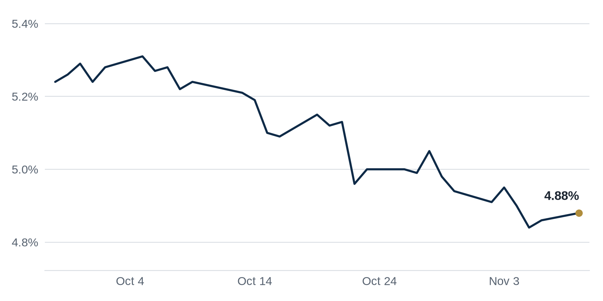

> **Review before publishing:**
> - reits: prices from Alpha Vantage only, not cross-checked (no second source; set TIINGO_API_KEY)
> - editor: fixed: The source title/summary only says high vacancies and defaulted loans fuel DFW office woes; the 'once seen as a Sun Belt safe haven' framing is not supported.
> - editor: fixed: The source only states Bay Area rent growth beats the national trend by 7x; the tech-hiring cause and the remote-work population-loss history are added facts...
> - check/missing_link: https://news.google.com/rss/articles/CBMingFBVV95cUxPaFhObHFtbEN5Qk1jQVdpYllpcUFQV2JUVUFpR2ZQV1VyenZsUTNTQWtHUlZYUTNlc1A0aHVkVG1Jd3dLVFVJai1YMmZqU1piSlF5cVBQMDlSM0NONGp3dzRPZTBqcjN0ZS1tbEVjSWM0MkxOMVM0RXJtWG53YVBTOFVQeUxKRXhNVDdpXzQzQ1VNczdCWkptUUNOMmJyZw?oc=5
> - check/missing_link: https://www.bisnow.com/news/chicago/office/27-story-mag-mile-office-tower-slated-for-foreclosure-auction
> - check/coffee_chat: no number: Bay Area apartment rents are growing about seven...

## The Brief

- Inflation kept climbing in October as shelter and food costs rose, giving the Fed little reason to cut soon. [Connect CRE](https://www.connectcre.com/stories/consumer-prices-rise-0-4-in-october-as-shelter-food-costs-climb/)
- A downtown Chicago office tower sold at a steep discount, a fresh comp for every distressed building nearby. [Crain's Chicago Business](https://news.google.com/rss/articles/CBMipgFBVV95cUxOaWpkZ3pGS01Fcm1PZllMS1N3YXNHRWR1RDdRbUVMYm9INFdFdjNkMlFQUmMtWTdPNVRaanFyZlU5Nk9jb0dLNVRlX255bzFQaHBzb19mSnFGRG81Zk5pdktKMmF3ZUlTUWhnU0VFallMNkhmY29kSTlQZEhudkpXb1NhX1RuaU15NlRyczYxd1ZnTUVnTUJPdFk1WFRuLXllVU5faUVR?oc=5)
- A New York landlord signed an investment bank to a large downtown lease, a sign office demand is firming. [Bisnow](https://www.bisnow.com/news/new-york/office/rxr-signs-investment-bank-to-220k-sf-in-fidi-office)

## The Numbers

*Rates as of Nov 9 close.*

- **10Y Treasury:** 4.88% (+2 bps)
- **5Y Treasury:** 4.67% (+3 bps)
- **SOFR:** 3.88% (-1 bps)
- **Fed funds:** 3.75% to 4.00%
- **Next Fed meeting (Dec 9):** Polymarket's top outcome is 25 bps increase 84.5%
- **REITs:** VNQ $97.30 (+1.6%). Best: HPP +10.8%. Worst: UDR +0.4%.
- **REIT yield vs. 10Y:** VNQ yields 3.63%, -125 bps vs. the 10Y.

**What it means:** Treasury yields were little changed, so a new loan today costs about what it did last week. That gives buyers and lenders a steady backdrop to price deals.

**Why Hudson Pacific Properties (HPP) moved:** No company-specific news today; it may have moved with other office REITs.

**Why UDR moved:** No company-specific news today; it may have moved with other multifamily REITs.

## Debt Markets

Mall owner Macerich defaulted on $399M in mall loans as it reshapes its portfolio, offloads weaker centers and pours money into its best ones. Handing properties back to lenders is one way landlords shed debt they no longer want to carry. [Bisnow](https://www.bisnow.com/news/national/retail/macerich-defaults-on-nearly-400m-in-mall-debt)

**Why it matters:** when a big owner walks away from loans, the lender inherits the property and the loss, and other mall borrowers lose leverage in their own talks.

Apartment owners could need $6.8 billion in fresh equity to refinance loans maturing through 2028, according to an October CRED iQ analysis flagged by Commercial Observer. Refinancing means replacing an old loan with a new one, and higher rates mean the new loan covers less, so owners must write a check to keep the building. [Commercial Observer](https://commercialobserver.com/2026/11/multifamily-refinancing-crisis-ai/)

**Why it matters:** owners who cannot find that equity may be forced to sell or default, which puts more apartments on the market at lower prices.

Industrial landlord Faropoint lined up nearly $500M to refinance its warehouse portfolio. Lenders still competing to fund industrial deals shows where capital feels safe right now. [The Real Deal](https://news.google.com/rss/articles/CBMipwFBVV95cUxOQVF5SkREUFlPUVcxUWEwaVVUZlVwdm5FejdJX1RjYU1NVzV3TGVtUTIydVlobzB4MkhhYXM4T1FjOWtza21xXzNlQUNDR0sybVl1V2QzSjdTWWNvc3NLcUc3Zy0tMU0yTlZDZTdFY1ZFNUZxV2dsYzY4c1U2NEYza0RZSVZMMldXVzBTQV9MSjNrek5rYzdSejVVd2tkemk5aTBvczVaYw?oc=5)

**Why it matters:** easy refinancing for warehouses tells buyers industrial income is still bankable, even as offices and malls struggle.

A jump in interest rates during September appears to have slowed the recent pickup in commercial real estate lending. Lenders and borrowers tend to pause new loans when rates climb, since higher rates make deals harder to pencil. The report frames the spike as a setback for lending that had been gaining ground. [GlobeSt.com](https://news.google.com/rss/articles/CBMijAFBVV95cUxQaUFTVE83am1QNTN5eGpJT3habEp4ODZJeGh2UzQ2d2pEeHZCdGEwSVlzRVNFaGVxRndTOU11WHNqZ3Vab2lxV2VBX2I2bVFUOVhKMlR0X1BreHVlTmxpbUZ0d3o2MkRtQU1tOHpQZHVZUzFmTjk2VDc0XzZCWnJPdTMwM2x4QS00eExmbg?oc=5)

**Why it matters:** When rates spike, borrowers who need new loans or need to refinance face higher costs, so some deals stall and property owners wait for cheaper money.

**Distress Watch:** The Real Deal reports high vacancies and defaulted loans are deepening the office slump in Dallas-Fort Worth. [The Real Deal](https://news.google.com/rss/articles/CBMioAFBVV95cUxOc2pVTDAyX0s0T2NhODNwdDR6UGRLTFNUc19IeTl2UFhVZ1hnVWppeGREVkVQSFlNSks3eWFoc1ZiUTRFTlo0MGRIdk5VaWNYSkNZbHZqV1RQTFI0RElZM0FTNUppcm9qNV9OcDBlWkhublpIZXRBcWVUcWRjRUVzYjR3RE5VOEl4TERWTUNybGJSMldCMWRMX1l1YS01Ym91?oc=5)

## Top Stories

### Oppenheimer Takes 220K SF in Lower Manhattan

Landlord RXR signed investment firm Oppenheimer to a 220,000-square-foot lease at 32 Old Slip in New York's Financial District. It is a rare large commitment in a neighborhood that has struggled to refill office space. [Bisnow](https://www.bisnow.com/news/new-york/office/rxr-signs-investment-bank-to-220k-sf-in-fidi-office)

**Why it matters:** a large, long-term tenant gives the owner steady rent to show lenders, which makes it far easier to refinance the building when its loan comes due.

### October Inflation Stays Warm

U.S. consumer prices rose 0.4% in October, with shelter costs accounting for more than 30% of the monthly increase, the Bureau of Labor Statistics reported. The pace slowed from September as energy prices climbed more gently. [Connect CRE](https://www.connectcre.com/stories/consumer-prices-rise-0-4-in-october-as-shelter-food-costs-climb/)

**Why it matters:** sticky inflation keeps the Fed cautious about cutting rates, so borrowers counting on cheaper loans next year may have to wait longer.

### A Wacker Drive Office Tower Sells at a 75% Discount

A downtown Chicago office building on Wacker Drive changed hands at a 75% discount to its prior value, Crain's reported. Deep markdowns like this are becoming the way stalled office buildings finally trade. [Crain's Chicago Business](https://news.google.com/rss/articles/CBMipgFBVV95cUxOaWpkZ3pGS01Fcm1PZllMS1N3YXNHRWR1RDdRbUVMYm9INFdFdjNkMlFQUmMtWTdPNVRaanFyZlU5Nk9jb0dLNVRlX255bzFQaHBzb19mSnFGRG81Zk5pdktKMmF3ZUlTUWhnU0VFallMNkhmY29kSTlQZEhudkpXb1NhX1RuaU15NlRyczYxd1ZnTUVnTUJPdFk1WFRuLXllVU5faUVR?oc=5)

**Why it matters:** a sale sets a comp, the price nearby owners and appraisers point to, so one discounted deal can drag down values across the whole submarket.

### Blackstone Reshuffles Its Real Estate Leadership

Blackstone named new leaders for its real estate arm after the exit of Meghji, who ran the giant property business. The firm is one of the biggest owners in commercial real estate, so its bench changes matter to the market. [Yahoo Finance](https://news.google.com/rss/articles/CBMinwFBVV95cUxOZUdHdFVORTd6cUdTYmdrTWQ2clVzaXNIWFBpa2RQVE1PQWJkZDJ0dVF5YzFaMTExNk9rZUd5X3NOWEhOQ2phVUsyTVNDWUxUN3VDb2wxQzh5YXVhbGt6aGZtV1JpQ19INTV0MmRGaXBIYWZ3NE4zMGxvaURES2UxYnhXMFJxTHJJQzAyaG0wbjZPYU5tYmZJT0Y1bWdvelE?oc=5)

**Why it matters:** the people steering Blackstone's buying decide where billions in capital flow, so a leadership change can shift which markets and property types get funded next.

### Apartment Construction Falls to a 2019 Low

New apartment deliveries will hit their lowest level since 2019 this year, GlobeSt reported, as high rates and construction costs stall new projects. Fewer new units are coming just as the current wave of supply gets absorbed. [GlobeSt.com](https://news.google.com/rss/articles/CBMiowFBVV95cUxNTWgzR2lLVG9ZNGRSdnFicElrLTNHdkVxaTNNNlhka2ZDMWcwRUZNRkJpWFZEREZxREhscC1mMmUxQXUteHBQRkhBZ1dDZThOVEoycElCZmtQY190MWJtZUtCYW5ncVd0cERIUkpYMEdXT1NCS3pNb1J0c0x2S2U5bHFiRTZUR2t3YUZqdEN3S25UeXRhZzhBSHJ4ZGZUbGNCczA4?oc=5)

**Why it matters:** a thinner construction pipeline means less competition for tenants in a year or two, which supports rents and values for owners who already hold apartments.

**Coffee chat talking points:**

- Office leasing hit 62 million square feet last quarter, so a big new downtown lease like Oppenheimer's at 32 Old Slip is landing on real demand, not a one-off. [Commercial Observer](https://commercialobserver.com/2026/11/footprint-demand-us-office-leasing-q3/)
- Apartment owners could need $6.8 billion in fresh equity to refinance maturing loans, and October's warm inflation keeps the rate relief they are counting on out of reach. [Commercial Observer](https://commercialobserver.com/2026/11/multifamily-refinancing-crisis-ai/)
- Bay Area apartment rents are growing about seven times the national pace just as new construction thins out, a squeeze that favors owners who already hold units. [GlobeSt.com](https://news.google.com/rss/articles/CBMingFBVV95cUxNMl81d05ZbjNiQ2JjYV9MWS1hQVdyZUxsN2ZYT2hIRlBGY0dpUzhnSUtmRGlsb3ZLSkpMZkg1OXdacHYtTzdwc0lLSlgwYV9rZjNXSTdTVERVcjJxaGlqS1BzRmNFYjBFa045VE1QUjN5cFpWRFRzYmpkN3czSldYYVJERjlMZURGZWFvMldrWkJuYjBGR2FEcVRlT3JVQQ?oc=5)

## Market Watch

### Sun Belt

Austin's office market is drawing a new wave of defense and hardware startups, with tenants building drone defenses and sea robots, The Real Deal reported. These tech firms need lab and office space, which helps backfill a market that overbuilt during the last boom. [The Real Deal](https://news.google.com/rss/articles/CBMif0FVX3lxTE92QlVGREtZLXNCbHdiYS1Zb09Qa2U4RUxzOEdzWi12LVBhTC1mTUFNaU9hMGVsUWRFVURLazZpTmVIQlAyTTZjaEYwTVE2dWpoaGFJZHhqSk5KSUhJa2x5WHNYeFZjVFdSNmJwNG5hbVNVanF0M0dhTXpIRzJHNzQ?oc=5)

**Why it matters:** fresh tenant demand fills empty desks, and landlords with rising occupancy can hold rents instead of cutting them to compete.

### West Coast

Bay Area apartment rents are growing roughly seven times faster than the national pace, GlobeSt reported. [GlobeSt.com](https://news.google.com/rss/articles/CBMingFBVV95cUxNMl81d05ZbjNiQ2JjYV9MWS1hQVdyZUxsN2ZYT2hIRlBGY0dpUzhnSUtmRGlsb3ZLSkpMZkg1OXdacHYtTzdwc0lLSlgwYV9rZjNXSTdTVERVcjJxaGlqS1BzRmNFYjBFa045VE1QUjN5cFpWRFRzYmpkN3czSldYYVJERjlMZURGZWFvMldrWkJuYjBGR2FEcVRlT3JVQQ?oc=5)

**Why it matters:** faster rent growth lifts the income a building throws off, which raises its value and rewards owners who held through the downturn.

### International

Two foreign property groups are buying up some of Singapore's best-known buildings in deals worth up to $11B, Stacked Homes reported. The purchases signal that overseas investors still see safety in prime Asian real estate. [Stacked Homes](https://news.google.com/rss/articles/CBMiekFVX3lxTE1SUG9hTTFfeVI4MzR3NXBROUNIN2tHWGJXTEJ2NTJqemE1R2t6cUQyMC03TkdWbENBMnJucXlPc1E4cWN2eWZWZWJtbXRtMUlXbHA2dHBQQkV6aEZ6UTlxYkM0ZGVaSlhPRzNIdjJJVkM4Z1JOQ3VmczlR?oc=5)

**Why it matters:** large cross-border purchases set pricing benchmarks that ripple into how investors value prime towers in other global cities.

## Quick Hits

- U.S. office leasing reached 62 million square feet in the third quarter, up 18 percent from a year earlier. [Commercial Observer](https://commercialobserver.com/2026/11/footprint-demand-us-office-leasing-q3/) A rebound in leasing means tenants are committing to space again, which slowly firms up rents for landlords.
- Charlotte investment sales jumped 38.6% to $2.2 billion through the third quarter, led by industrial deals. [The Business Journals](https://news.google.com/rss/articles/CBMipgFBVV95cUxPWEFteUNqSjZyMi1ldF8wVG5fZW56SWYwWHRqMXBkUXQ1NDNham9ETzU4LUl6WWxsdFVnT2U0MENFNnExMGVKX2p1Z0hXTmFDUnEwMTZTV1R5UlZZcUVkcE02am9LWWpqZFlXeEFJSjVJNXFGZWRCekVndUxHXy11RnNlU2c5Rko5VzNVdFhMUXRHYTRzV0pqbVIxM0xCYllDdTBtdFZn?oc=5) Warehouses staying in demand tells buyers that income from logistics space still feels dependable.
- A Florida firm is planning a San Francisco office buying spree. [The San Francisco Standard](https://news.google.com/rss/articles/CBMiggFBVV95cUxPYjk0c0tnY3RncExIcEhNSDd4cUNtZ1hpTWJyM0k0SEUtVEItZHVKQkxwSGNUS2dUamR4VHdCZmtLX1NjNHVjNzJNNEVIY3R3Rkx3MURFZnlFalFVM0EzZHhZTFIwcHBOT3F0eGFZWFlWbWVTNDZMRTRNLU8xNU84X3Nn?oc=5) Outside investors bargain-hunting in a beaten-down market is often the first sign a bottom is near.
- 1754 Properties and Vander Capital Partners bought a Google-leased office building in San Francisco. [Citybiz](https://news.google.com/rss/articles/CBMi0wFBVV95cUxOa1BkcXNLMnF4cEZHenBDZVU4QlZFSUI2U2tGV1lWd0w0QS1QaFVlSHRFZGRua1lVR2tHZ3gtemhRSTJDeTVoMXBYWHVBbTNJSzdwX3hWNmFHRU1HVC1KZDctaEZLekJELVBKMHJhYndKUVdfVlVLY1NPbkM3al9KR21kanhXaU5WVVNtdFd0MlRHTy1IT29la2xETDdkZHhWXy15UXRydlRweXFlUm1tQkQyZTRuYjNGeDBsbkNYNmJPdnBjUXRpRHFMY2l6VmQxRVF3?oc=5) A building with a strong corporate tenant already signed is a safer bet, because the rent is locked in.
- Tokyo's commercial property market is booming, and Blackstone is reportedly looking to sell there. [아시아경제](https://news.google.com/rss/articles/CBMid0FVX3lxTFBSMzN2REoxOXpXZHRQMm9KWFJETlJLcVpfaDU0aVhvdTFfUUlZcnk1cGx2NnFoRkduc0RtSkEwOEptS19FaDI1T0I1NVF6TUNZWFo2SWhETU1sampyNGFHR0lxSVRZbC0tVG5jNXpIb042ZWNJMXJr?oc=5) Selling into a hot market lets a big owner lock in gains while buyers are still eager to pay up.

## Term of the Day

**Amortization:** paying down a loan's principal, the amount you borrowed, a little at a time instead of only covering the interest. On a $10 million loan, an amortizing schedule shrinks the balance each month, so the borrower owes less at the end and the lender faces less risk if values fall.

For informational purposes only. Not investment advice.
