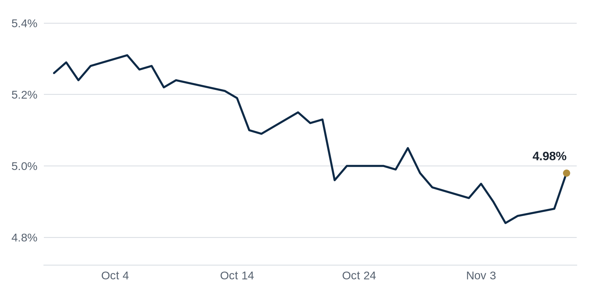

> **Review before publishing:**
> - reits: prices from Alpha Vantage only, not cross-checked (no second source; set TIINGO_API_KEY)
> - editor: hold: Repeat of yesterday: the lead Top Story and Brief bullet 1 (121 W. Wacker, the Chicago office tower sold at a 75% discount) are the same deal that led the No...
> - editor: hold: Repeat from Nov 9: the CMBS special servicing rate at 11.74% (13-year high) anchors the Brief (bullet 2), the Debt Markets lead, and Coffee chat point 1, but...
> - editor: hold: While reworking, also fix three accuracy problems the rewrite should carry over: (1) The Brief and Top Stories say Dallas 'approved' its zoning overhaul, but...
> - check/long_sentence: 92 words: Wacker, the Chicago office tower sold at a...
> - check/long_sentence: 31 words: A forced sale usually means the owner could...
> - check/long_sentence: 38 words: **Why it matters:** An auction (a public forced...
> - check/long_sentence: 31 words: **Why it matters:** Clearer, more permissive rules can...
> - check/budget: Debt Markets: 328 words (budget 250)
> - check/missing_link: https://news.google.com/rss/articles/CBMimAFBVV95cUxNdm1MV3RKd3ZnM181REM3X2pzem1FU3dwb3ZNQ3duZU41VmVtZGR0YWFOa09mREhOU1VYSDMtd2FzYklBdnRidFlKRjFad1BGdDRBYjY0d2luUTdzaW80VzZOZ1pMQ290anpkdVBQeVMyeXpod1JRVUxlY2NuNnZFbWhJejVCOUh5Skx6VDFBVUFqOHVFUEkxQQ?oc=5
> - check/repeat_in_issue: linked 3 times: https://news.google.com/rss/articles/CBMimgFBVV95cUxPV3FlWXZBMFVOTXkyNlVGeUlkcFBJTmJhbUZZVUI3eUVzTUJOZFltUkFkU2hrQm11SHlSWThBbzVrMXE4ajlIbWVsMnJJdUtUWW01c1F1MFpOQlRJcjlaNlJKR2RnUDluYy1rLW9tTWlBOUZBSkx6UDlRR0lEQzkzRUNjTnRuclJFd29VZTdySy1VMkY5Y3pYM1RB?oc=5

[CHECK] Editor hold: Repeat of yesterday: the lead Top Story and Brief bullet 1 (121 W. Wacker, the Chicago office tower sold at a 75% discount) are the same deal that led the Nov 10 issue (Crain's, 'A Wacker Drive Off...; Repeat from Nov 9: the CMBS special servicing rate at 11.74% (13-year high) anchors the Brief (bullet 2), the Debt Markets lead, and Coffee chat point 1, but that same 11.74% figure was the lead of...; While reworking, also fix three accuracy problems the rewrite should carry over: (1) The Brief and Top Stories say Dallas 'approved' its zoning overhaul, but the source title says 'Unveils' (change...

## The Brief

- A Chicago office tower sold at a steep discount, a fresh sign downtown values keep sliding. [Bisnow](https://www.bisnow.com/news/chicago/deal-sheet/the-chicago-deal-sheet-nov-10-2026)
- The share of troubled commercial mortgage loans hit a multiyear high, a warning for office landlords. [Yahoo Finance](https://news.google.com/rss/articles/CBMimgFBVV95cUxPV3FlWXZBMFVOTXkyNlVGeUlkcFBJTmJhbUZZVUI3eUVzTUJOZFltUkFkU2hrQm11SHlSWThBbzVrMXE4ajlIbWVsMnJJdUtUWW01c1F1MFpOQlRJcjlaNlJKR2RnUDluYy1rLW9tTWlBOUZBSkx6UDlRR0lEQzkzRUNjTnRuclJFd29VZTdySy1VMkY5Y3pYM1RB?oc=5)
- Dallas approved its first major zoning overhaul in decades, changing where developers can build. [The Real Deal](https://news.google.com/rss/articles/CBMimwFBVV95cUxQMHVxSnBUcjNDT1FMYTJWZnVFcm9RN1JCSGVnZ0txMGlVeFNpalBlS3owazBleDRlNEY5TXhsSV93X0pSMk5xSDBwNWpOc0ZsQ2p2RHpzSGJrMGdoMXZwbGljTFlRNlFxNWgycDhicnZfOWNrZm0tM2FsVFRlRUlsazdjUVRuYTU0SGlkUk1aSDRTYjJudzRIWDRZcw?oc=5)

## The Numbers

*Rates as of Nov 10 close.*

- **10Y Treasury:** 4.98% (+10 bps)
- **5Y Treasury:** 4.81% (+14 bps)
- **SOFR:** 3.88% (-1 bps)
- **Fed funds:** 3.75% to 4.00%
- **Next Fed meeting (Dec 9):** Polymarket's top outcome is 25 bps increase 85.5%
- **REITs:** VNQ $97.08 (-0.2%). Best: SPG +0.6%. Worst: HPP -4.8%.
- **REIT yield vs. 10Y:** VNQ yields 3.63%, -135 bps vs. the 10Y.

**What it means:** The 2-year Treasury, which tracks where investors think the Fed is heading, jumped. Higher short-term yields push up the cost of floating-rate debt. When borrowing gets pricier, buyers pay less for the same building, so cap rates drift up. Refinancing a maturing loan also gets harder.

**Why Simon Property Group (SPG) moved:** No company-specific news today; it may have moved with other retail REITs.

**Why Hudson Pacific Properties (HPP) moved:** No company-specific news today; it may have moved with other office REITs.

## Debt Markets

The CMBS special servicing rate hit 11.74%, a 13-year high. Special servicing is where a commercial mortgage in trouble gets handed to a specialist firm to work out, so a rising rate means more loans are stumbling. Office loans are driving most of the increase. [Yahoo Finance](https://news.google.com/rss/articles/CBMimgFBVV95cUxPV3FlWXZBMFVOTXkyNlVGeUlkcFBJTmJhbUZZVUI3eUVzTUJOZFltUkFkU2hrQm11SHlSWThBbzVrMXE4ajlIbWVsMnJJdUtUWW01c1F1MFpOQlRJcjlaNlJKR2RnUDluYy1rLW9tTWlBOUZBSkx6UDlRR0lEQzkzRUNjTnRuclJFd29VZTdySy1VMkY5Y3pYM1RB?oc=5)

**Why it matters:** Bond investors who hold CMBS face bigger losses, and that makes them demand higher rates on new loans, raising costs for every borrower.

Rising rates have pushed about half of CRE deals into repricing. Repricing means the buyer and seller reopen the agreed price because financing got more expensive after they shook hands. Deals that penciled months ago no longer work at the old number. [GlobeSt.com](https://news.google.com/rss/articles/CBMiigFBVV95cUxObllMQW43QXE3d0xVU0wtMkF0RFl6d0dyRjhWamZtQ2QtMmpiZS1Lbk5qVzQyNEZSRzg4U002dUpfdVdUWXRzWTVza0hIYk9uRG43YmRNVzV0VVBydjZiZWNzYzJUM3lVMVBqQm0tWGN1TURhcFEwVWY3OVJ4OW5NSF96akw0YV9HNlE?oc=5)

**Why it matters:** Sellers who need to close often have to cut their asking price, which pulls down comparable values for everyone else in that market.

Banks have reversed course and tightened their standards for multifamily lending. That means apartment developers and buyers face stricter terms, like lower loan amounts and more required equity. [GlobeSt.com](https://news.google.com/rss/articles/CBMinwFBVV95cUxNb29FTlBuQkRwdEp0U3ZEc195OWZ6X0dWQi1iamlYOGptcjlSR0dTZlo3cWs5TF9zMXRxdVFLY1hKSGlaNHlXSDlWOE1obUhtVE4zU1NUMVlsd3VkT3JXNzdfemNnV0E0VVlEejIzODJzVGdISU9zc0Vza3QxNWJSVE5USmZpbDZMeTVCSV9iVHB0MWpkV3h3bVFKS3ZLRzA?oc=5)

**Why it matters:** Harder bank financing pushes borrowers toward costlier private lenders, squeezing returns on new apartment projects.

Distress on Chicago's Magnificent Mile is getting worse, with a 27-story office high-rise now heading to auction. A forced sale usually means the owner could not refinance or find a buyer at a price that covered the debt, so a lender is trying to recover what it can. The move adds to a growing pile of troubled downtown office buildings in the city. [The Real Deal](https://news.google.com/rss/articles/CBMipgFBVV95cUxQaGhfNGpQMHM1QWNYRTZBTE9Oa0twVV9SYmNjdXJtUmt0UEhYUHV2U3oxTGhQOHZZQzlqbDhVMlNoSF9VRExOQmw4SU9Ld2NRVTlUcXN3bU42dzNwZGtsSzRGenByNmdBUTFfMkVmLTVKaGY0QWxzVk5QOHZPcl9IQXlPOGZiYTMxMUl4MHlKcDNGLUFLUmM1Q0I1WXZ4NXhXbmdLSXBR?oc=5).

**Why it matters:** An auction (a public forced sale) of a prime office tower sets a low comp, a recent sale price that other owners and lenders nearby must now use when valuing or refinancing their own buildings.

**Distress Watch:** Dallas-Fort Worth office loans make up an outsized share of CMBS defaults. That means the metro's older office buildings miss payments on their securitized mortgages more often than the national average. [Yahoo Finance](https://news.google.com/rss/articles/CBMimAFBVV95cUxQZ2FQLUd6eFVORm96bEFwUUxoYXozR0VSQ0xwMTdtZ1g1M1NOR0t6aUI5WFlsME5XeHJWSE5OT0hlUS1tN1B5SWFJMmJMb19qSjMxWXJFcWJfamRUZ3F0YUpRNGo2RXZrM3VvVzNwMnp1UHcydi1xcDVPLXpRY1ZoWm5WWjRqU3pBZ1kxU3NjZFFDT1RjeGR2RQ?oc=5)

## Top Stories

### Chicago office tower sells at a 75% discount

Ken Buckman and Robert Castillo bought 121 W. Wacker Drive from Ameritus for $30M, a 75% discount to the 41-story tower's prior value. The buyers now own a downtown high-rise at a fraction of what the seller paid.

**Why it matters:** A rock-bottom purchase price lets the new owners offer cheaper rents and still profit, which pressures nearby landlords who paid far more and now have to compete. [Bisnow](https://www.bisnow.com/news/chicago/deal-sheet/the-chicago-deal-sheet-nov-10-2026)

### Dallas rewrites its zoning rules

Dallas approved its first major zoning overhaul in decades. Zoning sets what can be built where and how densely, so a rewrite can open up land for housing that was previously off-limits.

**Why it matters:** Clearer, more permissive rules can speed up approvals for apartment developers and renters who need supply, while landowners near newly upzoned parcels may see their property values climb. [The Real Deal](https://news.google.com/rss/articles/CBMimwFBVV95cUxQMHVxSnBUcjNDT1FMYTJWZnVFcm9RN1JCSGVnZ0txMGlVeFNpalBlS3owazBleDRlNEY5TXhsSV93X0pSMk5xSDBwNWpOc0ZsQ2p2RHpzSGJrMGdoMXZwbGljTFlRNlFxNWgycDhicnZfOWNrZm0tM2FsVFRlRUlsazdjUVRuYTU0SGlkUk1aSDRTYjJudzRIWDRZcw?oc=5)

### Prado buys 700-plus San Francisco apartments from Veritas

Prado Group acquired more than 700 San Francisco apartments from Veritas Investments, a landlord long criticized by tenant groups. The deal moves a large chunk of the city's rental housing to a new owner.

**Why it matters:** How the new owner treats more than 700 units, and whether it reinvests, sets the tone for San Francisco tenants and the city's aging rental stock. [The Business Journals](https://news.google.com/rss/articles/CBMipwFBVV95cUxPM3lLY3hwa1U0R1l3dk12TFYwcGdrT0gwdWZLWGxmRGZWbEc4UDdVSDdIalc2NjNwSXpzbklaNUx4NzJub3EwV1R1cVVCYkxUUDUtcm5Ha1M0NUc3aVdyMm1BRE9feG5xVGY3WTJMVWFvTGFmUjRzUjBocUdBc3MxRVJ4RWRvdzRLVXRsTS1BeGRqdWlPTkhzWmtIX2NpM2t1Qkd3V0xzbw?oc=5)

### Lincoln and Cohen & Steers chase distressed Dallas office

Lincoln Property and Cohen & Steers are nearing a $150m purchase of a distressed Dallas office building. Distressed means the prior owner could not keep up with its loan or lost tenants, forcing a sale.

**Why it matters:** Well-funded buyers stepping into troubled office suggests some investors think prices have fallen far enough to bet on a recovery, which could put a floor under values. [Green Street News](https://news.google.com/rss/articles/CBMiowFBVV95cUxNclM2YUFQX1ljSWdmM3MtdTVGX3ZwNUo2T1Q2dW1BNGQwSEVSLWRlME9YVlRfMm1WTjltMlIwemJuY1J1NGFmVkJYVTJreEdRbG44ZW44Zjdwemd5YlVaQW5aNS1MR2R6MVpZQk1la2NMUlRON3IwbkRyRmNCM25VamxienJLNzlzRUc2X2dHeEpqR24tTll5ZWZoUEMwdDhQbkZv?oc=5)

### Pretium pays $50M over rent-pricing charges

Pretium agreed to pay $50M to settle charges that it used software to set rents in a deceptive way. The case targets the algorithmic pricing tools some large landlords use to decide what to charge.

**Why it matters:** Regulators going after rent-setting software raises legal risk for any landlord using those tools, and tenants may see the practice curbed. [The Real Deal](https://news.google.com/rss/articles/CBMipAFBVV95cUxQOENhSUF3RFh1ZHRsZmx3ejA3WkpQajFsZDZGYVdWYzRuQnE5STJfM3MtZW82eV9RbUJSZ19Tc2Q3M012c2hheGpiTUVpVkRxRkFzV0NhRmRsLUFsYzA0UXZ6Yjc1bUZHT1lvd21BdE0zTVNNbHpaNnM0eDNoX2VlYWhkWE92Yjgwc2xrMWlObkZjeUlDYnR5TWVLekszdFBwU3VUWQ?oc=5)

**Coffee chat talking points:**

- The CMBS special servicing rate just hit 11.74%, which helps explain fire-sale office trades like the discounted Chicago tower that just changed hands. [Yahoo Finance](https://news.google.com/rss/articles/CBMimgFBVV95cUxPV3FlWXZBMFVOTXkyNlVGeUlkcFBJTmJhbUZZVUI3eUVzTUJOZFltUkFkU2hrQm11SHlSWThBbzVrMXE4ajlIbWVsMnJJdUtUWW01c1F1MFpOQlRJcjlaNlJKR2RnUDluYy1rLW9tTWlBOUZBSkx6UDlRR0lEQzkzRUNjTnRuclJFd29VZTdySy1VMkY5Y3pYM1RB?oc=5)
- Prologis says industrial rents must climb 27% before new warehouses pencil, the same supply squeeze driving buyers into tight apartment markets like Seattle. [GlobeSt.com](https://news.google.com/rss/articles/CBMitgFBVV95cUxPcTZXcjJSN3A4anVhbkdSX0dxRXYweEVHTkVkQllIM3RvcThJTWJlN0lOS2RrMkxodnZzOGFoTUp5MGhCLW1zekpET09MSVYxUGMyZ0MtYzhudHlFUW1fdmlOREUzQVVIaWlodVA5em56V0ozUUlfRjNzam1NelZEN0hBZ3BmT1FzemM1cW96ZGh4aVp1R1k3RktlNllzVTRJMzJscEVLSVA0ZTcyYUZkbnhCQzdFdw?oc=5)
- Lincoln and Cohen & Steers are circling a $150m distressed Dallas office tower, even as DFW office loans drive an outsized share of CMBS defaults. [Green Street News](https://news.google.com/rss/articles/CBMiowFBVV95cUxNclM2YUFQX1ljSWdmM3MtdTVGX3ZwNUo2T1Q2dW1BNGQwSEVSLWRlME9YVlRfMm1WTjltMlIwemJuY1J1NGFmVkJYVTJreEdRbG44ZW44Zjdwemd5YlVaQW5aNS1MR2R6MVpZQk1la2NMUlRON3IwbkRyRmNCM25VamxienJLNzlzRUc2X2dHeEpqR24tTll5ZWZoUEMwdDhQbkZv?oc=5)

## Market Watch

### Sun Belt

Simon Property Group and Prime Property Fund are closing in on a $555 million CMBS debt package to refinance the Dadeland Mall in suburban Miami-Dade County. Wells Fargo, Bank of Montreal and J.P. Morgan Chase are originating the 10-year, fixed-rate, interest-only loan on the 1.5 million-square-foot mall. [Commercial Observer](https://commercialobserver.com/2026/11/dadeland-mall-miami-simon-prime/)

**Why it matters:** Lenders writing a large fixed-rate loan on a mall shows top-tier retail can still attract cheap, long-term debt even as weaker properties struggle to refinance.

### West Coast

Swig and SKS landed fresh financing as they fill a downtown San Francisco office tower with tenants. Lining up new debt on a leasing-up building is a sign that lenders see the downturn in SF office starting to turn. [The Real Deal](https://news.google.com/rss/articles/CBMiqgFBVV95cUxORUNxcGNDOUI1c21DU2t3bVBqZkVQQTQxbmttWG5jaW1ZUFNwZGxSTjFLZjdJSnRNVlRjMnhjOVBZQVl1N3JqWW9HVlVRX3lCTTliXzFqb1pMTkstSkl3cXNtdnZ3ekNKOTZnTVNUa3p4X0c1LTl5UUJJdU1HSTZmUjVSTHIza3gtdndURURWNmRqbl92VDRkbC1tWFNjaHVoUzdGZ05aT0dtQQ?oc=5)

**Why it matters:** New financing lets the owners fund tenant improvements and keep leasing, and a completed deal gives other SF office landlords a hopeful comp to point to.

### International

A housing column argues Canada dodged the kind of housing bust the US went through, but now faces a wave of mortgage renewals at much higher rates. Borrowers who locked in cheap loans years ago must refinance into today's pricier market. [The Real Deal](https://news.google.com/rss/articles/CBMimAFBVV95cUxPWUYtdUlUTExmTFhvZjZldHZSOTZJLXFmM2lnWDN5aVItaF9QNVZfWXRXWnFVOUQ5NlhKbTV6SEJ3S2szWmgxY1ltaUtYcE95LTFybnpDbzNtLXVmLTMxRGR6dno5UFhvd0tfNExkdlh4Q2NJZUZoakUwbjgzTzZZZE4zTE5oeEwxalF0eUFEWHRGdXBNT0lpNA?oc=5)

**Why it matters:** A renewal wall means Canadian households and landlords will pay a lot more to keep the same loan, which can cut spending and soften property demand.

## Quick Hits

- Timberlane bought Seattle-area apartments from Rise for $83M amid tight supply. [The Real Deal](https://news.google.com/rss/articles/CBMiqwFBVV95cUxNbmxEamdMckc3enBVUHltWGI0bGRDY3R5emJGM3hQVDJlRWpqREwxYU5UbURrNnpocUpmblFEdnFHdlB4eTRkejFIcEhWWHJxMnZGV01weE92WHg0eDcyLVp6WlU1MDU0NUpETVpNZG1GUVZsTEpRMnpLQ2ZQUXd2azlqcnlwVzFHT1l0TGdmd2ZRR2hsWmRGWHRlZDl4YVFNc1dfVDNsNVBmM1E?oc=5) When new supply is scarce, buyers bet landlords can keep raising rents because renters have few other options.
- Prologis says industrial rents must rise 27% before new warehouse construction makes financial sense. [GlobeSt.com](https://news.google.com/rss/articles/CBMitgFBVV95cUxPcTZXcjJSN3A4anVhbkdSX0dxRXYweEVHTkVkQllIM3RvcThJTWJlN0lOS2RrMkxodnZzOGFoTUp5MGhCLW1zekpET09MSVYxUGMyZ0MtYzhudHlFUW1fdmlOREUzQVVIaWlodVA5em56V0ozUUlfRjNzam1NelZEN0hBZ3BmT1FzemM1cW96ZGh4aVp1R1k3RktlNllzVTRJMzJscEVLSVA0ZTcyYUZkbnhCQzdFdw?oc=5) When rents are too low to justify building, developers stop, and tight supply tends to protect owners of existing warehouses.
- "Buy America" rules are driving up costs and delaying affordable housing projects. [The Real Deal](https://news.google.com/rss/articles/CBMioAFBVV95cUxNZVB3VFRIRTZJOEw5dXlOXy03UnJMMEtlQ01uQUJBb1ZNOWd0Z25iU01PekdrX05RemRfMW5GVEZlelAyeW1RYWhPVnRFZjgzYXp3TEtESjItRU5GdkpBSi12U21KdC1MbUdISUdRa2xCNzYzMUlpZnZRWWZrelNrYlNpbFVTN3Z0Z2ttQVdDbnpiR2piNkFIR1I2TzYwVXRm?oc=5) Rules requiring domestic materials can raise building costs, which means fewer affordable units get finished for the people who need them.
- Mayor Mamdani signed COPA into law. [The Real Deal](https://news.google.com/rss/articles/CBMifkFVX3lxTE9mNEhRT2FxME5hNW5KYklTd3NuUjdhaW12RGotVFJVb3F6RVkxalhLMUc2em1vOTk3R2cwb1gwWkhTT3U5elB4WVMtQVUxOW9yTGMwTGd5bHNNbXlUZ3VFUFljWFVvSTl1Wk1BZXdUWTI2Z085TFlTMWN1c284QQ?oc=5) New rules on how apartments can be sold or converted change the playbook for owners and the tenants living in those buildings.
- Nuveen picked up four Denver-area shopping centers for $127M, including one at a major discount. [The Real Deal](https://news.google.com/rss/articles/CBMirgFBVV95cUxPYVRVaFZXZkdUV0RDRGVSRmFWTkpmVGs4aDgxbTg1MHQ4Q2J4OUFLZjhOQUZnXzdTcUNjNXR1SEZrOWdZSVo3WTlEeFRidVdrTVdCN0p0MXF6Mk5MbWxEMWlFNW9acHlOSW1QRHFwLTlBc05MelRiLTkxdUNoZ1Ztd3k3ZkV0Zm9hYkJWaGpTdUpPcFRTZlBBc3RLdk9nb0ZFS1B0S1dFejF1QnZIelE?oc=5) A big investor buying retail at a discount suggests it sees steady income from shopping centers that others gave up on.
- Fortune and One United are partnering on a $1B Miami condo project. [Multifamily Housing News](https://news.google.com/rss/articles/CBMijwFBVV95cUxPME1RWnVhR3hrMVdKc2NCZ1VNZ2FPaWdDdDd6bThnN1dZUjQ2ZURPUlJJejNqRnFSSy1EU29DRmQ2TDB5aTF1R3pFUmsyUGc2Q3gtak9NWGl5LTg1eUFRU2tQaEJKYVVOVWwybTNKMklfTDdmeDVZaWRkQzZhal9xQklJNmRldkIzN3NlNS1Lcw?oc=5) A large new condo bet signals developers still see wealthy buyers willing to pay up for Miami waterfront living.

## AI Infrastructure

The Kraft Group, owned by the New England Patriots' owner, is seeking to build a $16B data center campus in Sutton, Massachusetts. The proposed 10-building project would be the region's largest data center if fully built. [Bisnow](https://www.bisnow.com/news/boston/deal-sheet/kraft-group-seeks-to-build-16b-data-center-campus-boston-deal-sheet) Data centers are the warehouses full of servers that power AI and cloud apps. If approved, local landowners, construction firms and power suppliers gain, while neighbors may push back over electricity and water use.

## Term of the Day

**Cash-on-cash return:** the yearly cash you collect after loan payments, divided by the cash you actually put in. If you invest $200,000 of your own money and pocket $20,000 after the mortgage, that is a 10% cash-on-cash return. It tells a buyer how hard their own money is working, separate from the loan.

For informational purposes only. Not investment advice.
