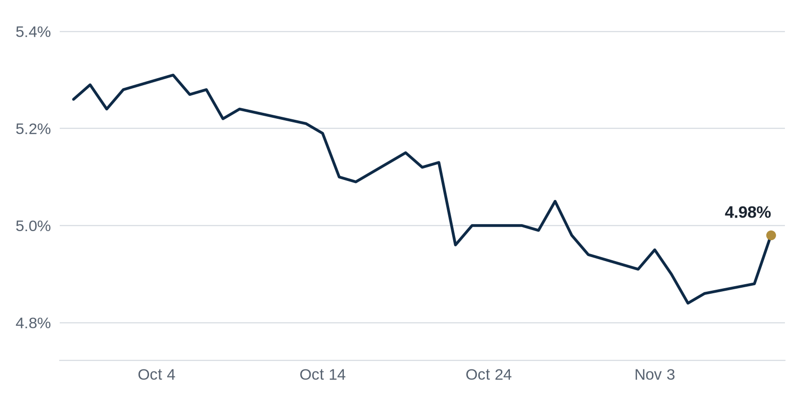

> **Review before publishing:**
> - reits: prices from Alpha Vantage only, not cross-checked (no second source; set TIINGO_API_KEY)
> - editor: fixed: Repeat: the CMBS special servicing rate (highest since 2012 / 11.74% 13-year high) led Debt Markets on Nov 9 and Nov 11 and was a reason the Nov 11 draft was...
> - editor: fixed: Repeat: the 121 W. Wacker Chicago office tower sale (buyers Buckman and Castillo) was the Nov 10 Brief and the Nov 11 lead Top Story, which was held partly f...
> - check/long_sentence: 36 words: **Why it matters:** When a lender forecloses on...
> - check/long_sentence: 31 words: **Why it matters:** A slower land market means...
> - check/missing_link: https://rebusinessonline.com/cushman-wakefield-brokers-sale-of-41-story-office-tower-in-chicago/
> - check/missing_link: https://news.google.com/rss/articles/CBMimAFBVV95cUxQVFFuWVY4MmZoVGxRam81M0Zfd3ZxMy1Dc1lsSzN6YkRXdldBaXJBTlBSSi04N1NFM29LMExJZDJBR0dJakxQXzl3WDVMa01Hb2F6Vl9iOWstZ1ptaDlFLUJTTTFTSEFvWXROY0dGeVFTblpIc21jMjFzTURXZDlDMWRFenc4LTdnUWJaOUxCeUgzM3JTSmhzNA?oc=5
> - check/missing_link: https://news.google.com/rss/articles/CBMinAFBVV95cUxQSmZZbXZIaGttUFRUX1hhYldZRlo3Ml8xdkpMRENoXzNlYjJZd0E5dWhTQ2VQN1A2THlBVzBBYVFZUHpCc2pWUENxdWZVM1dYbThJSjB1NnYzNGZpTGxPeWk4WVF4TVBTc0VBS2RLeExTYjgxYWZuMmVxUFVjUzd0SnNnX29vYlJmb0xVRHlKMDlSS2pqNjg1UVREZU4?oc=5

## The Brief

- Investors are pulling money from Blackstone's flagship property fund as its returns keep sliding. [GlobeSt.com](https://news.google.com/rss/articles/CBMipgFBVV95cUxQZEtTdjVzVjhWRzE5MFB4OWtWUTd1WE9LMms0T2p6REZzU2trV3ZndWJmQ1o1enM1Nk9DNGFJM2h1T3VmTEdNdl9tTzRaMHA1RUtNclczUW1VcFlkUElsRDdfWXRhOVlBODFWVmhNVi1yd0xnbUFTZGZ0WFd3VVFNX1gzZjlWSkVpaTBKNlFiYnptSGE2UG5BU3V0UzBad1RSSlg5eERn?oc=5)
- The Children's Place filed for bankruptcy and will close every store, emptying retail space nationwide. [Connect CRE](https://www.connectcre.com/stories/childrens-place-retail-chain-files-for-chapter-11-closing-all-stores/)
- Databricks opened a huge San Francisco headquarters, a sign AI firms are reviving office demand. [San Francisco Chronicle](https://news.google.com/rss/articles/CBMiqwFBVV95cUxOd1RDTjZXVnloNjl0OVVYM18ydGpVX2ltdDI5anB4Y1BUMEJkMU9udzF4NmtHTHNNaFh5Zmt3QjFMSHFTb3FHN0RzVlVSMS10SUJVNTZBdDY2Wk9WV2k4RE1sUk9jM01oTk9helVYSk5VR3ZmXzdReG9xNHBKTDFGWjlXdlU5eTJOZ0RzZUZqNmlpbmpGUVBCYVh6em9QZXRaY1VYQjJrMjczblk?oc=5)

## The Numbers

*Rates as of Nov 10 close.*

- **10Y Treasury:** 4.98% (+10 bps)
- **5Y Treasury:** 4.81% (+14 bps)
- **SOFR:** 3.89% (+1 bps)
- **Fed funds:** 3.75% to 4.00%
- **Next Fed meeting (Dec 9):** Polymarket's top outcome is 25 bps increase 89.5%
- **REITs:** VNQ $97.02 (-0.1%). Best: EQIX +1.7%. Worst: HPP -3.6%.
- **REIT yield vs. 10Y:** VNQ yields 3.63%, -135 bps vs. the 10Y.

**What it means:** The 2-year Treasury, which tracks what traders expect the Fed to do soon, made a notable move. Short-term borrowing costs shifted, so anyone pricing a floating-rate loan should take note.

**Why Equinix (EQIX) moved:** No company-specific news today; it may have moved with other data center REITs.

**Why Hudson Pacific Properties (HPP) moved:** No company-specific news today; it may have moved with other office REITs.

## Debt Markets

Private lenders are outpacing banks and insurers in commercial real estate lending, GlobeSt reports. As banks pulled back, debt funds and other private players stepped in to make loans. [GlobeSt.com](https://news.google.com/rss/articles/CBMinwFBVV95cUxNZDgtM1hQSUJOVElycVZkNzk0MldUaFhMcmNnV0wwZnZxQ1dmTDd0c2V2ZnFhd2VzYWd4cTdnSGZJdXhsRVBMaXREMnhmeXd3Z3pvSVdXMWVSc21XYWt4TkhHcVdTQjdQYW1XWUJvYlBLcm1xNGpXRWRmcFp3d01oYnlpd0NkV0N2d3JaaWZZeEVOWTV3VzJLRHJDUTFFNkk?oc=5)

**Why it matters:** Borrowers can still find money, but private debt often costs more than a bank loan, so financing deals gets pricier.

Big law firm tenants are becoming a refinancing risk for office owners, GlobeSt writes. When a major firm downsizes or leaves, the building's income falls. [GlobeSt.com](https://news.google.com/rss/articles/CBMingFBVV95cUxPWkVtNXRCSjB2V1JHWUdDQ2xjQUdhUDhzZmxHMU9DTXRRVTlwYVhvd1k3ZnlHNTlUUDU2elMyWjhSOVkwNnlGTXF3TnNncTA3THB1b180LWhiVjRkWFIxUTZ6NVVWQlNTNEFmQ2I4QzI5bHZBZDJVcXFJaVJsNlh0Si0tSkJXUFNsWUVoemxIZE15TVZfZGhSU0xXcmZrQQ?oc=5)

**Why it matters:** Lenders size a refinance off a building's rent, so a shrinking law-firm tenant can leave an owner short when the loan comes due.

Luxury apartments in Santa Monica owned by Pimco and Witkoff are heading to foreclosure, according to a new report. Foreclosure means the lender is moving to seize the property because the owners fell behind on the loan. Even well-known investors with deep pockets are not immune when a building's debt comes due in a hard market. [The Real Deal](https://news.google.com/rss/articles/CBMinwFBVV95cUxNUEVpb2FqMXIxSmhMb0FrajhTU3NMd0swcUthRVMtN1E2azAtTUhBWlVtdG9Vemt2Ymw5S3hQUlYtVGlfWUFIZ2pWb0RrWE9JMldXQVdkRXdqd0pseDU1TGstY2lFV0tSMHpkLTB6NVRLTVc3NXZnX2t3ZmJSQ0dnd2tQanUteFpzSk9OZGRlMU1qbl9EU0J5SW1qR09nX1k?oc=5).

**Why it matters:** When a lender forecloses on a trophy property owned by big-name firms, it signals to other lenders that even prime assets can go bad, which can make new apartment loans harder to get.

**Distress Watch:** Store openings are now overtaking closures as retailers move into space left by bankrupt chains, GlobeSt reports. [GlobeSt.com](https://news.google.com/rss/articles/CBMisgFBVV95cUxNSExNZVZMNG05NXFDUFNpSVhKVU93T2NYT2tfNkJTXzl6MldkRm85eVRPZXVmVndDUXZ4LVpGaW1zVGdJMi1sWGFadG9WOGtiRVpDVTMwb3BTRjFUbEZZaDI4RGZDM0lmQmRFU0lCbWVrVm5yVXNSSjVCU3Z0d19hUEtaQ0tVMGJjS1M2NkpMSHR0TUY2aDFyLVd1MXYyOVVNcHhPQUd2MGkyYXl6TllzSTF3?oc=5)

## Top Stories

### A Brooklyn Building Collapsed, Killing Eight

A building in Brooklyn collapsed, killing eight people and injuring many others, The Real Deal reported. The cause of the collapse was not yet clear.

**Why it matters:** Owners of older buildings and the city now face pressure to step up inspections, and liability questions could follow for whoever maintained the structure.

[The Real Deal](https://news.google.com/rss/articles/CBMinwFBVV95cUxQdUJzc3NXaU5tRTdXU2tzME51WVNpQVJ4UWgzM0wycjBhNlk4Sm9UWGR3NFFjX1Y5M3VBcWpkaDVreWZTamJUNVBzMkQxbjJWb3h5Q0tTOTM5QWFLNGN1S0RycExCaENRdDlPaHlkalB5aU9WLXlSUlZtaDJpSTlwUm5pSHlGQzhoMS1IXy1SWnM3a2Y2VEN2QklxNElHSWM?oc=5)

### Investors Head for the Exit at a Blackstone Property Fund

Investors in Blackstone Real Estate Partners are heading for the exit as the fund's returns slide, GlobeSt reported. Redemption requests tend to rise when a fund's performance disappoints its backers.

**Why it matters:** To pay out withdrawals, a fund may have to sell buildings, and forced sales can drag down prices for other owners holding similar assets.

[GlobeSt.com](https://news.google.com/rss/articles/CBMipgFBVV95cUxQZEtTdjVzVjhWRzE5MFB4OWtWUTd1WE9LMms0T2p6REZzU2trV3ZndWJmQ1o1enM1Nk9DNGFJM2h1T3VmTEdNdl9tTzRaMHA1RUtNclczUW1VcFlkUElsRDdfWXRhOVlBODFWVmhNVi1yd0xnbUFTZGZ0WFd3VVFNX1gzZjlWSkVpaTBKNlFiYnptSGE2UG5BU3V0UzBad1RSSlg5eERn?oc=5)

### A Google-Occupied SF Building Sells at a Big Markup

A Google-occupied office building in San Francisco's Financial District traded at nearly a 60% markup over its 2023 price, The Real Deal reported. The jump suggests buyers now see downtown office values recovering.

**Why it matters:** A fresh comp (a recent sale used to value similar buildings) gives nearby owners something to point to when they refinance or sell.

[The Real Deal](https://news.google.com/rss/articles/CBMiogFBVV95cUxQTS15UjJHRENKZDZJZWFSVHVZLS1ZNHk1NzZoTk16M1F4T1VCOEJpLU1GMHBuWENLR3NvODVRdEx5NWxycmxvMEphdUJHaWl6eHZTX0NQWGR5M2V6NnJBbTRyYXMwRFRWaVZVaGlwZ2NOczd0RWRHMXVJdVA2TklqamR1UkNrSzZKVnhFRjFFME5oRjFYaTljcFhiWHJNa2hQWnc?oc=5)

### The Children's Place Files for Chapter 11

The Children's Place, based in Secaucus, New Jersey, filed for Chapter 11 bankruptcy and said all stores will close as inventory liquidation begins. Its brands include The Children's Place and Gymboree.

**Why it matters:** Mall and strip-center landlords lose a national tenant and must find new occupants, a slow process that can cut a property's income for months.

[Connect CRE](https://www.connectcre.com/stories/childrens-place-retail-chain-files-for-chapter-11-closing-all-stores/)

### Databricks Opens a Big SF Headquarters

Databricks opened a large new San Francisco headquarters, which the Chronicle tied to an AI-driven office-market comeback. Growing AI firms are taking space that sat empty after the pandemic.

**Why it matters:** When well-funded AI tenants lease large offices, they absorb vacancy, which helps San Francisco landlords and the lenders holding their loans.

[San Francisco Chronicle](https://news.google.com/rss/articles/CBMiqwFBVV95cUxOd1RDTjZXVnloNjl0OVVYM18ydGpVX2ltdDI5anB4Y1BUMEJkMU9udzF4NmtHTHNNaFh5Zmt3QjFMSHFTb3FHN0RzVlVSMS10SUJVNTZBdDY2Wk9WV2k4RE1sUk9jM01oTk9helVYSk5VR3ZmXzdReG9xNHBKTDFGWjlXdlU5eTJOZ0RzZUZqNmlpbmpGUVBCYVh6em9QZXRaY1VYQjJrMjczblk?oc=5)

**Coffee chat talking points:**

- The Google-occupied FiDi building sold at nearly a 60% markup over its 2023 price, and with Databricks opening a new headquarters, San Francisco office values look to be recovering. [The Real Deal](https://news.google.com/rss/articles/CBMiogFBVV95cUxQTS15UjJHRENKZDZJZWFSVHVZLS1ZNHk1NzZoTk16M1F4T1VCOEJpLU1GMHBuWENLR3NvODVRdEx5NWxycmxvMEphdUJHaWl6eHZTX0NQWGR5M2V6NnJBbTRyYXMwRFRWaVZVaGlwZ2NOczd0RWRHMXVJdVA2TklqamR1UkNrSzZKVnhFRjFFME5oRjFYaTljcFhiWHJNa2hQWnc?oc=5)
- DFW's land market may need about 18 months to level out, cooling the Sun Belt just as San Francisco offices show signs of recovering. [Bisnow](https://www.bisnow.com/news/dallas-ft-worth/master-planned-communities/dfw-land-market-braces-for-slowdown-after-five-year-development-boom)

## Market Watch

### Sun Belt

Rex Real Estate owner Rex Glendenning expects it to take about 18 months for the Dallas-Fort Worth land market to level out after a five-year development boom. He sees sales volume picking back up only after that stretch. [Bisnow](https://www.bisnow.com/news/dallas-ft-worth/master-planned-communities/dfw-land-market-braces-for-slowdown-after-five-year-development-boom)

**Why it matters:** A slower land market means developers who bought lots to build on may wait longer to sell, tying up cash in one of the country's hottest growth regions.

### West Coast

Clarion Partners has put its loan on a Netflix-occupied Hollywood campus up for sale, The Real Deal reported. Selling the debt lets the lender raise cash or offload risk on the property. [The Real Deal](https://news.google.com/rss/articles/CBMilwFBVV95cUxQMmhlNVRidWIzcXRkVUt0TkZtQUZpU0R4RVg3d3BYSTl1bkdlTHVfNXBDRUwzLURHQlFYNlp0ZFc4ZFZhYWtRMXZoX0ZMNkpydVBFMG8xa1ljM0FIRlVvZkZ5MC1wS0dCTlI2Ty1pd2h5VVhZSTJnLTliQTNVUkJka1dBT3NNNjBXZzE4WFY2dDJLTWQ3YklB?oc=5)

**Why it matters:** When a lender sells a loan, the price it fetches signals how much investors trust the building's rent, here a single large media tenant.

### International

Argentic confirmed the launch of a European real estate lending platform, Green Street News reported. The move expands the firm's loan business beyond the United States. [Green Street News](https://news.google.com/rss/articles/CBMipAFBVV95cUxOZzdpcVhyTUVJaDdoZy1YLThTaGRMNGtMcDk2a2NwdEp4U2RmMkFSNjlSTWZpMlZpQTVCYndBWGNGdV9vZUY2R1NzcmdFNXZJN2kzU1k1R1h0WVZyeVJXMlJKN2tmUkZPNTJUTkxBaU9ibEhHRm8xUG5kZ1FWbXAzSXYzWkdxMHRoQjlHcWRScGJ6Um5ZZTk2d1RlNmJrcll0eGRqWA?oc=5)

**Why it matters:** More lenders entering Europe gives property owners there more options to borrow, which can ease financing just as it tightens in some US markets.

## Quick Hits

- Los Angeles Mayor-elect Nithya Raman inherits a stalled housing pipeline and must decide how to speed development. [Commercial Observer](https://commercialobserver.com/2026/11/mayor-nithya-raman-los-angeles-housing-development/) Faster approvals would let builders add badly needed homes in a city known for long permitting delays.
- A new Opportunity Zone map shifts the hunt for deals toward suburbs and secondary cities. [Bisnow](https://www.bisnow.com/news/national/opportunity-zones/oz-2-0-map-makes-thousands-of-new-areas-targets-for-investment) Opportunity Zones offer tax breaks for investing in designated areas, so the new map redirects that money to smaller markets.
- A foreclosure auction is set for the Radford Studio Center, with Netflix the leading bidder. [The Real Deal](https://news.google.com/rss/articles/CBMingFBVV95cUxOWHNfME9nTnJtY1NVQzRsR0NQZnhJRkVqRUFQdVgzMGJmS1VhaXIyN243Ujg2QzJub3pyX0UyM19hSl9Kc1IwaWlNYjB6S25QUmg0aXdqSlBiV0FjS25yYWI0RDJfN01oMGx0TU9nUUVyX3Q5U0ZOZzR4QUd3VGtJcHJXd01VZE5IeklDUzFRLVFnbzNNalBOcVNmWWtHQQ?oc=5) When a tenant bids to buy the property it occupies, it can lock in its space and avoid a new landlord.
- Gary Barnett bought out the Podolsky brothers, ending a years-long standoff over an Upper East Side development site. [The Real Deal](https://news.google.com/rss/articles/CBMiogFBVV95cUxOY3FQT0w2ODNfaGZOcTN3VXNMYmE0Um81YkdMcXYtNEs2cEdBVjRZNEx3ajBWbEVlZEtYRThwNXRXajhXRWNQc3Y0TnVFLVRySmpXN3ZwUDBick1aeHdvQmM1OHRmY1BTaUI5ZW9NTmNoZWEtcE5OYXgwQjlPc2hIRzNnb0c3SXE1TmVoSzVXRk1mZmJOTG1INlBsQkhXazhiS0E?oc=5) Clearing a co-owner dispute lets the developer finally move ahead with building.
- The Broe Group added a 22-floor luxury Dallas tower to its growing multifamily portfolio. [PR Newswire](https://news.google.com/rss/articles/CBMihAJBVV95cUxQb1AtdGptWmxRdGxQbWhseGM0eHE1N0xwd2Zva2hXYW4zdFYwZTJ2Z1d2emJiSDBkejY3QzdYVFRiRlZrUE9Wc2RYbkllVWQxeW5uZktBYWZ1Z1ByVDBENUFVZ3FMYlN0YWdwMGk0QjdzQzRzOFdKLWFYZ1c3dDQ2UXNXdVBuSDFqNDdRS2ZjMXdLbnpKSzM4dXRsQXVkZlVSSGxidW5mNWgxYndvREprSUVzYVRwa3FNNFlFeERWWTN2aVp2OGl4eHlDX1RMVjMyRG12aEpWMHpoMzdsMU5rY0pRRnRvN3FJekxnYXZsZnlLZDQ5NThmb0tGZHFZZ095V2RreQ?oc=5) Buying apartments in a fast-growing metro bets that renter demand keeps rising.

## Term of the Day

**Interest-only:** a loan period where the borrower pays only the interest each month, with the full principal (the amount borrowed) due later. On a $10 million interest-only loan, the owner pays interest but nothing toward the $10 million until the term ends. It keeps payments low now, but the borrower must refinance or sell to repay the principal later.

For informational purposes only. Not investment advice.
