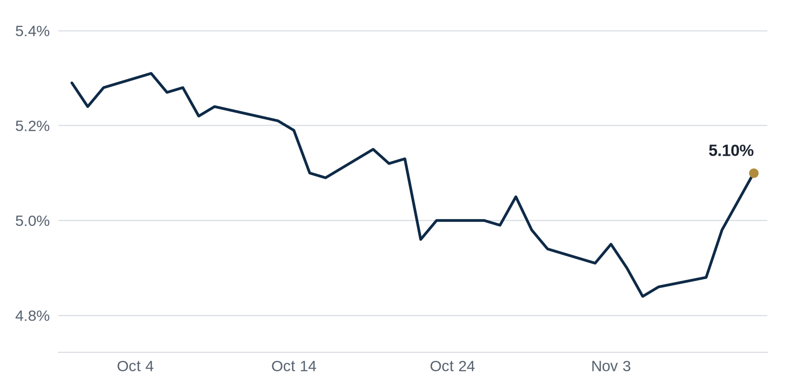

> **Review before publishing:**
> - reits: prices from Alpha Vantage only, not cross-checked (no second source; set TIINGO_API_KEY)
> - editor: fixed: Repeat: the CMBS special servicing 'highest since 2012' milestone led the Nov 11 issue (Brief bullet and Debt Markets lead).
> - editor: fixed: Same repeat: this Debt Markets lead restates the Nov 11 CMBS special servicing 'highest since 2012' story; four other fresh debt items remain.
> - check/long_sentence: 33 words: Active tenant demand across the big life science...
> - check/missing_link: https://news.google.com/rss/articles/CBMimAFBVV95cUxQVFFuWVY4MmZoVGxRam81M0Zfd3ZxMy1Dc1lsSzN6YkRXdldBaXJBTlBSSi04N1NFM29LMExJZDJBR0dJakxQXzl3WDVMa01Hb2F6Vl9iOWstZ1ptaDlFLUJTTTFTSEFvWXROY0dGeVFTblpIc21jMjFzTURXZDlDMWRFenc4LTdnUWJaOUxCeUgzM3JTSmhzNA?oc=5
> - check/missing_link: https://news.google.com/rss/articles/CBMinAFBVV95cUxQbzB6SUYxSUZXX1JrUkc1REZOV1FRaDJZZWhqSlBuZlNCNkdsU0RPNlpVX09GMHdsUzU2YlQ5YXJHRF9ENThIWkl0ejd3X2ZaRzlKbUowSjViWTBPNnpOUXRXWlpFOEdJcFUyOURaZEtpbk9qWlY3MXhHRWFkS25uVHZRTnVaRHNpTnNnQVFOcTdYYkhqREotLV9ITjE?oc=5
> - check/repeat_in_issue: linked 3 times: https://news.google.com/rss/articles/CBMimAFBVV95cUxNVHpISi1MWmZOTjlKOE9GQnRrZHR5clN2Wm5TMDJ2anFveU42N3VadlZvdXBnNnZXSXdtdEY3eVZsbGYtQjlmTUJpeW5GeTZoLVI1dkd6dEFTMngtZWM5NXRDZERSdDdKdWduVkVqOVFVZk5aU0JvWm5lelBIYjIzV3pTLVBVLWN5WUJsdGw4MF9hVGdJOGdEOA?oc=5
> - check/stale_data: Bank CRE loans last updated 2026-10-28

## The Brief

- Commercial property sales jumped last quarter, a sign large investors are putting money back to work in buildings. [Yahoo Finance](https://news.google.com/rss/articles/CBMimAFBVV95cUxNVHpISi1MWmZOTjlKOE9GQnRrZHR5clN2Wm5TMDJ2anFveU42N3VadlZvdXBnNnZXSXdtdEY3eVZsbGYtQjlmTUJpeW5GeTZoLVI1dkd6dEFTMngtZWM5NXRDZERSdDdKdWduVkVqOVFVZk5aU0JvWm5lelBIYjIzV3pTLVBVLWN5WUJsdGw4MF9hVGdJOGdEOA?oc=5)
- Warehouse vacancy fell for the first time in years, led by newer buildings, easing pressure on industrial landlords. [GlobeSt.com](https://news.google.com/rss/articles/CBMiuwFBVV95cUxOSDVnSy1HSFVtYjBfYWRqYUMxMk01MmZWWnh2ZEFTekZOR19TYmZINUhGUVpvaUtZSG5JLU5NUE9DclVVWmlsWHZrb2U1UXF0azlsQW13ckNwLVEwcFkzd0lvU2MzdTJEUzRxSWxMUnNGY3h6THFrdnhrclZyYU5xcC1DX2NrVXZ2QTZWeDQ1ZGIzY1Vfbm5lUTFiSkJfMnhFd2dzbXlHTlN6aDVZT1FTY2s4dzBnd3I2MDI4?oc=5)

## The Numbers

*Rates as of Nov 12 close.*

- **10Y Treasury:** 5.10% (+12 bps)
- **5Y Treasury:** 4.95% (+14 bps)
- **SOFR:** 3.90% (+1 bps)
- **Fed funds:** 3.75% to 4.00%
- **Next Fed meeting (Dec 9):** Polymarket's top outcome is 25 bps increase 91.5%
- **REITs:** VNQ $96.44 (-0.6%). Best: HPP +1.9%. Worst: DEI -1.7%.
- **REIT yield vs. 10Y:** VNQ yields 3.63%, -147 bps vs. the 10Y.

**What it means:** The 10-year Treasury, the rate most commercial mortgages are priced off, made a notable move. When it rises, borrowers refinancing face higher payments and buyers need higher cap rates (lower prices) to make the math work.

**Why Hudson Pacific Properties (HPP) moved:** No company-specific news today; it may have moved with other office REITs.

**Why Douglas Emmett (DEI) moved:** No company-specific news today; it may have moved with other office REITs.

## Debt Markets

Trepp counts $4.42 billion of private-label CMBS debt reaching its hard maturity, the date a loan must be paid in full, this November across 182 whole loans. More than half of that balance carries a debt yield below 8%, a thin cushion that makes refinancing at the same size tough. [Trepp](https://www.trepp.com/trepptalk/cmbs-hard-maturities-november-2026)

**Why it matters:** Owners who cannot refinance the full balance must add cash or sell, which can push distressed buildings onto the market at lower prices.

Even with borrowing costs climbing, CRE lenders are putting out more loan quotes, GlobeSt reported, a sign that capital is cautiously returning to deals. Lenders quote when they want to compete for business. [GlobeSt.com](https://news.google.com/rss/articles/CBMimAFBVV95cUxOYTVjQk1meFRJZDlLR1h1NExXbnZJWGlONEVOczZJQTZjcGJuTWpKZFRfZ2lHbEhRT2RzQW1JcURFXzgzbDFWQ3M2Mk1nQlpmNTYwaktaWjl0bkpPQ0JDMEdXdTV0NFlzbmcxWEZETmFhaTFDSWlwYk5oZjZKbm9LQ1hGQWhfU1pieEJjdFlBWnhFY1dVS3loVQ?oc=5)

**Why it matters:** More quotes give borrowers more options, which can slow the rise in spreads lenders charge over the base rate.

The share of office loans in commercial mortgage-backed securities (CMBS) that are behind on payments has hit an all-time high. Many of these loans are coming due at a time when rates are higher than when they were first made, so borrowers who need to refinance face steeper costs. Older office buildings with weak occupancy are driving the trend. [Green Street News](https://news.google.com/rss/articles/CBMiswFBVV95cUxNSnR4Qkd0aFhZbnpNcGxOa0VxekRndFY1YXZCRG42LXRHb1gyUlJGOGsxd2pSNUYwMDFKQktobEhMMExvVHpQNG84N09qZkZEaWpfZE5KbENnVTRXNjdLbk4tX3NCWHdDbm9DZXVodDhHaHhQblpVd0ZtSmF1cENrUHRQMkREY0dXdlVPRnhCaHhBdURJdXRDa3p0amZGZjYyb3VSWWNsLWI5NHhuOTU3YmllQQ?oc=5).

**Why it matters:** When these loans go delinquent, the investors who bought the bonds can lose money, which makes them charge more to fund future office deals.

**Distress Watch:** CIM Group faces a foreclosure threat at 1440 Broadway, a Manhattan office tower, as its lender moves to take the building, The Real Deal reported. [The Real Deal](https://news.google.com/rss/articles/CBMinAFBVV95cUxQSmZZbXZIaGttUFRUX1hhYldZRlo3Ml8xdkpMRENoXzNlYjJZd0E5dWhTQ2VQN1A2THlBVzBBYVFZUHpCc2pWUENxdWZVM1dYbThJSjB1NnYzNGZpTGxPeWk4WVF4TVBTc0VBS2RLeExTYjgxYWZuMmVxUFVjUzd0SnNnX29vYlJmb0xVRHlKMDlSS2pqNjg1UVREZU4?oc=5)

## Top Stories

### CBRE: Q3 investment volume jumps 98% to $257.8B

CBRE, the world's largest commercial real estate brokerage, said global investment volume reached $257.8 billion in the third quarter, up 98% from a year earlier. Investment volume is the total dollars spent buying income-producing property. [Yahoo Finance](https://news.google.com/rss/articles/CBMimAFBVV95cUxNVHpISi1MWmZOTjlKOE9GQnRrZHR5clN2Wm5TMDJ2anFveU42N3VadlZvdXBnNnZXSXdtdEY3eVZsbGYtQjlmTUJpeW5GeTZoLVI1dkd6dEFTMngtZWM5NXRDZERSdDdKdWduVkVqOVFVZk5aU0JvWm5lelBIYjIzV3pTLVBVLWN5WUJsdGw4MF9hVGdJOGdEOA?oc=5)

**Why it matters:** A near doubling of deal volume tells sellers that buyers are back, which can firm up prices after a long stretch of thin trading.

### Industrial vacancy falls for the first time since 2022

Warehouse vacancy, the share of industrial space sitting empty, fell for the first time since 2022, GlobeSt reported, with newer buildings leading the recovery. Older warehouses with lower ceilings and fewer loading docks are still lagging. [GlobeSt.com](https://news.google.com/rss/articles/CBMiuwFBVV95cUxOSDVnSy1HSFVtYjBfYWRqYUMxMk01MmZWWnh2ZEFTekZOR19TYmZINUhGUVpvaUtZSG5JLU5NUE9DclVVWmlsWHZrb2U1UXF0azlsQW13ckNwLVEwcFkzd0lvU2MzdTJEUzRxSWxMUnNGY3h6THFrdnhrclZyYU5xcC1DX2NrVXZ2QTZWeDQ1ZGIzY1Vfbm5lUTFiSkJfMnhFd2dzbXlHTlN6aDVZT1FTY2s4dzBnd3I2MDI4?oc=5)

**Why it matters:** Falling vacancy lets industrial landlords push rents again, and it signals that the glut of new warehouse supply is finally being absorbed.

### Blackstone seeks $3B for real estate secondaries fund

Blackstone, the largest manager of private real estate, is raising $3 billion for a secondaries fund, The Real Deal reported. Secondaries funds buy existing stakes from investors who want to cash out of property funds before those funds wind down. [The Real Deal](https://news.google.com/rss/articles/CBMingFBVV95cUxPSHctT1I4WWhzTURtRk1heFhMUXFvSUVjZ283R0RoRlJtM1hRaUVBdDdwNjdQWGVxd24tcXA1bUZBSEpOV0tUcUdsVzdHTHJhWmNWZTRGWUdPVEJYdV9lN1R1dmFiSE9LQk5RMi1fblBUMzlFSTIyczRJQXdjQVBHeml2QXdiWEVtNVNWR1RNSEg4RldrZnFNbGdNU1lPZw?oc=5)

**Why it matters:** A big secondaries pool gives stuck investors a way out, and it sets price marks for fund stakes that had been hard to value.

**Coffee chat talking points:**

- CBRE just reported $257.8 billion of third-quarter investment volume, so I would ask a broker whether that capital is chasing new deals or mostly refinancing older ones. [Yahoo Finance](https://news.google.com/rss/articles/CBMimAFBVV95cUxNVHpISi1MWmZOTjlKOE9GQnRrZHR5clN2Wm5TMDJ2anFveU42N3VadlZvdXBnNnZXSXdtdEY3eVZsbGYtQjlmTUJpeW5GeTZoLVI1dkd6dEFTMngtZWM5NXRDZERSdDdKdWduVkVqOVFVZk5aU0JvWm5lelBIYjIzV3pTLVBVLWN5WUJsdGw4MF9hVGdJOGdEOA?oc=5)
- Blackstone is raising $3 billion for secondaries just as CMBS special servicing hits a decade high, so I would ask which owners are expected to sell. [The Real Deal](https://news.google.com/rss/articles/CBMingFBVV95cUxPSHctT1I4WWhzTURtRk1heFhMUXFvSUVjZ283R0RoRlJtM1hRaUVBdDdwNjdQWGVxd24tcXA1bUZBSEpOV0tUcUdsVzdHTHJhWmNWZTRGWUdPVEJYdV9lN1R1dmFiSE9LQk5RMi1fblBUMzlFSTIyczRJQXdjQVBHeml2QXdiWEVtNVNWR1RNSEg4RldrZnFNbGdNU1lPZw?oc=5)
- Oxford's $100 million Phoenix warehouse buy lands right as industrial vacancy turns down, so I would ask whether that bet is early or right on time. [CommercialCafe](https://news.google.com/rss/articles/CBMiqgFBVV95cUxNYjJRUFFJMlNSN0JDMUVTQ1pVZ3BBNGdNQzNDRVRhQkZVa2ZaRVZtRGl4NFdqTFBsZG5FY2wyLXhDNjRQU0RpT1Z6WURSSXJFREVWOVpBbWp0LXIxWWl1LWtadGNNYmZUbXo3U01zdmxQWGN3S2pTdHVySUlUMDR6akFGZHkyS01wX21PUkFEcXBNbTBYbHU1TElVaTdYSHBoT1NaN08wc0NxUQ?oc=5)

## Market Watch

### Sun Belt

Jay Paul Company sealed $227.5 million of C-PACE debt to refinance a construction loan for the 881,427-square-foot Springdale Green office campus in Austin, Commercial Observer reported. C-PACE is financing repaid through a property tax assessment and used for energy upgrades. The deal is the largest C-PACE loan in Texas history. [Commercial Observer](https://commercialobserver.com/2026/11/nuveen-green-capital-c-pace-record-texas/)

**Why it matters:** When conventional construction loans get expensive, owners turn to tools like C-PACE to refinance, which keeps troubled projects out of default.

### West Coast

Active tenant demand across the big life science markets of Boston, the Bay Area and San Diego rose 62.6% from its 2025 low, and year-to-date leasing reached 6.9 million square feet, Newmark reported. Life science space is lab and research real estate. Vacancy is still high, but demand is turning up. [Connect CRE](https://www.connectcre.com/stories/tenant-demand-rises-in-major-u-s-life-science-markets/)

**Why it matters:** Rising tenant demand is an early signal that empty lab space will start filling, which helps landlords who overbuilt during the biotech boom.

### International

Commercial real estate investment in India jumped 15%, Construction Week India reported, as global capital keeps flowing into the country's offices and warehouses. Investment measures dollars committed to buying income property. [Construction Week India](https://news.google.com/rss/articles/CBMipAFBVV95cUxQWlY3MWhVUmExdUhvTGhkVHhDQ2dWRFFIOG5FV1M1YXRjTWxDTTlnRGVCbm82ellQd08zWlQzYTJ3RDMwM01Zc0RWRjB0SzhyNVZhRTFHdlZLNEhCREZNc3lKVHlVbjdWWTdBTFdsYjZIZDVkdndIZFNGUWhUUmtYSWYyTVNhYV9ubV9DQ19feTdXQWlDQWJkbkZORWx6Rjc4QXY2cg?oc=5)

**Why it matters:** As investors look past slower markets, India's pull shows where global money sees growth, pressuring other countries to compete for it.

## Quick Hits

- Producer prices rose 0.3% in October, but annual producer inflation hit 6.5%, its highest in nearly four years. [Connect CRE](https://www.connectcre.com/stories/producer-prices-rise-0-3-in-october-as-annual-inflation-hits-6-5/) Producer prices track what businesses charge each other, so a hot reading keeps pressure on the Fed to hold rates high, which weighs on property values.
- A passed City Council bill gives office-to-residential conversions a boost. [The Real Deal](https://news.google.com/rss/articles/CBMiogFBVV95cUxPTUwtckRmTmlWMElJZkNTcjVHcmE0QnJuNmJCY0ZRVmQtdTZLMHc2eXB6OGt4aFdGLWpONHBQT0VwaERjeFBYM1hBRkVtWk13WEM1WEJ5NUJfUkM3N0s5NFZPbXdrNDR1c1p6S0R5a3c4OVBmYlVWaWNQSldtTEpNRlpRVUdTUDNjX1hRenlEQjJYQUVrVWpZeE5tZlgzdEM2M3c?oc=5) Conversions turn empty offices into apartments, which helps landlords stuck with vacant towers and adds housing a city needs.
- Amazon's affordable housing fund reached a 12,000-unit milestone in the Puget Sound region. [The Business Journals](https://news.google.com/rss/articles/CBMingFBVV95cUxPemtKSFFkZkRKdGptY0tfMFRMZVFmNmhPZU1tUl95VkFGUzZoUm1FZzZPM1h6b2FZQnZJc0pldXM5M3BNTkJPLUpJV3RBWmNIYzZBb1RRcl9JMWVjcnBvak9lQ0xYcXF0WW5FeUh0UVRYQ3Q2dklFZUhsdm5OU3BET1B5ZXBKNXNuTEM5di13TjJtZy13YTJDVEZ0Q2o5Zw?oc=5) A corporate fund subsidizing apartments adds supply to a tight market, easing rents for workers priced out of the region.
- India overtook China as global investors poured $5.5 billion into its property market. [Moneycontrol.com](https://news.google.com/rss/articles/CBMi8gFBVV95cUxOampIX1d0VDhfWFJhNEZDMWtWdmxZaXlRLVZPRm4wdWJqa2JGM2Rhak13YWRvamYzZGlvRnRnZnEzVmFOV3RkUl9sLVRXX29XZ2FiaXpjbjZMY3BJSy12ejVSckNWdGtBazNoNnh2cWdHTlZXeW1ZUWliVTQ3QnR3NG4xRnJYaW5yT2I3NU5qVzJYc2lYV3JwSjJndTNwSTljWEd4Z1pNMlF2a1ZnWjlmbEE2RUQwMHFiaHNNeWtTZ1Y0anNhQ0xnUldqMVFzdm05eXg4WWg1LWs2MW9zM2VuYlROdjc2UVpWTTlhRmFDZDFBUdIB9wFBVV95cUxPZTZnQlZWMHVTcUdQT3MzenlKMzhQUlVrcnFDZ0tTUzdHVlA1Q2N5REFZRFc2RGF4ejVvMmJVSlQxclNPbTVBVHVneTJIYVl0UG00Mnc0RDlOUUxvOVF0TXdJS0k5ZVRYVGdYbi02a3ZHdHBVc1A4ZUtsOHpmNDZ0c1kwY0lsaC0ySzhiVWJ0NjJFTGkxTjFJQVBRRC1tOEItNUR2eEFxNHNMOGUzLTJhMDJGUzMwMnRDdGlLb2R3NlE3OWtJT2FZR0w5QzZpbjFvSG1YaWJpUlp2UnhuMUp2a1BfNVo0RnF1SDNNbGZTSG9Ndzd4WUkw?oc=5) When global money shifts toward one country, it signals where investors expect growth, and it pulls capital away from slower markets.
- Alvarez & Marsal published its first-half 2026 recap of US real estate. [Alvarez & Marsal](https://news.google.com/rss/articles/CBMihwFBVV95cUxONWRPU285VHJ5NVFSQTB0elAyQmVBMS02Y3JkM1g2WW1KRERmdW56STZhT21XRVRxRmExb0RBdWl2TkstMktiR1hYd05lcnQyTGpQV0ZXMEV5ZzFLa29XNm8ydEJreFJ1LUJMN25PcEpJcWptMWx2bmpRN3RnWlRUNzVRcHU0b0E?oc=5) A mid-year recap gives owners and lenders a shared scorecard on what sectors are recovering and which still face trouble.

## Deals of the Week

**Phoenix industrial portfolio:** Oxford Properties invested $100 million in a Phoenix industrial portfolio, CommercialCafe reported. Oxford is the real estate arm of a Canadian pension fund. [CommercialCafe](https://news.google.com/rss/articles/CBMiqgFBVV95cUxNYjJRUFFJMlNSN0JDMUVTQ1pVZ3BBNGdNQzNDRVRhQkZVa2ZaRVZtRGl4NFdqTFBsZG5FY2wyLXhDNjRQU0RpT1Z6WURSSXJFREVWOVpBbWp0LXIxWWl1LWtadGNNYmZUbXo3U01zdmxQWGN3S2pTdHVySUlUMDR6akFGZHkyS01wX21PUkFEcXBNbTBYbHU1TElVaTdYSHBoT1NaN08wc0NxUQ?oc=5)

## AI Infrastructure

Nvidia's CEO Jensen Huang resigned, and Bisnow laid out six ways his exit could ripple into data centers and commercial real estate. Huang drove the AI chip boom that has fueled demand for data center space, the specialized buildings that house computing servers. Developers and landlords who bet heavily on AI-driven data center growth now face more uncertainty about whether that pace of demand holds. [Bisnow](https://www.bisnow.com/news/national/data-center-development/nvidia-lost-its-dealmaker-6-ways-jensen-huang-exit-could-hit-data-centers-and-cre)

## Term of the Day

**Exit cap rate:** the cap rate an owner assumes when selling at the end of a hold. Cap rate is yearly income divided by price, so a higher exit cap means a lower sale price. If a building earns $1 million a year and you assume a 6% exit cap, you project selling it for about $16.7 million.

For informational purposes only. Not investment advice.
