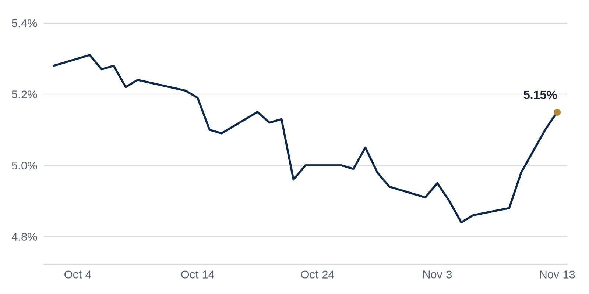

> **Review before publishing:**
> - editor: fixed: Source only says a deadly building collapse occurred; it does not say the building was old, so drop the unsupported 'older' characterization.
> - editor: fixed: Same: nothing in the source supports framing this around 'aging' buildings.
> - check/long_sentence: 32 words: **What it means:** Rates barely moved, so borrowing...
> - check/long_sentence: 31 words: CBRE calls today's lending a "tale of two...
> - check/long_sentence: 31 words: Blackstone Digital Infrastructure Trust, a publicly traded REIT...
> - check/missing_link: https://news.google.com/rss/articles/CBMiogFBVV95cUxNNFJOTlZ5a3I4VV9IYkJtVDQ3dXdkTzdHY1FHeW00VXQyWkIzbC1XODBnOFhDRnVkbWoxSTZ5d2Ryd1ItcHNaQ3UtYWcxeEszQkxIMkYzc0liV1E2Ym0xajFpQXFMaVpuR2Vya0N4cUtrYVhBaFctdi1GMUhickR2QlAtN2o3NHVuRlFlMGsyQ2xQcFpwQ1huekJ3VDdHWXloUUE?oc=5
> - check/missing_link: https://news.google.com/rss/articles/CBMirgFBVV95cUxPZXdBa01OSFM5Nkp1UWVpYm9NQWxxNWs0RjNrS0FiSjlGTkVCUHpMRDltcFJfbVVVRTVfd0VQblhSOTU1V0FtRVFnZlExS2ZrUS1jZ0hyWW5vVWQwLVBfSXhvMHN6ZS1PZ3FnMm40T29LMjRlYVlVQ0Q2WE1UUDdDZDZkcEhObTRTdE05amJzbDJEU2FYMGR1ZXRmZWVyYng5LVEwNlFLc3lEWjNwTGc?oc=5

## The Brief

- Higher mortgage rates pushed home buying to its slowest pace in years, squeezing both sellers and lenders. [The Real Deal](https://news.google.com/rss/articles/CBMiqwFBVV95cUxQY0w2TE9kbDB0U0ZZN25OVTBnaWpZTFNmTFFRM0NSRVNaOWZhX0UwTmNRZl9xQzNjRkE3VHEzUHFxb0xfb2VTQ0h0WEFkVnZOY1JWMzdCZFFJTldneTJWNG9QN1k0R29rWGRXemN3V0h1LV81dXN0X1NTemZPX2NHM2hzaXZJTXBRdm1YT1M0NHllZjR0WWIyOEg1XzQ5WjJ1eEI2NHZDdnk2QW8?oc=5)
- Blackstone's data center arm teamed up with Amazon, betting big on the buildings that power cloud computing. [Commercial Observer](https://commercialobserver.com/2026/11/blackstone-digital-infrastructure-trust-aws-data-center-joint-venture/)
- Analysts now see near-term Fed rate hikes, yet argue the shift could still help commercial property owners. [GlobeSt.com](https://news.google.com/rss/articles/CBMirgFBVV95cUxNVlU2ZDlxa3BCQ1dQVVhvS2tWai1uOGI2ZDRoWUNKa1lhTU94Vk5YUDhwMDMtTjNrUG1ucXRKTGVyci1YXzVjZlFXajZHaTZYV01EQWEtdWdXZnRrVzNyell0ZUJBVDZlMWpxLXNJT00zYTIzS1BQcFBCOUprWElPaFc4Z3VJREVzV2JVY25FaTVUbV9XNnJDOHJZLVZGVFdjYmZwX1pPOHNOXzNOVXc?oc=5)

## The Numbers

*Rates as of Nov 13 close.*

- **10Y Treasury:** 5.15% (+5 bps)
- **5Y Treasury:** 4.98% (+3 bps)
- **SOFR:** 3.90% (0 bps)
- **Fed funds:** 3.75% to 4.00%
- **Next Fed meeting (Dec 9):** Polymarket's top outcome is 25 bps increase 90.5%
- **REITs:** VNQ $96.47 (0.0%). Best: BXP +1.4%. Worst: DLR -1.9%.
- **REIT yield vs. 10Y:** VNQ yields 3.63%, -152 bps vs. the 10Y.

**What it means:** Rates barely moved, so borrowing costs for new loans are about where they were last week, and buyers can plan deals without bracing for a sudden jump in payments.

**Why BXP moved:** No company-specific news today; it may have moved with other office REITs.

**Why Digital Realty (DLR) moved:** The company won approval for a new data center site northwest of Chicago, and investors may be weighing the heavy cost of building it out. [The Real Deal](https://news.google.com/rss/articles/CBMiqgFBVV95cUxPc2c4bVRmMTNDUTBiUjl0bHE3Q014TjNWTXhfZzl2VUZ1TC1VWnZHU2FZTTFvM1JVb2J4dUFKejFIR2lOSUhGSjU0MTFQbHZaLURpd3NOVjVKMzczcUtGaVo0YTVmbFZNaDJoVGh1OFZjblZqc0t3QjBTLWQ4RjNuNjdrbWhRMVV3a1VYOEQ1VEFocWI2WTF2RXRwcEtFdTdmZWtxMDBpMTRhZw?oc=5)

## Debt Markets

November brings $4.42 billion of commercial mortgage-backed securities (CMBS, bonds backed by pools of property loans) coming due, and $805 million of that has no clear way to refinance. That shortfall is the refi gap: the amount lenders may not get back when a loan matures. [Yahoo Finance](https://news.google.com/rss/articles/CBMimgFBVV95cUxPem9Va3BEVW1VN21ZWERkcUtTYUZNWEZubjctbkp2WnhuYm5fMlBQSXVfVmxqRWl0dGZxZVpTVGRWREVRNzRWMEVfUWJhVmp1OENlenVSWGxGdFBfbFZtcjFVajNMQzR1aUgyNWJjVXVFYndwWVROU3BVVkE0YWg4ZU9wLURVM0d6QmFLZWMta0tycnRSSjlwenNB?oc=5)

**Why it matters:** Borrowers who cannot refinance may have to sell at a loss or hand the keys to their lender.

CBRE calls today's lending a "tale of two markets": money flows easily to strong assets like apartments and warehouses, while offices and weaker properties struggle to find any lender at all. [MBA Newslink](https://news.google.com/rss/articles/CBMisgFBVV95cUxPZ0xPLUlFMDdSWXhNb0FObFlZQ21iQlJIRFJGWkxQaDd6VDAwaWZXNklFWVVwU2lhNFZyVFB2b1Q3aDNhajBXVUdIYkR0N09ZN3hhVU1kb1RtaEU2SXFiQlh2WlNRSnlXM0lwYUtnWmlqaGFBQkxYbWhGNEVYczVXSVFESE9xZDFDWkJkbmFmd3BXanZxbTNkUTNvdEFRbTc0UVBDZzFob0ZfNU5SbWdSVmJn?oc=5)

**Why it matters:** Owners of older offices face a lending freeze, so many will need fresh equity or a sale to stay afloat.

Stonehenge landed a $233 million refinancing on a Midtown West apartment building in Manhattan after finishing a renovation. Lenders reward completed, income-producing projects. [GlobeSt.com](https://news.google.com/rss/articles/CBMiqgFBVV95cUxOV1NwbjdFNy1jMnotOWJESWtyaWJfR2dseFpRZmtCdHl2VTFjZHYzM1BNS1lSVnY5Qnl2S0cwZThNa3NTeEl4d01LVGx4SVJBNk0taGlUVlIyNklydVFLZGhNRm5PT3VScVZRSlFzYXpmVkRXRmNHd1NWRWZodU1fR3lGeGU0NFM5Ti1jbFQ5NEpkeV9sam5xcDhHbnJuTmFxYk9USE45WVp4dw?oc=5)

**Why it matters:** A clean refi shows that strong rental buildings can still attract debt even while offices cannot.

A Berkeley waterfront hotel has defaulted on its loan and now faces possible foreclosure, meaning its lender could seize the property. Default happens when a borrower stops making required payments. The hotel's summary gives no dollar figures, only the warning that the lender may move to take it over. [The Business Journals](https://news.google.com/rss/articles/CBMirgFBVV95cUxPanBzOFhQdkp6dndtQU1SZndYczJuSERTR1VNNXVlUS1hZmt4MWFadEhsSWVRWEltbThSWlhjNHpUV0JXRkZFazJtN21TTDhHLUlrVnlPSHRVMFFETXVmQVRLcDhuLXpCU2VqM2VPU3g3QVJCT1dSVkp0QkJsZmlrcFhtRzQtby1nODk5cVNiZFVmM0k5SkU3U3hFQVVIOHVyOUlhT3FZdUMwZ0RLUFE?oc=5)

**Why it matters:** A hotel owner missing loan payments is a warning sign to lenders, who may tighten terms on other hotel borrowers to protect themselves.

**Distress Watch:** A lender took ownership of a prominent apartment tower in West Raleigh after the owner defaulted on its loan, per [The Business Journals](https://news.google.com/rss/articles/CBMiqgFBVV95cUxNbVRxTk4yd3V6ZjNrTDFJMkhzcWNXMGhvV1BHd1AyVXlicmx4bzFxWVJnMi1tTTNyTW93NGx3TTNObWMxYjdRSDlLdXlXWHVmd1gwLW9vMFl2eGZmV21SR085RHBKRkIxbURvaFVlek1mZ2tnSEd2N3htZGRCWi1WWXVtZ2ZPZDRkLUVEYWpYeHRIZ2xROVRwcldQVVFfMXJDOXg4ZzdoWDVrZw?oc=5).

## Top Stories

### Existing-home sales fall to a 16-year low

A spike in mortgage rates pushed existing-home sales down to their slowest pace in 16 years, according to The Real Deal. Higher rates make monthly payments larger, so many would-be buyers simply wait.

**Why it matters:** Fewer home sales slow the whole housing chain, hurting agents, lenders and builders who depend on steady deal flow. [The Real Deal](https://news.google.com/rss/articles/CBMiqwFBVV95cUxQY0w2TE9kbDB0U0ZZN25OVTBnaWpZTFNmTFFRM0NSRVNaOWZhX0UwTmNRZl9xQzNjRkE3VHEzUHFxb0xfb2VTQ0h0WEFkVnZOY1JWMzdCZFFJTldneTJWNG9QN1k0R29rWGRXemN3V0h1LV81dXN0X1NTemZPX2NHM2hzaXZJTXBRdm1YT1M0NHllZjR0WWIyOEg1XzQ5WjJ1eEI2NHZDdnk2QW8?oc=5)

### Analysts see near-term rate hikes, and a silver lining for CRE

GlobeSt reports growing signs that the Fed could raise rates again soon, which usually spells trouble for property values. The twist: some analysts argue the move could clear out weak owners and reset prices to levels that reward patient buyers.

**Why it matters:** Higher rates raise borrowing costs for everyone, but a reset in prices gives well-capitalized buyers a cheaper entry point. [GlobeSt.com](https://news.google.com/rss/articles/CBMirgFBVV95cUxNVlU2ZDlxa3BCQ1dQVVhvS2tWai1uOGI2ZDRoWUNKa1lhTU94Vk5YUDhwMDMtTjNrUG1ucXRKTGVyci1YXzVjZlFXajZHaTZYV01EQWEtdWdXZnRrVzNyell0ZUJBVDZlMWpxLXNJT00zYTIzS1BQcFBCOUprWElPaFc4Z3VJREVzV2JVY25FaTVUbV9XNnJDOHJZLVZGVFdjYmZwX1pPOHNOXzNOVXc?oc=5)

### Deadly building collapse rattles New York City

New York City is reeling from a deadly building collapse, The Real Deal reports. The disaster puts a spotlight on how buildings are inspected and maintained.

**Why it matters:** City officials and owners may face tougher inspection rules, raising upkeep costs for buildings across the five boroughs. [The Real Deal](https://news.google.com/rss/articles/CBMimgFBVV95cUxQRERWSGZjcFp4V042eG5pcWROeFNjNEtaOUxUOEo2eUVWVS1XSm9hOUNHYkczakduX0h5TlI1WGc3aXl5WjdQQ0wtM1YzaVlKNTYyX3pqMFZ4STg4blpwTDJQWFc2NmIwRm13aWVNb19heWo0OWJxUXlxQ3VSMTVOSWJhQVlJTGVmN0lCSldOb2NXQ0hxM1VRaUpR?oc=5)

### AT&T breaks ground on a $1.4B headquarters in Plano

AT&T started construction on a $1.4 billion headquarters in Plano, Texas, and expects to move staff in during late 2028, per The Real Deal. The project anchors a major corporate relocation to the Dallas area.

**Why it matters:** A large new headquarters pulls jobs and demand to Plano, lifting nearby office, retail and housing markets. [The Real Deal](https://news.google.com/rss/articles/CBMijwFBVV95cUxQMDlidkYwQXlXRms2TFc1a2ZkMnV4eW9zMm1ieVRueUpDTlhSWjR1MHphYWd0eUFqckZfbkRDT0VRakVqem0tazYzNzY2blI0X3dKVTlZSHJlNjVGNTJYT0xfSmUwT0JHdjExNDFyYlpoRzZuNWJya1pnVW05MjVzTVhQLTdMZVZIZHFrdGpkYw?oc=5)

**Coffee chat talking points:**

- Apartment REITs sold $3.31 billion of property through the third quarter even as owners pile on concessions, so public landlords look like net sellers in a soft rental market. [Trepp](https://www.trepp.com/trepptalk/apartment-reits-sales-outpace-acquisitions-3q26)
- With $805 million of November CMBS maturities lacking a clear refi, any near-term Fed rate hike would make that funding gap even harder to close. [Yahoo Finance](https://news.google.com/rss/articles/CBMimgFBVV95cUxPem9Va3BEVW1VN21ZWERkcUtTYUZNWEZubjctbkp2WnhuYm5fMlBQSXVfVmxqRWl0dGZxZVpTVGRWREVRNzRWMEVfUWJhVmp1OENlenVSWGxGdFBfbFZtcjFVajNMQzR1aUgyNWJjVXVFYndwWVROU3BVVkE0YWg4ZU9wLURVM0d6QmFLZWMta0tycnRSSjlwenNB?oc=5)

## Market Watch

### Sun Belt

Dallas withdrew a $96 million incentive agreement for Hoque Global's $450 million Newpark district downtown after the developer missed its financing and building permit deadlines. The city pulled support once the project stalled. [Bisnow](https://www.bisnow.com/news/dallas-ft-worth/development/hoque-global-s-450m-downtown-dallas-project-loses-city-incentive)

**Why it matters:** Losing a public incentive makes an already pricey project harder to fund, and other developers see that deadlines carry real consequences.

### West Coast

Office development will not pencil out in most US markets for years, Mortgage Professional America reports. "Pencil out" means a project earns enough rent to cover its cost and turn a profit, and today's high building and borrowing costs make that math fail.

**Why it matters:** With no new offices breaking ground, existing buildings face less competition, but construction workers and lenders lose a steady source of deals. [Mortgage Professional America](https://news.google.com/rss/articles/CBMiuAFBVV95cUxQX1poV25Yb29zTTZVVms3UEVVdGQ3Q2M4cjRmZmctZTBST2Ruc01jSVNBXzRqd2ZMdXZzbXpRVUtPZHRMYURhV29ZWmZzQ0hrd1l4bnVnNVNzNUJxWEZvSHBFTW1rTzAzOEY1Rk0zRXNpa2hrc2pwM1k5RGlwc1dRQk9NN2dsYzY5ZjFTYkdUcGVzTEF5SVowNVV6TS05bkNoX0c4aE5RUWZCOUxNX1RJazNBVkJHcFBJ?oc=5)

### International

Great Portland Estates sold a London mixed-use block for £422.3 million, trimming its holdings in the city center. The sale shows buyers still want prime London property. [Completely Retail News](https://news.google.com/rss/articles/CBMiiwFBVV95cUxQa3YwYUZuSi1xcmFaaXJERWJsRTgxLW1WSXg3d21fUm42ZmVwOHVjSnFyVllsdjRIbGJ2NDNfeTdSLWdYeVVRd2FscXRCTHpMSHE3cC1uaDBvZElDMFpCSGw0WkpCWXRfcDBEeUxNRFBwcHp4NGtndnpIY1JnRFk3WC1EOHNFeVRPTkdv?oc=5)

**Why it matters:** A large sale at a firm price signals that global investors still trust London values, giving other owners there a comp to point to.

## Quick Hits

- The Broe Group entered Dallas with one of the nation's largest multifamily transactions of 2026, per [Yield PRO](https://news.google.com/rss/articles/CBMiZEFVX3lxTFBZR2V5UURSbGxUTkZ4WWx4MENINVpEcFJoZWUwaW5oMXM2QmowS2h1cEdvSmZVZ2pQM2ozdnB0b0FJSXhybmhLQ0pHSVVSMktjNm5BcWFrLWl3WktlbThzTFJxcWU?oc=5). A new, deep-pocketed buyer entering a metro is a vote of confidence in that market's apartment demand.
- Apartment concessions are climbing as owners defend a 94% occupancy rate, reports [Yahoo Finance](https://news.google.com/rss/articles/CBMipgFBVV95cUxQSzhURWlVdmtWVEVraUwtVjFyZTY4cVpiQkhNWEhpTEVnS1g0R0N0R2V5V0hCbGI4c1dPYTIxV25ZelRKVzlTWUlkTmJ0dmE5Yk5xSkJjZ193dmVNT09JRmw4OUtfbFF2ZE5ORnBjN3lNMTNQenFlQ0pUQzN6ZUNldFpFWURiay1VZ1NmNGhYM01LNlpSVnlxNzRVY2FST3JjS2l3LTB3?oc=5). A concession is a freebie like a month of no rent, so owners are trading income for full buildings.
- At Austin's Mueller Flats, the borrower warned its servicer that rivals are offering months of free rent, per [Commercial Observer](https://commercialobserver.com/2026/11/multifamily-distress-cmbs/). Heavy give-aways signal a glut of empty units competing for the same renters.
- RXR bought a minority stake in Silverstein and MetroLoft's 55 Broad Street in Downtown Manhattan, reports [Commercial Observer](https://commercialobserver.com/2026/11/rxr-55-broad-street-wells-macuarie-newmark-metro-loft/). Fresh equity from a new partner helps an owner pay down debt and keep a recapitalized building afloat.
- The nine major apartment REITs sold far more property than they bought this year, according to [Trepp](https://www.trepp.com/trepptalk/apartment-reits-sales-outpace-acquisitions-3q26). When public landlords become net sellers, they are raising cash and shrinking rather than expanding.
- Service Properties Trust rejected a $2 billion cash bid, claiming its hotels could be worth double, per [Bisnow](https://www.bisnow.com/news/national/hotel/service-properties-trust-rejects-2b-cash-bid). A rejected lowball offer shows management and bidders disagree sharply on what the assets are worth.

## AI Infrastructure

Blackstone Digital Infrastructure Trust, a publicly traded REIT that buys and runs data centers, agreed to acquire a 75 percent interest in a $5 billion joint venture with Amazon Web Services. Data centers are the warehouse-like buildings full of servers that run cloud computing and artificial intelligence. Pairing a major landlord with Amazon locks in a large, creditworthy tenant and signals that investors still see data centers as one of the strongest corners of real estate. [Commercial Observer](https://commercialobserver.com/2026/11/blackstone-digital-infrastructure-trust-aws-data-center-joint-venture/)

## Term of the Day

**Maturity wall:** a cluster of loans all coming due around the same time, so borrowers must refinance or repay at once. Imagine $100 million of five-year loans made in one busy year; five years later they hit together. If rates are higher then, some owners cannot refinance and are forced to sell.

For informational purposes only. Not investment advice.
