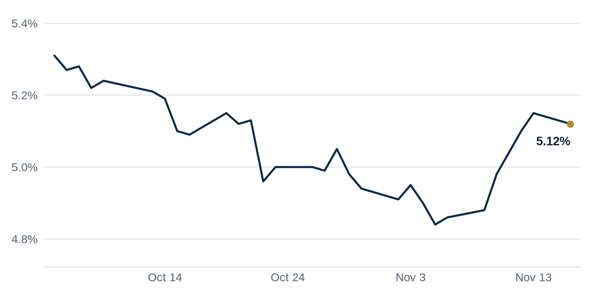

> **Review before publishing:**
> - reits: prices from Alpha Vantage only, not cross-checked (no second source; set TIINGO_API_KEY)
> - editor: fixed: Duplicate of the Bisnow Ashcroft Capital foreclosure story already in Debt Markets (same $366M deal); repeated within the issue.
> - editor: fixed: The floating-rate reset claim is not in the WSJ title or summary.
> - editor: fixed: The source only says Congress is scrutinizing the acquisition; the rent-hike motive is not in the source.
> - check/budget: Term of the Day: 67 words (budget 50)
> - check/missing_link: https://news.google.com/rss/articles/CBMinAFBVV95cUxNZDZZRWN2UjRPaU80SDRZTEVnaWZpLVp0WUF0SGZQRUQzUVhoanZ6VFR1a2NNVEUxV3NHQjloVnFuX2tGV0pLU19QeF9pZ01OSm1fNk5qaVF1SzdyWnhqQUZtUWE1ejJGOFVlTG5zeENiOXMydGZTczFiWlpCZ0hrX0pRbVJ3RVNOR0x4T25yZG5URWptYmVpSUpKZ28?oc=5
> - check/missing_link: https://news.google.com/rss/articles/CBMiggFBVV95cUxNd1ZPcEprVk5UazZRMzZxUTN2b1BwRE9JVTRnUS11MzJWeTFGZ3F0bnVnQXpMeXg3X0g3TExkTDhMVzBRT28xMzdTUU55WEt3dldoX0ptWXdjeDc5UVdKY2pFRkpwNVlIWmlWaTB0c1JGZ0RfMlgwdWNKM1NibzVFT3JR?oc=5

## The Brief

- Blackstone paid big for Amazon's data centers, a sign the largest buyers still want landlords that power artificial intelligence. [GlobeSt.com](https://news.google.com/rss/articles/CBMiogFBVV95cUxNNFJOTlZ5a3I4VV9IYkJtVDQ3dXdkTzdHY1FHeW00VXQyWkIzbC1XODBnOFhDRnVkbWoxSTZ5d2Ryd1ItcHNaQ3UtYWcxeEszQkxIMkYzc0liV1E2Ym0xajFpQXFMaVpuR2Vya0N4cUtrYVhBaFctdi1GMUhickR2QlAtN2o3NHVuRlFlMGsyQ2xQcFpwQ1huekJ3VDdHWXloUUE?oc=5)
- A big apartment syndicator faces foreclosure on its Sun Belt portfolio, a sign last cycle's multifamily bets are still unwinding. [Bisnow](https://www.bisnow.com/news/atlanta/capital-markets/syndicator-firm-faces-foreclosure-on-atlanta-apartments-tied-to-366m-loan)
- OpenAI's hardware team leased a large San Francisco office, more proof that AI firms are pulling tenants back into the city. [San Francisco Chronicle](https://news.google.com/rss/articles/CBMirAFBVV95cUxNX3pyazFyRWxzMVJSd05yQXNBNmNZaDIyUHc5bk9qODBUQXUyYUR4c2ZkeDYzV1RHdVg4LUJyNDBHOFZRQ0xQRU95MDF1V0VZa0lTS3VwcWpNZEtrVHBBbUdvLWlKQXQ5T1VLODkwNi1LZnQ3a19oWkk4YVd5MnQ3ckg3UE1SSTZBek04VmR0N3BvNUYzZXRKakVFbV9SRTV5aXZQdlVzUlRDQ3Vq?oc=5)

## The Numbers

*Rates as of Nov 16 close.*

- **10Y Treasury:** 5.12% (-3 bps)
- **5Y Treasury:** 4.93% (-5 bps)
- **SOFR:** 3.93% (+3 bps)
- **Fed funds:** 3.75% to 4.00%
- **Next Fed meeting (Dec 9):** Polymarket's top outcome is 25 bps increase 92.5%
- **REITs:** VNQ $96.23 (-0.2%). Best: HPP +7.4%. Worst: STAG -1.1%.
- **REIT yield vs. 10Y:** VNQ yields 3.63%, -149 bps vs. the 10Y.

**What it means:** Rates were little changed, so new-loan borrowing costs sit about where they did last week. Buyers can underwrite deals without guessing at a fresh jump in financing costs.

**Why Hudson Pacific Properties (HPP) moved:** No company-specific news today; it may have moved with other office REITs.

**Why STAG Industrial (STAG) moved:** No company-specific news today; it may have moved with other industrial REITs.

## Debt Markets

Ashcroft Capital may lose nearly 1,700 Sun Belt apartments after allegedly defaulting on a $365.6M multifamily loan. The syndicator pooled money from many small investors to buy apartments, then borrowed heavily against them. [Bisnow](https://www.bisnow.com/news/atlanta/capital-markets/syndicator-firm-faces-foreclosure-on-atlanta-apartments-tied-to-366m-loan)

**Why it matters:** When a syndicator defaults, the lender takes the buildings and the small investors can lose their stake, a warning for anyone buying into these deals.

Large investors are increasingly walking away from apartment loans they can no longer carry, leaving lenders to absorb the losses, the WSJ reports. [WSJ](https://news.google.com/rss/articles/CBMirAFBVV95cUxQTVlIM09ZLXlkby03Y0VOMlU2eHFsbVNycTRnTnlCUjUwMzhkSEQ0cDVfX21NbEwwWk9PT1VaeVZmZlhMbGNpU2dNd3J3Zi1KRUJuZ2FWeVNYSlU1SVZrQVQxQm5JajM1Q0hnYTkySTVzQ2l4TzBtYW9iTUtrTWh6OE5LYXdHejA0UnBkNVB6T3BxdFVCaW5Vd1VoTlhMSk1MVWRJUEFOejNMbkRX?oc=5)

**Why it matters:** If big borrowers default without penalty, lenders tighten terms for everyone, making new apartment loans harder to get.

The Chetrit Group's 26 Broadway office tower, the historic Standard Oil Building, had its appraised value cut to $147M as the owner faces mounting financial and legal trouble. [Bisnow](https://www.bisnow.com/news/new-york/office/chetrit-family-woes-deepen-26-broadway-appraisal-slashed)

**Why it matters:** A lower appraisal means the loan may now exceed the building's worth, so the lender could demand repayment or take the tower.

**Distress Watch:** Mount Point bought a distressed Rosemont office tower outside Chicago at roughly half its former value, per The Real Deal. [The Real Deal](https://news.google.com/rss/articles/CBMimwFBVV95cUxPV2VPbnVndjhjN3NXZ3FoVm5UQlNJcXZtdFlLSHQ5T09tYUJkRGRiblZKbm5jdFp2WkxlN1ZIaEJ1Nzlud0hRVUJTY01xYmloSldpVGJKZTFLN0Q2YXVpZ1V5UEg1ZmQ2UE9jdS1ielNUMVdaTkdRd0FxNkhLa1l3MlYzOVNwS2tRUjdQYzJtRHNRSVhHS0lkMFhlbw?oc=5)

## Top Stories

### Blackstone buys Amazon data center portfolio for $5B

Blackstone's data center REIT agreed to acquire a portfolio of Amazon data centers for $5B. The deal expands Blackstone's bet on the buildings that house the servers running cloud and AI services. [GlobeSt.com](https://news.google.com/rss/articles/CBMiogFBVV95cUxNNFJOTlZ5a3I4VV9IYkJtVDQ3dXdkTzdHY1FHeW00VXQyWkIzbC1XODBnOFhDRnVkbWoxSTZ5d2Ryd1ItcHNaQ3UtYWcxeEszQkxIMkYzc0liV1E2Ym0xajFpQXFMaVpuR2Vya0N4cUtrYVhBaFctdi1GMUhickR2QlAtN2o3NHVuRlFlMGsyQ2xQcFpwQ1huekJ3VDdHWXloUUE?oc=5)

**Why it matters:** A $5B purchase tells other investors that data centers are now a core property type, pulling capital away from older offices and malls.

### Macerich pays $250M for San Jose's Oakridge Mall

Mall owner Macerich acquired the Oakridge mall in San Jose for $250M, growing its Bay Area retail footprint. The company expects the center to lift occupancy and income. [Bisnow](https://www.bisnow.com/news/san-francisco/retail/macerich-acquires-oakridge-mall-in-san-jose-for-250m)

**Why it matters:** A REIT paying up for a strong mall, while weaker retail drives loan defaults, shows buyers are splitting good centers from troubled ones.

### Amancio Ortega pushes Chicago bets to $1B

Zara founder Amancio Ortega bought a Gold Coast apartment building in Chicago, lifting his local investments to about $1B. The purchase adds to a steady run of U.S. buys by his investment arm. [The Real Deal](https://news.google.com/rss/articles/CBMimwFBVV95cUxPYzBfQWpPOS05eUpneVF0Y3FOY25TR3pXeGVMQXpIN2lfUl9sOTRmejFzbnMyMWFkdjRmRVhhbG9zT3NaM1l3T0V3T09kWVBFOF90MW9aaWQ2TUhuTWt3LV9pLS1feWgwQnB3R3N6eDFmX3lUVzI5RUxaWTZNNElQMVBPTnltYmxlWThhNVNVZ0VwTWNGX0RBSDdNTQ?oc=5)

**Why it matters:** A deep-pocketed foreign buyer concentrating on Chicago apartments gives local owners a comp to cite when they refinance or sell.

### SF's latest AI lease signals a tech return

A wave of AI firms is signing new leases in San Francisco, bringing tenants back to the city once hollowed out by remote work. The latest deal adds to a run of AI-driven office demand. [The Real Deal](https://news.google.com/rss/articles/CBMiqgFBVV95cUxNSTFrbDdhdmc4NHFWaTRTblpfVEZFcFVkamRRTzBEVVNwSlRlS0Zpc0s0NDZqbGJHcG53ZzFoakptcURlX2xfaFI5Zk5hMFdfVnZyaHZFa1ZlTndPakJyRTRyNmd2ekhGNDRpOWhjYXZuWGxjQkt3T3ZacUpwVDBJLVlJbTl2Q29EMHAycUlBVTl3VHJTVGJpd3YyMzdjV1I5azB4ZmNLLXRGZw?oc=5)

**Why it matters:** New AI leases absorb empty office space, which helps San Francisco landlords refill towers and slows the slide in downtown values.

### Congress questions Brookfield's manufactured housing deal

Lawmakers are scrutinizing Brookfield's acquisition of manufactured housing, often called mobile home parks. The review could shape how big owners run these communities. [The Real Deal](https://news.google.com/rss/articles/CBMipAFBVV95cUxQT3ZtTHpmN09SUmhTNzVQWFA2ZTBfVHBkY3J0NnF5dGNZUlh4ZFVENzZ3cWFJTy14ajllcVZNQjFPMFFNWl8tSkxzLWVnaTNTZHFFRWotbFh4R3RHZVByMkg1QThLcG5SV09nSkpHWHpHc3dHN1d4bUZ4WnB6TnNWOHJDWDk4ZndqWTUxS0NKelVZX3FDTFNqWEVoV3ktYXI0eFctYg?oc=5)

**Why it matters:** Federal pressure on a large owner could cap rent growth, trimming the returns investors expected from these parks.

**Coffee chat talking points:**

- Macerich paid $250M for San Jose's Oakridge mall even as retail pushes CMBS delinquency higher, so buyers are separating prime malls from failing ones. [Bisnow](https://www.bisnow.com/news/san-francisco/retail/macerich-acquires-oakridge-mall-in-san-jose-for-250m)
- Onni's Wilshire Courtyard in Los Angeles was marked down 69%, fresh evidence that office repricing is spreading from New York to the West Coast. [The Real Deal](https://news.google.com/rss/articles/CBMiiAFBVV95cUxOMUdDVFgxcEk2VGk1X3BoMjNRaExvR0k5NUQ5YWdiWU85MlZEMXBwQUZqVTFOazhEUWNaUnZuaXA4VUc4bHB6Ymtrc2NPM0xqR1JYNHFtQVZpb0hDcFA0Z0RQZml4Zld5M2k3dkxZQk1NSFhyQ0dJZWhOMVBfWnpNQVJKX0J6TWha?oc=5)
- Amancio Ortega lifting his Chicago bets to $1B while leveraged syndicators lose Sun Belt apartments shows all-cash buyers gaining on stretched borrowers. [The Real Deal](https://news.google.com/rss/articles/CBMimwFBVV95cUxPYzBfQWpPOS05eUpneVF0Y3FOY25TR3pXeGVMQXpIN2lfUl9sOTRmejFzbnMyMWFkdjRmRVhhbG9zT3NaM1l3T0V3T09kWVBFOF90MW9aaWQ2TUhuTWt3LV9pLS1feWgwQnB3R3N6eDFmX3lUVzI5RUxaWTZNNElQMVBPTnltYmxlWThhNVNVZ0VwTWNGX0RBSDdNTQ?oc=5)

## Market Watch

### Sun Belt

RSP Architects unveiled designs for Ovation Orlando, a $2 billion mixed-use project less than a mile from Walt Disney World. Developer Accesso plans 650,000 square feet across three districts on the 77-acre former Orlando Sun Resort site in Kissimmee. [REBusiness Online](https://rebusinessonline.com/rsp-unveils-designs-for-2b-mixed-use-destination-near-walt-disney-world/)

**Why it matters:** A project this size near Disney signals developers still see strong tourist and resident demand in Central Florida, which supports nearby land and retail values.

### West Coast

The value of Onni's Wilshire Courtyard office complex in Los Angeles was slashed by 69%, The Real Deal reports. The steep markdown reflects weak demand for older offices across the LA market. [The Real Deal](https://news.google.com/rss/articles/CBMiiAFBVV95cUxOMUdDVFgxcEk2VGk1X3BoMjNRaExvR0k5NUQ5YWdiWU85MlZEMXBwQUZqVTFOazhEUWNaUnZuaXA4VUc4bHB6Ymtrc2NPM0xqR1JYNHFtQVZpb0hDcFA0Z0RQZml4Zld5M2k3dkxZQk1NSFhyQ0dJZWhOMVBfWnpNQVJKX0J6TWha?oc=5)

**Why it matters:** A cut this steep sets a low comp that drags down values on nearby offices, making it harder for owners there to refinance their loans.

### International

India overtook China as the top source of cross-border property capital, The Realty Today reports. The shift reflects faster growth and more outbound investors from India. [The Realty Today](https://news.google.com/rss/articles/CBMioAFBVV95cUxPU2lrVi1GbXVqSzhqcmZzZFpGY2VudC10enc0T1FrQ2t5c0I5RTNzcHprajN5emZ2U2Uwa1hncFBkdDdTc2tvNjRiNzhNdzZRV3dsMmtEb3NyRUxjeHlFZk1UbXBmVWZLSk0tUDlVZnBFdFB3QlFDSWRqTlBldWRaZXZkalR2cWJiaHlQSG9ESzFsbGVWUDV4cm9EZ3pDQXI1?oc=5)

**Why it matters:** Where foreign capital comes from shapes which markets get bids, and U.S. sellers may increasingly court Indian buyers.

## Quick Hits

- An activist investor is pressuring Invitation Homes to pull back on its single-family rental strategy. [The Real Deal](https://news.google.com/rss/articles/CBMimgFBVV95cUxOcW84c0FJRG40Ymo3ellMWlByVTJGcThKSzF0TDhLcmRxZDdaNExaUEVJNzFMc2dQWGhydnFKOElOa3QzTWY3QzRReW5aNFBpMUxmZ0Qwbkx4eThsRzZOYTFmQ3BpZktsWjBPdmNwRWM0LWtkbDlPV1JNdnBGcGhqcURvaU9xQUhPTVdRUGkxM21abDQwT1hPd3l3?oc=5) An activist investor buys a stake to push for changes, so management may now have to rethink how it grows.
- Apartment REITs are keeping tenants on renewals but struggling to raise rents on new leases. [GlobeSt.com](https://news.google.com/rss/articles/CBMinwFBVV95cUxQU3d0dmVjdy1EU0wyMGJkNHF0WWlQd2tJQjkteXZ0dU5CYWpCakNUdkQyV2dGWjBCdVJRUHlVV2ZXRnowWllSb2lZM1VReExpUkdiaDdRTWZTdm1CU192ZnY4VnZUMHRmWmJScEZmbHFzd21hVkRLNzZmN0dlVHdLR3QwMTM1WTVCaVROcnN5Ml8tOHJuSkJva2JFeC1kczA?oc=5) When new-lease rents stall, landlords lean on existing tenants to hold income steady.
- Office-to-residential conversions in New York City are taking longer than expected to close. [GlobeSt.com](https://news.google.com/rss/articles/CBMiogFBVV95cUxOUzhrNnhxdWczUlhhYkNLSUx3YnBKTlNjUk5kd3pfQTFIRXRXNGN0VGpOUXZncmhEZklPQnJHeVFwc3Zaa1A0UEJPb090OGZBVVMtMTdFMEx1eTItMzFMMGg3QXhRVUtycC1HcXZEWEo2ZEpDRFdnWGN3QVg4V21BcEpfT0tGaEdYOXVRRmNmZ3ZqTWxNdFdubjkxM1dCblhBUXc?oc=5) Slow conversions mean empty offices stay off the housing market longer, delaying relief for renters.
- Greystar and CBRE Investment Management struck a 603-unit apartment deal in Dallas. [Multi-Housing News](https://news.google.com/rss/articles/CBMijwFBVV95cUxPRi1zSEtCVVI0VTlZMU9JS3NDVmtXdkxyMFlYejRqem1keVpzN1FSY0lONU5aVzQxcGx6cmMtWmt1Ni1vVkNXZnpvN2RTYXN2WlNVd013T09RbkROdnlieE1yWVRTdS1HQXhoTzFhRjZHVThFQ1RjbzNwZU54MTVHNkFQbzVDamZmQzd5RG9JSQ?oc=5) Large institutions buying Dallas apartments signals continued confidence in Sun Belt rental demand.
- Crow Holdings and PGIM Real Estate broke ground on a 474-acre industrial campus in Southern New Jersey. [REBusiness Online](https://rebusinessonline.com/crow-holdings-pgim-real-estate-break-ground-on-474-acre-industrial-campus-in-southern-new-jersey/) New warehouse space near major ports keeps betting that online shopping will fill distribution buildings.
- Eli Lilly broke ground on a $3.5B drug manufacturing plant in Pennsylvania's Lehigh Valley. [REBusiness Online](https://rebusinessonline.com/eli-lilly-breaks-ground-on-3-5b-manufacturing-facility-in-pennsylvanias-lehigh-valley/) A plant this large brings jobs that lift demand for nearby housing and services.

## AI in Real Estate

OpenAI and Jony Ive's secretive AI hardware team leased a large San Francisco office, the San Francisco Chronicle reports. The team is building AI-powered devices and needs room to grow its staff. [San Francisco Chronicle](https://news.google.com/rss/articles/CBMirAFBVV95cUxNX3pyazFyRWxzMVJSd05yQXNBNmNZaDIyUHc5bk9qODBUQXUyYUR4c2ZkeDYzV1RHdVg4LUJyNDBHOFZRQ0xQRU95MDF1V0VZa0lTS3VwcWpNZEtrVHBBbUdvLWlKQXQ5T1VLODkwNi1LZnQ3a19oWkk4YVd5MnQ3ckg3UE1SSTZBek04VmR0N3BvNUYzZXRKakVFbV9SRTV5aXZQdlVzUlRDQ3Vq?oc=5) AI companies taking space downtown give San Francisco landlords real tenants to fill offices that sat empty after remote work emptied the city.

## Term of the Day

**Cap rate compression:** when cap rates fall, meaning buyers accept a lower yearly return relative to price. Because the rate is income divided by price, a lower rate pushes values up for the same income. If a building earns $1M a year and the market cap rate drops from 8% to 6%, its value rises from about $12.5M to roughly $16.7M. Owners gain; new buyers earn less.

For informational purposes only. Not investment advice.
