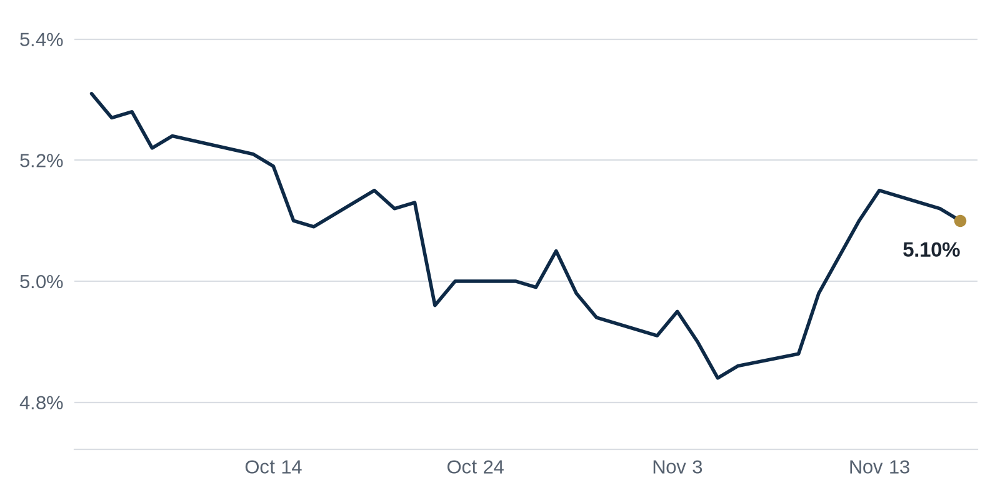

> **Review before publishing:**
> - reits: prices from Alpha Vantage only, not cross-checked (no second source; set TIINGO_API_KEY)
> - editor: fixed: Repeats the last 3 issues: the $250M Bay Area mall sale is the same San Jose Oakridge Mall ($250M) deal already reported in the Nov 17 issue (Macerich).
> - check/long_sentence: 31 words: A GlobeSt report says the "extend and pretend"...
> - check/long_sentence: 33 words: **Why it matters:** When lenders can no longer...
> - check/long_sentence: 31 words: **Why it matters:** Investors are still paying a...
> - check/budget: Debt Markets: 329 words (budget 250)
> - check/missing_link: https://www.bisnow.com/news/washington-dc/data-center-development/loudoun-says-no-new-data-center-approvals-for-a-year
> - check/missing_link: https://www.connectcre.com/stories/related-kushner-partner-on-redevelopment-of-jersey-city-medical-center-campus/
> - check/missing_link: https://news.google.com/rss/articles/CBMimAFBVV95cUxPV0lYNFZkVTRhWUNZMTl1ZGhlQzEzd0h4eE5zVG10aThtNzRTNFlfYXhxTGdvM0NMYWlBcmZyckxlb3Y3WklnNDdqdDRHblM3QXFvZjFHeW42YU5rTnZHY21LbGU0clJZX191d21KcnZ3T0JfbDUxTExpUTJpZHBQVVFRY2lJU09qNVZ3U2FMRzVXUHp2OE1GOQ?oc=5
> - check/missing_link: https://news.google.com/rss/articles/CBMilwFBVV95cUxOZC1XS0FHSlRJTVl6YnJQeVJ5NkF6eVBSc2ZXNmc2N3Uyek5lMGZyU3l0cFVXZ20yM3MzTE5fb1Z5d3RsYXZWSE0yQW11TkwtXzBvZlRKTzBSbHMyZ2xwYmRPVWRaUWdrbC1ORlFHeURlNEVSU2t1Z2g5Qm5mYXFzRjZvQmVHR2RnbWNuSEdJQjhvZjI0ODdF?oc=5
> - check/repeat_in_issue: linked 3 times: https://news.google.com/rss/articles/CBMingFBVV95cUxPY1VKdEZGRWZCR095VVlrQWVHMElyeUVfT1A5cW9VTjBfTzR0Rnd2b2hIaXY2N2FpNmVOLW8wTHNSQ09GTmotZV9TYTc0Z3AzZ3JfUjRRRHlyelh4ajZVLURtanY3ZEdKZDhPSW5zT1Zya2N4dkdsUkhLUlh5MWZQQjlrUkozc09VQXlIMWYtdE1YRl9nRjYzWVBlSlV0QQ?oc=5
> - check/repeat_in_issue: linked 3 times: https://www.trepp.com/trepptalk/failed-cmbs-workouts-rise-extend-and-pretend-bill

## The Brief

- The data center capital of the country hit pause on new projects, unnerving developers who banked on nonstop growth. [Commercial Observer](https://commercialobserver.com/2026/11/loudoun-county-u-s-data-center-capital-pauses-new-data-center-projects/)
- A hotel landlord rejected an all-cash buyout, betting its properties are worth more than the price offered. [The Real Deal](https://news.google.com/rss/articles/CBMingFBVV95cUxPY1VKdEZGRWZCR095VVlrQWVHMElyeUVfT1A5cW9VTjBfTzR0Rnd2b2hIaXY2N2FpNmVOLW8wTHNSQ09GTmotZV9TYTc0Z3AzZ3JfUjRRRHlyelh4ajZVLURtanY3ZEdKZDhPSW5zT1Zya2N4dkdsUkhLUlh5MWZQQjlrUkozc09VQXlIMWYtdE1YRl9nRjYzWVBlSlV0QQ?oc=5)
- Lenders are running out of room to extend troubled loans, so more properties now face foreclosure. [Trepp](https://www.trepp.com/trepptalk/failed-cmbs-workouts-rise-extend-and-pretend-bill)

## The Numbers

*Rates as of Nov 17 close.*

- **10Y Treasury:** 5.10% (-2 bps)
- **5Y Treasury:** 4.90% (-3 bps)
- **SOFR:** 3.92% (-1 bps)
- **Fed funds:** 3.75% to 4.00%
- **Next Fed meeting (Dec 9):** Polymarket's top outcome is 25 bps increase 92.5%
- **REITs:** VNQ $94.89 (-1.4%). Best: WELL +0.5%. Worst: HPP -4.2%.
- **REIT yield vs. 10Y:** VNQ yields 3.63%, -147 bps vs. the 10Y.

**What it means:** Rates were little changed, so a new loan or a refinancing costs about the same as last week. Owners weighing a deal face roughly the same math they did a few days ago.

**Why Welltower (WELL) moved:** No company-specific news today; it may have moved with other senior housing REITs.

**Why Hudson Pacific Properties (HPP) moved:** No company-specific news today; it may have moved with other office REITs.

## Debt Markets

For three years, the fix for a troubled commercial mortgage was simple: extend the maturity and wait for rates to drop. Trepp reports that trade is breaking down, with loan modifications down to 37% of balances leaving special servicing in 2026 from 54% in 2024, while foreclosures climb. [Trepp](https://www.trepp.com/trepptalk/failed-cmbs-workouts-rise-extend-and-pretend-bill)
**Why it matters:** Special servicing is where distressed loans go to be worked out, and fewer extensions means more owners lose buildings instead of buying time.

The October inflation report offered little relief for commercial property borrowers, according to CoStar, with price data firm enough to keep the Fed cautious. Borrowers hoping cheaper debt would arrive soon got little new reason for optimism. [CoStar](https://news.google.com/rss/articles/CBMivAFBVV95cUxONjUxa09Yb2NUbklZTkhOR24zbTlzRjNPOVpmaWJwMk9iU1RUaXozeG5tSkNTRmI3QklhSmZIOFhqVG9teG9xZWc2ZUQzaEotVFBkZ1ozSVNaMlRVT1RKMy1oUW1XUnVZRFZuclh0LVJTaTVLcmsyMTFHWDNranBZTE9kdFkyOHlwSUdBekdCSXRpaEhJaU4wQkRJM1JTUl9lc01GSThZZTVKRnBfenFJcTR2enR4NXozalpybA?oc=5)
**Why it matters:** When inflation stays sticky, the Fed keeps rates high, and every borrower facing a 2027 maturity pays more to refinance.

Casino operator Bally's lined up $560 million to ease financial pressure and push forward its Chicago casino buildout, per The Real Deal. The financing buys the company room as it funds a large project. [The Real Deal](https://news.google.com/rss/articles/CBMimgFBVV95cUxQeWNMU3FvQURzQ2FzOF9DWXFIZEVkQnlCQnFJQkxGb3NuT3piMmRxU0JpenVBNjB5ZV9jc3RKdHZadUcyalFvSEc4cjlDempJckc2a1BEelJhbC15VlNnWlhrQTJHcGdxdmNKOFZ0NHZhdjU5RmotcTUzYTBUbTRLTFhhVktldDZzOFBveUNmQ0hRZlBfR205SF93?oc=5)
**Why it matters:** Fresh capital keeps a half-built project alive, protecting the contractors, lenders and the city counting on the finished casino.

A GlobeSt report says the "extend and pretend" strategy is starting to fail as more CMBS (commercial mortgage-backed securities, bundles of property loans sold to investors) loans hit their due dates. Lenders had been quietly extending these loans rather than forcing a sale or default, betting that rates and property values would recover first. That bet is now coming up short as the bills come due, according to [GlobeSt.com](https://news.google.com/rss/articles/CBMiiwFBVV95cUxQSDlUeXBPNlRDUXhlZHNqV2RORzZFcGFnbXhlbE9VTHJkNGdYNG9IRFRkX2Y4Rkc1QjNISC1WRWRfcjR0dGdGdXlUaEhneEpPSkZ6MHdHWHdPU0tDenBwcVhndEFYc2VnSDVXd2VKc25uWW1WUDgyS3hRbmlObi1JRGs0TXJqa3RuNjdz?oc=5).

**Why it matters:** When lenders can no longer delay, owners who cannot repay or refinance may have to sell at a loss, which sets lower price comps that drag down nearby property values.

**Distress Watch:** Kushner and RFR face foreclosure at their Dumbo Heights office campus in Brooklyn, The Real Deal reports, as the owners struggle with the debt on the property. [The Real Deal](https://news.google.com/rss/articles/CBMipwFBVV95cUxQb0ZLOWVBQUROS3RGUzhCa0VydVRtLXdaUDhOVWpXZjZNUmlldGlsaGViWDNuMFdtSVhrQ28wMTQ4N1J4Ym54S1M1X3p1XzRrLTdHeFRWUWVOQlRneU93WWhpSzd6Ym1GdXVQQkRpSklSRU1qR3dRRG1Yemk4Mm5tVlpheERiOVp6MHpzTWhnOXJvWUhENW1xbTFWbEFfMUNHQ1Z6TTZCRQ?oc=5)

## Top Stories

### Service Properties Trust turns down a $2 billion buyout

Service Properties Trust, a hotel-focused real estate investment trust, passed on a $2 billion all-cash offer to take the company private, per The Real Deal. The board decided the price did not reflect what it believes its properties are worth.
**Why it matters:** When a seller walks away from cash, it signals owners and buyers still disagree on value, which keeps deals from closing across the hotel sector. [The Real Deal](https://news.google.com/rss/articles/CBMingFBVV95cUxPY1VKdEZGRWZCR095VVlrQWVHMElyeUVfT1A5cW9VTjBfTzR0Rnd2b2hIaXY2N2FpNmVOLW8wTHNSQ09GTmotZV9TYTc0Z3AzZ3JfUjRRRHlyelh4ajZVLURtanY3ZEdKZDhPSW5zT1Zya2N4dkdsUkhLUlh5MWZQQjlrUkozc09VQXlIMWYtdE1YRl9nRjYzWVBlSlV0QQ?oc=5)

### Loudoun County freezes new data center approvals

Loudoun County, Virginia, home to the world's largest cluster of data centers, approved a 12-month pause on entitling new data centers and electrical substations. The Board of Supervisors voted 7-1 to stop considering applications while it writes tighter rules.
**Why it matters:** Developers who counted on building in the busiest market in the country now face a year of waiting. That could push new projects, and the power demand behind them, into other counties. [Commercial Observer](https://commercialobserver.com/2026/11/loudoun-county-u-s-data-center-capital-pauses-new-data-center-projects/)

### Blue Owl pays $780M for a Northern Virginia data center

A Blue Owl Capital affiliate bought a 54-megawatt data center in Gainesville, Virginia, for $779.5 million. The 363,220-square-foot building is fully leased to a single hyperscale tenant that was not named.
**Why it matters:** Investors are still paying a premium for already-leased data centers, so owners of standing facilities gain as a nearby county halts new supply and makes existing space scarcer. [Commercial Observer](https://commercialobserver.com/2026/11/blue-owl-virginia-data-center-gainesville-crossing/)

### Related and Kushner launch a $1B Jersey City project

Related, Kushner and RWJBarnabas are launching a $1 billion redevelopment in Jersey City, New Jersey, per Multi-Housing News. The partners plan to remake land around the Jersey City Medical Center campus into housing, retail and public space.
**Why it matters:** A billion-dollar bet on new apartments and retail signals developers still see demand across the Hudson from Manhattan. It also gives the city a major tax base and construction jobs. [Multi-Housing News](https://news.google.com/rss/articles/CBMilgFBVV95cUxNQ25FSG9jLWZweXZiS2huZ0laekZrVmUxQkZiazlmcGxIZzlvRHdmQTVXRVBpb1lIeU92c01NQWxaYUVhM2V3Qm1rWkpHN3ltRExqMmJyOHNINl9JdnJHM2Zpa201MWxaZlhwekhsMUVJU2NPakxGOTlOTXc3SDlENXJHOEVGQW1ORWh5VnpPZ2NsWUp4cmc?oc=5)

**Coffee chat talking points:**

- Blue Owl just paid $779.5 million for one leased Northern Virginia data center, a bet that looks smart if Loudoun's building freeze keeps new supply tight. [Commercial Observer](https://commercialobserver.com/2026/11/blue-owl-virginia-data-center-gainesville-crossing/)
- Loan modifications fell to 37% of special-servicing exits in 2026, and with CoStar reporting no relief from October inflation, more owners will face foreclosure instead of an extension. [Trepp](https://www.trepp.com/trepptalk/failed-cmbs-workouts-rise-extend-and-pretend-bill)
- Service Properties Trust turned down a $2 billion buyout even as PayPal Park and Bay Area malls kept trading, a sign pricing fights stall some deals while others close. [The Real Deal](https://news.google.com/rss/articles/CBMingFBVV95cUxPY1VKdEZGRWZCR095VVlrQWVHMElyeUVfT1A5cW9VTjBfTzR0Rnd2b2hIaXY2N2FpNmVOLW8wTHNSQ09GTmotZV9TYTc0Z3AzZ3JfUjRRRHlyelh4ajZVLURtanY3ZEdKZDhPSW5zT1Zya2N4dkdsUkhLUlh5MWZQQjlrUkozc09VQXlIMWYtdE1YRl9nRjYzWVBlSlV0QQ?oc=5)

## Market Watch

### Sun Belt

Key International wants to redevelop a historic oceanfront hotel on Ocean Drive into luxury condos, per Commercial Observer. The plan would replace the 10-story Marriott Stanton South Beach at 161 Ocean Drive, on a 1.5-acre parcel in Miami Beach, with a 13-story condo building. [Commercial Observer](https://commercialobserver.com/2026/11/key-international-ocean-drive-miami-beach-marriott-stanton-south-beach/)
**Why it matters:** Converting a hotel into for-sale condos means the owner expects buyers to pay more for homes than guests pay for rooms. It reads as a bet on how hot Miami Beach's luxury market still is.

### West Coast

A Detroit riverfront complex sold for $83 million, the city's most expensive multifamily deal in at least a decade, per Crain's Detroit. The sale sets a new high-water mark for apartment prices in the market. [Crain's Detroit](https://news.google.com/rss/articles/CBMijAFBVV95cUxQRGtYYUxtcnpyNXRLaFpBVGV0NlNieE4zanJfSERZV3NtZWtzSi1NNmlqc2VMYmJ4c2JLeDRUZmRfVFM2cExZejN4ajRxcWJJZ2F2cnNYbDVPZFZPcGw4NkFwNlN1bzZvUE9yZERzU21faG5LME5adzBkUXZvcTdFa1JKQzY5TVdfQ2Uzdw?oc=5)
**Why it matters:** A record price gives other apartment owners in the city a fresh comp, a recent sale they can point to when they refinance or sell.

### International

Global Emission Systems, a Canadian manufacturer, is building a 135,000-square-foot headquarters in Troutman, north of Charlotte, per Connect CRE. The project is expected to cost $35 million, built on land next to the company's existing facility. [Connect CRE](https://www.connectcre.com/stories/canadian-emissions-systems-builder-chooses-troutman-for-hq/)
**Why it matters:** A foreign company planting its HQ in the Charlotte region means local landlords and the town gain jobs and a long-term industrial tenant.

## Quick Hits

- Homebuilder confidence fell to its lowest level since 2012, per GlobeSt. [GlobeSt.com](https://news.google.com/rss/articles/CBMikAFBVV95cUxNT1R3Y0hKalU4ZlNhTUh3ZHhPTnRSa2E5R1Y1elUwVWlja1lMYWZmV1dER0ZUUERldGN6Vmp1VmpfeXBNRlRzR1J4dGl5UTd3ZDNHc3FUWmhfNUhVbnppOWI3X1pPc2duWmFqaER2LXdUMEZjSzF6RWF1TVZSWVdhS1dJSDNNZG9nMDJoTkNUWTY?oc=5) When builders feel gloomy, they start fewer homes, which eventually tightens housing supply and keeps a lid on new construction jobs.
- Greg Abel is pushing Berkshire Hathaway deeper into housing bets, per The Real Deal. [The Real Deal](https://news.google.com/rss/articles/CBMiqAFBVV95cUxPS2d5Uk1JbmU1WlRHM2x1SlFScHcyemJRZDMxUDZIMVcwaHp2anlMeVBGZzUzN2x3M21uQmRRRlNYSkhEck95QWM3NmYwVmI2ZjNDa1M5U0ZhZThVSzNYT05IazdpVW9iQjliM0plWGdabUxCV2UtejlncWRZSlZCUDU2eURiNGoycnJDQ3JYNkJSVWVPRmpBOERCNzN5UW8xTnRmWGRMMDA?oc=5) When a large, cautious investor leans into housing, it signals confidence that demand for homes will hold up.
- The San Jose Earthquakes' PayPal Park stadium sold to a media executive for $625 million, per The Real Deal. [The Real Deal](https://news.google.com/rss/articles/CBMinwFBVV95cUxOX3VQeVFCLVRxLW43WFJiS0V4V2lOMUFJOVo3dnFaS1NQX3EyOEw1bVJpZDFpczNXN05lQ1ZCTDVRSFlRekFNQ0w2aXRhV2RjUzZuTWxHS0s5MzBZQ2JwdUFJOHdYZ0dFYW93Zk1jaF9GZ3c5ZGdKTjRtSmZ0d3AzR1NUTFMxUXdLNjN6T3h5dUFpQkxrckR3OVJUamNkaHM?oc=5) Trophy sports assets draw wealthy buyers who value the land and prestige as much as the ticket revenue.

- A San Jose apartment complex landed a buyer for well over $250 million, per the East Bay Times. [East Bay Times](https://news.google.com/rss/articles/CBMiqwFBVV95cUxQWE9sSkRhQkx2QzJfRzNjaFJTZ0NxVGNaZHVfbDE2bHFpTTNoazJYeXVIQzZKOV9rcHNHZjRoZ2d2djdLM3p4YUF6dndUQUY0dmpGNV9YZ3o2ZjhUR0JhejRPaC1hazFjRG9lcm1waDRzMDFqX3JYbUhobWtpVHRWM1RKR01ENWdyMTFyT0xMRHdhZnYxTkJTandaTm5VcVZ6c0RDQ2FDd01sOHc?oc=5) A big multifamily sale signals buyers expect steady rent demand in one of the priciest rental markets in the country.

## Term of the Day

**Refinancing gap:** the shortfall when a new loan comes in smaller than the maturing loan it replaces. If a building's value or income has fallen, the lender will lend less, say $7 million against an old $10 million loan. The owner must then bring the missing cash to close, or risk losing the property.

For informational purposes only. Not investment advice.
