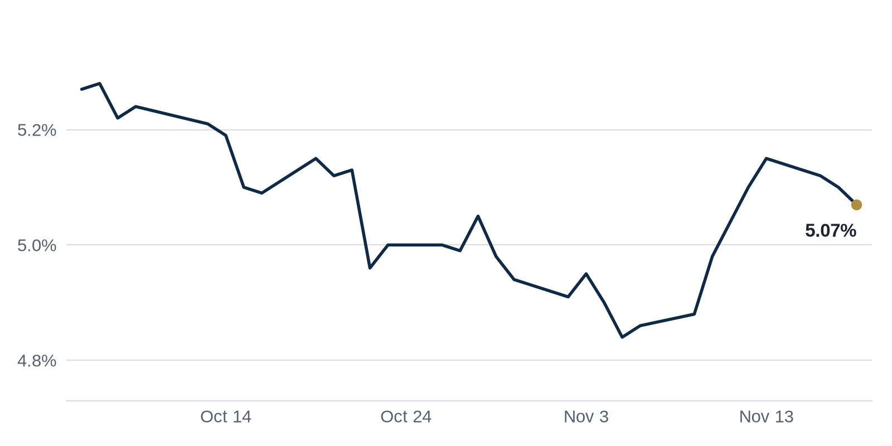

> **Review before publishing:**
> - news/The Real Deal: HTTPStatusError: Client error '429 Too Many Requests' for url 'https://news.google.com/rss/search?q=site%3Atherealdeal.com+when%3A2d&hl=en-US&gl=US&ceid=US:en'
For more information check: https://developer.mozilla.org/en-US/docs/Web/HTTP/Status/429
> - news/GlobeSt: HTTPStatusError: Client error '429 Too Many Requests' for url 'https://news.google.com/rss/search?q=site%3Aglobest.com+when%3A7d&hl=en-US&gl=US&ceid=US:en'
For more information check: https://developer.mozilla.org/en-US/docs/Web/HTTP/Status/429
> - news/Multi-Housing News: HTTPStatusError: Client error '429 Too Many Requests' for url 'https://news.google.com/rss/search?q=site%3Amultihousingnews.com+when%3A7d&hl=en-US&gl=US&ceid=US:en'
For more information check: https://developer.mozilla.org/en-US/docs/Web/HTTP/Status/429
> - reits: prices from Alpha Vantage only, not cross-checked (no second source; set TIINGO_API_KEY)
> - check/long_sentence: 32 words: **Why REIT_UP_NAME moved:** the owner is in a...
> - check/long_sentence: 39 words: **Why it matters:** CMBS loans are bundled and...
> - check/missing_link: https://news.google.com/rss/articles/CBMihwFBVV95cUxNUmxzZzJLaTJrM0Z6RjVyc1gtS2k3RGxwWlpnYWZXdnp5Yl9wNEhjSnZ3dVUtamxNYndXVWhmbEMxUlUzdkM5WFpFT2ZVSnN6ZmFqblFWMHpJRm80dFRfRzN4YXljd2E0UHBLX3E1UV9yME50ajBJOHRzbU00czAxcjhydldCaXc?oc=5
> - check/missing_link: https://news.google.com/rss/articles/CBMiqwFBVV95cUxPUWdrLUh3NWJSMVZOanUtb2JxMV9oY0k3TElFd25FLVdzYW9sdGNWMldpNHYwdkF1WFBHRWhCNndQOGY4ZmUyWVNMVDVGdkNGSU5PRi1Wd0l4Y2FfSWNJaXE0bGhid3EzRE9teVhkX0FEZjNMM3JMXzVvQWtoN0pJQTY3bDFFbVVqTXFWdlBjdldWNF83VEhZT3Y4cUVrdUxMaXJsR25uRC16MW8?oc=5
> - check/missing_link: https://news.google.com/rss/articles/CBMirAFBVV95cUxPUk0wOWVXZDluVVFZWGNLU3UwQUtjS2YyQjBLU29EaDhQWmZ5STVPVTgzcmF2b3I4dW9hUzZxeWdJaHM2UzN3eVpXWExWS2N2di1OY1RDUFBUN1Y2LTRvbC1JS0ZhNVFUdXdQZmtSQzZzdFFxa1pGdmRMOWtuTXA3T3NVNzhoQkJ3TUd0c1EwM2NHaHRJTUJIV0Znc005cl9xaWRlb3V4RmVRcFBh?oc=5
> - check/repeat_in_issue: linked 3 times: https://www.connectcre.com/stories/office-cmbs-delinquencies-reach-all-time-high-in-october/
> - check/repeat_in_issue: linked 3 times: https://news.google.com/rss/articles/CBMijwFBVV95cUxNdHcyNzJVWFJzMDhFaHExTldLbnZGbktXRk52N1pEQjloZ1N6bm1Qc2Ztd1hFZEdmWDE1TWpxc0ZIWFk5TkdyT0xGLTdhdFpEZUJKTFJUOWtNdk56MXZ4elhqMnhURFR2VDJVOF81b1V0UUtGQjV0WjVrTkhuOHA5RkpOQ3BlZ2o4LTNEaXNUcw?oc=5

## The Brief

- Office loans bundled into bonds are souring at a record pace, squeezing building owners. [Connect CRE](https://www.connectcre.com/stories/office-cmbs-delinquencies-reach-all-time-high-in-october/)
- A closely watched industry survey shows sentiment sliding as high rates freeze dealmaking. [Connect CRE](https://www.connectcre.com/stories/real-estate-roundtables-q4-sentiment-index-registers-quarterly-decline/)
- Fewer buyers signed home contracts in October, a warning sign for housing demand. [National Association of REALTORS®](https://news.google.com/rss/articles/CBMijwFBVV95cUxNdHcyNzJVWFJzMDhFaHExTldLbnZGbktXRk52N1pEQjloZ1N6bm1Qc2Ztd1hFZEdmWDE1TWpxc0ZIWFk5TkdyT0xGLTdhdFpEZUJKTFJUOWtNdk56MXZ4elhqMnhURFR2VDJVOF81b1V0UUtGQjV0WjVrTkhuOHA5RkpOQ3BlZ2o4LTNEaXNUcw?oc=5)

## The Numbers

*Rates as of Nov 18 close.*

- **10Y Treasury:** 5.07% (-3 bps)
- **5Y Treasury:** 4.89% (-1 bps)
- **SOFR:** 3.90% (-2 bps)
- **Fed funds:** 3.75% to 4.00%
- **Next Fed meeting (Dec 9):** Polymarket's top outcome is 25 bps increase 91.5%
- **REITs:** VNQ $95.18 (+0.3%). Best: DEI +1.9%. Worst: HPP -6.5%.
- **REIT yield vs. 10Y:** VNQ yields 3.63%, -144 bps vs. the 10Y.

**What it means:** Treasury yields held roughly steady, but the 30-year mortgage rate jumped, which raises monthly costs for homebuyers and keeps pressure on housing demand.

**Why Douglas Emmett (DEI) moved:** the owner is in a public rent fight, suing SoulCycle over unpaid rent at a Santa Monica space, a reminder that even well-located landlords are chasing tenants for payment. [The Real Deal](https://news.google.com/rss/articles/CBMid0FVX3lxTE83WjNfWENwbHdTNEtvOGVsUzBSMzlab2Rwbl82bW5IT09FbUxCMWV6YWdfUFhQOGw0Q3RjTFNFdDRxRHhVYkxaTHpwRHgxOGpKaGo3YmdfQno3bU9aTzg1MlFMbUQxdHlDVHE2TmFYZjVBMzdKaTQ0?oc=5)

**Why Hudson Pacific Properties (HPP) moved:** No company-specific news today; it may have moved with other office REITs.

## Debt Markets

Higher borrowing costs could stall the rebound in CMBS issuance expected in 2027, according to CoStar. CMBS (commercial mortgage-backed securities) are bonds backed by pools of property loans, and when lenders and bond buyers demand higher yields, new deals get harder to pencil. [CoStar](https://news.google.com/rss/articles/CBMilwFBVV95cUxOZC1XS0FHSlRJTVl6YnJQeVJ5NkF6eVBSc2ZXNmc2N3Uyek5lMGZyU3l0cFVXZ20yM3MzTE5fb1Z5d3RsYXZWSE0yQW11TkwtXzBvZlRKTzBSbHMyZ2xwYmRPVWRaUWdrbC1ORlFHeURlNEVSU2t1Z2g5Qm5mYXFzRjZvQmVHR2RnbWNuSEdJQjhvZjI0ODdF?oc=5)

**Why it matters:** fewer new CMBS deals mean less fresh financing for owners who need to refinance loans coming due.

A $250 million CMBS loan on 101 Hudson Street, a 1.4 million-square-foot Jersey City office tower, was sent to special servicing after missing its October maturity. Special servicing is where troubled loans go to be worked out or headed toward foreclosure. [Commercial Observer](https://commercialobserver.com/2026/11/250m-cmbs-loan-jersey-city-101-hudson-street-special-servicing/)

**Why it matters:** another large office loan in trouble pushes lenders to tighten terms on similar buildings, raising costs for every office borrower.

Servicers have modified nearly $100 billion of CMBS loans since 2022, but one in five dollars from those fixes is delinquent again, Trepp reports. Modifying a loan means changing its terms to buy the borrower time. [Trepp](https://www.trepp.com/trepptalk/cmbs-loan-modifications-modified-not-fixed)

**Why it matters:** if workouts keep failing, lenders may stop offering them, pushing more struggling owners toward foreclosure or sale.

A $140 million commercial mortgage-backed securities (CMBS) loan tied to 123 William Street, a 27-story office tower in Manhattan's Financial District, has entered special servicing. Occupancy fell sharply, pushing the building below break-even, and its owners face bankruptcy risks. Special servicing means a troubled-loan specialist now handles the debt, according to [Commercial Observer](https://commercialobserver.com/2026/11/123-william-street-distress-cmbs/).

**Why it matters:** CMBS loans are bundled and sold to bond investors, so when a big office building stops earning enough to cover its debt, those investors can lose money and lenders grow warier of other shaky office towers.

**Distress Watch:** The Real Deal looks at a lender taking control of 12 distressed New York buildings and asks what a lender actually wants with a troubled portfolio. [The Real Deal](https://news.google.com/rss/articles/CBMipAFBVV95cUxQN3Q1NVZZRHoxUWxhMlNsNl9SZXdVdXJCVllaWXctU1FNY1NULUVmbzJ3SFVHbDU3STZQRkJvUGVfbVhta2lUZ3Vpd0xHYkJnTE9ZSFJsN2VkQm1kdndDWlYzaVFhaFU1Z2J2QUxpNWNHX2VaQU5QWVpDbnU5WFd5ejVyeENoeG9hR1pCeFVYODA3dTI3RWpadmRPdVhURWtsZVZfcA?oc=5)

## Top Stories

### Office CMBS Delinquencies Hit a Record

Fitch Ratings' overall U.S. CMBS delinquency rate rose to 3.60% in October from 3.46% in September, driven by a wave of new defaults led by office. The office delinquency rate reached an all-time high of 9.33%, beating the prior record.

**Why it matters:** when office loans inside these bonds stop paying, bondholders lose income and lenders grow wary, making it harder and pricier for any office owner to refinance. [Connect CRE](https://www.connectcre.com/stories/office-cmbs-delinquencies-reach-all-time-high-in-october/)

### Industry Sentiment Slips as Deals Stall

The Real Estate Roundtable's Q4 2026 Sentiment Index fell 10 points to 53, as higher interest rates and geopolitical uncertainty pushed investors to hold off on deals. The Current Index dropped 16 points to 47, even as property operations stayed healthy across most sectors.

**Why it matters:** sentiment surveys track how willing large investors are to buy and sell, and a drop means fewer transactions, which slows price discovery and leaves sellers waiting. [Connect CRE](https://www.connectcre.com/stories/real-estate-roundtables-q4-sentiment-index-registers-quarterly-decline/)

### A Korean Fund Warns an AI Credit Event Could Spread

A large South Korean fund said it plans to trim its real estate holdings and warned that a credit problem tied to AI lending could ripple into other markets. A credit event is when a borrower defaults or a loan sours badly enough to rattle investors.

**Why it matters:** if a major global investor pulls back from property, it removes a buyer from the market and can drag values lower for everyone still holding. [Markets Group](https://news.google.com/rss/articles/CBMisAFBVV95cUxQNk9mSC1mTnZtWFJxYkxRWGFwc1JqVEpMNFUwX0NXZkdhUFBxMnc0NUh2bWxPSnFiNGMzRDlWOUc1R2E4b3lqMDJQLWp4R0lDZkZ0NW93Y3pCaGdSaWJ4ZGxxX1lQYjhSdnlHREFWUXVhZFQyRWEtUkdJRGRVdW5Mdkd6eWs2QmY3TG9JTDFQMEtXR0FucFJwQ2dvTlZncmpTQWVxZFhQMkU2RnJqalQ0NA?oc=5)

### Pending Home Sales Fell in October

Pending home sales dropped 4.7% in October, according to the National Association of Realtors. Pending sales count signed contracts, so they hint at where closings are headed over the next month or two.

**Why it matters:** softer housing demand pressures homebuilders and apartment owners, since would-be buyers stay put and for-sale listings sit longer. [National Association of REALTORS®](https://news.google.com/rss/articles/CBMijwFBVV95cUxNdHcyNzJVWFJzMDhFaHExTldLbnZGbktXRk52N1pEQjloZ1N6bm1Qc2Ztd1hFZEdmWDE1TWpxc0ZIWFk5TkdyT0xGLTdhdFpEZUJKTFJUOWtNdk56MXZ4elhqMnhURFR2VDJVOF81b1V0UUtGQjV0WjVrTkhuOHA5RkpOQ3BlZ2o4LTNEaXNUcw?oc=5)

**Coffee chat talking points:**

- With the office CMBS delinquency rate hitting a record 9.33%, it makes sense the Roundtable's sentiment reading is sliding. [Connect CRE](https://www.connectcre.com/stories/office-cmbs-delinquencies-reach-all-time-high-in-october/)
- Pending home sales falling 4.7% in October shows the demand softness isn't just a commercial story, it's reaching housing too. [National Association of REALTORS®](https://news.google.com/rss/articles/CBMijwFBVV95cUxNdHcyNzJVWFJzMDhFaHExTldLbnZGbktXRk52N1pEQjloZ1N6bm1Qc2Ztd1hFZEdmWDE1TWpxc0ZIWFk5TkdyT0xGLTdhdFpEZUJKTFJUOWtNdk56MXZ4elhqMnhURFR2VDJVOF81b1V0UUtGQjV0WjVrTkhuOHA5RkpOQ3BlZ2o4LTNEaXNUcw?oc=5)

## Market Watch

### Sun Belt

Dallas-Fort Worth developers are pushing industrial projects beyond the metro's established core as they chase cheaper land, Bisnow reports. DFW is already one of the nation's top warehouse markets, and the growth is spreading to outlying areas. [Bisnow](https://www.bisnow.com/news/dallas-ft-worth/industrial/dfw-industrial-growth-expands-beyond-core-markets-developers-chase-cheaper-land)

**Why it matters:** cheaper land on the edges lets developers build warehouses at rents tenants can still afford, helping DFW keep winning logistics tenants.

### West Coast

A San Diego investor paid $51 million for a Woodinville industrial park outside Seattle, according to The Business Journals. The out-of-state buyer stepped in for a suburban warehouse and flex-space complex. [The Business Journals](https://news.google.com/rss/articles/CBMipgFBVV95cUxQd1J4VklXeVdBT3NMeWdab1dXcHV0REZURUZfallxYmlkYnNZYS1hV0o4MW5NV1JIWGZNRC1zR0t3TDJvTTBkUkRyZVBGZHVOWEJqYlhpc1UyZncxUUZCTzhwYlVNN25XUUlsTU9ITVN2MDh6X0lES3hkQ1A2M2c1TVhqQXpReFBZQ1pWOTZaQi1ocGNrWEtsRGJVYklFYVBlLVdpZEdn?oc=5)

**Why it matters:** out-of-state buyers paying up for industrial parks signals they still see steady demand for warehouse space around Seattle.

### International

The Cerberus-backed company behind London's Battersea Glassmill tower is being liquidated after a failed planning bid and local opposition, Bisnow reports. The project was held in an SPV, a company set up to own one development. [Bisnow](https://www.bisnow.com/news/london/construction-development/exclusive-cerberus-backed-company-behind-london-resi-development-to-be-liquidated)

**Why it matters:** when a single-project company collapses, its lenders and investors can lose money, a reminder that failing to win planning approval can sink a development.

## Quick Hits

- Asheville's commercial vacancies hit a 10-year high following Hurricane Helene. [WLOS](https://news.google.com/rss/articles/CBMiqwFBVV95cUxQLVlaZVo3aURsekpDSGhHOHlmdTVhYmItWWEtdXNhcVBZQVBPSHptSk9CMkxVSWJlNG5ha2hNeDZNMU40aFhoRjExSFg3YjRKeF9GZ2lhcVNTME9OZmU4Qjd4b1JLd1RqRlVuWDRZaTlVMVVFcjNNMk9mWFBVN04xU1dfN1lIb1FUNmRFYTNiNGlyLW9BckVHdmhwY3h6VHFBNjVDcGd1OXhNZXc?oc=5) When a disaster drives businesses out, empty storefronts pile up and landlords struggle to fill them.
- Private equity owners are slower than REITs to mark their CRE portfolios to current market values. [Bisnow](https://www.bisnow.com/news/national/capital-markets/private-equity-lags-reits-in-getting-cre-portfolios-up-to-market-speed) Private appraisals can lag reality, so some owners may be carrying buildings at prices buyers will not actually pay.
- Boston's City Council voted to eliminate parking minimums for new housing. [Bisnow](https://www.bisnow.com/news/boston/multifamily/boston-city-council-votes-to-eliminate-parking-minimums-for-new-housing-development) Dropping required parking spaces cuts construction costs, which can make apartments cheaper and quicker to build.
- New York City's Mamdani administration is suing Bronx landlords, claiming unpaid fines amount to fraud. [Bisnow](https://www.bisnow.com/news/new-york/multifamily/mamdani-has-new-legal-strategy-to-clamp-down-on-bad-landlords) Aggressive enforcement raises the stakes for owners who ignore city penalties.
- Medipower bought a 16-property grocery-anchored portfolio in Pennsylvania for $275 million. [Bisnow](https://www.bisnow.com/news/philadelphia/deal-sheet/pennsylvania-grocery-portfolio-sale) Grocery-anchored centers draw steady foot traffic, which keeps investors interested even when other retail struggles.

## Term of the Day

**Price per square foot:** a building's sale price divided by its total size. It lets buyers compare deals of different sizes on equal footing. If a $10 million building holds 100,000 square feet, that is $100 per square foot. A nearby building selling for more per foot is pricier for the same amount of space.

For informational purposes only. Not investment advice.
