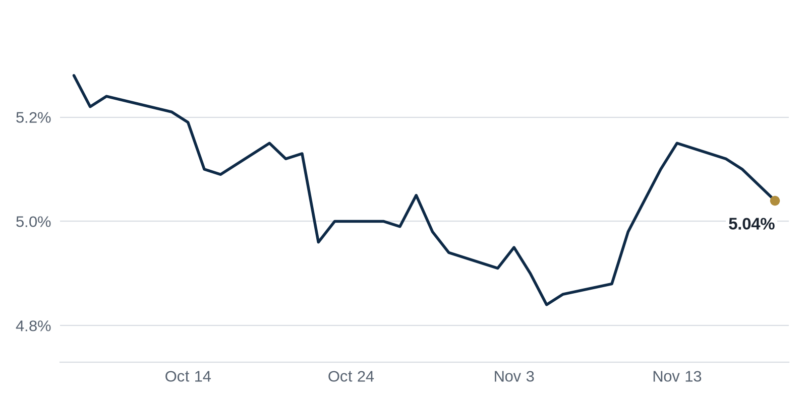

> **Review before publishing:**
> - reits: prices from Alpha Vantage only, not cross-checked (no second source; set TIINGO_API_KEY)
> - editor: fixed: Source says the office lift happened pre-IPO, not from the debut; the brief wrongly credits the debut for lifting offices.
> - check/long_sentence: 32 words: **What it means:** Treasury yields held roughly steady,...
> - check/long_sentence: 34 words: **Why it matters:** Multifamily distress (apartment loans the...
> - check/long_sentence: 34 words: **Distress Watch:** A Trepp study of CMBS loan...
> - check/repeat_in_issue: linked 3 times: https://news.google.com/rss/articles/CBMipgFBVV95cUxQMm13eHd6R2xCRHZkZ1M0NERLMTJSS2ZTOUNyamxiU1RoWlR5MUNxNkwwOGxNMFpPQUVJSW4zbUpxLUhkN0VtQmtsZlUtM0hpYWdrbU02ZTJIcEstdWo1YUdOV2t2TElJYXVmdmY2RWdaTlhNSDB2ZGxBSHRIOUEwc0hFRktiSl9LdVQ1N3V3Y0dYcnlaVUZQUnN3TURERmd4MVBBQ013?oc=5
> - check/repeat_in_issue: linked 3 times: https://news.google.com/rss/articles/CBMimgFBVV95cUxNWWJ4czRZQlFEUXBJb0hUaC00RzFSdFpYdllxY0RTcVZBSV8zOUVvQ2pCMk5Od0p1SWkwQ281MXU4T3lyUWw5eEtfQXBuZndUMFdmSjdIQjFRTVZGUjRZOE52N2l4RVhOVVdJdUZvd20xYXRLZVEwRU9vWl9pRXNobWRsb1l4RzZYeFBiSEU5T1pUemNXbE5PbkdB?oc=5
> - check/stale_data: Bank CRE loans last updated 2026-11-04

## The Brief

- SpaceX wants to build a huge AI supercomputing campus in rural Arizona, extending the data center land rush. [Real Estate Daily News](https://news.google.com/rss/articles/CBMipgFBVV95cUxQMm13eHd6R2xCRHZkZ1M0NERLMTJSS2ZTOUNyamxiU1RoWlR5MUNxNkwwOGxNMFpPQUVJSW4zbUpxLUhkN0VtQmtsZlUtM0hpYWdrbU02ZTJIcEstdWo1YUdOV2t2TElJYXVmdmY2RWdaTlhNSDB2ZGxBSHRIOUEwc0hFRktiSl9LdVQ1N3V3Y0dYcnlaVUZQUnN3TURERmd4MVBBQ013?oc=5)
- Commercial property deal activity is slowing into year-end as buyers turn cautious and wait. [GlobeSt.com](https://news.google.com/rss/articles/CBMimgFBVV95cUxNWWJ4czRZQlFEUXBJb0hUaC00RzFSdFpYdllxY0RTcVZBSV8zOUVvQ2pCMk5Od0p1SWkwQ281MXU4T3lyUWw5eEtfQXBuZndUMFdmSjdIQjFRTVZGUjRZOE52N2l4RVhOVVdJdUZvd20xYXRLZVEwRU9vWl9pRXNobWRsb1l4RzZYeFBiSEU5T1pUemNXbE5PbkdB?oc=5)
- Anthropic already lifted San Francisco offices before its public debut, which may soon ripple into housing. [The Real Deal](https://news.google.com/rss/articles/CBMisgFBVV95cUxPelhqZEdvZDhIYVpha3VmRC14eHlDbl83QzJuTlpDUFNfOWc0eHV3ZWNyV1dlNnN6SnZVWkJyQ21FdnlMemVYMDZjYmZJR0ViaDlRZGUyZDNseU9lUmZ4OHdkSDAxNUVLMWI5T1Qzd0hFSUtLd2toXzVCQkM4WTY5X3dqaHREaDE3bld1eldqWnFuQ1ZLS2oyczZJUk9CYmJoeEh2bGlyNUVpSlE4eEtTUVJ3?oc=5)

## The Numbers

*Rates as of Nov 19 close.*

- **10Y Treasury:** 5.04% (-3 bps)
- **5Y Treasury:** 4.86% (-3 bps)
- **SOFR:** 3.91% (+1 bps)
- **Fed funds:** 3.75% to 4.00%
- **Next Fed meeting (Dec 9):** Polymarket's top outcome is 25 bps increase 89.5%
- **REITs:** VNQ $93.47 (-1.8%). Best: ADC 0.0%. Worst: HPP -7.4%.
- **REIT yield vs. 10Y:** VNQ yields 3.63%, -141 bps vs. the 10Y.

**What it means:** Treasury yields held roughly steady, but the 30-year mortgage rate jumped, which lifts monthly payments for home buyers and cools the housing demand that feeds apartment and rental values.

**Why Agree Realty (ADC) moved:** No company-specific news today; it may have moved with other retail REITs.

**Why Hudson Pacific Properties (HPP) moved:** No company-specific news today; it may have moved with other office REITs.

## Debt Markets

Blue Owl Capital is preparing a $513 million single-asset, single-borrower CMBS deal to finance a newly built Northern Virginia data center fully leased to Amazon. A single-asset CMBS bundles one property's loan into bonds sold to investors. [Commercial Observer](https://commercialobserver.com/2026/11/blue-owl-amazon-data-center-virginia-cmbs/)

**Why it matters:** Bond buyers are still funding data centers even as politicians push back, so lenders keep competing to finance the sector.

The $175.5 million loan on Atlanta's 191 Peachtree Tower moved to special servicing after Banyan Street Capital missed its maturity payment. Special servicing is where a troubled loan goes to be worked out or foreclosed. [Bisnow](https://www.bisnow.com/news/atlanta/capital-markets/191-peachtree-loan-moves-to-special-servicing-after-banyan-misses-maturity-payment)

**Why it matters:** An owner who cannot repay or refinance at maturity signals that older office towers still struggle to find new loans.

Birch Group's Jersey City office debt was also sent to special servicing, another sign of stress in suburban and commuter-belt office buildings. [The Real Deal](https://news.google.com/rss/articles/CBMirgFBVV95cUxOQTBsajVLZEdHR0kweGJ0a0VpMjR4NWVXX0RyRlBzdEI4dTA3amRQYjRwSVNuZE8xUFpiOE1pNXk5Qm8yUkYtUTlUaGZmaGt0aWlEZ3RoZ0ZuZHhjUkxVMVlGcFpaNEFHWDZYZVZrZ2tWZ0RLeVRRMU1tQmQtTk9aU3JERVFfaG9DSDJobmx6Yy1CbUJxMC1LSTdFTEsxREVka0xLMTdoTkJBel9FTWc?oc=5)

**Why it matters:** More office loans entering workout gives special servicers a heavier backlog, which slows every borrower's path to a deal.

The Real Deal walked through how it traced a web of connected deals tied to Chicago's multifamily distress. The report shows that troubled apartment loans in the city often link back to the same players and overlapping transactions. Mapping those ties helps explain why the distress keeps spreading across related properties, [The Real Deal](https://news.google.com/rss/articles/CBMiogFBVV95cUxPMHk4dFRXWHBDMHp3cFRmMk14dWFaUzEtNnJ4ZXlQQXZjZkxzU2NKNi1NazFoMUM3M3ZfVUJBV252RlZRSVpVMnZib284Tk9hNVlRaHpKclQ0RDB4WFpNZ1NDMzJvcFNIVVdSYTdzUkdHUEVXM1Bid0t5Y0lldUhBUlBPUVdVTGtsUEVLQUJzQlhtZF9mbkV5bDRDVWpidXB0a3c?oc=5).

**Why it matters:** Multifamily distress (apartment loans the borrower is struggling to repay) that traces back to shared owners warns lenders that one failing deal can drag down others tied to the same hands.

**Distress Watch:** A Trepp study of CMBS loan modifications since 2022 found one in five came with a paydown, and those borrowers were half as likely to be back in trouble two years later. [Trepp](https://www.trepp.com/trepptalk/pay-to-stay-what-cmbs-borrowers-put-in-to-win-a-modification)

## Top Stories

### SpaceX Pitches a $50 Billion AI Campus in Arizona

SpaceX has proposed a $50 billion AI supercomputing campus in Cochise County, Arizona, according to Real Estate Daily News. The plan would plant one of the country's largest computing sites in a rural border county.

**Why it matters:** A project this size reshapes a small county's land, power and water demand, giving local officials huge leverage but also years of infrastructure strain. [Real Estate Daily News](https://news.google.com/rss/articles/CBMipgFBVV95cUxQMm13eHd6R2xCRHZkZ1M0NERLMTJSS2ZTOUNyamxiU1RoWlR5MUNxNkwwOGxNMFpPQUVJSW4zbUpxLUhkN0VtQmtsZlUtM0hpYWdrbU02ZTJIcEstdWo1YUdOV2t2TElJYXVmdmY2RWdaTlhNSDB2ZGxBSHRIOUEwc0hFRktiSl9LdVQ1N3V3Y0dYcnlaVUZQUnN3TURERmd4MVBBQ013?oc=5)

### Deal Activity Falls 14% Into Year-End

CRE transaction activity dropped 14% as the market braces for a cautious finish to 2026, GlobeSt reports. Fewer buyers and sellers are closing as both sides wait for clearer pricing.

**Why it matters:** When volume falls, brokers earn fewer fees and owners lack fresh comps, which makes it harder to value a building or refinance a loan. [GlobeSt.com](https://news.google.com/rss/articles/CBMimgFBVV95cUxNWWJ4czRZQlFEUXBJb0hUaC00RzFSdFpYdllxY0RTcVZBSV8zOUVvQ2pCMk5Od0p1SWkwQ281MXU4T3lyUWw5eEtfQXBuZndUMFdmSjdIQjFRTVZGUjRZOE52N2l4RVhOVVdJdUZvd20xYXRLZVEwRU9vWl9pRXNobWRsb1l4RzZYeFBiSEU5T1pUemNXbE5PbkdB?oc=5)

### Anthropic's $81 Billion Debut Spills Into SF Real Estate

Anthropic's growth lifted the San Francisco office market before its roughly $81 billion public debut, and The Real Deal says the next effect may land in local housing. A flush, hiring AI employer draws workers who need places to live.

**Why it matters:** New high-paid tenants can push up apartment rents and home prices, helping landlords but squeezing everyone else competing for San Francisco housing. [The Real Deal](https://news.google.com/rss/articles/CBMisgFBVV95cUxPelhqZEdvZDhIYVpha3VmRC14eHlDbl83QzJuTlpDUFNfOWc0eHV3ZWNyV1dlNnN6SnZVWkJyQ21FdnlMemVYMDZjYmZJR0ViaDlRZGUyZDNseU9lUmZ4OHdkSDAxNUVLMWI5T1Qzd0hFSUtLd2toXzVCQkM4WTY5X3dqaHREaDE3bld1eldqWnFuQ1ZLS2oyczZJUk9CYmJoeEh2bGlyNUVpSlE4eEtTUVJ3?oc=5)

**Coffee chat talking points:**

- SpaceX is floating a $50 billion AI campus in rural Arizona even as the Fed warns about AI returns, so data center demand is still outrunning the caution. [Real Estate Daily News](https://news.google.com/rss/articles/CBMipgFBVV95cUxQMm13eHd6R2xCRHZkZ1M0NERLMTJSS2ZTOUNyamxiU1RoWlR5MUNxNkwwOGxNMFpPQUVJSW4zbUpxLUhkN0VtQmtsZlUtM0hpYWdrbU02ZTJIcEstdWo1YUdOV2t2TElJYXVmdmY2RWdaTlhNSDB2ZGxBSHRIOUEwc0hFRktiSl9LdVQ1N3V3Y0dYcnlaVUZQUnN3TURERmd4MVBBQ013?oc=5)
- Aerospace and defense have pulled $20.6 billion into Greater LA since 2020, and that is turning into real demand for industrial and advanced manufacturing space. [Commercial Observer](https://commercialobserver.com/2026/11/vc-aerospace-defense-california-manufacturing-industrial/)
- Overall deal activity fell 14% into year-end even as lenders like Blue Owl keep issuing CMBS, showing financing is holding up better than transactions. [GlobeSt.com](https://news.google.com/rss/articles/CBMimgFBVV95cUxNWWJ4czRZQlFEUXBJb0hUaC00RzFSdFpYdllxY0RTcVZBSV8zOUVvQ2pCMk5Od0p1SWkwQ281MXU4T3lyUWw5eEtfQXBuZndUMFdmSjdIQjFRTVZGUjRZOE52N2l4RVhOVVdJdUZvd20xYXRLZVEwRU9vWl9pRXNobWRsb1l4RzZYeFBiSEU5T1pUemNXbE5PbkdB?oc=5)

## Market Watch

### Sun Belt

Tesla has leased 82,000 square feet in the former GM Innovation Center in North Austin, The Real Deal reports. The move fills space inside a large, well-known campus in one of the Sun Belt's busiest job markets. [The Real Deal](https://news.google.com/rss/articles/CBMijwFBVV95cUxQNll6cGxlMF9OaVJ0VFJpOFA0aE1SY0pFcFZlNGhmNWFoNkdmTkpwQUc3UlM3UGRXM1BaWlBKVDlvajN3eUxVclJhUVZxRk51R1MwQTg5c0xhay0tMmpsZHVFMktjOElKTXNibS15RV8yM3JNTFI3NFhDS21SakdJTFB1cms3R2dOWjg2WW5Bcw?oc=5)

**Why it matters:** A big-name tenant taking older space helps backfill offices that risk sitting empty, steadying values for nearby Austin landlords.

### West Coast

Rithm is lining up a $280 million CMBS loan from Wells Fargo and JPMorgan against a San Francisco office portfolio, per Green Street News. A CMBS loan is funded by bonds sold to investors rather than held on a bank's books. [Green Street News](https://news.google.com/rss/articles/CBMiowFBVV95cUxOODF1c0F2NFpIUFNvVHRmRlZCRElIUjM4ZHdMVld1YVdZSGstSHhscFJERmhkakpLSW4wLTdzOWFiMXdMNF9zZk51VURBZnlvOExYbW9JNlduaU5LT3ZId1I5SFE4dmxRbmxOa0pZLVBHbDZLcEItcmlLVlBLYk0wWFNUanFsa2Q3X1hQSnItNmRwQzI5SnZxbmM3TWk2QnBXbTlR?oc=5)

**Why it matters:** Major banks willing to finance San Francisco offices again suggests lenders see a floor forming under the city's battered office market.

### International

Mapletree, a Singapore-based developer, has broken ground on a 952,720-square-foot industrial project in Manalapan, New Jersey, near Exit 8 of the Turnpike. The two-building site is set for completion in early 2028. [REBusiness Online](https://rebusinessonline.com/mapletree-breaks-ground-on-952720-sf-industrial-project-in-manalapan-new-jersey/)

**Why it matters:** A foreign investor building large warehouses near New York signals continued confidence in U.S. logistics demand, a bet that helps local contractors and workers.

## Quick Hits

- Senior housing starts have fallen by roughly two-thirds even as demand hits records, GlobeSt reports. [GlobeSt.com](https://news.google.com/rss/articles/CBMipgFBVV95cUxNdllUTW9VVUZrT2JnQWdsdTZUVHE4X2V4YVAtVXNfaGNFNUlEXzF3UGlycHU1MWdIR2dfV04tanl4Si1NSG5lOGhfN2c0dDJyZEEtV1FxV2ZzZnhLTWlvZ0w5Zm1tcWJhdlp2a2xNekI0bWEzcUcyeDRVMnBLLWZUajk5MmhwUmNkOFRRQ2FCVmtZVFIzZ1hRczhqdEl2MGVRVFQ2WEl3?oc=5) A gap this wide between building and demand points to future shortages that could push senior rents higher.
- A construction roundup covers rising input prices, a proposed federal framework for data centers, and a lawsuit testing algorithmic rent-pricing bans, per JD Supra. [JD Supra](https://news.google.com/rss/articles/CBMihwFBVV95cUxNUmxzZzJLaTJrM0Z6RjVyc1gtS2k3RGxwWlpnYWZXdnp5Yl9wNEhjSnZ3dVUtamxNYndXVWhmbEMxUlUzdkM5WFpFT2ZVSnN6ZmFqblFWMHpJRm80dFRfRzN4YXljd2E0UHBLX3E1UV9yME50ajBJOHRzbU00czAxcjhydldCaXc?oc=5) The rent-pricing case could decide whether landlords may use software to set asking rents.
- Goodman faced a shareholder strike over its large data center building plans, AFR reports. [AFR](https://news.google.com/rss/articles/CBMixAFBVV95cUxNWnN0OG5jVHdRYVk2dVRDb1QzLXJYVGxoSk00bU13X0Y5TWlPbU9XWnU3NlZTYkxXNlpzOXpUSFJtTWstVk9LcHVWeU9Hc1ZqUXFfSVNIOHhFcVBZQ0RXalhib3JvU3FRQmdiMU9Jc2NfZDRGTm1vUnQydjVHMDF1SV80ZEF3TjVTeTJadlZmZVN6dU5za2VpZGRsSmVWdlk5aW5XUFZZS2d2Q3o4VG8yTTdBb0M0aElBMEc5Rmkwcks3aElh?oc=5) Investor pushback shows even landlords chasing the data center boom face questions about cost and risk.
- Retail rents in Southern California are outpacing sales growth, which GlobeSt frames as hidden pressure on tenants. [GlobeSt.com](https://news.google.com/rss/articles/CBMipgFBVV95cUxOOV9SZ2VGM015ZUNac0tvd1N3NWhYRUluT1Y5NGIyWm9LZWFTSXFOdlIwcjdrWjVhX1E3Rnp2cXBPSG1jVGFhOGlFSjRYb2d4VmZ0TnQwNGFRU2J6MjVoT252djdiNHBEcTJ5TV8zZ2FkalJKYjgybG5zUXlabXd1b2JSOWNMVGpPZTBLU2VFUGl3SjZ6eUdPWUo2UnJuWjFFQkJCX2tB?oc=5) When rent climbs faster than a store's sales, those tenants may struggle to renew leases.
- The Real Deal maps Greenpoint's split between a thriving corridor and a lagging one in Brooklyn. [The Real Deal](https://news.google.com/rss/articles/CBMikAFBVV95cUxOaGtLdXpDNGNVV2d3UVZYNDg3UmtpZjhGblhzcVpBYlY5Q2UzdjFaVXlhTUZGVkNiM3lOUm1CR2FHXzN4TkVmckZNMEZfRDNaVzNBLXRTTTc2aU83SmhsVk1XUWl5dlNPZHdpWUVGcVg5VUI5ZElZMjI5X1JHZEE0YnoyTlZqWHJFalhFTHVYU2g?oc=5) Street-by-street gaps remind investors that a hot neighborhood can still hide weak blocks.

## Deals of the Week

Rockrose refinanced a NoMad office building in Manhattan with a $309 million loan, The Real Deal reports. A refinancing replaces an old loan with a new one, often to extend the term or lock in terms. [The Real Deal](https://news.google.com/rss/articles/CBMixAFBVV95cUxPc0N5SHF2UXhnMEgxMU91b1VsWk01ZHVQbnFGUlR6UzU4UWJzM0diNFRiUXgyMTNySXpVbTRmOFMzRTlncnE5b2ljQWNxTTJ2NEZJYjBCeENSV1RNeENuY2tnZlRTdVpNYjRHSmxnVFpWUjFHN0hRanl3ZzVhSzMzcGlJbVh2OVJON0ttM1JBTFoxNlJHZkN2ZzdTeTdOZHF6c2c1ZjRHUERmVXdMUGtkaGZwMm44ZE9IM0s5TzgtTXdBa2hv?oc=5)

## AI Infrastructure

The Federal Reserve raised concern about AI returns and the data centers built to support them, GlobeSt reports. In plain terms, the Fed is asking whether companies will earn enough from AI to justify the huge sums spent on computing sites and power. [GlobeSt.com](https://news.google.com/rss/articles/CBMikAFBVV95cUxPLW9Yb1dTR2pLcFRHckRFMEpNV2pWa2FmT3psVGUzSkhPTVBOTHRNcmg5Y19SdDk3emMzY3A3ZXlNYmd0Z1dQWHVFSG1oNFdSN1c0ZFFEbmZwRHExUkhyVHZwN3VlalRwbUQycVVCc015X2tubDFvQzhCclk2WEhnMHNHLWw1dVhTSElIWndUbUM?oc=5) If those returns disappoint, developers and lenders tied to data center projects could face losses.

## Term of the Day

**Prepayment penalty:** a fee a borrower pays for paying off a loan early. It protects the lender's expected interest income. For example, a landlord repaying a $10 million loan years ahead of schedule might owe a penalty so the lender is not left short. It can make refinancing into lower rates too costly to be worth it.

For informational purposes only. Not investment advice.
