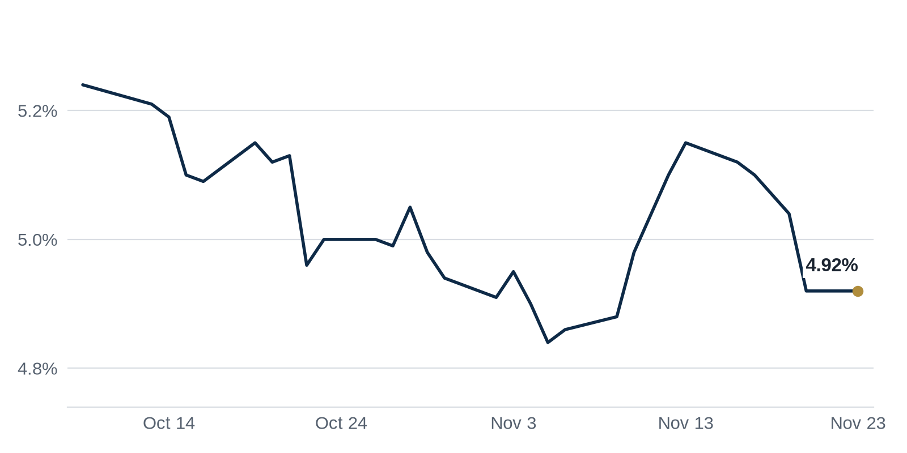

> **Review before publishing:**
> - editor: fixed: The CoStar source is a headline only ('lending loses momentum'); it does not say lending had recovered earlier in the year, so this adds an unsupported fact.
> - editor: fixed: The Yahoo Finance source is a headline only; 'downtown' and 'floors that sat empty for years' are specific claims it does not support.
> - check/long_sentence: 31 words: A Dutch bank's auction of $500 million in...
> - check/long_sentence: 31 words: **Distress Watch:** GlobeSt describes how a "hope note"...
> - check/missing_link: https://commercialobserver.com/2026/11/namdar-group-west-brickell-miami-slate-scale/
> - check/missing_link: https://www.prnewswire.com/news-releases/sui-zee-md-fascp-installed-as-2026-2027-president-of-the-american-society-for-clinical-pathology-302938695.html

## The Brief

- Brookfield bought into a prized New York office portfolio, showing deep-pocketed buyers still chase trophy space. [Commercial Observer](https://commercialobserver.com/2026/11/brookfield-seeks-stake-in-hudson-square-properties-portfolio/)
- Offices keep selling below past prices, a sign the market has not yet found its floor. [The Business Journals](https://news.google.com/rss/articles/CBMirwFBVV95cUxQdFpaZmRLemhSU01ycWRhQ0g4RlJvelNlUlBBVnZKM25BMW45aEh4WTB4NlBiQ1lGTU5aOUJtTmRwSmVrVXRLekI1NTEyVXVaR2dqZWxOOU1yX0E2b3NfcjZJaEdEZkt6OGRQWnZKNWhsRDhBU0pPc0p4WGZYT3hrbkJWZS16VUNiOTRFMDFIQkhhWFZMeDRCQ24tZDJGcktJU2tmVkFjNHFwbENVQVFF?oc=5)
- A new HUD rule makes landlords verify tenant eligibility fast, threatening the supply of subsidized housing. [Bisnow](https://www.bisnow.com/news/national/affordable-housing/hud-issues-final-citizenship-rule-giving-landlords-just-weeks-to-comply)

## The Numbers

*Rates as of Nov 23 close.*

- **10Y Treasury:** 4.92% (0 bps)
- **5Y Treasury:** 4.74% (+3 bps)
- **SOFR:** 3.92% (+1 bps)
- **Fed funds:** 3.75% to 4.00%
- **Next Fed meeting (Dec 9):** Polymarket's top outcome is 25 bps increase 93.5%
- **REITs:** VNQ $92.56 (-1.0%). Best: ADC +1.0%. Worst: DLR -6.6%.
- **REIT yield vs. 10Y:** VNQ yields 3.63%, -129 bps vs. the 10Y.

**What it means:** Treasury yields held roughly steady, but the 30-year mortgage rate jumped. That raises monthly costs for anyone buying or refinancing a home and keeps pressure on housing demand.

**Why Agree Realty (ADC) moved:** No company-specific news today; it may have moved with other retail REITs.

**Why Digital Realty (DLR) moved:** Digital Realty reported record data center leasing and raised its guidance, so the dip likely reflects profit-taking after a strong run rather than weak demand. [Kalkine Media](https://news.google.com/rss/articles/CBMi4gFBVV95cUxNbFJuam5qTkpISkhHT2NwTjZXVUlTQm02QWhhQ1JMTXlKSUEwN1E0UzhNTVRqRk1Fd1F4dngyVjctUEZUR29lTk4tU0tNMEh4SjNGMlFiZ29XZmpXM0lrdGNWY0JLaDBrdmJyWmNFMTRtOXlYcDhsNzJHZjV4YXlpek1LaUE4OGhfRkt4NnpOTE1PVDRlczdELVh2ZHVIU1hIalFVai1kVHZBSXJCR3pNMzlMNGg3NmdNeTVodHBZQ3JBbXJsR2hTYmRiTHpRQXl6SGRxZWpJRG9relVRNFllVExR?oc=5)

## Debt Markets

Trepp says lenders are now holding back cash on about $31 billion of CMBS loans, near the highest share since at least 2020. A cash trap is a lender's quiet form of control. When a loan trips a trigger in its documents, the property's extra cash stops flowing to the borrower and sits in reserve. Office loans lead the trend. [Trepp](https://www.trepp.com/trepptalk/cash-trapped-cmbs-loans)

**Why it matters:** a trapped borrower cannot pull cash out of a building to cover other costs, which tightens the squeeze on owners already short on income.

Commercial real estate lending is losing momentum, CoStar reports. The slowdown points to lenders turning cautious again. [CoStar](https://news.google.com/rss/articles/CBMikAFBVV95cUxPMS1DdjNuaDVyRTlIWktOQ3J1blpWYVQ5OGxkanRqY1ZuMnV1Mk1ETHhHM3Y2OW5Ud09mUTJFZVdQY2haemNHVEhtR1lKOHRRUDF6U2FpYlVJcExaR3Z4SWhTa3d5RS1wVHlEbC1mNTdhTlg2YXc1RngtMVBnMlgzTG5ZWkZDcVZOT0xZZkNvaWw?oc=5)

**Why it matters:** when lending cools, borrowers face fewer options and stiffer terms to refinance loans coming due.

A Dutch bank's auction of $500 million in data center debt tied to AI megaprojects fizzled on weak demand, forcing it to shop the loans around to individual buyers, Bisnow reports. [Bisnow](https://www.bisnow.com/news/national/data-center/-500m-data-center-debt-auction-fizzles-leaving-dutch-bank-to-shop-for-buyers)

**Why it matters:** cool investor appetite for AI-linked loans signals that financing for giant data center projects is getting harder, even as leasing stays strong.

**Distress Watch:** GlobeSt describes how a "hope note" lets multifamily sponsors exit a troubled loan without a formal foreclosure, by splitting the debt into a payable piece and a long-shot piece. [GlobeSt.com](https://news.google.com/rss/articles/CBMiogFBVV95cUxNYjEtdFc5a2dCWTNueXZldDd2Yy1FenAwOXExSU8zUERocjJoSTlHUGRIR3J4c0l1bE96SENKQlZwZllORk5HcEJRaWdvWll6M3gzb2dmUXNpR0puZjB6Vk52MkV3Q1dXeGtUMlFtbEJiUzh1Ukc3X3hzdHVLV3NDZm5PZWdHLVRNS3JGNFlhRnhLb1ZieU9TdFRycGNKVGJQMUE?oc=5)

## Top Stories

### Brookfield replaces Hines in Hudson Square venture

Brookfield has acquired a 10 percent stake in Hudson Square Properties, a 13-property New York office portfolio, stepping into a role once held by Hines. The deal, first reported by the Wall Street Journal in July and valued at about $3.5 billion, was confirmed by the firm on Monday.

**Why it matters:** a global investor buying into Manhattan office signals that top-tier buildings still attract capital, giving owners of trophy assets a fresh comp to cite when they refinance. [Commercial Observer](https://commercialobserver.com/2026/11/brookfield-seeks-stake-in-hudson-square-properties-portfolio/)

### Offices are still selling at a discount

Offices continue to trade below their prior values, and The Business Journals says that gap is shaping how owners and buyers plan for 2027. Cheaper sales suggest the market has not settled on a new price floor.

**Why it matters:** every discounted sale resets comps for a whole submarket, so owners refinancing soon may face appraisals that fall short of their loan balances. [The Business Journals](https://news.google.com/rss/articles/CBMirwFBVV95cUxQdFpaZmRLemhSU01ycWRhQ0g4RlJvelNlUlBBVnZKM25BMW45aEh4WTB4NlBiQ1lGTU5aOUJtTmRwSmVrVXRLekI1NTEyVXVaR2dqZWxOOU1yX0E2b3NfcjZJaEdEZkt6OGRQWnZKNWhsRDhBU0pPc0p4WGZYT3hrbkJWZS16VUNiOTRFMDFIQkhhWFZMeDRCQ24tZDJGcktJU2tmVkFjNHFwbENVQVFF?oc=5)

### Anthropic is powering a San Francisco office rebound

Anthropic's rapid growth is pulling San Francisco's office market off the floor, Yahoo Finance reports, as the AI company takes on more space. A single fast-expanding tenant is absorbing space that had sat empty.

**Why it matters:** concentrated demand from one firm gives San Francisco landlords real leasing activity to point to, but it leaves the recovery leaning on a handful of AI companies. [Yahoo Finance](https://news.google.com/rss/articles/CBMikwFBVV95cUxOcUlPT0RlblIzR2ZmZGpCUXN1VUdXV3k4aWVtTnE1LVc4bHNIdWxnSjVwNEt1MkNBcFY5VXBGaGNSWGRWVGVzeW94S3RNcjBndnRDNnh6dG9tLXBEalgwcjJVVE5ySEhxUC16UktIa3RwOWRvSnZqOU41MjI5cEwtbUNmdU95b2xJT2I5alY0WUtZUGM?oc=5)

### Meta pulls back space in its San Francisco headquarters

Meta is giving up part of its San Francisco headquarters, the San Francisco Chronicle reports, raising doubts about how durable the AI-driven office boom really is. The move cuts against the story of a city-wide tech rebound.

**Why it matters:** if a large established tenant shrinks while AI startups grow, San Francisco's comeback rests on a narrow base, a risk for landlords betting on broad demand. [San Francisco Chronicle](https://news.google.com/rss/articles/CBMiowFBVV95cUxQSjctR0xQNlAzb19hejFSWU1ZS2VoQU0yd2RDNjNUSDVwa3NtZ1RMQ29QbndxbjdfRFNhR1FCVm11UTlPdDUzbXBfcnh6eWJzbDRqaWFtaDcxVUwyejZtdFo5cmg4YjhBMXVHaWdzd3Q5X3k4QjJ3WW0wNTd4WGZEU0JZNk84U1FuV0RQOVZyVVRjVTNBS1diYnpsVnNhU3pxTEVv?oc=5)

### HUD gives landlords weeks to prove tenant eligibility

A final HUD rule gives landlords only weeks to verify that tenants are eligible to live in subsidized housing. Advocates warn the rule will reduce the supply of HUD-assisted units.

**Why it matters:** affordable-housing owners face new paperwork and the risk of losing tenants, which could cut their rental income and pull units off the market. [Bisnow](https://www.bisnow.com/news/national/affordable-housing/hud-issues-final-citizenship-rule-giving-landlords-just-weeks-to-comply)

**Coffee chat talking points:**

- Lenders are pulling back just as borrowers need them: CoStar sees CRE lending losing momentum while Trepp counts cash traps on about $31 billion of CMBS debt. [Trepp](https://www.trepp.com/trepptalk/cash-trapped-cmbs-loans)
- Trepp says 20% of CMBS loans modified since 2022 are delinquent again, which helps explain why offices keep selling at a discount. [Bisnow](https://news.google.com/rss/articles/CBMivAFBVV95cUxPSzAwMWRSS19weWliS1luaTl4d3M2cGg1UjZQTkFOMFgzUzJDbFFnSVpHOEhXWkVQX3o2dS04bG1IV1h2dms3MjFfZTRqZHk0U0xMS29JVllqaENuSVdSUHN3Y1ZFMkJab1N4VUlsTUR3UjE2bF9GNUtqODVLZndzckRrNVgzLVU1OWtkSGJhWFdKOTBMMWtRT2w1Rk0yR2pVVkZ2UENkQ0RvQzEwM2pwb3o4bTdfM3BTWUsxUQ?oc=5)
- A Dutch bank could not sell $500 million of data center debt even as Digital Realty touts record leasing, a sign lenders are getting pickier on AI megaprojects. [Bisnow](https://www.bisnow.com/news/national/data-center/-500m-data-center-debt-auction-fizzles-leaving-dutch-bank-to-shop-for-buyers)

## Market Watch

### Sun Belt

Namdar Group landed a $345 million construction loan to build more than 1,000 rentals in Miami's West Brickell district, The Real Deal reports, despite a slower local market. The floating-rate financing backs a 42-story tower near Interstate 95. [The Real Deal](https://news.google.com/rss/articles/CBMinwFBVV95cUxOT1NNYTJTc1pEUmdIcVE5eXFrMVEwTVRKaFcySmVuY21tRjdPdWRlcGYzeUI2VzFSQlNwYzl2TnUzSHlZUDZ0UVk2ZGxNTEZrbGRoZ1ltcWxHVUNyUVpNdl9vVlRQU1JTNXhmblF0b0ZjWTJndEZZU0dpZ2N3dzRWMHdxb0ozQnplWHJPMWp6bXBXclVmWERvaXVaYnZ5ZVU?oc=5)

**Why it matters:** a large new apartment project means more supply hitting Miami, which can hold down rents for nearby landlords even as the developer bets on long-term demand.

### West Coast

Nvidia won approval from Santa Clara officials to build a new headquarters building, The Real Deal reports, expanding its footprint in the heart of Silicon Valley. The green light clears the way for more corporate construction in the region. [The Real Deal](https://news.google.com/rss/articles/CBMiogFBVV95cUxPanM3eEo5NndmZzY3RnBDaEtoX1hGLVBPeGVtUGVVVGpKbUlpOGhvRHN4cTMzMEdQU2RzUnplZzZCdWsxT2NvR3hHM1B3d3VWcmxNX0Q5am5oRTBPbFA3ci1oTUY2V3Fqa1FBOV9PYnUxemp0WWdya1FvNGpvajRZOHYzMndKVUxhQ0FUSG9nMG5La1Rxd3VDTmdOaWtQeGlEX2c?oc=5)

**Why it matters:** a marquee tenant building its own campus anchors demand for Santa Clara space and lifts confidence for landlords and developers nearby.

## Quick Hits

- Gaylord Rockies in Aurora plans a $305 million expansion with 450 rooms and a luxury indoor water park. [Bisnow](https://www.bisnow.com/news/denver/deal-sheet/gaylord-rockies-to-undergo-305m-expansion-the-denver-deal-sheet) Big convention hotels bet on group travel, so the spending signals owners expect business events to keep filling rooms.
- Dallas-Fort Worth is winning Texas's race for corporate headquarters, The Real Deal reports, and offices are landing across the metro. [The Real Deal](https://news.google.com/rss/articles/CBMilgFBVV95cUxNM2tra2tyZGc1QVBmUUdlVEo5aVRya3FPN1dlc19ta19xTGlHM2k4WlAwYnJ2bHhWWVg4bExobHU3ZTRXTy1GNkxoc3MteG5NbGZDTzRKYnhuZ3ZaU1BhVG5UUUxYY3BEY0JLOGRleTJOYmVMZHNwMUM3TkRJTG45am45WFhfR3lhaG9vbGRvckdvYno0WUE?oc=5) When companies relocate headquarters, they fill office space and draw housing and retail demand to the winning metro.
- Tishman sold the Union West apartments for $154 million, The Real Deal reports. [The Real Deal](https://news.google.com/rss/articles/CBMikgFBVV95cUxOVmYtdll2OEdLUjJFY0VoOUVqU054OXFTaWFVR21BRnNvS25XS2NMZTVDVHc1SkNXeHcxWktubXYyZzlrZm5VSncwc2o0S052ZmM1NElDRTdRRzZrZzlJUDdhRERLSkhMSFdIeFgxMkJwSTdVd0ZkZ1lVY01oMzZFdUV4UnpFVHd5V0xZVFBscEhGQQ?oc=5) A completed apartment sale gives the market a fresh price point, helping buyers and sellers gauge what similar buildings are worth.
- Cohen Brothers is preparing a legal fight after a city pulled back a deadline extension for its West Palm office tower, The Real Deal reports. [The Real Deal](https://news.google.com/rss/articles/CBMioAFBVV95cUxQYTM1ZDQtdjU4LVp6ZXQ2LWdOZXg1TUtXZUZIaG9hOW1FRWR0SmthVTBnUUJLaDhLcVo4QWJyOGhVR3A3cGppUlYtYjcyd1dCeE5Ka1VyQXNpTDkyUkxFc3hnWTdOOGdJZnFiMld4QWhRRThUSjczVU9sSHZjUTV6elFBeUw2S0tkT1hRU3lWMHI5R1lYSU9UdjZveU1DcG9q?oc=5) Permit deadlines can make or break a project, so a fight over timing can stall a tower for months.
- CRE equity is pulling back even as debt becomes more available, GlobeSt reports. [GlobeSt.com](https://news.google.com/rss/articles/CBMikwFBVV95cUxPeDZPempSWnAySTZOQy1ybFVsNTVQSkNjM2ZHLWZOWjZaLVVzcDNIaUY1WHZZV2YzTUlzU1N1N3Fldi0wczl0VVJqVFFPREt3YWk5a0RrYk5icWFmZjZMZHY2OHItWk1sSnplaWVHWlZpOUZmMUpndzRzZDd4ZjI0ZTlmUWZLUHgwUTJKcGpsdF85YVk?oc=5) When buyers stay cautious while loans loosen, deals can still stall because owners need equity partners to close.
- Apartment operators are gaining pricing power as investors wait for values to settle, GlobeSt reports. [GlobeSt.com](https://news.google.com/rss/articles/CBMirgFBVV95cUxOMlFoV2hEdFNoNUhna1NRR2loSWdTd0RueXBjWkg4eE1idXhHQXlwOW1wMnFFa1F3UVVkZlo4aml3Z3QwVUdUV19ZQkt2UUI2ZkFQcEwxUm9FUC1kXzY4SlBsbDZlYk1wSGpkbjNyWXJKemFNaFZndDkwTndid2hzSXg3RUFEeXppUFVmMzBMTmpXYTBGVGplRE9hMmcxbVdaZlRDY0pJcGN2LW4tRGc?oc=5) Landlords who can raise rents again hold the advantage while buyers hesitate over what properties are worth.

## AI Infrastructure

Digital Realty reported record data center leasing and raised its guidance, a sign that demand for space to run AI models keeps climbing. Data centers are power-hungry buildings packed with servers, and landlords like Digital Realty rent them to tech companies. The winners are those landlords and the regions that can supply land and electricity; the losers are power-strapped markets where utilities and neighbors feel the strain. [Kalkine Media](https://news.google.com/rss/articles/CBMi4gFBVV95cUxNbFJuam5qTkpISkhHT2NwTjZXVUlTQm02QWhhQ1JMTXlKSUEwN1E0UzhNTVRqRk1Fd1F4dngyVjctUEZUR29lTk4tU0tNMEh4SjNGMlFiZ29XZmpXM0lrdGNWY0JLaDBrdmJyWmNFMTRtOXlYcDhsNzJHZjV4YXlpek1LaUE4OGhfRkt4NnpOTE1PVDRlczdELVh2ZHVIU1hIalFVai1kVHZBSXJCR3pNMzlMNGg3NmdNeTVodHBZQ3JBbXJsR2hTYmRiTHpRQXl6SGRxZWpJRG9relVRNFllVExR?oc=5)

## Term of the Day

**Comps:** short for comparables, the recent sales or leases of similar nearby properties used to set a price. If three similar offices down the street sold for about $300 a square foot, a seller nearby will struggle to ask much more. When offices trade at a discount, those low comps drag down what every other owner can realistically charge.

For informational purposes only. Not investment advice.
