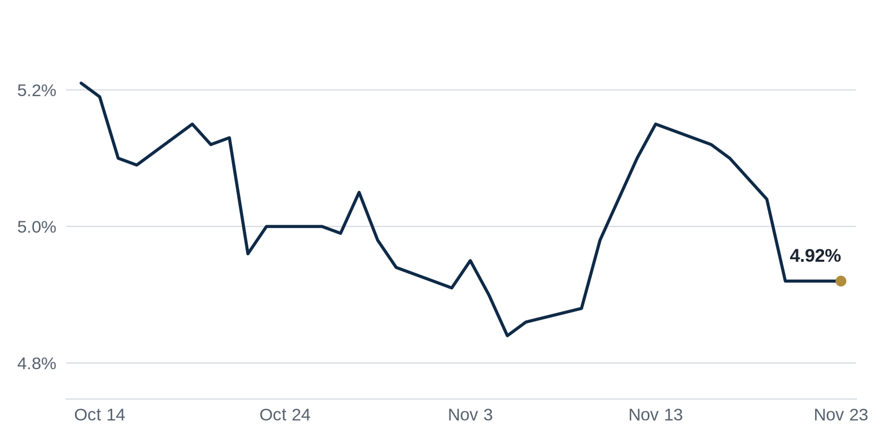

> **Review before publishing:**
> - news/CPE: HTTPStatusError: Client error '429 Too Many Requests' for url 'https://news.google.com/rss/search?q=site%3Acpexecutive.com+when%3A7d&hl=en-US&gl=US&ceid=US:en' For more information check: https://developer.mozilla.org/en-US/docs/Web/HTTP/Status/429
> - reits: prices from Alpha Vantage only, not cross-checked (no second source; set TIINGO_API_KEY)
> - editor: fixed: Source calls it a mixed-use project, not apartments; 'apartments' adds a fact the source does not state.
> - check/missing_link: https://news.google.com/rss/articles/CBMikgFBVV95cUxPcTE4LUJXWUpNRV9tUGJHaXZScWhLMHdYZmNSazRIcHJtRWVQSG1PcFpqSUIxQjBUYVpua0puMGFjWlJkaERKdHkxWjQzVTdTMm5DMUMzSFBWcHNmTU1pV0hyRHhxYTNxbHc5a0E2YWxiNjZ5OHpVQ1diRm1SMnlYdEVxcmhSdkwtRWFYZl9SYU5YQQ?oc=5
> - check/missing_link: https://news.google.com/rss/articles/CBMipgFBVV95cUxPXzJiUzJxRHRUUW1XeUNhLUw1MmloVnlXczlQZWZvdVJITlgyWDBqbzl2dU9hMUNUbUdRbVQwb3BoSUM5QnFVYkVNYmVhOG14VVdvcnhfSzFiYXVVeUV1R1R5eWlia3dMMVI3dEc2WlZZZlN1TGlsSWZKYkVYaEhjTEpUZnE0cF90bXlwOFZrY3RYZGU3TE9TRGRvSUVlMnJWaTV6QTZ3?oc=5
> - check/repeat_in_issue: linked 3 times: https://news.google.com/rss/articles/CBMikgFBVV95cUxOUzJ0MnlsenJKR2JtenE4bkk3Q0RaNm9lanBpbzlqWE1VWmtJZllMYnlJNFkzUlpJQ1o4ZG5JaGR5dEZVQWc5Y2M4VHVIcTJDaG5xMkZSaHRydWJRU0ZtdlV6VktrTG1RZWhIZkNiWXJsM1UxV1lvMGhnN3FsZ2VmZU50d3dmeFpVUXBGTTVQMHhMdw?oc=5
> - check/repeat_in_issue: linked 3 times: https://news.google.com/rss/articles/CBMijAFBVV95cUxNSlpTWW9ZZzliOTlpR1JrUXFLanpFU2hRY3doTE8xWHNENHFQRUplcXNKYXRldERLQURQQzRTeDFiT3ZCem5jbGpielltdzJLRVFyUDE5aFMtR1dfYkVuSVlXOWhIa0NRNXJTQmVfSEhwR3lseHhDaXVGbTBibkNBTU5MOFhhT2ZwM3pmQw?oc=5
> - check/unsourced_number: Coffee chat talking points: 2012,

## The Brief

- Developers broke ground on the fewest apartment projects in over a decade, which could tighten rental supply later and lift rents. [GlobeSt.com](https://news.google.com/rss/articles/CBMikgFBVV95cUxOUzJ0MnlsenJKR2JtenE4bkk3Q0RaNm9lanBpbzlqWE1VWmtJZllMYnlJNFkzUlpJQ1o4ZG5JaGR5dEZVQWc5Y2M4VHVIcTJDaG5xMkZSaHRydWJRU0ZtdlV6VktrTG1RZWhIZkNiWXJsM1UxV1lvMGhnN3FsZ2VmZU50d3dmeFpVUXBGTTVQMHhMdw?oc=5)
- Hotel sales picked up as buyers paid up for bigger properties, a sign investor confidence in hospitality is coming back. [GlobeSt.com](https://news.google.com/rss/articles/CBMijAFBVV95cUxNSlpTWW9ZZzliOTlpR1JrUXFLanpFU2hRY3doTE8xWHNENHFQRUplcXNKYXRldERLQURQQzRTeDFiT3ZCem5jbGpielltdzJLRVFyUDE5aFMtR1dfYkVuSVlXOWhIa0NRNXJTQmVfSEhwR3lseHhDaXVGbTBibkNBTU5MOFhhT2ZwM3pmQw?oc=5)
- An Orange County landlord handed offices back to its lender rather than keep paying, another sign of office distress. [The Real Deal](https://news.google.com/rss/articles/CBMijAFBVV95cUxOSTA0bTV3M09RY3BxdEtXZnljamZoR3Yxa19yX2ZxdEpWejYwek1ONkRrZlo1SHFUcHRTdEE3cGpqbHZpY0NiZ1BkUTlzNHIyVXlmdTBxaWhuN0RiZldHQ3Q4M2dieENkVlZKalJNek5JZlUtQzFqTnJzRXpGYXVmTGlTRFZ0YWhvMnBvbQ?oc=5)

## The Numbers

*Rates as of Nov 23 close.*

- **10Y Treasury:** 4.92% (0 bps)
- **5Y Treasury:** 4.74% (+3 bps)
- **SOFR:** 3.92% (0 bps)
- **Fed funds:** 3.75% to 4.00%
- **Next Fed meeting (Dec 9):** Polymarket's top outcome is 25 bps increase 93.5%
- **REITs:** VNQ $93.67 (+1.2%). Best: HPP +6.8%. Worst: DEI -0.9%.
- **REIT yield vs. 10Y:** VNQ yields 3.63%, -129 bps vs. the 10Y.

**What it means:** Treasury yields held steady, but the 30-year mortgage rate jumped. Homebuyers and anyone refinancing a house now face higher costs even though the rest of the rate picture was little changed.

**Why Hudson Pacific Properties (HPP) moved:** No company-specific news today; it may have moved with other office REITs.

**Why Douglas Emmett (DEI) moved:** No company-specific news today; it may have moved with other office REITs.

## Debt Markets

A landlord tied to Kelemen handed the keys to several Orange County offices back to its lender after owing more than $100 million on the loans. Giving back the keys means the owner walked away instead of keeping up payments, letting the lender take the buildings. [The Real Deal](https://news.google.com/rss/articles/CBMijAFBVV95cUxOSTA0bTV3M09RY3BxdEtXZnljamZoR3Yxa19yX2ZxdEpWejYwek1ONkRrZlo1SHFUcHRTdEE3cGpqbHZpY0NiZ1BkUTlzNHIyVXlmdTBxaWhuN0RiZldHQ3Q4M2dieENkVlZKalJNek5JZlUtQzFqTnJzRXpGYXVmTGlTRFZ0YWhvMnBvbQ?oc=5)

**Why it matters:** When owners decide a building is worth less than its loan, lenders eat the loss and nearby office values take another hit.

Namdar kept building in Miami, lining up $340 million in financing for a Brickell mixed-use project. A financing is the loan a developer takes out to fund construction, and a lender willing to write a check this size signals confidence in the submarket. [GlobeSt.com](https://news.google.com/rss/articles/CBMiqAFBVV95cUxPSFNrdVBYMlRfRXJ6Wm9xRVloQVBySGJDNHVzUUwxYS1yY01QajNMUF9zcV9pdVJscHFPdTdmYU9PaUFKSWJYY3kwdTZEZWRfZVlYOVRaTnFxdllQanM0MmRRRFVoRmtsZnh2VWdYLVE1QlplZDZNX2xqRF92MUdEQk1MUHd1WGgxVGk0c1hlYXg2NTV3cUpHSFhMcjV3aE1Jc2hKWU14UGE?oc=5)

**Why it matters:** A loan this size tells other developers that lenders still fund new Miami projects, giving them a reference point for their own deals.

Apollo provided a $305 million loan to convert 101 Franklin in Tribeca into luxury condos. A conversion turns one use into another, here an older building into for-sale apartments. [The Real Deal](https://news.google.com/rss/articles/CBMinwFBVV95cUxOdXllZVdPbEQ1TEVKZU5UNTNBQXl2eWdCSndFWEJWZ0NURkpzSHBVeUMydV92em1majhtTm5maXh2NVpndFdFMTdiZFh4Zk5aQmxIb0RITm85Yy1BYWpiVDJ3dkZENnI1cE0zTHpyck5JX3VVcVZtWlNrZ1draUZxaVhpeFd5R0FIVkVud29CR1BwUFBYQkpCTFU3Q3NEbHM?oc=5)

**Why it matters:** Fresh conversion money shows lenders will still fund the right project, even while troubled offices change hands at a loss.

**Distress Watch:** Moinian Group modified the $131 million CMBS loan on 2 Washington Street in Battery Park City and signed a new tenant after the prior tenant, Sonder, went bankrupt. A CMBS loan is a mortgage bundled and sold to bond investors, so modifying it means the borrower and those investors agreed to new terms rather than foreclose. [Commercial Observer](https://commercialobserver.com/2026/11/moinian-group-2-washington-mod-prism/)

## Top Stories

### Apartment construction falls to its lowest level since 2012

Multifamily starts, the count of new apartment projects that break ground, dropped to their weakest pace since 2012. Developers are pulling back as high financing costs and softer rents make new projects hard to justify. [GlobeSt.com](https://news.google.com/rss/articles/CBMikgFBVV95cUxOUzJ0MnlsenJKR2JtenE4bkk3Q0RaNm9lanBpbzlqWE1VWmtJZllMYnlJNFkzUlpJQ1o4ZG5JaGR5dEZVQWc5Y2M4VHVIcTJDaG5xMkZSaHRydWJRU0ZtdlV6VktrTG1RZWhIZkNiWXJsM1UxV1lvMGhnN3FsZ2VmZU50d3dmeFpVUXBGTTVQMHhMdw?oc=5)

**Why it matters:** Fewer projects now means less new supply in two to three years, which supports rents for landlords but makes affordability worse for renters.

### Tyko places a multibillion-dollar bet on South Florida

Tyko is assembling a large portfolio across South Florida, a multibillion-dollar wager on the region's continued growth. [The Real Deal](https://news.google.com/rss/articles/CBMipwFBVV95cUxNOHQyLTRaWnpHLXdIOXo4MjRxODlEb2ZwS1JfQ0lqTVhwNk5qYUg2VlpGQUszdXBHdE5SaG85ZVBlVDBWYVBOc0U5RFI3MjJIRG4yWjJTV2FrZHJmeXBSREpPb2N3WHNZeW8zU2Z2MkpTUTZsSXhUMGE1bG1YazRia09nRnlHUTRQNXR0WXNDZnlIcGNyV1ZrVGJXUGRQUlVMUDI4RXZlSQ?oc=5)

**Why it matters:** Concentrated buying by one firm sets price comparisons, called comps, that nearby owners can point to when they sell or refinance.

### Hotel sales volume jumps 30% as deal sizes grow

Hotel transaction volume rose 30% in the third quarter, and the average deal got bigger. Buyers are moving back into hospitality. [GlobeSt.com](https://news.google.com/rss/articles/CBMijAFBVV95cUxNSlpTWW9ZZzliOTlpR1JrUXFLanpFU2hRY3doTE8xWHNENHFQRUplcXNKYXRldERLQURQQzRTeDFiT3ZCem5jbGpielltdzJLRVFyUDE5aFMtR1dfYkVuSVlXOWhIa0NRNXJTQmVfSEhwR3lseHhDaXVGbTBibkNBTU5MOFhhT2ZwM3pmQw?oc=5)

**Why it matters:** Rising volume tells sellers that buyers and their lenders are comfortable pricing hotels again, which makes it easier to sell or refinance one.

### Court upholds Section 8 protections as Hochul vetoes a broker bill

A court upheld rules barring New York landlords from rejecting tenants who pay with Section 8, the federal voucher that subsidizes rent for lower-income renters. Governor Hochul separately vetoed a bill that would have changed who pays broker fees. [The Real Deal](https://news.google.com/rss/articles/CBMiqAFBVV95cUxObDM3WG9tV2kzZk1PMGMzVDZIQ05nc01oOWkyQTV5WHpBQVBfTk5zcWt1VnI4R0pwQ1JoUmdsS3hUQ3JQV2tDa3NVUGl2Mi13U1JMSGwxMnN3SndHcWNJcGpVSlJaNHNBMko5dEluTDl5aVdFVW1tQjVwbUZlRTBKMDRZdjZ4dmwwTEUtTXRNU2pySkN4cjRGNTVBVlZ2RXdLa2xtTVEzdF8?oc=5)

**Why it matters:** Landlords must keep accepting voucher tenants, while the vetoed bill leaves the current broker-fee rules in place for renters and agents.

### Historic Loop office above Macy's sells at a steep discount

A historic office property above the Macy's in Chicago's Loop sold at a substantial discount to its earlier value. The sale is one more marked-down office trade in a struggling downtown. [The Real Deal](https://news.google.com/rss/articles/CBMipgFBVV95cUxQck9TbmtZYXhSczFxRl9oQXA1VEZIWTgwSjY0Zk9Ycjh2S3JVRGY5MXFYR1JWOUZ2N1ROSFdyb0RrZzk1S0VLSmhFLXV3OVpTcHNETnV0bklaQUw4OWMya2Rqd0tJM2NpODlMbVk3bXpKZVF2RW15QW1rMlNFQjFyX2dkaEd4akxraDJKYm5odk96M3FRWnlpSmlvVjFIQ0s1enpDYU5n?oc=5)

**Why it matters:** A discounted sale sets a low comp that drags on other Loop office values and makes refinancing those buildings harder.

**Coffee chat talking points:**

- Hotel sales volume jumped 30% in the third quarter, so lenders who stepped back from hospitality may start competing for deals again just as apartment construction cools. [GlobeSt.com](https://news.google.com/rss/articles/CBMijAFBVV95cUxNSlpTWW9ZZzliOTlpR1JrUXFLanpFU2hRY3doTE8xWHNENHFQRUplcXNKYXRldERLQURQQzRTeDFiT3ZCem5jbGpielltdzJLRVFyUDE5aFMtR1dfYkVuSVlXOWhIa0NRNXJTQmVfSEhwR3lseHhDaXVGbTBibkNBTU5MOFhhT2ZwM3pmQw?oc=5)
- Apartment starts fell to their lowest since 2012, a supply slowdown that could finally put a floor under rents in the weakest markets. [GlobeSt.com](https://news.google.com/rss/articles/CBMikgFBVV95cUxOUzJ0MnlsenJKR2JtenE4bkk3Q0RaNm9lanBpbzlqWE1VWmtJZllMYnlJNFkzUlpJQ1o4ZG5JaGR5dEZVQWc5Y2M4VHVIcTJDaG5xMkZSaHRydWJRU0ZtdlV6VktrTG1RZWhIZkNiWXJsM1UxV1lvMGhnN3FsZ2VmZU50d3dmeFpVUXBGTTVQMHhMdw?oc=5)
- Lincoln Property is holding a $6 billion Southern California development pipeline, a bet that the region's housing shortage outlasts today's high financing costs. [Commercial Observer](https://commercialobserver.com/2026/11/rob-kane-lincoln-property-company-southern-california-development-los-angeles/)

## Market Watch

### Sun Belt

SCALE Lending issued a $345 million construction loan for a multifamily project in Miami's Brickell neighborhood. A construction loan funds a building while it goes up and is paid back once the project is leased or sold. [Yield PRO](https://news.google.com/rss/articles/CBMiW0FVX3lxTE1jcGVDakdHS3AyX0MwMEVTeWdvdk1ITzFHd0ZCN2l5YzNaZjh1dFlOQzc4RjJpZ3FSaGVYWjFhbFZRUDR5NHFKRjFNelJJdHBnNi1GQkhlbDlISlE?oc=5)

**Why it matters:** A loan this big shows lenders still back new apartments in Brickell even as construction stalls nationally.

### West Coast

Lincoln Property Company has doubled its Southern California portfolio over five years to about 78 million square feet. It now holds a $6 billion development pipeline across Los Angeles, Orange and San Diego counties. A pipeline is the set of projects a firm plans to build next. [Commercial Observer](https://commercialobserver.com/2026/11/rob-kane-lincoln-property-company-southern-california-development-los-angeles/)

**Why it matters:** A pipeline that large is a bet that chronic housing shortages will keep Southern California space in demand despite costly financing.

### International

ESR broke ground on a US$762 million logistics development in Greater Tokyo, one of its largest warehouse projects in the region. Logistics means warehouses and distribution centers that move goods. [RE Talk Asia](https://news.google.com/rss/articles/CBMiuwFBVV95cUxPMDNXa09iWHc1bHpEYjhhREx3QnhuMEh3eGFmQ0IyMGlLQVpyanlXNDJpaWRNVUozcV8tdHExRFZfdndfZXR5M1BpOGk1U0RYS0NpRGxha0tQV1NmT2pnUjVDRWJBaGI3WWFpZDFMT1pTM0xEWkpzaU5VVU0yTzE4U3RNRHlvbUlEZmxOTTFfQUJQbWdXUDlzUWd1Sk00b3V4Ymp3MUVON3g5dXNndXVLSUNMTTlZV2Q1MjZV?oc=5)

**Why it matters:** Big spending on Tokyo warehouses signals global investors still see steady demand for space that serves e-commerce and trade.

## Quick Hits

- Law firm office leasing hit its strongest third quarter since 2018. [GlobeSt.com](https://news.google.com/rss/articles/CBMilgFBVV95cUxNdGE2VFplUnBjVVBiUkZfaGgtZUNrX3dmaUlQekM0emI3MUZrcElGcC1hMlZ4aVdFTFcycXlYZ0tNSExfQVBINGlOUU1MbTZRMHJOcUJtVF92YzhTS2pVUnpkYjNhcUJEaVNVend0WWc0Nnp4UHF2WFBVcDNsZ1ZoWWFwQ3JzSWFtdU5wd1IyYWh3NFhHT1E?oc=5) Law firms are signing offices again, a bright spot for landlords in a weak office market.
- Yardi Matrix flagged five apartment markets likely to see rents fall in 2026 and urged owners to be patient. [GlobeSt.com](https://news.google.com/rss/articles/CBMiuwFBVV95cUxQNjd6dmUwSUp6VG1qdGhlZ3l6RDljNDNEZnpBc1RhU1FVbjd2TXBlRGVTRldERFZLcUUyYjk2YmQ3Ul9UZmpUVWRnWHpQRklKTG1Md0RRRUo0S20wMEppSlVwN0htSmV6TXZUcWtTRkdwTFVnUG5MR0JOaE9mbVN0RGp1OTNFUXU1b01qS1hydFlnaFRfY1BXZUpMNjBkcDFFYVNkcU83V2htdUdFeW8wUUFnZWNtYkFFMXdV?oc=5) Where new supply arrived fastest, landlords may have to cut rents to keep units filled.
- Tesla leased a 1.2 million-square-foot warehouse in the Cedar Port industrial park near Houston. [The Business Journals](https://news.google.com/rss/articles/CBMingFBVV95cUxPdWxZMF9nUkhLQXZoQnlGU0JhbmF4M0JjdEt0OE1XSGRVQWFrb0tRcEExeFNsQVlmRl8zUm9sVlhiLWtKd2lGZzRhNl9MemxTVE5TNGVuMm9fWDJXYjdfYWJvM3RIVnJ2UDB6ZUxnZmsyZEFZMHE3a1M0ME1FRFVmUmk0bFZaa3hMdDJvUXJrVnhpc0RidnRUTFhnRDJzUQ?oc=5) A lease this size keeps big-box industrial demand looking healthy even as other sectors slow.
- Anthropic's newly wealthy employees are heating up San Francisco's housing market. [WSJ](https://news.google.com/rss/articles/CBMifEFVX3lxTE11SHBETmFkYWF4Z3d4VEluVmI3bW1ReGhyNU9iSExzOUZZeGVLdGpBTUc0WEFkYXh4VXJYTmM0R01kWVY0bjJUYlhsRFJ2TlB5ZUMzZ3dQcXphelRvSDZ1UU4teW5ZdGRIWFpsRGZWWUxPT0cwN3kyclQwNHc?oc=5) A wave of tech wealth can push up home prices and rents across a whole city.
- Commercial real estate investment in the Greater Toronto Area hit $13.5 billion in the third quarter, topping all of last year. [RENX](https://news.google.com/rss/articles/CBMie0FVX3lxTFBtLUhFT2RQaEl6ajNoR00xdDhGVHZ6ZHZBWDJWbmhQZERGc29Dak5ra0R0QlYtT3JjcXNuMVRFaW9jVFRveUxyU1E5NGlzN2VSbWExMEgybUo3b2dwbVFPVDRkZUFCUWN6NUh6REl2UEZ6UXJtUEJzZjBmUQ?oc=5) Strong activity shows global investors are hunting for stable places to park money.
- Schnitzer West cleared a major hurdle for a 19-story office tower in Bellevue, Washington. [The Business Journals](https://news.google.com/rss/articles/CBMiqAFBVV95cUxNRkJ3d0pLa0M3QWJXalNaNTJMNnN6VWlxRW1DNmFEY3F1SWh6VjFENE5TWEhLWVN3VVptVFBNUEZwa3B4dElrWmRyMjJ5RUYxVHIzNTR0a0cwbHNjSVpGZEZPUlZZT0J0UkVJODFEQzlnY09GeHd2d01LUjdIRUhjSHpFZm5mY2s0endaVGJBWTJIcEtYR3JnUWVvelR0TjZEb0U3d183TlE?oc=5) A new tower moving forward signals developers still see tenant demand in Bellevue's tech corridor.

## AI Infrastructure

Data center leasing reached 50 million square feet as cloud and AI companies race to rent computing space. [Wisevoter](https://news.google.com/rss/articles/CBMikwFBVV95cUxQVEFuWFpuQ3MtRUFPTzUtaTNmSTljYUxJMXpldVRvOG93bzh4V3A5bjB5U0Q3TmVWS2p2cTVEVHl3WS1vWkY4RGVwTjZVdndId1U1Yy1XT0pvYlNnUlF6eGxQTGpUbWN0SkRvNG1tVTZMQW9MR3RIbEJsUUFXcnhpM2xvLUdYQW1Rd3hNUE1BTS1JRjA?oc=5) Data centers are the warehouses full of servers that run AI. Developers and landlords who can deliver power and space gain a fast-growing tenant, while nearby communities often worry about strain on the local electric grid.

## Term of the Day

**Defeasance:** swapping a loan's collateral for a basket of Treasury bonds so the owner can sell or refinance before the loan matures. The bonds generate the same payments the lender expected, so the lender is kept whole. Example: an owner with a $10 million loan buys Treasuries that cover the remaining payments, freeing the building to be sold.

For informational purposes only. Not investment advice.
