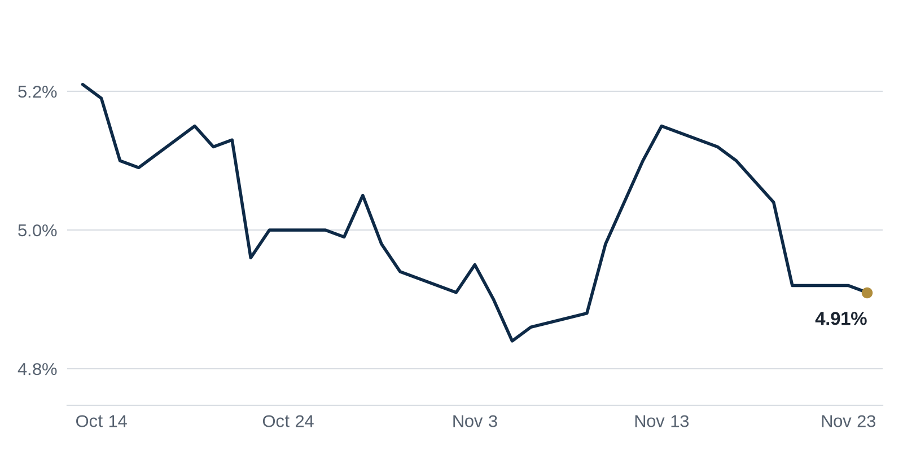

> **Review before publishing:**
> - reits: prices from Alpha Vantage only, not cross-checked (no second source; set TIINGO_API_KEY)
> - editor: fixed: The law firms source only supports the leasing total and expansion; the widening quality gap and older offices falling behind come from a different story and...
> - check/long_sentence: 32 words: Trepp **Why it matters:** healthy borrowers are clearing...
> - check/missing_link: https://news.google.com/rss/articles/CBMinAFBVV95cUxPWmp6QW9vblhzai1PY2Fjb1d4dDVaVnFUbFJnU0t5OWZRVENnb2lNMTFLWlhfREVaQ2Z5MjZVMXhUaDNrdmRYZVlPUHpBM0p2bkVtWkNPbC1QVXZLOXBqOFphR05NdTM1amF1Y29WV2dZTkJPLU4tTk8tYXAxTjNqbHpSaDRFSWZGb29aOVBQX3dvb0NucU1yMUtEOVM?oc=5
> - check/missing_link: https://news.google.com/rss/articles/CBMilAFBVV95cUxQeHZhN1RSQ3BDRTZ4MHBlVlg3ZTItUUZ0RUNfcnpaZWdDM0NVcG1JWWxfOFNJeW5xbTIzZW5Qa0k2cXNlZG9FRlNiazdFUUp6MUNrU0pxdGxnN3BuVGpiWEdBQXJLVTN0VVctNF9TTmNSVlRKcXdDZFpEYk5KejFCVXZ1TWR0MU40SnU1NUJMTHBQTkFU?oc=5
> - check/missing_link: https://news.google.com/rss/articles/CBMivwFBVV95cUxOZmotaVhwejJnakVkWTU3SE1kTDd4T3hRdzQzd0hrYTl1SkY5SjVzUjlrMXg1Y1RnRWhuUFJETkNHV210LUh3dl81QVgtYnJWZFEyWS16ZzhWZV9xVjcySk9HeURjdVh2RVpMQkdUMVRySThfSUVFZVlUenR0a1NWZzhWYnB6Q1drODVnWjBmcHFOa0ZCR0xDNXZkYllFVGt0NEVZend0Rm5wOEM2aGx4MzFwUDVLNmhBT3VkRnp5NA?oc=5
> - check/missing_link: https://news.google.com/rss/articles/CBMivgFBVV95cUxOZmtneGlySS1GdDE5Z1o2d3RDVkFTamdtOFhVY3ZNTV9iTXU2MWlqSV9nWFZCU3pHWXN3TWZpOExkMkY2cWs0dTFBMGk5X1NTdmtUTHA1VmV6cEl3SGZpV2NSb3hUdkRjNTQ1WWJzclVKUi1pY1RfbklkNFlKOXBDU21GbHFjQ2RLSkh2czNfVDE4c3FSTFhTbUxaczNwUzRJSnFxTUxONVEyYnplS2Q1QmphLThUWWdlcTRBT3B3?oc=5
> - check/missing_link: https://news.google.com/rss/articles/CBMitAFBVV95cUxNSU5LeWdqSFRhMFk5cmt6WE5rd1FaZl9najBWQ19wWXliUjIyUFlhUm1GM2J0eEtHYnlCM0Vabkw5cG1aa21IczNkZlhvQzVYWjlLQmdvb1ZkZHFUNTdQbzdQYmFyX0czN3FMR1ZBSkNudlViT05qSnZVUldOSUhIZG5fLU5obzA1dkMzNFJTZFNjRTlKTFFlbmE1UDNuV0wyb3BkeEFnUkpqaDBOTXNzMzFtbVY?oc=5

## The Brief

- Vornado brought new partners into a Midtown office tower, a sign buyers still want trophy Manhattan space. [Commercial Observer](https://commercialobserver.com/2026/11/vornado-90-park-avenue-sixth-street-divco/)
- The appraisal on Portland's largest hotel portfolio collapsed, leaving the bonds behind those loans facing steep losses. [The Business Journals](https://news.google.com/rss/articles/CBMimwFBVV95cUxPNTBKUVRUVUpCTGp2OEVZdjJpYTdnZUxaWEl5a013RFJYTFJERHFRdHZsVEdZV1VoU2oybEUxSHdQTVhOcDU0Z2dOU3JpclE4bWlYN3JYTTV3WktqYnU1VVhHQkxjM3hYS0NnWGlxYlQ5Z190VFdobVlwUjc3TmVTQzZwWUlIVllVQnk2NWNxR2I2czN4d3NIdWR4Zw?oc=5)
- Apartment buyers are pushing for discounts on deals they already signed, and most sellers are refusing. [Bisnow](https://www.bisnow.com/news/national/capital-markets/us-apartment-buyers-want-8-percent-off-deals-they-already-signed-most-sellers-are-saying-no)

## The Numbers

*Rates as of Nov 24 close.*

- **10Y Treasury:** 4.91% (-1 bps)
- **5Y Treasury:** 4.69% (-5 bps)
- **SOFR:** 3.94% (+2 bps)
- **Fed funds:** 3.75% to 4.00%
- **Next Fed meeting (Dec 9):** Polymarket's top outcome is 25 bps increase 93.5%
- **REITs:** VNQ $94.78 (+1.2%). Best: VICI +2.5%. Worst: EQIX -1.7%.
- **REIT yield vs. 10Y:** VNQ yields 3.63%, -128 bps vs. the 10Y.

**What it means:** Rates were little changed, so a new loan or a refinancing costs about what it did yesterday. Borrowing stays expensive but predictable, which helps buyers and lenders size deals.

**Why VICI Properties (VICI) moved:** No company-specific news today; it may have moved with other casino REITs.

**Why Equinix (EQIX) moved:** No company-specific news today; it may have moved with other data center REITs.

## Debt Markets

The appraisal on downtown Portland's largest hotel portfolio plunged 83 percent, and the investors who lent against it now face steep losses. The two hotels back commercial mortgage-backed securities (CMBS), bonds built from pooled commercial property loans, so the write-down flows straight through to bondholders. [The Business Journals](https://news.google.com/rss/articles/CBMimwFBVV95cUxPNTBKUVRUVUpCTGp2OEVZdjJpYTdnZUxaWEl5a013RFJYTFJERHFRdHZsVEdZV1VoU2oybEUxSHdQTVhOcDU0Z2dOU3JpclE4bWlYN3JYTTV3WktqYnU1VVhHQkxjM3hYS0NnWGlxYlQ5Z190VFdobVlwUjc3TmVTQzZwWUlIVllVQnk2NWNxR2I2czN4d3NIdWR4Zw?oc=5)
**Why it matters:** when one portfolio can erase this much value, CMBS buyers grow warier of hotel loans, and other hotel owners pay more to borrow.

Trepp reports that early CMBS payoffs and defeasance are the strongest since 2022, while loan liquidations are the most since 2019 and losses are running a little higher. Defeasance is when a borrower swaps in safe securities to retire a loan early. [Trepp](https://www.trepp.com/trepptalk/save-room-for-pie-cmbs-early-payoffs-liquidations)
**Why it matters:** healthy borrowers are clearing loans early while weak ones are forced out at a loss, a split that shows lenders which corners of the market are still financeable.

**AAA-rated** bonds are supposed to be the safest layer of a commercial mortgage bond, paid back before everyone else. A new analysis warns that heavy losses on hotel loans could be large enough to wipe out even those top-rated slices inside some CMBS (bonds backed by pooled commercial mortgages). That would break the core promise that senior bondholders get paid first. [Propmodo](https://news.google.com/rss/articles/CBMifEFVX3lxTE1tSHZOLWhFRDVXcWtxdUhGdVlRbWltLXdIMU5KdjBGcXFqaDZZVDJOak50NEU4UEoteElZZWpxbE02aTMyc1pKUFQ5cGRDc2pyRGI1NFpZbzhjM0pZZDdHMWxiS25LOVN1M3JTbm9PUDFuZFJvbWREWW41MnM?oc=5).

**Why it matters:** If even AAA hotel-bond buyers can lose money, lenders will demand higher rates on new hotel loans, making it costlier for owners to borrow or refinance.

**Distress Watch:** Trepp found CMBS tied to the five cranberry-growing states ran 9.05 percent delinquent in October, above its 7.87 percent national rate, led by Oregon hotels. [Trepp](https://www.trepp.com/trepptalk/cranberry-state-cmbs-delinquency-oregon-hotels)

## Top Stories

### Vornado sells a stake in a Midtown office tower

Vornado Realty Trust sold a 49 percent stake in 90 Park Avenue, a 41-story Class A tower three blocks south of Grand Central Terminal, to Sixth Street and DivcoWest. The deal valued the building at $722.5 million.
**Why it matters:** a trophy Manhattan office changing hands at a clear price gives other office owners a fresh comp to cite when they refinance or market their own buildings.
[Commercial Observer](https://commercialobserver.com/2026/11/vornado-90-park-avenue-sixth-street-divco/)

### Ransomware hits a major multifamily debt broker

A ransomware group called Qilin, which has ties to Russia, hacked Meridian Capital Group, one of the country's largest multifamily debt brokerages. Ransomware locks up a company's files until it pays to get them back.
**Why it matters:** Meridian arranges loans for apartment owners, so a breach could expose borrower financials and slow financing for deals already in its pipeline.
[Bisnow](https://www.bisnow.com/news/national/multifamily/multifamily-debt-brokerage-meridian-capital-group-hit-with-ransomware-hack)

### Apartment buyers push for discounts on signed deals

U.S. apartment buyers are asking for 8 percent price cuts on deals they already agreed to, and most sellers are saying no. Higher interest rates and rising cap rates have squeezed buyers since they signed, while looming loan maturities add pressure.
**Why it matters:** when buyers and sellers cannot agree on price, deals collapse, and the standoff keeps apartment sales volume stuck at low levels.
[Bisnow](https://www.bisnow.com/news/national/capital-markets/us-apartment-buyers-want-8-percent-off-deals-they-already-signed-most-sellers-are-saying-no)

**Coffee chat talking points:**

- Law firms leased nearly 5 million square feet last quarter, with many still looking to expand their office footprints. [Commercial Observer](https://commercialobserver.com/2026/11/law-firms-office-leasing-q3/)
- TSMC is weighing a $22.6 billion chip campus in College Station, Texas, which would stoke housing and industrial demand even as Austin's apartment pipeline shrinks. [Connect CRE](https://www.connectcre.com/stories/tsmc-considering-college-station-for-22-6b-chip-plant/)
- Dubai office vacancy fell to 3.9 percent while U.S. commercial indicators slipped in October, a split steering global capital toward faster-growing markets. [Gulf Daily News (Bahrain)](https://news.google.com/rss/articles/CBMiU0FVX3lxTFBUZ0RDMTZ4M0JVcF9Eak5OOGJVZnhYYUVnd3d6TWZONk9TY04tejhoaWZ1NTBZSHRYdUQ1UXZiTV9USzdWaGVjc3o0dEJJQnFjLVpV?oc=5)

## Market Watch

### Sun Belt

Austin's multifamily construction pipeline shrank last quarter, according to new data, as fewer apartment projects break ground in one of the Sun Belt's hottest rental markets. Builders have pulled back after years of heavy supply. [The Business Journals](https://news.google.com/rss/articles/CBMioAFBVV95cUxNUS1QamdCSDdGVXpwLVZvSlJaZkhqTWxpRDRkSGRQZHpJVmd2dG5LeWZya0dzWHNISW1WQXBNak56dUVKU2hVSk5jYUp0RGRDdEZrbnMxTG8zbE5pQXZJN0VoVlktVjZoamdkRW1sbWdYYTItVk1QMkhwX19TUWNBOEpTamN2dy05V1YzU3prWTd2VGJtX3p3Tnl6NzJra3FI?oc=5)
**Why it matters:** less new supply ahead means existing Austin apartment owners face less competition, which can help their rents and occupancy recover.

### West Coast

Meta is weighing a sublease of 160,000 square feet at its downtown San Francisco office hub. Subleasing means a tenant rents out space it still holds on its own lease. [The Real Deal](https://news.google.com/rss/articles/CBMingFBVV95cUxOYW15YU9JaC0wOGtjVWxCNzVtM1AzUXhkWlVCMktxQU1qN19QS2NOaHNPVkxCNjBPNWhPRURCeG91aDJXWk91bFJmM1pTQU92cnRpTFFyNGN0MG85cnhEc3NNY2NkMmtoQnpqakxPc1gwOGV1NktlMTNpclVJWk1mOWVnTXBTTHdZUVlEMk5wdmE4XzdPNTY4dlc1bldaZw?oc=5)
**Why it matters:** when a large tenant tries to shed space, it adds to San Francisco's office glut and pushes landlords to cut rents to compete.

### International

Dubai office rents are climbing as vacancy has fallen to 3.9 percent, with steady demand from companies setting up in the emirate absorbing available space. The market stands in sharp contrast to softer Western office hubs. [Gulf Daily News (Bahrain)](https://news.google.com/rss/articles/CBMiU0FVX3lxTFBUZ0RDMTZ4M0JVcF9Eak5OOGJVZnhYYUVnd3d6TWZONk9TY04tejhoaWZ1NTBZSHRYdUQ1UXZiTV9USzdWaGVjc3o0dEJJQnFjLVpV?oc=5)
**Why it matters:** tight vacancy and rising rents make Dubai offices attractive to developers and investors hunting for growth outside slower markets.

## Quick Hits

- TSMC is considering College Station, Texas for a $22.6 billion chip plant. [Connect CRE](https://www.connectcre.com/stories/tsmc-considering-college-station-for-22-6b-chip-plant/) A campus that size would drive demand for nearby industrial space, housing and services for years.
- The gap between the strongest and weakest U.S. office markets is widening as a flight to quality continues. [Commercial Observer](https://commercialobserver.com/2026/11/us-office-investment-sales-rent/) Tenants keep favoring newer, amenity-rich buildings, leaving older offices struggling to fill space.
- U.S. law firms are on pace for a second straight record year of office leasing. [Commercial Observer](https://commercialobserver.com/2026/11/law-firms-office-leasing-q3/) Strong demand from one sector helps landlords backfill space that other tenants have given back.
- Hudson River Trading expanded to 551,000 square feet at 3 World Trade Center. [Commercial Observer](https://commercialobserver.com/2026/11/hudson-river-trading-lease-expansion-3-world-trade-center/) A growing trading firm committing to more space is a vote of confidence in Lower Manhattan offices.
- Commercial real estate indicators slipped in October. [The Real Deal](https://news.google.com/rss/articles/CBMimgFBVV95cUxOU1ZEWDV0TTZobExkdWdzUUZZd0psNU96a2FRdF80SnBMZkUzZm0xNHhxQWRhSjl0dlctOXRLV09HZVhYS21BZ0FXSW15V19qaUpKWXFaQWhURmdxb256a1B4X2swSmlwYzMzeHFscjZYTWlrRHlPY3BRQkFLODBtSGs2LUxFMW9GQWMtcEswV25CSVROZnp5bjF3?oc=5) Softer readings suggest demand and pricing cooled as the year wound down.

## Term of the Day

**Appraisal:** a licensed professional's estimate of what a property is worth in today's market, which lenders usually require before they make a loan. If a building appraises for $10 million but still carries a $12 million mortgage, the lender is suddenly under-collateralized, and the bonds backed by that loan lose value.

For informational purposes only. Not investment advice.
