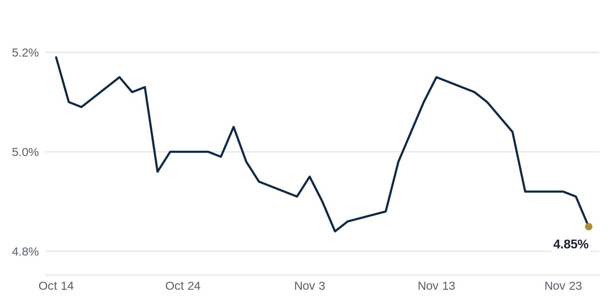

> **Review before publishing:**
> - reits: prices from Alpha Vantage only, not cross-checked (no second source; set TIINGO_API_KEY)
> - editor: fixed: Same Portland Hilton 83% CMBS wipeout is already the first Debt Markets paragraph (Bisnow); this Yahoo Finance paragraph repeats the identical deal within th...
> - check/banned: unprecedented
> - check/long_sentence: 32 words: **Why it matters:** Apartment borrowers will compete for...
> - check/long_sentence: 32 words: **Why it matters:** Owners of stabilized buildings cannot...
> - check/long_sentence: 32 words: **Why it matters:** When a tenant as large...
> - check/long_sentence: 32 words: **Why it matters:** When foreign capital chases a...
> - check/long_sentence: 31 words: **Loan covenant:** a promise the borrower makes in...
> - check/missing_link: https://news.google.com/rss/articles/CBMif0FVX3lxTE5pYjQ0SVFhVkhqS2ZQNE92eU9JWjk0MVJrR2k0NlJTSHQxbnlHNDZoZ2VfTENiVlkyeGNKUFFlNmYwd0FaTTEtTzZTTTFaUEs0YkxkTHRBTGZsOGJkVkJNNjd2OVgxLWpkcm9sQlFGTjc1SjZibE5zcEZZcUhJYWs?oc=5
> - check/missing_link: https://news.google.com/rss/articles/CBMinAFBVV95cUxOZS0xNEZHd21XaVBPMzdWY0p4ZDhwZXJzMldicWFKNFR4MjJGSmpXR1ZVU3ZwNmhrMUNUYzBXU0tobC1OZUI1VU5vSDYzclNzTjdsRzFrLXhOUlBZSnpVZFpONFFFZHFoRlNsUHc5dmNJM3VZdkV2THk3bGRmUzRhZ01PbjdLUThFZkZsX0l6VzE3cVJPNzgtVG9QemPSAZwBQVVfeXFMTmUtMTRGR3dtV2lQTzM3VmNKeGQ4cGVyczJXYnFhSjRUeDIyRkpqV0dWVVN2cDZoazFDVGMwV1NLaGwtTmVCNVVOb0g2M3JTc043bEcxay14TlJQWUp6VWRaTjRRRWRxaEZTbFB3OXZjSTN1WXZFdkx5N2xkZlM0YWdNT243S1E4RWZGbF9JelcxN3FSTzc4LVRvUHpj?oc=5
> - check/missing_link: https://news.google.com/rss/articles/CBMirAFBVV95cUxPamFyYW1LdlNQM1JFbHF0TVAwcVhPZXB2cHdVLXN0UXliVXJxYlBmN2lWZWQyY3lBX1dWNk4yT0RxN0JlYjVodE52bkJyTHFZSVpialB1c3VHclg4MmVFcmNBY3NPUzBIeDJnRGlGRzNqQzVhSjh1UzA1cEhZbEE4aW5PVERKRFd5N001SW8tVkVXbmhqREJxZ3NQdFZRYnJCTXhvV2lmQ2EzMnBr?oc=5
> - check/missing_link: https://news.google.com/rss/articles/CBMimgFBVV95cUxONnhURUxzd2tKNG4yYkczbTRLM2tYMVloUlNFb0xrcmZGUUJhSmlaZFVrbVdKbzdOSG5ISTYxWHEyZW5OVmZkLTh0djl0ZmN5Tl9yM0o2OUY1U2RKbmtkUm8tUnBlUHBCRXNuZE9aaU9FT1Y1aFIwU296blZnV1dxLVYzbHRXampNUUxhOGJZZ3NiNnhIZnA1OTZB?oc=5
> - check/missing_link: https://www.bisnow.com/news/houston/multifamily/725-houston-apartments-sit-vacant-as-fercan-kalkan-fights-foreclosure

## The Brief

- A New York court upheld the city's rent freeze, holding rents flat for stabilized tenants and squeezing their landlords. [Commercial Observer](https://commercialobserver.com/2026/11/mamdani-rent-freeze-court-decision/)
- Miami signed off on a huge mixed-use project in Midtown, adding homes, shops and offices to a fast-growing district. [The Real Deal](https://news.google.com/rss/articles/CBMipwFBVV95cUxPUFRDVEo0RzdSSzY3czRDNlV3ZTNmVVdjZjl4UjQ2X0lKOVRCalJoYk9vZHFHTXo1ZGJNczhCTllmazJOX19WQTZKVm9pMGpOQ01nUmJicUYzT09sS0hkcU5SVWdjblJ1YnNDQ1FJUUdESnMyYlJTalVSOU82Nm4yUExXVEhXXzlaS05jTHNWdEVzUHFtQnh6RkhndDlDSEx4eDgwSGFObw?oc=5)
- Google is buying more London office space, a sign big tech still wants prime central-city headquarters. [The Real Deal](https://news.google.com/rss/articles/CBMirAFBVV95cUxOMkkyVmhFTzVUR2dsdlhjSXlNYXNTbkw3aGFZakVQaS1qbi1PYWZucktlTUdmZ1p6SXZWelFLcGRZN2FSeWl6RnFfVk42WFBjcEFTT2VOai1NSzlKSHpPdTMwZnhVSE0wd1MwS05LaGgwT1RyaVpGS2xneXhWVmNOcS13dC05MTJ4TXZLdUlxb0xiLWM5enE3LTBaSHJ1S3M5VGphZXItQXhTdHlT?oc=5)

## The Numbers

*Rates as of Nov 25 close.*

- **10Y Treasury:** 4.85% (-6 bps)
- **5Y Treasury:** 4.65% (-4 bps)
- **SOFR:** 3.94% (+2 bps)
- **Fed funds:** 3.75% to 4.00%
- **Next Fed meeting (Dec 9):** Polymarket's top outcome is 25 bps increase 93.5%
- **REITs:** VNQ $95.66 (+0.9%). Best: HPP +6.1%. Worst: EQIX -0.5%.
- **REIT yield vs. 10Y:** VNQ yields 3.63%, -122 bps vs. the 10Y.

**What it means:** Rates barely moved, so borrowing costs for new loans and refinancings sit about where they were last week. That lets buyers and lenders price deals without guessing where money goes next.

**Why Hudson Pacific Properties (HPP) moved:** No company-specific news today; it may have moved with other office REITs.

**Why Equinix (EQIX) moved:** No company-specific news today; it may have moved with other data center REITs.

## Debt Markets

The value of two Portland, Oregon Hilton hotels has dropped 83% since they were bundled into a commercial mortgage-backed security (CMBS, a bond backed by property loans) in 2019. Investors in that bond now face a near-total wipeout. [Bisnow](https://www.bisnow.com/news/national/hotel/value-of-2-hilton-hotels-drops-by-83-setting-up-unprecedented-cmbs-losses)

**Why it matters:** CMBS bondholders are learning that hotels in weaker downtowns can lose almost all their value. That pushes lenders to charge more and demand bigger cushions on future hotel loans.

Some large apartment owners are handing the keys back to their lenders rather than keep funding buildings worth less than their debt. GlobeSt reports the trend is spreading as loans come due at higher rates. [GlobeSt.com](https://news.google.com/rss/articles/CBMiigFBVV95cUxNX0I3MVQwNEJDYmw1VkdHdm5JbkhOM19reUU5d1BnUzVpWDVjcEdmYklLR2VEX0VCTTNYTUhCV0ZJUnRzQl9WMXNmc3g0a1g1M0xVcnI0NVZ3NkxtYmdHbDNhRGY3RmNoTzNwaFFPWnVCT0VjMVc2SndrOEVMOE1GQ0xocDgzOGhsVlE?oc=5)

**Why it matters:** When owners walk away, the lender takes the loss and the property, so banks and bond buyers tighten the terms they offer the next apartment borrower.

Fannie Mae and Freddie Mac will keep their multifamily loan caps flat for 2027, holding steady the amount of government-backed apartment lending they can do. [GlobeSt.com](https://news.google.com/rss/articles/CBMioAFBVV95cUxNZG4xQUlBajlDR245SFNMUnVyeWlLU25YWHpidm5EMjlHa1F2UEJpcUMwVU41ZHlHMmdqdGh2T2tRaTU2eDVPcFhuZmFlUEJ5Z0NvQl92bWt5T2ZPTEpQdGRNZl92N1dobUNOdnJUSVp6dTA2NjZYRDgxREFKY1hFMTk4Z3FqejRuU3B6cEJKVE83Nk9sLUJhSmdya3oycU5M?oc=5)

**Why it matters:** Apartment borrowers will compete for the same fixed pool of cheap agency money, so well-prepared deals get funded first and marginal ones may have to find costlier private debt.

**Distress Watch:** A Miami Worldcenter development site could be seized in a $23M foreclosure, according to The Business Journals. [The Business Journals](https://news.google.com/rss/articles/CBMisgFBVV95cUxNbjR3cjhEOHNfMDJObTVQUzlCczRRbWZGUnVqamJsbEZub0UzRDJydnBSaFNPR0tfYmFzdWs2MC1qVE0yS3pjZkdBZjFjU3ltcHU5TXJGWDhtNTZOXzNnVFZiU0I5Qks5Tl9ORXpnMmwtaUJkSHRYaXY3b3dfY1dWaXhrR05CUjI4d3JtRGFSRVR3b19ET05PRUpCcWVJckRzMW55SEJkaUp2bFZoaktZNWtB?oc=5)

## Top Stories

### A New York court upheld the city's rent freeze

A Manhattan Supreme Court judge threw out a lawsuit from landlords and upheld Mayor Zohran Mamdani's rent freeze on New York City's rent-stabilized apartments. The ruling keeps the freeze in place for more than 1 million stabilized units.

**Why it matters:** Owners of stabilized buildings cannot raise rents to cover rising taxes, insurance and repair bills, which squeezes their cash flow and can push weaker owners toward missed loan payments.

[Bisnow](https://www.bisnow.com/news/new-york/affordable-housing/challenge-to-mamdani-rent-freeze-thrown-out-by-judge)

### Miami approved a $2B Midtown Park project

Miami commissioners signed off on Rosso and Vadia's $2B Midtown Park development, a large mixed-use project in the city's Midtown district. The plan adds housing, retail and office space to one of Miami's fastest-growing areas.

**Why it matters:** A project this size is a vote of confidence in Miami demand. Nearby owners get fresh sale and rent comps plus new foot traffic that can lift their own values.

[The Real Deal](https://news.google.com/rss/articles/CBMipwFBVV95cUxPUFRDVEo0RzdSSzY3czRDNlV3ZTNmVVdjZjl4UjQ2X0lKOVRCalJoYk9vZHFHTXo1ZGJNczhCTllmazJOX19WQTZKVm9pMGpOQ01nUmJicUYzT09sS0hkcU5SVWdjblJ1YnNDQ1FJUUdESnMyYlJTalVSOU82Nm4yUExXVEhXXzlaS05jTHNWdEVzUHFtQnh6RkhndDlDSEx4eDgwSGFObw?oc=5)

### Google put another $655M into London offices

Google invested a further $655M in the London office market, deepening its bet on the UK capital's prime office space. The move continues the company's steady expansion of space in major global cities.

**Why it matters:** When a tenant as large as Google keeps buying central offices, it reassures landlords and lenders that top-tier city space still draws demand even as weaker offices sit half-empty.

[The Real Deal](https://news.google.com/rss/articles/CBMirAFBVV95cUxOMkkyVmhFTzVUR2dsdlhjSXlNYXNTbkw3aGFZakVQaS1qbi1PYWZucktlTUdmZ1p6SXZWelFLcGRZN2FSeWl6RnFfVk42WFBjcEFTT2VOai1NSzlKSHpPdTMwZnhVSE0wd1MwS05LaGgwT1RyaVpGS2xneXhWVmNOcS13dC05MTJ4TXZLdUlxb0xiLWM5enE3LTBaSHJ1S3M5VGphZXItQXhTdHlT?oc=5)

**Coffee chat talking points:**

- Cardone Capital paid a record $480M for a Blackstone apartment portfolio just as other large owners hand keys back, so this market has clear winners and losers. [The Real Deal](https://news.google.com/rss/articles/CBMimwFBVV95cUxPdDU0ZEktcWlxTnhwWjJhcEwyQXhJWXg1c0Q4ckgtWUJ1a0luR0JVRnFoandaWFoxSkppZHQxOUpUX1JSSXVSRldjcFRHb1pSZERHMU1FbUpOZUI0VnliOEthbHBhb1V5TnZrWmJBVVFaaVZaWmxnNHFRdk1Sam0wbFRJMjk3ZzRNaHlIQUJuVlp1ZnY1UlZQVnNBOA?oc=5)
- US commercial real estate activity fell 14% in October, yet growth metros keep clearing new towers, so the slowdown is landing unevenly rather than everywhere at once. [Wisevoter](https://news.google.com/rss/articles/CBMilwFBVV95cUxPYWs1UVVURmNwdGxrTThPMVV0UmNuRmt6OFNZR2VROG9mU3VlVU00WDh4LTZMVEVEdzk2T0pOMk1FWTgzT0J5TTRRMFlQMng3U3JnUnVhdFFGZ1BTa0o0OUVLbG04OUNNOWx0YUVrZU10MVBrUHN1WUhlTXpWMHJtVEJzTjRZQWktTHlWNHZ4a3VxcE5WZzZJ?oc=5)
- California rents run 53% above the rest of the country, which keeps nudging both renters and employers toward cheaper Sun Belt states where new supply is still getting approved. [Wisevoter](https://news.google.com/rss/articles/CBMikwFBVV95cUxONlVtS3NQRGVaLTF6eFNTbmRTWkdTRWZzVFRxc0RRLUlrdTlIN2FrYmkxOGJfWFVWdFdGVE10b2FrOGs3eWY2blNRejdrT0h6WWEzZmV0NGtjNXFwbnpYakxERm5nNURJLVNWNDk5TExUMk1VcXFzQy1QV3dQWUtwOE9WVjEyb3l4c2pUZ0pzWXJEMVE?oc=5)

## Market Watch

### Sun Belt

Florida cut homestead property taxes for homeowners, and local officials are now weighing new fees and other tax tweaks to fill the budget gaps that creates. Bisnow reports commercial property could end up absorbing part of the shortfall. [Bisnow](https://www.bisnow.com/news/south-florida/economy/florida-amendment-3-property-taxes-commercial-real-estate-impact)

**Why it matters:** If towns lean on commercial owners to replace lost homeowner tax revenue, those owners face higher carrying costs, which cuts into the income a building throws off.

### West Coast

California rents run 53% above the rest of the United States, according to Wisevoter. That gap reflects tight supply and high demand in the state's major coastal metros. [Wisevoter](https://news.google.com/rss/articles/CBMikwFBVV95cUxONlVtS3NQRGVaLTF6eFNTbmRTWkdTRWZzVFRxc0RRLUlrdTlIN2FrYmkxOGJfWFVWdFdGVE10b2FrOGs3eWY2blNRejdrT0h6WWEzZmV0NGtjNXFwbnpYakxERm5nNURJLVNWNDk5TExUMk1VcXFzQy1QV3dQWUtwOE9WVjEyb3l4c2pUZ0pzWXJEMVE?oc=5)

**Why it matters:** Rents this far above average give owners strong income today, but they also push residents and employers toward cheaper states, which can soften demand over time.

### International

Global investment funds are pouring money into Japanese real estate even as interest rates there rise, The Economic Times reports. Foreign buyers are drawn to Japan's steady rental income and relatively cheap financing. [The Economic Times](https://news.google.com/rss/articles/CBMi6AFBVV95cUxNbU42OGt6U2xzclQ0eEJSdjAtdk13STFHMHhfOU45WUZQSUw4d19oR2lGV01rNDc3XzFwc0VKQWllYk44OUtnWDJnSl9OZlVDM1FMdVlSS20yZnBhV3JYRVo2UGM0YUVIUUcybW5VbGNLMHhIeERrZklvYXRzb3ZqMWoyaTBIT1gxWkQxUnFZSWlTOUFKemdqT1Zwd0ZpSHRDdnQzaEdzNnhDVjRieE9Rb1hXWm5xajlkU3JldHI4VkxhS2k0WW96TDJuWkdnX09OcGtwQXFDaE91TmVoOUNFZW9aeFgteU5u0gHuAUFVX3lxTFBWcXRRaGt3cEY3MFZQUm9haXItQXdFR3RyUDlwMGZCLThadlc3Y2FRakFQNlVZeFJLYW5wc3BzMkJ3bUNGNEQzNFJBSmF2TTBsLUQ5N2tPUVpsTlB2N1I1UUxoaFdmMW94STJzQlB4dWVBVzhISWVzcjN0d2JHVXdMNlVxNjlnZnl1Z3cxQ2tPUDlTa2ZVamZiY0xIZVdxQlZONEhYV29RZ2wxSmo1U3U2a0VKb1RocUJrU1p6ZVZ2Tm5kQnBlYzEwOUk3YlhEOVNZS0hEMno3R09jalZ6aS1md0xVN3JuTkxkSjVySHc?oc=5)

**Why it matters:** When foreign capital chases a market even as rates climb, it signals investors still want stable income abroad, and that money can lift prices for everyone holding Japanese property.

## Quick Hits

- Cardone Capital closed on a 1,500-unit Blackstone apartment portfolio for a record $480M. [The Real Deal](https://news.google.com/rss/articles/CBMimwFBVV95cUxPdDU0ZEktcWlxTnhwWjJhcEwyQXhJWXg1c0Q4ckgtWUJ1a0luR0JVRnFoandaWFoxSkppZHQxOUpUX1JSSXVSRldjcFRHb1pSZERHMU1FbUpOZUI0VnliOEthbHBhb1V5TnZrWmJBVVFaaVZaWmxnNHFRdk1Sam0wbFRJMjk3ZzRNaHlIQUJuVlp1ZnY1UlZQVnNBOA?oc=5) A single buyer scooping up a large apartment block signals confidence that rental demand will hold.
- Commercial real estate activity fell 14% in October. [Wisevoter](https://news.google.com/rss/articles/CBMilwFBVV95cUxPYWs1UVVURmNwdGxrTThPMVV0UmNuRmt6OFNZR2VROG9mU3VlVU00WDh4LTZMVEVEdzk2T0pOMk1FWTgzT0J5TTRRMFlQMng3U3JnUnVhdFFGZ1BTa0o0OUVLbG04OUNNOWx0YUVrZU10MVBrUHN1WUhlTXpWMHJtVEJzTjRZQWktTHlWNHZ4a3VxcE5WZzZJ?oc=5) Fewer deals getting done means brokers, lenders and appraisers all see less work and thinner fees.
- San Francisco voters approved new affordable housing measures. [The Center Square](https://news.google.com/rss/articles/CBMinAFBVV95cUxOZS0xNEZHd21XaVBPMzdWY0p4ZDhwZXJzMldicWFKNFR4MjJGSmpXR1ZVU3ZwNmhrMUNUYzBXU0tobC1OZUI1VU5vSDYzclNzTjdsRzFrLXhOUlBZSnpVZFpONFFFZHFoRlNsUHc5dmNJM3VZdkV2THk3bGRmUzRhZ01PbjdLUThFZkZsX0l6VzE3cVJPNzgtVG9QemM?oc=5) Public backing for affordable housing can unlock funding and approvals that private builders struggle to get alone.
- Google is buying two large Sunnyvale tech buildings in a fresh Bay Area expansion. [East Bay Times](https://news.google.com/rss/articles/CBMisgFBVV95cUxPb1gzV0Z2NUo2SzRPN0h2ZWh0N2ZCdDctTWdtT0RIVUN5aHBqQXd5RmNtR1VPVG1KVlQtNzBNQjBNTFhyMWo1T2dBTGpTTTlTLW1kUE9ILVQzN2xiSGNVNVBrVjh2OHUwTTBnMEpCMlVnUk5HOFVEeVI0QkUyM25qUlFkV2dQenFuejE1RWQ1UWQ2Q1RPRWhnWkVpZHphZ3dJeGFlMEdGaXgzTGdTTjVkUjlR?oc=5) A tech giant adding space suggests it expects to keep growing headcount in that market.
- A New York investor is buying into San Francisco's AI-driven real estate recovery. [CoStar](https://news.google.com/rss/articles/CBMivwFBVV95cUxONFMwNTlKRUhJWGxBTlNfTFlNRlBrYy1EYmFSdERIa1dDVEFGcnRlZ25KcTJ5aEoyWVNhQlZ2VVd2TlpQUGFWODFkT0FsbDhzeFdERDFXbGZ0bEMwSDFSSV8xeEN2ajBLT2ZORDJkYTR1U3R6WkJUblJYMm5BMWc1a1gxR1I1eDgzejFCbXNzOHltajhCX0xsUjFWT1RYNDA1Y1FGUWdGSHBTdWdjTWpyZG1Nd1NSRGtReXM0RkZ3cw?oc=5) Out-of-town money returning to San Francisco is an early sign some investors think its office slump has bottomed.

## Term of the Day

**Loan covenant:** a promise the borrower makes in a loan agreement, such as keeping a minimum debt service coverage ratio (its building income divided by its loan payments, at least 1.25). Break a covenant and the lender can charge more or demand early repayment. Covenants let lenders catch trouble before a loan actually misses a payment.

For informational purposes only. Not investment advice.
