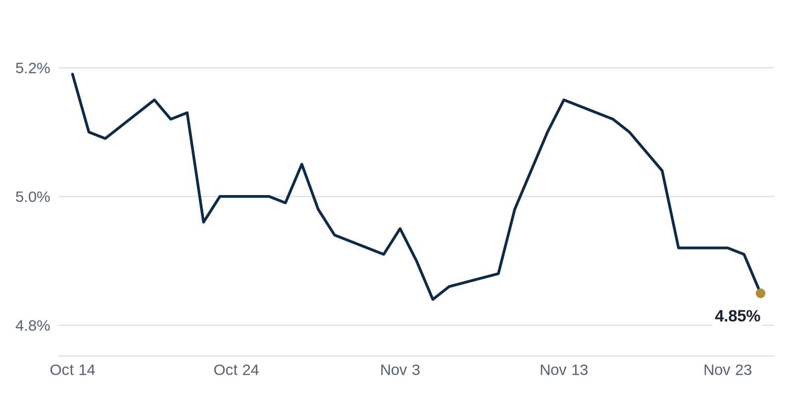

> **Review before publishing:**
> - editor: hold: The lead story, Google buying its King's Cross London headquarters for GBP 500M, repeats the previous issue's lead: Google's $655M London office purchase (GB...
> - check/long_sentence: 36 words: [CHECK] Editor hold: The lead story, Google buying...
> - check/long_sentence: 31 words: The Business Journals **Why it matters:** when financing...
> - check/budget: Term of the Day: 68 words (budget 50)
> - check/missing_link: https://news.google.com/rss/articles/CBMijgFBVV95cUxOZTZuTE1VSlI4cEJuVXRjUW1lZ3BWSXM2S3NQZndVRjdhSW53X2ZnajJkRlhxRmtUN2E3ZDVEbThYUVowNGpTZmttN3dDUEJ1S0hZVmVrSDlnN1FfUWpjeG53aFFPZFM0dHA2TE9Ed1FnTzVUc3pDWk5uNHFCOHcxMTVzdDVFT2w1eUdlU0xR?oc=5
> - check/missing_link: https://news.google.com/rss/articles/CBMivAFBVV95cUxQUlJKVWdYQnhoS2xMSGtFSTFFQWdxdGxXY2UxUUl1S2NQbFNuOXlYMDBJMVViYUEzTzFuYlFoekNacksyY2lNM2NCd2NnS2UycEQ2ZW9iOEdGcDVlZFRBdV9SZHp6SWE1eEhaMFhES3RNbXdUTkV1enpWSEZGWjN5T2QzVTU1Y0FmeWU4UlAtR3E4R2hYNDdKd2pjOWM1Uy1PLXJWMXBodmlRQnNwSG5MMWI0ZUFodGNSd0c1Zg?oc=5
> - check/unsourced_number: intro: $655M
> - check/unsourced_number: intro: $655M
> - check/repeat_in_issue: linked 3 times: https://www.bisnow.com/news/london/deal-sheet/google-buys-king-s-cross-hq-for-pound500m-the-london-deal-sheet
> - check/stale_data: Bank CRE loans last updated 2026-11-11

[CHECK] Editor hold: The lead story, Google buying its King's Cross London headquarters for GBP 500M, repeats the previous issue's lead: Google's $655M London office purchase (GBP 500M is about $655M, so this is the sa...

## The Brief

- Google is buying its King's Cross London headquarters outright, a sign top tenants still want prime offices. [Bisnow](https://www.bisnow.com/news/london/deal-sheet/google-buys-king-s-cross-hq-for-pound500m-the-london-deal-sheet)
- Lenders expect a wave of refinancing as borrowing costs climb, squeezing owners with maturing loans. [Mortgage Professional America](https://news.google.com/rss/articles/CBMirwFBVV95cUxNa2hCdmhnaFdjbUdEUzd6Wk9yVXEwV2EzU3IwejcwM1Z1dUhOMFlpNWViZFAxNVpuNlBkWk9ueDlXOVpldTlKRzh5a0E1WXo3VzJCSFBXTzN1TWJObHFielB6V3VhUTJXRVIzdzRFRG5qTGo2LVRtUndQd0dVOThGaWxQLXFwbkt6Sm04S3JCUnR6cDd1ZFd3TlM1MFVodndmTHluYnZxMFJCTlRkQXNJ?oc=5)
- Capital shortages are stalling major Orlando projects, pushing new retail construction to a decade low. [The Business Journals](https://news.google.com/rss/articles/CBMipAFBVV95cUxQWm1sZzdKdWl2OTZlRFZfRGItX0M0R3ZGZVc1c3I1ZTFvY2NOLWdnbjY1djVJeXFHYnBWbzgtQ3Y4eGJQR2RoTWFfenF4OUJYR0Zzem8wV213ZHByemVDRktnWTA3Z2dtUElZM2RBTWc5NVZ6YWw5Ymp0QVFPSGhESHd0ak4tdGdzQkVrbVVkaVYwSWxRYVBObm1PUDduSlZpVi1rZg?oc=5)

## The Numbers

*Rates as of Nov 25 close.*

- **10Y Treasury:** 4.85% (-6 bps)
- **5Y Treasury:** 4.65% (-4 bps)
- **SOFR:** 3.95% (+1 bps)
- **Fed funds:** 3.75% to 4.00%
- **Next Fed meeting (Dec 9):** Polymarket's top outcome is 25 bps increase 94.5%
- **REITs:** VNQ $95.66 (+0.9%). Best: HPP +6.1%. Worst: EQIX -0.5%.
- **REIT yield vs. 10Y:** VNQ yields 3.63%, -122 bps vs. the 10Y.

**What it means:** Treasury yields barely moved, so financing costs are holding steady. Borrowers face the same math this week that they did last week when pricing a loan or a refinancing.

**Why Hudson Pacific Properties (HPP) moved:** No company-specific news today; it may have moved with other office REITs.

**Why Equinix (EQIX) moved:** No company-specific news today; it may have moved with other data center REITs.

## Debt Markets

Lenders expect refinancing to dominate commercial real estate activity in the year ahead as credit costs rise. Owners who borrowed cheaply years ago now must replace that debt at higher rates when their loans come due. [Mortgage Professional America](https://news.google.com/rss/articles/CBMirwFBVV95cUxNa2hCdmhnaFdjbUdEUzd6Wk9yVXEwV2EzU3IwejcwM1Z1dUhOMFlpNWViZFAxNVpuNlBkWk9ueDlXOVpldTlKRzh5a0E1WXo3VzJCSFBXTzN1TWJObHFielB6V3VhUTJXRVIzdzRFRG5qTGo2LVRtUndQd0dVOThGaWxQLXFwbkt6Sm04S3JCUnR6cDd1ZFd3TlM1MFVodndmTHluYnZxMFJCTlRkQXNJ?oc=5)
**Why it matters:** borrowers rolling over old loans will face bigger interest bills, which can force them to add cash, sell, or hand back the keys.

Blackstone closed a busy year in commercial mortgage-backed securities with a new £248.5 million launch. CMBS bundles many property loans into bonds that investors buy, which frees lenders to make more loans. [CoStar](https://news.google.com/rss/articles/CBMinwFBVV95cUxPU1NsYTZhbkhEd05HT0xuenE0eDJ3MHhWeHNEYmY3SDNQUUdoU0duZHo4cTdoZlVscG5aVmxpVEtjaVNpM2UyWGI4R3ZlQ2N0d2V3d1djU2JPVFp6NzdiekwySDFmN05CQnJoLW5rNTk3QS05Szdiek9oQmpaaGVxdXR0SUlqTmx3WjlhYVc3Wk9KNGtGR1ZvSkR2TlJ5YW8?oc=5)
**Why it matters:** an active CMBS market gives landlords another place to find loans, keeping credit flowing when banks pull back.

Willow Valley landed $259M to fund a Pennsylvania development. The financing backs new construction rather than refinancing an asset that already exists. [Multifamily Housing News](https://news.google.com/rss/articles/CBMikAFBVV95cUxQNFFQVXFxRW15cWN4UHRnMklLX05qMmNkakRDLVRCR2c1YncxeUFuTFN5U3dzUDlMVl9YLW5vNFNUOFFLQ2dfTWhsZEl4b1ZaT1Y2ZmlzZlUzOG1oY1JjNFNTcGRzUFhpdld0R21fekFjWG1RUjNyemZEaFAyWE9IU2o4cTlmYjVQRlVkUVMydlU?oc=5)
**Why it matters:** fresh construction loans show lenders will still bankroll new projects in select markets, a lifeline for developers who need capital to build.

Oakland's Moxy Hotel, a boutique property that opened just five years ago, is headed to a foreclosure sale. A foreclosure sale happens when a borrower cannot keep up with the loan and the lender forces the property to be sold. The quick fall from new build to default signals strain on Oakland's downtown hotel market. [The Business Journals](https://news.google.com/rss/articles/CBMipwFBVV95cUxQZ0ZIRC1iTFo4a0paWkdwS3BGelZmdjNrdHJhdEFPTTRZTlUwemV0eU81MHdlWEk4T1RGeGwtUTlDclNMdE84SEZvMnFIME5JN0hUandfcU5pTWo0U2d0N2hMNjBuY2Q1ZzdXZVptU3RXUVBPSnNaVjEydWczbFBzcUJ5NFNfeUxjVW9sUHlFYzZmaEwwMmp1VnBpM29yZk14S0tyRzlJWQ?oc=5).

**Why it matters:** A five-year-old hotel losing its property to the lender warns other hotel owners and their banks that even new buildings can fail when travel demand falls short.

**Distress Watch:** The Children's Place is looking to sell 24 New Jersey store leases as part of its bankruptcy. [Bergen Record](https://news.google.com/rss/articles/CBMi1AFBVV95cUxPSWFFVVA1bWVXVVdVaDJUN1AtSVpGaEswWlVhMlBrdWpBVkpvYUk2TTBYQmItelRjd0pWbXc1dHBwODRqa05STXF6cTNDejc0ekF0VmcxRHNBV29WTVJnS3Q2bkdBRUtMQWlKMjd5aXdmckFwN0xvYUdOYlFVbGNsVzZOVXJuZGhNYUhsWTVjTjV5bTdieGxudzNTY216cWc0eFQzZ2JWVVQxZzM5SXBxWnhjTDkxMVVJYlY3d3VETFdHazVORjY5Z3piZDUtT3BReTRpOQ?oc=5)

## Top Stories

### Google buys its King's Cross home for £500M

Google is buying 6 Pancras Square, its King's Cross headquarters in London, for £500M, part of a wider set of London housing, planning and funding moves. The purchase turns a long-term tenant into the building's owner.
**Why it matters:** when a tenant pays £500M to own its own offices, it signals real confidence in prime London space. Nearby landlords get a fresh comp to cite in their own valuations and refinancings.
[Bisnow](https://www.bisnow.com/news/london/deal-sheet/google-buys-king-s-cross-hq-for-pound500m-the-london-deal-sheet)

### Bellevue clears a 19-story office tower

Bellevue, Washington approved the Arcadian, a 19-story office tower, adding major new space to a Seattle-area suburb. The green light moves the project from a drawing to a buildable permit.
**Why it matters:** approving a 19-story tower while office demand is uneven is a bet by the city and the developer that Bellevue keeps drawing tenants. If that bet is wrong, the new floors could sit empty and drag on local rents.
[Wisevoter](https://news.google.com/rss/articles/CBMimAFBVV95cUxPM25YOXdja3d0WHROTFNESzRCdzBxQTdvTUpiS3h3Zlp1dElmVjRqYU9pNHg4M0I1dkVxaWg4YmxNUkRRX2E2OXVmRDV0SGR2cDhWcXIxeGxXeVVOc01hSmxJZUJaeVJyT0RnZ05rRVd5MERhWGVFSmotYW9NOEkyMmQtN29xM1lGZXNfLURaVEtXa1hmbDRZaw?oc=5)

**Coffee chat talking points:**

- Google paid £500M to own its King's Cross headquarters, so trophy offices still pull huge checks even while secondary space struggles. [Bisnow](https://www.bisnow.com/news/london/deal-sheet/google-buys-king-s-cross-hq-for-pound500m-the-london-deal-sheet)
- Apollo cashed in $53M on an Orange County asset even as Sun Belt developers stall, so buyers with cash are still finding clean exits. [CommercialSearch](https://news.google.com/rss/articles/CBMimAFBVV95cUxOejJ3VTFPLVBDWGpDWlo3WTREMTVUeVd5b0pDaUtfZ2stQzdQU1NhS1M1MVB3Q3h6bkNLdmkwazNlWHZCbE1KT2NBNjdjS1NPa01BTEFLRG5ybXhzdnlkd1lacC1jRlhBV2Q1SkRwQ28wbzlzZ05BVkFpbmMxeWFlMDZVT3hYSkNTN0x1eVB2T1hUaXhWMXJ0Nw?oc=5)
- Blackstone capped its year with a £248.5 million CMBS launch, a sign the bond market that funds commercial mortgages is still open. [CoStar](https://news.google.com/rss/articles/CBMinwFBVV95cUxPU1NsYTZhbkhEd05HT0xuenE0eDJ3MHhWeHNEYmY3SDNQUUdoU0duZHo4cTdoZlVscG5aVmxpVEtjaVNpM2UyWGI4R3ZlQ2N0d2V3d1djU2JPVFp6NzdiekwySDFmN05CQnJoLW5rNTk3QS05Szdiek9oQmpaaGVxdXR0SUlqTmx3WjlhYVc3Wk9KNGtGR1ZvSkR2TlJ5YW8?oc=5)

## Market Watch

### Sun Belt

Capital constraints are stalling major mixed-use projects in Orlando, and new retail construction there has fallen to a decade low. Developers cannot line up the funding needed to break ground. [The Business Journals](https://news.google.com/rss/articles/CBMipAFBVV95cUxQWm1sZzdKdWl2OTZlRFZfRGItX0M0R3ZGZVc1c3I1ZTFvY2NOLWdnbjY1djVJeXFHYnBWbzgtQ3Y4eGJQR2RoTWFfenF4OUJYR0Zzem8wV213ZHByemVDRktnWTA3Z2dtUElZM2RBTWc5NVZ6YWw5Ymp0QVFPSGhESHd0ak4tdGdzQkVrbVVkaVYwSWxRYVBObm1PUDduSlZpVi1rZg?oc=5)
**Why it matters:** when financing dries up, fewer shops and apartments get built, which can tighten supply and eventually push rents higher for tenants already in the market.

### West Coast

Apollo sold an Orange County asset for $53M, cashing out of the Southern California property. The exit lands as some investors trim their real estate holdings. [CommercialSearch](https://news.google.com/rss/articles/CBMimAFBVV95cUxOejJ3VTFPLVBDWGpDWlo3WTREMTVUeVd5b0pDaUtfZ2stQzdQU1NhS1M1MVB3Q3h6bkNLdmkwazNlWHZCbE1KT2NBNjdjS1NPa01BTEFLRG5ybXhzdnlkd1lacC1jRlhBV2Q1SkRwQ28wbzlzZ05BVkFpbmMxeWFlMDZVT3hYSkNTN0x1eVB2T1hUaXhWMXJ0Nw?oc=5)
**Why it matters:** a clean $53M sale shows buyers are still willing to pay for well-located West Coast assets, giving other owners confidence they can find an exit.

### International

A new report calls Dubai's commercial real estate market resilient through the third quarter of 2026, with demand holding up. [UPPERNEWS](https://news.google.com/rss/articles/CBMilAFBVV95cUxNZFZwaVVOZDRhRWVlbUdoSjhFNWNJV0V6VU5nU3pWTG5Gb1dGSXVoNFBORmRELXZSZ3oxR3ZXNmM1eDUwX3p1d0RKM0dpRjZmd25DWmc4R0tTYXlPRHYzT2lpUms2U3NJMktCeGpzVXhEODRDOXJET1RQMHhJMEx5ZzVtWThDT05ZWURPenczWTlmcWZR?oc=5)
**Why it matters:** steady Dubai demand draws global capital that might otherwise chase US deals, so strength abroad can pull investor dollars away from American markets.

## Quick Hits

- Dubai businesses now get 37% less office space for the same rent as prime prices surge. [Arabian Business](https://news.google.com/rss/articles/CBMickFVX3lxTE8yVERiZm5FX0tIdU5uZ192RVVMejNuM3Vfdkpydk9UMkg4ODdBM0pXZmczNHIxYy1yM1BIdXZoT2pMVDRkcTZTYTVTS3pnVU55WHppRm4wTVFxcU4zSmFrVEdsd055RHFtOG11Q0Y3MEQ5dw?oc=5) When rents rise and the space shrinks, tenants pay more to occupy less, squeezing companies that need room to grow.
- Natixis Investment Managers is reportedly weighing a sale of AEW Capital Management. [Bisnow](https://news.google.com/rss/articles/CBMinAFBVV95cUxQOVhYWEMxSUFPTXowRjhjWUVwSXlVZXFyVjFFUk5OTmRfeFE2Sl90Q2FLTHplamxTWElJcmdzbl9GOW11QWxTUWQ1NVZHZTJiYktieWRlLXJPY3dGU3pMeEpHSFVBdWhYR1llOVVtOGpISHA3bUxfVEh6RTk2X3FNUV9CQXhhcDJ3ZU1aX3JYNUQwX0pnMWNRMG1zNWI?oc=5) A sale would hand one of real estate's larger money managers to a new owner, who could reshape how its property funds are run.
- New York City retail's split recovery is reaching a critical point this holiday season. [Commercial Observer](https://commercialobserver.com/2026/11/new-york-city-retail-split-recovery-vacancies/) Prime corridors are filling while weaker blocks lag, so a storefront's exact location increasingly decides whether its landlord thrives.
- Manhattan's biggest soft goods retailer is testing whether it can keep growing against record-low vacancies. [The Real Deal](https://news.google.com/rss/articles/CBMigwFBVV95cUxNY3dWY0tNaVBmejJkZnZKY1Q5VjhEZzUzZ2J3SVlxRkFJV0gzd09WZ1MxVWJkcmJMYjJrby1mQ1Jac0JqSkpjR3c3aVR3X09LVXgtQ2Q1dklTcThpeExEaXBnVjZsSUFzLVkwOXh4MlpLY2t5OVNFMVp3VWtDTnFIRVlWMA?oc=5) Scarce available space makes it harder and pricier for even established chains to expand, handing leverage to landlords.
- Multi-Housing News published its 2026 Single-Family Rental Index. [Multi-Housing News](https://news.google.com/rss/articles/CBMib0FVX3lxTE9RTGxtR1JGUU1tXy1kV205Q2k2Q1RrdWxBVXBHZUlTZkJPNXlhTDAzaHRudVJIcjJzWkFhVWVmVGQ1UjNkclBxZWw0LW9SOEppcThhaWFEV2c0RHZXeGFVVExWUk1YRk9QWm9JamdUNA?oc=5) The index tracks how rents and demand are moving for rented houses, a sector landlords watch to gauge tenant appetite.

## Deals of the Week

### Shorenstein buys International Plaza 3 in Dallas

Shorenstein acquired International Plaza 3, an office tower in Dallas. [CommercialCafe](https://news.google.com/rss/articles/CBMimwFBVV95cUxPS0xvNlhTd3pWSGU4RTBLRFRxZjltY1MwRXYzemRjS3JKNlI3Vm0zNVFVMVoxSDFmdzFYb2dpbDM0aVk4bjR4UWlsc2NTdGU4eTY2dUtsQUZtOWpWVVN6X0VzcFRMOGQ5QjlDYVNQTDhwTm94Snk4a1huSzczV1laRl9ieW03MkpPRWdIRmJTRUtqclowVVdETURTYw?oc=5)

## Term of the Day

**BOV (broker opinion of value):** a broker's informal estimate of what a property would sell for, built from recent comparable sales and market feel, not a formal appraisal. If an owner wants a quick read on a $10 million building before listing it, a broker might peg it near $9.5 million. Owners lean on a BOV to set expectations, though it carries less weight than a certified appraisal.

For informational purposes only. Not investment advice.
